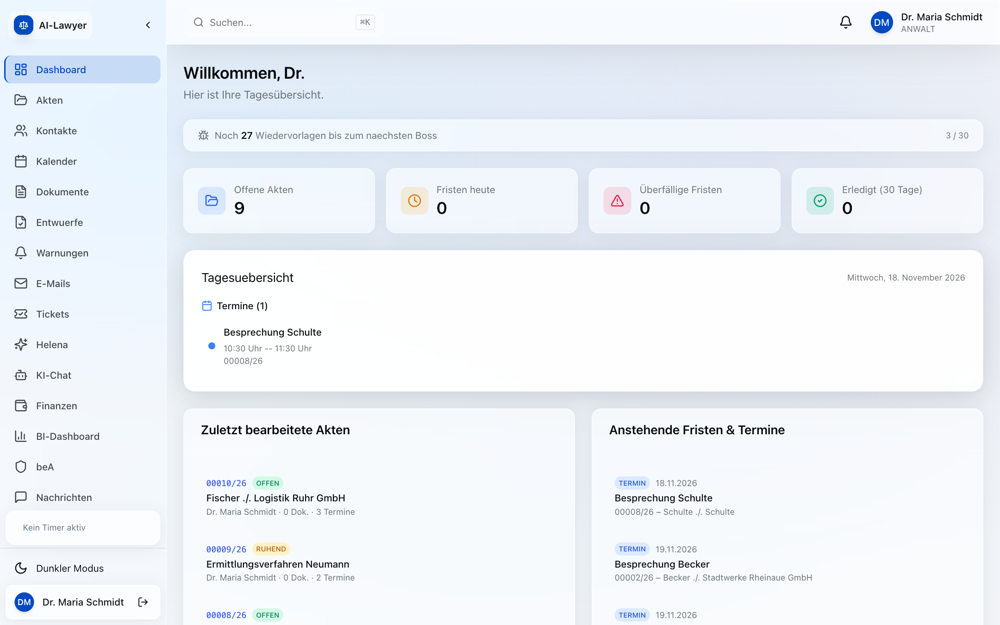
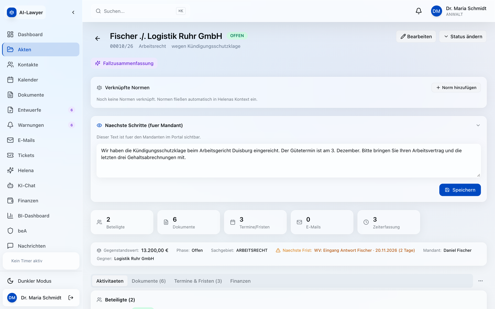
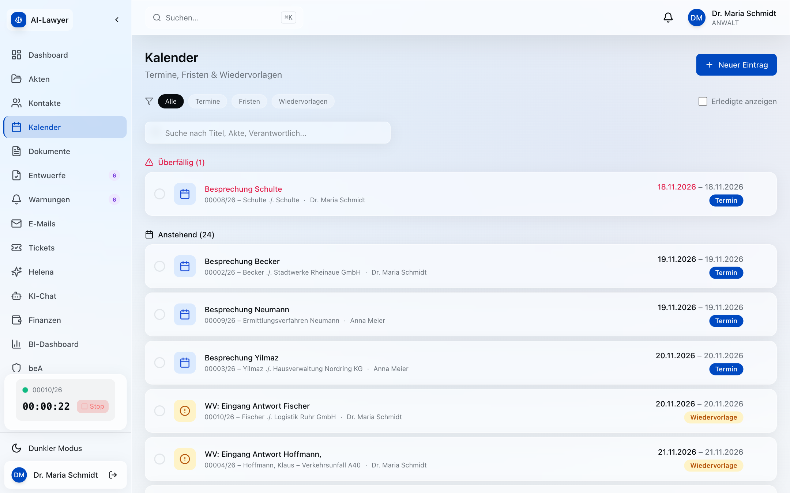
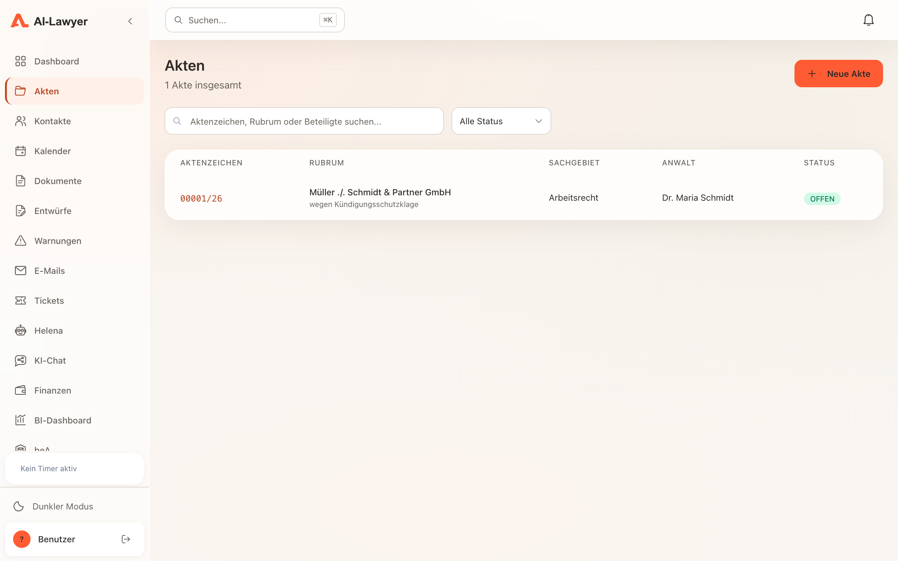
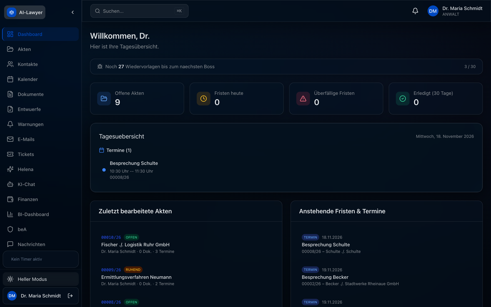
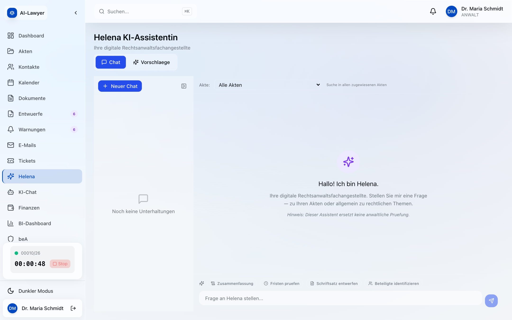

# AI-Lawyer

[](https://github.com/PBaumfalk/AI-Lawyer/actions/workflows/ci.yml)
[](LICENSE)
[](CHANGELOG.md)
[](#stand-der-entwicklung)

**Die Kanzleisoftware, in der die KI mitarbeitet, auf dem eigenen Server.**
AI-Lawyer vereint Akten, Kontakte, Dokumente, Fristen, E-Mail, Abrechnung und
ein Mandantenportal in einer Webanwendung. Mittendrin arbeitet **Helena**, eine
KI-Kollegin: Sie liest mit, erkennt Fristen in Schreiben der Gegenseite, fasst
Akten zusammen, recherchiert in Gesetzen und Urteilen und legt Schriftsatzentwürfe
vor. Freigeben und unterschreiben tut immer ein Mensch.

Alles läuft im Browser, ohne Desktop-Installation und ohne externes Office.
Die Daten bleiben auf Ihrem Server. Die KI kann vollständig lokal laufen
(Ollama), auf Wunsch auch über OpenAI oder Anthropic.

> **English abstract:** Self-hosted, AI-first practice management software for
> German law firms. Case files, contacts, document management with in-browser
> editing (OnlyOffice), OCR, deadline calculation with German holidays, e-mail
> filing, beA, time tracking, RVG billing with XRechnung and DATEV export, team
> chat and a client portal. The built-in agent *Helena* runs a bounded ReAct loop
> with 18 tools and RAG over statutes, case law and templates (pgvector, hybrid
> search, reranking), with local models via Ollama or OpenAI/Anthropic.
> Next.js 14, TypeScript, PostgreSQL 16, Prisma, BullMQ, Docker Compose.
> UI and documentation are in German.



## Stand der Entwicklung

AI-Lawyer ist ein **aktives Entwicklungsprojekt, noch nicht für den
Produktivbetrieb freigegeben.** Version 0.9 ist funktional weit
(rund 141 000 Zeilen TypeScript, 86 Datenmodelle, 196 API-Endpunkte), der
nächste Meilenstein v1.0 „Production Hardening“ ist in Planung. Vor dem Einsatz mit echten Mandantendaten bitte
Installation, Sicherung und Berechtigungen selbst prüfen; beA ist noch nicht
angebunden. Was bekannt offen ist,
steht unter [Bekannte Grenzen](#bekannte-grenzen) und ausführlich in
[Kapitel 23 des Handbuchs](docs/handbuch/23-einschraenkungen-und-fragen.md).

## 📖 Handbuch

Das **[Handbuch](docs/handbuch/README.md)** beschreibt AI-Lawyer in 23 Kapiteln
mit Bildschirmfotos: für die Arbeit in der Kanzlei von den
[ersten Schritten](docs/handbuch/02-erste-schritte.md) über
[Akten](docs/handbuch/03-akten.md),
[Fristen](docs/handbuch/06-fristen-und-kalender.md) und
[Helena](docs/handbuch/09-helena.md) bis zum
[Mandantenportal](docs/handbuch/12-mandantenportal.md), für Admins
[Benutzer und Rollen](docs/handbuch/15-benutzer-und-rollen.md) und die
[Migration aus j-lawyer.org](docs/handbuch/17-migration-aus-j-lawyer.md), für
die IT [Installation](docs/handbuch/19-installation.md),
[Konfiguration](docs/handbuch/20-konfiguration.md) und
[Betrieb](docs/handbuch/21-betrieb-und-sicherung.md). Jedes Kapitel sagt offen,
wo eine Funktion noch fehlt.

## Installation

AI-Lawyer ist eine Server-Anwendung aus neun Docker-Diensten. Sie wird einmal
installiert, danach arbeiten alle im Browser.

Voraussetzungen: [Docker](https://docs.docker.com/get-docker/) ab Version 24 mit
Docker Compose, etwa 8 GB freier Arbeitsspeicher (mehr für lokale KI-Modelle)
und 20 GB Speicherplatz.

<details>
<summary><strong>🧭 Mit dem Setup-Skript</strong> (empfohlen)</summary>

```bash
git clone https://github.com/PBaumfalk/AI-Lawyer.git
cd AI-Lawyer
./setup.sh
```

Das Skript fragt nach der Adresse der Anwendung (z. B.
`https://ailawyer.kanzlei.de`) und dem KI-Anbieter: Ollama (lokal, ohne
API-Schlüssel), OpenAI oder Anthropic. Danach erzeugt es Geheimnisse in einer
`.env`, baut die Images und startet die Dienste.

Mit NVIDIA-GPU nimmt das Skript `docker-compose.gpu.yml` automatisch dazu.
</details>

<details>
<summary><strong>🖥️ Mit Docker Compose</strong> (für die IT)</summary>

```bash
git clone https://github.com/PBaumfalk/AI-Lawyer.git && cd AI-Lawyer
cp .env.example .env          # Pflichtwerte setzen, siehe Konfiguration
docker compose -f docker-compose.portainer.yml up -d --build
```

Neu bauen nach einem Update:

```bash
docker compose -f docker-compose.portainer.yml up -d --build --force-recreate
```
</details>

<details>
<summary><strong>🐳 Mit Portainer</strong></summary>

1. Portainer → **Stacks** → **Add stack** → **Repository**
2. Repository-URL `https://github.com/PBaumfalk/AI-Lawyer`, Compose-Pfad
   `docker-compose.portainer.yml`
3. Die Pflichtvariablen unter **Environment variables** setzen
4. **Deploy the stack**
</details>

<details>
<summary><strong>🔑 Erste Anmeldung</strong></summary>

Beim ersten Start legt AI-Lawyer **ein** Administratorkonto an: Anmeldename
`INITIAL_ADMIN_EMAIL`, Passwort `INITIAL_ADMIN_PASSWORD` aus der `.env`
(`./setup.sh` erzeugt es zufällig, anzeigen mit `grep INITIAL_ADMIN_PASSWORD .env`).
Ein bekanntes Standardpasswort gibt es nicht.

Danach unter **Einstellungen → Sicherheit** ein eigenes Passwort setzen und unter
**Admin → Benutzer** die Mitarbeitenden anlegen. Beispielkonten und eine
Beispielakte zum Ausprobieren: `SEED_DEMO=true` vor dem ersten Start
([Kapitel 19](docs/handbuch/19-installation.md#erste-anmeldung)).
Zwei-Faktor-Anmeldung lässt sich über `TOTP_REQUIRED_ROLES` je Rolle
verpflichtend machen.
</details>

## Funktionen im Überblick

| Akte mit Kennzahlen und Verlauf | Fristen, Termine, Wiedervorlagen |
| --- | --- |
|  |  |

- **Akten:** konfigurierbares Aktenzeichen, Sachgebiete, Beteiligte mit Rollen,
  Kollisionsprüfung bei Neuanlage, Gegenstandswert, Dezernate, verknüpfte Normen,
  Aktivitätsverlauf und vollständiger Audit-Trail
- **Kontakte:** natürliche und juristische Personen, mehrere Anschriften,
  Kontaktbeziehungen, Vollmachten, KYC-Prüfung mit Risikostufe, eigene Felder,
  Massenimport, DSGVO-Anonymisierung
- **Dokumente:** Versionen, Freigabestatus von *Entwurf* bis *Versendet*,
  Bearbeitung im Browser mit OnlyOffice (DOCX, XLSX, PPTX, ODT), OCR über
  Stirling-PDF, PDF-Werkzeuge, Volltextsuche, Schlagwörter
- **Fristen und Kalender:** Fristenrechner mit Feiertagen je Bundesland,
  Vorfristen und Halbfristen, Notfristen, Quittierung, Fristenzettel,
  Vertretungen, Abgleich mit Google und Apple Kalender über CalDAV
- **E-Mail und beA:** IMAP-Postfächer mit Threads, Veraktung, zeitversetzter
  Versand, Zuweisungsregeln, beA-Eingang mit Zuordnung zu Akte und Bearbeiter,
  eEB-Quittierung
- **Zeiterfassung und Abrechnung:** Stoppuhr je Akte, Tätigkeitskategorien,
  RVG-Rechner, Rechnungen mit Briefkopf, E-Rechnung (XRechnung), Mahnwesen,
  SEPA- und DATEV-Export, Aktenkonto mit Fremdgeld
- **Mandantenportal:** Einladung per Link, Mandanten sehen nur ihre Akten und
  nur freigegebene Dokumente, sichere Nachrichten mit Anhängen,
  „Nächste Schritte“ in verständlicher Sprache
- **Team:** Echtzeit-Nachrichten in Kanälen und Akten-Threads, Tickets,
  @-Erwähnungen, Urlaubs- und Vertretungsplanung
- **Auswertung:** BI-Dashboard mit Kennzahlen und Trends, Export als CSV, XLSX
  und PDF
- **Migration aus j-lawyer.org:** Akten, Kontakte, Beteiligte, Dokumente und
  Kalender werden über die REST-API übernommen und lassen sich gefahrlos
  wiederholt einlesen
- **Hell und dunkel**, Glass-Oberfläche, Befehlspalette (⌘K bzw. Strg+K)

| Akten | Dunkler Modus |
| --- | --- |
|  |  |

## Helena, die KI-Kollegin



- **Agent mit Grenzen:** Helena arbeitet in einer ReAct-Schleife mit 18
  Werkzeugen und höchstens 5 bzw. 20 Schritten. Sie liest Akten, Dokumente,
  Fristen und Zeiten, sucht in Gesetzen, Urteilen und Mustern, rechnet Kosten
  und legt Entwürfe, Fristen, Warnungen und Notizen an. Welche Werkzeuge sie
  nutzen darf, hängt von der Rolle ab.
- **Schriftsätze über eine feste Pipeline:** Für Schriftsätze nutzt Helena keinen
  freien Agenten, sondern eine strukturierte Pipeline mit Vorlagen für über 50
  Klagearten, Platzhaltern aus der Akte und Rückfragen, wenn etwas fehlt.
- **Wissen statt Raten:** Recherche in Gesetzen, Urteilen und den eigenen
  Schriftsatzmustern über Hybrid-Suche (pgvector und Volltext) mit Reranking.
  Personenbezogene Daten in Mustern werden vor der Aufnahme erkannt und
  entfernt.
- **Liest im Hintergrund mit:** erkennt Fristen in eingehenden Schreiben,
  warnt bei Auffälligkeiten und prüft neue Urteile gegen alle laufenden Akten.
- **Nichts geht ungeprüft raus:** Jeder Entwurf landet zur Freigabe bei einem
  Menschen. Ein QA-Dashboard misst Qualität und Halluzinationen.
- **Ihre Wahl des Modells:** lokal mit Ollama, ohne dass Daten das Haus
  verlassen, oder über OpenAI bzw. Anthropic.

## Gamification

Wer möchte, macht aus Wiedervorlagen ein Spiel: tägliche Quests, die gegen echte
Daten geprüft werden, Erfahrungspunkte und Level, Serien über Arbeitstage, ein
Team-Bossfight gegen das „Backlog-Monster“ und ein Shop für Abzeichen. Die
Teilnahme ist freiwillig, das Team-Dashboard zeigt nur anonymisierte Werte, und
nach zwölf Monaten wird gelöscht.

## Datenschutz und Sicherheit

- Selbst gehostet: Datenbank, Dateien, Suche und auf Wunsch die KI laufen auf
  Ihrem Server.
- Fünf Rollen (Admin, Anwalt, Sachbearbeitung, Sekretariat, Mandant). Vorgesehen
  ist Aktenzugriff über Zuweisung oder Dezernat; durchgesetzt wird das derzeit
  nicht überall (siehe unten).
- Zwei-Faktor-Anmeldung (TOTP) mit Backup-Codes, je Rolle erzwingbar.
- Zugangsdaten für E-Mail und beA werden verschlüsselt gespeichert (AES-256).
- Mandanten sehen ausschließlich das Portal und dort nur ihre freigegebenen
  Akten und Dokumente; Kanzleiseiten und -APIs sind für Mandantenkonten
  gesperrt (Middleware und serverseitige Prüfung, mit Tests abgesichert).
- Audit-Trail für Akten, Freigaben und Admin-Eingriffe, DSGVO-Anonymisierung
  von Kontakten.

<details>
<summary><strong>Rollen und Berechtigungen</strong></summary>

| Rolle | Darf |
| --- | --- |
| Admin | alles, dazu Benutzer, Einstellungen, Audit-Trail, DSGVO |
| Anwalt | Akten, Dokumente, KI, Freigaben, beA-Versand, Abrechnung |
| Sachbearbeitung | Akten, Dokumente, Fristen, KI, Zeiterfassung |
| Sekretariat | Akten lesen, E-Mail, Kalender, Fristen |
| Mandant | nur das Portal: eigene Akten, freigegebene Dokumente, Nachrichten |
</details>

## Konfiguration

Die wichtigsten Variablen stehen in [`.env.example`](.env.example), die
vollständige Liste mit Wirkung in
[Kapitel 20 des Handbuchs](docs/handbuch/20-konfiguration.md). Den KI-Anbieter
(Ollama, OpenAI, Anthropic) und das Modell legen Sie nicht per Variable fest,
sondern unter **Einstellungen → KI**. Ollama wird auch bei Cloud-Modellen für
Einbettungen und Reranking gebraucht.

<details>
<summary><strong>Pflichtwerte</strong></summary>

| Variable | Zweck | Erzeugen |
| --- | --- | --- |
| `NEXTAUTH_URL` | öffentliche Adresse der Anwendung | z. B. `https://ailawyer.kanzlei.de` |
| `NEXTAUTH_SECRET` | Sitzungsverschlüsselung | `openssl rand -base64 32` |
| `EMAIL_ENCRYPTION_KEY` | Verschlüsselung von Zugangsdaten | `openssl rand -hex 32` |
| `ONLYOFFICE_SECRET` | JWT für OnlyOffice | `openssl rand -base64 24` |
</details>

<details>
<summary><strong>Optionale Werte</strong></summary>

| Variable | Standard | Zweck |
| --- | --- | --- |
| `TOTP_REQUIRED_ROLES` | – | Rollen mit Pflicht zur Zwei-Faktor-Anmeldung |
| `POSTGRES_PASSWORD` | `ailawyer` | Datenbankpasswort, **ändern** |
| `MINIO_ACCESS_KEY` / `MINIO_SECRET_KEY` | `ailawyer` / `ailawyer123` | Dateispeicher, **ändern** |
| `MEILISEARCH_API_KEY` | `ailawyer-meili-key` | Suchdienst, **ändern** |
| `LOG_LEVEL` | `info` | `debug`, `info`, `warn`, `error` |
| `WORKER_CONCURRENCY` | `5` | parallele Hintergrundaufgaben |
| `JLAWYER_ALLOW_PRIVATE_URLS` | – | `true` für j-lawyer im eigenen Netz |
</details>

## Für Entwickler

TypeScript durchgehend, Next.js 14 (App Router) mit eigenem Server für
Socket.IO, ein separater Worker für die Hintergrundaufgaben.

| Schicht | Technik |
| --- | --- |
| Oberfläche | Next.js 14, React, Tailwind CSS, shadcn/ui, Motion |
| Daten | PostgreSQL 16 mit pgvector, Prisma (86 Modelle) |
| Suche | Meilisearch |
| Dateien | MinIO (S3-kompatibel) |
| Office | OnlyOffice Docs |
| KI | Vercel AI SDK: Ollama, OpenAI, Anthropic |
| Hintergrund | BullMQ und Redis (20 Warteschlangen) |
| Echtzeit | Socket.IO mit Redis-Adapter |
| Anmeldung | NextAuth.js v5, TOTP |
| PDF und OCR | Stirling-PDF (Tesseract), pdf-lib |

<details>
<summary><strong>Architektur</strong></summary>

```
┌──────────────────────────────────────────────────────────────┐
│ Browser: Next.js-Oberfläche, Socket.IO                        │
└───────────────┬──────────────────────────────┬───────────────┘
                │ HTTPS                        │ WebSocket
┌───────────────▼──────────────────────────────▼───────────────┐
│ app (Next.js + eigener Server, Port 3000)                     │
│  API-Routen · Server Components · Socket.IO                   │
└──┬───────┬───────┬───────┬──────────┬───────────┬────────────┘
   ▼       ▼       ▼       ▼          ▼           ▼
┌──────┐┌─────┐┌─────┐┌────────┐┌──────────┐┌───────────┐┌────────┐
│ db   ││redis││minio││meili-  ││onlyoffice││stirling-  ││ ollama │
│PG 16 ││     ││ S3  ││search  ││          ││pdf (OCR)  ││  LLM   │
└──────┘└──┬──┘└─────┘└────────┘└──────────┘└───────────┘└────────┘
           │
     ┌─────▼──────┐
     │ worker     │  BullMQ: OCR, Embeddings, E-Mail-Sync, Fristen-
     │            │  Scanner, Gesetze/Urteile, Portal-Benachrichtigung
     └────────────┘
```
</details>

```bash
npm install
npm run db:generate      # Prisma-Client erzeugen
npm run dev              # Oberfläche und API auf :3000
npm run dev:worker       # Hintergrund-Worker
npm test                 # Unit-Tests (vitest)
npx tsc --noEmit         # Typecheck
```

Für die Entwicklung reichen PostgreSQL mit pgvector, Redis, MinIO und
Meilisearch aus der `docker-compose.yml`. OnlyOffice, Stirling-PDF und Ollama
braucht nur, wer diese Funktionen testet. Typecheck und Unit-Tests laufen bei
jedem Push in GitHub Actions. Was sich von Version zu Version geändert hat,
steht im [Änderungsprotokoll](CHANGELOG.md).

## Bekannte Grenzen

Behoben im Branch `fix/stabilisierung` (Aktenzugriff, Mandantentrennung,
Migrationen, MinIO-Image, Socket.IO im Image, BI, Rechnungen, Fristen,
E-Mail-Anhänge, j-lawyer-Migration u. a., jeweils mit Tests). Offen sind:

- **beA:** Die kommerzielle Bibliothek von bea.expert ist nicht eingebunden.
  Ohne sie scheitern Anmeldung, Versand und eEB mit klarer Meldung; es wird
  nichts als gesendet gespeichert.
- **Fehlende Maske:** „Rechnung anlegen/bearbeiten“ gibt es in der Oberfläche
  noch nicht.
- **KI-Einwilligung:** Das Feld „KI-Verarbeitung erlaubt“ am Kontakt wird
  gespeichert, aber nicht ausgewertet. Die Regel muss die Kanzlei festlegen.
- **Next.js 14** ist veraltet; der Umstieg ist für v1.0 geplant.

Die vollständige Liste steht in
[Kapitel 23 des Handbuchs](docs/handbuch/23-einschraenkungen-und-fragen.md).

## Lizenz

[MIT](LICENSE), © 2026 Patrick Baumfalk.

## Haftungsausschluss

AI-Lawyer unterstützt die Kanzleiarbeit, ersetzt aber keine anwaltliche Prüfung.
Fristberechnungen, KI-Entwürfe, Rechercheergebnisse und Gebührenberechnungen
sind vor jeder Verwendung von einem Menschen zu prüfen. Sprachmodelle können
Normen und Entscheidungen falsch wiedergeben. Wer die Software betreibt, ist für
die verarbeiteten Daten verantwortlich, insbesondere für die Wahrung des
Mandatsgeheimnisses beim Einsatz von Cloud-Modellen. Die Software wird ohne
Gewähr bereitgestellt (siehe [LICENSE](LICENSE)).
