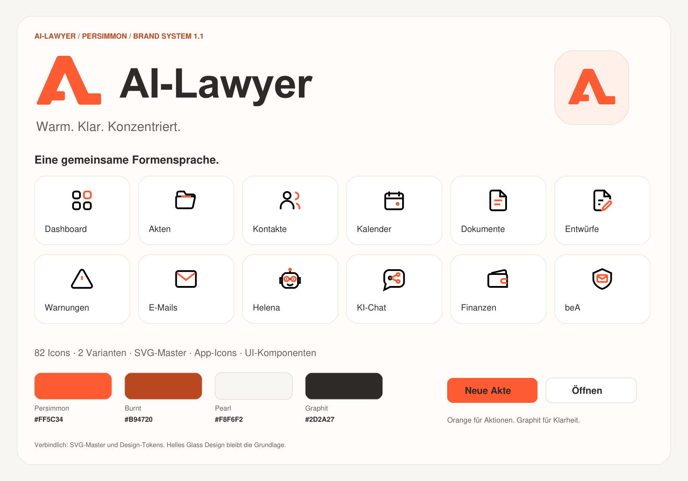

# Design: Persimmon

AI-Lawyer verwendet das Designsystem **Persimmon v1.1** (Richtung „04 / Persimmon“: warmes Orange, Graphit, helle Glasflächen). Verbindlich ist der [CI-Contract](persimmon/CI-CONTRACT.md). Dieses Dokument beschreibt, wie das Designpaket in der Anwendung umgesetzt ist und wo Abweichungen bestehen.



## Inhalt dieses Ordners

| Datei | Inhalt |
| --- | --- |
| [`persimmon/CI-CONTRACT.md`](persimmon/CI-CONTRACT.md) | Verbindliche Gestaltungsregeln: Farben, Logo, Glas, Icons, Buttons, Status, Dark Mode |
| [`persimmon/IMPLEMENTATION.md`](persimmon/IMPLEMENTATION.md) | Integrationsschritte aus dem Paket |
| [`persimmon/PAKET-README.md`](persimmon/PAKET-README.md), [`NOTICE.md`](persimmon/NOTICE.md), [`CHANGELOG.md`](persimmon/CHANGELOG.md) | Paketbeschreibung, Herkunft, Versionen |
| [`persimmon/design-tokens.json`](persimmon/design-tokens.json), [`persimmon.css`](persimmon/persimmon.css) | Token-Referenz des Pakets (die Anwendung bindet sie über `globals.css` ein, siehe unten) |
| [`persimmon/navigation-map.json`](persimmon/navigation-map.json), [`catalog.json`](persimmon/catalog.json) | Zuordnung Navigation → Icon, Liste der 82 Icons |
| [`persimmon/validation.json`](persimmon/validation.json) | Im Paket berechnete Kontrastpaare |

## Umsetzung in der Anwendung

| Bereich | Ort | Hinweise |
| --- | --- | --- |
| Tokens | `src/app/globals.css` | `--al-*` sind die einzige Farbquelle (hell und `.dark`). Die shadcn-Variablen (`--primary`, `--background` …) und die Tailwind-Skala `brand-*` verweisen darauf. |
| Tailwind | `tailwind.config.ts` | `primary` (`hover`, `foreground`, `strong`, `soft`), `brand-50…950` (500 = Persimmon `#FF5C34`, 600 = Burnt Orange `#B94720`), `success`/`warning`/`danger`/`info` mit `-soft`, Radien `2xl` = 24 px, `3xl` = 28 px, Systemschrift |
| Glas | `globals.css` (`.glass-card`, `.glass-panel`, `.glass-panel-elevated`, `.glass-sidebar`) | Blur 24 px nur, wenn der Browser es kann; sonst und bei `prefers-reduced-transparency` deckende Fläche. `forced-colors` erhält Konturen. |
| Fokus | `globals.css` | 3-px-Ring in `--al-focus`, Abstand 3 px, für alle fokussierbaren Elemente |
| Bewegung | `globals.css` | Übergänge 180 ms; bei `prefers-reduced-motion` keine Animationen |
| Logo, App-Icons, Manifest | `public/brand/`, `src/components/brand/brand-logo.tsx`, `src/app/layout.tsx` | Wortmarke hell/dunkel, Signet bei eingeklappter Sidebar, Favicon SVG/ICO, Apple-Touch-Icon, `site.webmanifest`, `theme-color`. `/brand` ist von der Anmeldepflicht ausgenommen (`src/middleware.ts`). |
| Icons | `src/components/icons/` | Siehe nächster Abschnitt |
| Komponenten | `src/components/ui/` | Button (Primär Orange mit Graphit-Text, 44 px, `loading` mit `aria-busy`), Input/Select/Textarea (44 px, `aria-invalid`), Badge mit Statusfarben, Tabs, Switch, Dialoge und Sheets (deckend, auf kleinen Bildschirmen scrollbar) |
| Navigation | `src/components/layout/sidebar.tsx` | Icons nach `navigation-map.json`, aktiver Eintrag mit hellem Orange, Burnt-Orange-Text, linker Markierung und `aria-current="page"` |
| Theme | `src/components/providers/theme-provider.tsx` | Hell ist Standard; Dunkel nur nach ausdrücklicher Wahl (Sidebar „Dunkler Modus“). Die Systemeinstellung schaltet nicht automatisch um. |

## Icons

Die 82 Persimmon-Icons liegen als React-Komponente in `src/components/icons/persimmon.tsx` (Formen unverändert aus dem Paket in `persimmon-shapes.tsx`):

```tsx
import { Icon } from "@/components/icons/persimmon";

<Icon name="cases" className="w-5 h-5" />                  // dekorativ, aria-hidden
<Icon name="helena" tone="duotone" label="Helena" />       // bedeutungstragend, mit Akzent
```

Bestehender und neuer Code importiert weiterhin aus `lucide-react`. Dieser Import ist in `next.config.mjs` (webpack und turbopack) und `vitest.config.ts` per Alias auf `src/components/icons/lucide-compat.tsx` umgeleitet:

- Lucide-Namen mit fachlicher Entsprechung (Tabelle `LUCIDE_ZU_PERSIMMON`) liefern die Persimmon-Form, z. B. `FolderOpen` → Akten, `Bot`/`Sparkles` → Helena, `Loader2` → Laden.
- Namen ohne Entsprechung im Paket erhalten ein Erweiterungsicon im Persimmon-Stil (siehe nächster Abschnitt); einige sind gedreht abgeleitet (`LUCIDE_GEDREHT`, z. B. `ChevronUp`, `MoreVertical`, `ArrowUpRight`).
- In der Oberfläche erscheint kein Lucide-Icon mehr.
- Helena ist der Roboterkopf mit runder Brille. KI-Funken (`Sparkles`) und die Waage (`Scale`) werden nicht mehr gezeigt.

Ein Unit-Test (`src/components/icons/__tests__/icons.test.tsx`) prüft, dass jeder in der Anwendung verwendete Icon-Name auflöst, ein Persimmon- oder Erweiterungsicon liefert (`data-icon`) und keiner mehr nackt aus Lucide kommt. Ein neuer Lucide-Name lässt den Test fehlschlagen, bis er zugeordnet oder als Erweiterungsicon gezeichnet ist.

### Erweiterungsicons

Das Designpaket hat 82 Icons; die Anwendung braucht mehr (Editor-Werkzeugleiste, Dateitypen, Server, Gamification usw.). Statt dafür Lucide-Symbole zu mischen (Contract §5: keine Nachbarsymbole aus anderen Bibliotheken), liegen eigene Formen in `src/components/icons/persimmon-erweiterung.tsx`. `<Icon name="…">` akzeptiert beide Namensräume.

Regeln für neue Erweiterungsicons:

- viewBox `0 0 24 24`, rund 2 px Abstand zum Rand, Strich 1,75, `stroke-linecap`/`stroke-linejoin` rund, `fill="none"`, `currentColor`.
- Nur `path`, `rect`, `circle`, `line`, `polyline`, `ellipse`; keine Füllflächen außer kleinen Punkten (`fill="currentColor" stroke="none"`, r ≤ 0,6).
- Eigene, einfache Geometrie mit wenigen Segmenten; keine Pfade aus Lucide oder anderen Bibliotheken. Grundformen (Blatt, Schild, Person) aus dem Paket wiederverwenden.
- Akzentelement optional mit `data-accent="true"` (Ton „duotone“).
- Zuerst prüfen, ob ein Paket-Icon fachlich passt (Bedeutung, nicht Aussehen) – dann nur zuordnen.
- Nach Änderungen die Übersicht neu erzeugen: `npx tsx scripts/icon-uebersicht.tsx` → [`persimmon-erweiterung.png`](persimmon-erweiterung.png).

Liste (90): `activity`, `swap`, `calculator`, `camera`, `check-double`, `check-square`, `chevrons-left`, `clipboard`, `clipboard-check`, `merge`, `columns`, `cpu`, `card`, `crown`, `database`, `file-check`, `file-plus`, `file-search`, `file-x`, `file-table`, `file-code`, `file-question`, `file-chart`, `folder-plus`, `folder-in`, `folder-tree`, `reply`, `reply-all`, `forward`, `court`, `gem`, `globe`, `grip`, `hash`, `heart`, `id-card`, `image`, `inbox`, `key`, `mail-open`, `minus-circle`, `x-circle`, `panel-left`, `panel-left-close`, `palette`, `plug`, `printer`, `undo`, `scissors`, `server`, `shield-alert`, `shield-off`, `note`, `swords`, `table`, `tag`, `target`, `thumbs-up`, `trend-up`, `trend-down`, `trophy`, `frame`, `flame`, `skull`, `shop`, `sliders`, `stamp`, `idea`, `bug`, `user-check`, `user-minus`, `user-plus`, `user-cog`, `wifi`, `wifi-off`, `zap`, `zoom-in`, `zoom-out`, `bold`, `italic`, `underline`, `strikethrough`, `heading-1`, `heading-2`, `heading-3`, `list`, `list-ordered`, `quote`, `code`, `text`.

Zusätzlich auf Paket-Icons zugeordnet: `ShieldCheck` → Schild, `ContactRound` → Person, `ExternalLink` → Quelle, `FileDown`/`FileUp`/`FileOutput` → Herunterladen/Hochladen/Export, `FileWarning` → Warnung, `GitBranch` → Workflow, `Brain` → Helena, `ScrollText` → Verlauf, `Square` (Timer stoppen) → Stopp, `Wrench` → Einstellungen.

Sobald das Designpaket eigene Formen für diese Bedeutungen liefert, ersetzen sie die Erweiterung.

## Regeln für neuen Code

- Farben nur über Tokens: `bg-primary text-primary-foreground` für die eine Hauptaktion je Bereich, `text-primary-strong` für Links und Akzente, `success`/`warning`/`danger`/`info` für Status, sonst neutrale Töne. Keine neuen Hex- oder `oklch()`-Werte in Komponenten.
- Text auf Orange ist immer Graphit (`text-primary-foreground`), nie Weiß.
- Status nie nur über Farbe: immer Text oder Icon dazu („Überfällig“, „Entwurf“).
- Icon-only-Buttons brauchen `aria-label`.
- KI-Ergebnisse bleiben als Entwurf gekennzeichnet, bis sie freigegeben sind.

## Abweichungen und offene Punkte

- **Erweiterungsicons** (siehe oben) sind in der Anwendung gezeichnet, nicht im Designpaket. Sie folgen den Regeln aus §5, sind aber nicht vom Designteam abgenommen; Ersatz durch Paketformen, sobald vorhanden.
- **Kategoriefarben** (z. B. Lila/Indigo für Dokumenttypen, Farben in BI-Diagrammen) sind beibehalten, weil sie Kategorien unterscheiden, nicht die Marke darstellen.
- **beA-Komponenten** (`src/components/bea/`) werden im Zuge der beA-Anbindung auf die Tokens umgestellt.
- **Gamification** behält ihre eigenen Farben.
- **Breite Tabellen** scrollen auf schmalen Bildschirmen in ihrem eigenen Container.
- **Barrierefreiheit:** Kontraste der Tokens sind berechnet (Graphit auf Persimmon 4,64:1, Burnt Orange auf Pearl 4,88:1). Zusätzlich prüft `tests/e2e/barrierefreiheit.spec.ts` mit axe-core die Regeln WCAG 2.0/2.1 A und AA auf der Anmeldeseite und 20 Hauptseiten (Dashboard, Akten-Liste und eine Akte, Kontakte, Kalender, Dokumente, Entwürfe, Warnungen, E-Mail, Tickets, beide KI-Chats, Finanzen, BI, Nachrichten, beA-Postfach und beA-Verfassen, Einstellungen, Suche, Benutzerverwaltung) bei 1280 und 390 px. Verstöße „serious“ oder „critical“ lassen den Test scheitern, kleinere werden protokolliert. Stand: 0 Verstöße, auch keine kleineren; Kontrastregeln sind nicht abgeschaltet. Die beA-Komponenten nutzen dieselben Statustokens (`success`/`warning`/`danger`/`info`) wie der Rest der App. Nicht abgedeckt: Bedienung mit Screenreader (VoiceOver, NVDA) und Tastatur über ganze Abläufe, Dialoge und aufgeklappte Zustände, verständliche Texte und Fehlermeldungen, Seiten außerhalb der Liste (Portal, Formulare zum Anlegen und Bearbeiten). Eine automatische Prüfung findet erfahrungsgemäß nur einen Teil der Probleme; eine manuelle Prüfung steht aus.
