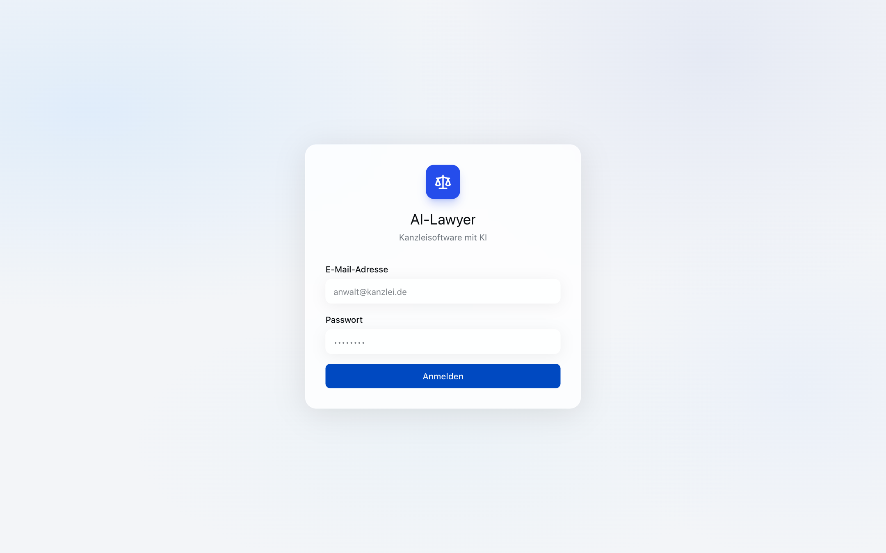
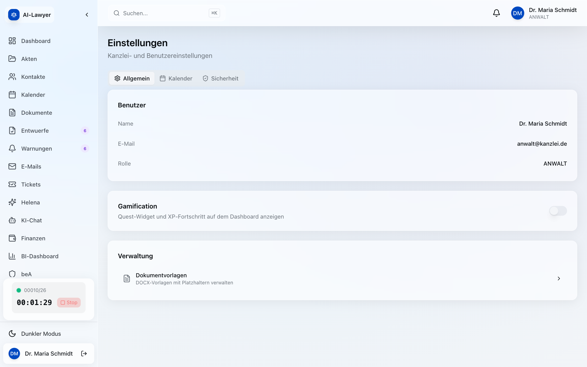
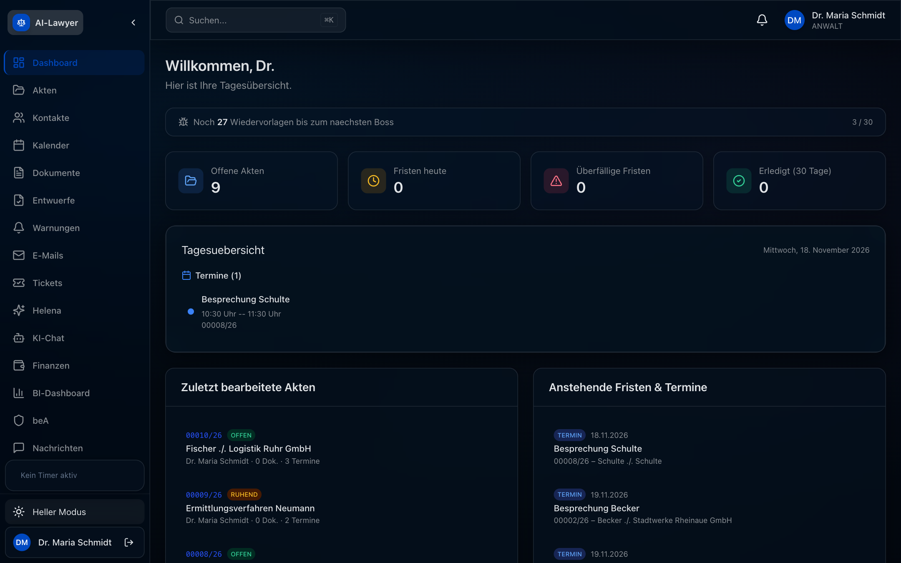
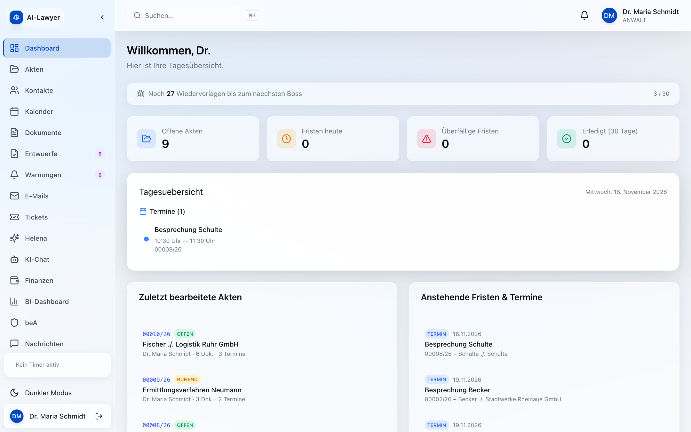

# 2 — Erste Schritte

Dieses Kapitel zeigt, wie Sie sich anmelden, die Zwei-Faktor-Anmeldung einrichten und sich auf der Oberfläche zurechtfinden. Am Ende kennen Sie Seitenleiste, Suche, Benachrichtigungen und das Dashboard.

## Schnelleinstieg in 5 Minuten

1. AI-Lawyer im Browser öffnen (die Adresse nennt Ihnen die Administration) und mit E-Mail-Adresse und Passwort anmelden ([Anmelden](#anmelden)).
2. Unter **Einstellungen → Sicherheit** die Zwei-Faktor-Anmeldung einrichten ([Zwei-Faktor einrichten](#zwei-faktor-anmeldung-einrichten)).
3. Mit **⌘K** (Mac) bzw. **Strg+K** (Windows) die Befehlspalette öffnen und **Neue Akte anlegen** wählen ([Kapitel 3](03-akten.md#neue-akte-anlegen)).
4. In der neuen Akte unten im Verlauf eine erste Notiz schreiben und mit **Enter** speichern.
5. Zurück auf dem **Dashboard** sehen Sie Ihre Akte unter **Zuletzt bearbeitete Akten** und heutige Fristen in der **Tagesuebersicht**.

AI-Lawyer ist für **Google Chrome** entwickelt und getestet. Andere Browser funktionieren meist, werden aber nicht gezielt geprüft.

## Anmelden

1. Öffnen Sie die Adresse von AI-Lawyer. Ohne Anmeldung landen Sie automatisch auf der Seite **AI-Lawyer — Kanzleisoftware mit KI**.
2. Geben Sie Ihre **E-Mail-Adresse** und Ihr **Passwort** ein.
3. Klicken Sie auf **Anmelden**.

Ist für Ihr Konto die Zwei-Faktor-Anmeldung aktiv, folgt die Seite **Zwei-Faktor-Authentifizierung**:

4. Öffnen Sie Ihre Authenticator-App und geben Sie den sechsstelligen Code in das Feld **Authentifizierungscode** ein.
5. Klicken Sie auf **Code bestätigen**.

Zwischen Passwort und Code haben Sie zehn Minuten Zeit. Danach müssen Sie über **Zuruck zur Anmeldung** neu beginnen.

**Handy nicht zur Hand?** Klicken Sie auf **Backup-Code verwenden** und geben Sie einen Ihrer Backup-Codes ein: acht Zeichen, genau so, wie sie beim Einrichten angezeigt wurden, also in Großbuchstaben und ohne Bindestrich (das Muster `xxxx-xxxx` im Feld ist irreführend). Jeder Backup-Code funktioniert genau einmal. Mit **Authenticator-Code verwenden** wechseln Sie zurück.

**Mandantinnen und Mandanten** melden sich nicht hier an, sondern auf der eigenen Anmeldeseite des Mandantenportals ([Kapitel 12](12-mandantenportal.md)).

### Erste Anmeldung nach der Installation

Eine frische Installation enthält Beispielkonten, etwa `admin@kanzlei.de`, `anwalt@kanzlei.de` und `sachbearbeiter@kanzlei.de` mit einem gemeinsamen Standardpasswort ([Kapitel 19](19-installation.md)). Diese Konten sind nur zum Ausprobieren gedacht. Vor echtem Betrieb muss die Administration sie ersetzen oder sperren ([Kapitel 15](15-benutzer-und-rollen.md)).

Meldet sich ein Admin zum ersten Mal an und öffnet die **Einstellungen**, startet ein Einrichtungsassistent mit den Schritten Kanzleidaten, Briefkopf, Bundesland, Vorfristen, Ordner-Schema und Benutzer ([Kapitel 16](16-einstellungen-und-vorlagen.md)).

## Zwei-Faktor-Anmeldung einrichten

Die Zwei-Faktor-Anmeldung (2FA) verlangt beim Anmelden zusätzlich einen Einmalcode aus einer App auf Ihrem Smartphone, etwa Google Authenticator, Authy oder 1Password. Selbst wer Ihr Passwort kennt, kommt so nicht in Ihr Konto.

1. Klicken Sie in der Seitenleiste auf **Einstellungen** und dann auf den Reiter **Sicherheit**.
2. Klicken Sie auf **2FA aktivieren**.
3. Unter **Authenticator-App einrichten** erscheint ein QR-Code. Scannen Sie ihn mit Ihrer App. Geht das nicht, tippen Sie den Schlüssel unter **Oder manuell eingeben:** in die App ein (das Kopiersymbol daneben kopiert ihn).
4. Geben Sie den sechsstelligen Code aus der App in **Code aus Authenticator-App eingeben** ein und klicken Sie auf **Bestätigen**.
5. AI-Lawyer zeigt jetzt **Backup-Codes speichern**: zehn Codes, die **nur einmal angezeigt** werden. Kopieren Sie sie mit **Alle kopieren** und bewahren Sie sie sicher auf, z. B. in einem Passwortmanager oder ausgedruckt im Tresor.
6. Klicken Sie auf **Fertig**. Die Karte zeigt nun **2FA aktiv**.

### Backup-Codes neu erzeugen und 2FA abschalten

Unter **Backup-Codes verwalten** sehen Sie, wie viele Codes noch übrig sind. Mit **Backup-Codes neu generieren** erhalten Sie zehn neue Codes; die alten werden damit ungültig. Zur Bestätigung geben Sie einen aktuellen Code aus der App ein und klicken auf **Bestätigen**.

Mit **2FA deaktivieren**, einem aktuellen App-Code und **Deaktivieren bestätigen** schalten Sie die Zwei-Faktor-Anmeldung wieder ab.

### Wenn 2FA Pflicht ist

Die IT kann die Zwei-Faktor-Anmeldung für bestimmte Rollen verpflichtend machen (Variable `TOTP_REQUIRED_ROLES`, [Kapitel 20](20-konfiguration.md)). Wer zu einer solchen Rolle gehört und noch keine 2FA eingerichtet hat, sieht nach dem Anmelden nur die Seite **Zwei-Faktor-Authentifizierung erforderlich**. Klicken Sie dort auf **Zu den Sicherheitseinstellungen**, wählen Sie den Reiter **Sicherheit** (die Seite öffnet sich auf **Allgemein**) und richten Sie 2FA wie oben ein. Danach sind alle Bereiche wieder erreichbar.

## Die Oberfläche

Die Oberfläche hat drei Teile: links die **Seitenleiste**, oben die **Kopfzeile**, in der Mitte der Arbeitsbereich.

### Seitenleiste

Die Seitenleiste enthält alle Bereiche:

| Eintrag | Inhalt | Kapitel |
| --- | --- | --- |
| **Dashboard** | Tagesübersicht, Kennzahlen, zuletzt bearbeitete Akten | [unten](#das-dashboard) |
| **Akten** | Aktenliste, neue Akte | [3](03-akten.md) |
| **Kontakte** | Personen und Firmen | [4](04-kontakte.md) |
| **Kalender** | Fristen, Termine, Wiedervorlagen | [6](06-fristen-und-kalender.md) |
| **Dokumente** | Dokumente aller Akten | [5](05-dokumente.md) |
| **Entwuerfe** | Entwürfe von Helena zur Prüfung | [9](09-helena.md) |
| **Warnungen** | Hinweise von Helena, z. B. erkannte Fristen | [9](09-helena.md) |
| **E-Mails** | Postfächer und Veraktung | [7](07-email-und-tickets.md) |
| **Tickets** | Aufgaben im Team | [7](07-email-und-tickets.md) |
| **Helena** | KI-Assistentin mit Aktenbezug | [9](09-helena.md) |
| **KI-Chat** | Aktenübergreifende Recherche | [9](09-helena.md) |
| **Finanzen** | Zeiterfassung, Rechnungen, Aktenkonto, RVG-Rechner | [10](10-zeiterfassung-und-abrechnung.md) |
| **BI-Dashboard** | Kennzahlen und Auswertungen | [13](13-suche-und-auswertung.md) |
| **beA** | Besonderes elektronisches Anwaltspostfach | [8](08-bea.md) |
| **Nachrichten** | Team-Chat | [11](11-team-nachrichten.md) |
| **Shop**, **Heldenkarte** | Gamification (freiwillig) | [14](14-gamification.md) |
| **Einstellungen** | Persönliche und Kanzlei-Einstellungen | [16](16-einstellungen-und-vorlagen.md) |

Zahlen neben **Entwuerfe**, **Warnungen** und **Nachrichten** zeigen offene Entwürfe, ungelesene Warnungen und ungelesene Nachrichten. Sie aktualisieren sich von selbst.

**Rollenhinweise:** Das Sekretariat sieht den Eintrag **Einstellungen** nicht. Admins sehen zusätzlich einen Abschnitt **Administration** mit **Job-Monitor**, **System**, **Pipeline**, **Dezernate**, **Rollen** und **Einstellungen** ([Teil B](15-benutzer-und-rollen.md)).

Der Pfeil oben neben dem Logo (**Sidebar einklappen**) verkleinert die Seitenleiste auf Symbole. Fahren Sie dann mit der Maus über ein Symbol, erscheint sein Name. Ein zweiter Klick (**Sidebar aufklappen**) stellt sie wieder her.

### Timer-Widget

Unten in der Seitenleiste sitzt die Stoppuhr der Zeiterfassung. Läuft keine, steht dort **Kein Timer aktiv**.

Wichtig zu wissen: **Sobald Sie eine Akte öffnen, startet AI-Lawyer automatisch einen Timer für diese Akte**, und beim Verlassen der Akte wird er wieder gestoppt. Es läuft immer höchstens ein Timer. Während er läuft, zeigt das Widget das Aktenzeichen, einen grünen Punkt und die verstrichene Zeit.

- **Stop** beendet den Timer und legt den Zeiteintrag an.
- Bei Akten mit Stundenhonorar fragt AI-Lawyer vorher nach der **Taetigkeit (Pflichtangabe)** („Was wurde gemacht?“). Erst dann ist **Stoppen** möglich. Bei anderen Akten ist die Angabe optional.

Wie Sie Zeiten nachträglich korrigieren und abrechnen, steht in [Kapitel 10](10-zeiterfassung-und-abrechnung.md).

### Dunkler Modus

Ganz unten in der Seitenleiste schaltet **Dunkler Modus** auf eine dunkle Darstellung um, **Heller Modus** zurück. Die Wahl wird in Ihrem Benutzerkonto gespeichert und gilt auf jedem Rechner, an dem Sie sich anmelden. Solange Sie nichts wählen, folgt AI-Lawyer der Einstellung Ihres Betriebssystems.

### Kopfzeile

Oben links steht das Suchfeld **Suchen...**, rechts die Glocke für Benachrichtigungen sowie Ihr Name mit Ihrer Rolle.

### Suche und Befehlspalette (⌘K)

Ein Klick auf **Suchen...** oder die Tastenkombination **⌘K** (Mac) bzw. **Strg+K** (Windows/Linux) öffnet die Befehlspalette **Suchen oder Aktion ausführen...**. **Esc** schließt sie wieder.

Solange das Feld leer ist, bietet sie Abkürzungen an:

| Gruppe | Einträge |
| --- | --- |
| **KI** | **Helena fragen** |
| **Navigation** | **Dashboard**, **Akten**, **Kontakte**, **Kalender**, **Dokumente**, **Einstellungen** |
| **Aktionen** | **Neue Akte anlegen**, **Neuen Kontakt anlegen**, **Neuen Termin anlegen**, **Frist berechnen** |

Sobald Sie tippen, sucht AI-Lawyer gleichzeitig in **Akten** (Aktenzeichen, Kurzrubrum), **Kontakte** und **Dokumente** und zeigt je bis zu fünf Treffer. Pfeiltasten und **Enter** öffnen einen Treffer. Unter den Dokumenten führt **Alle Ergebnisse anzeigen** zur ausführlichen Suchseite ([Kapitel 13](13-suche-und-auswertung.md)).

Ein Trick: Tippen Sie eine Frage ein und wählen Sie dann **Helena fragen**. Helena öffnet sich mit Ihrem Text bereits im Eingabefeld.

**Frist berechnen** öffnet den Fristenrechner als Seitenfenster, ohne die aktuelle Seite zu verlassen ([Kapitel 6](06-fristen-und-kalender.md)).

### Benachrichtigungen

Die Glocke rechts oben zeigt die Zahl ungelesener Benachrichtigungen (ab 100 als „99+“). Ein Klick öffnet die Liste **Benachrichtigungen** mit den letzten Meldungen, z. B. zu nahenden oder überfälligen Fristen, neuen E-Mails, Helena-Entwürfen, @-Erwähnungen im Team-Chat oder Uploads aus dem Mandantenportal.

- Ein Klick auf eine Meldung öffnet die passende Seite und markiert sie als gelesen.
- **Alle gelesen** markiert alle auf einmal.
- Das kleine X (**Benachrichtigung verwerfen**) entfernt eine Meldung.
- Bei fehlgeschlagenen Hintergrundaufgaben erscheint **Erneut versuchen**.

Ist nichts da, steht dort **Keine neuen Benachrichtigungen**.

## Das Dashboard

Nach der Anmeldung landen Sie auf dem **Dashboard**. Es zeigt nur Daten aus Akten, auf die Sie Zugriff haben (Admins: alle Akten).

Oben steht eine Begrüßung mit Ihrem Vornamen. (Bekannter Fehler: Beginnt der hinterlegte Name mit einem Titel, erscheint z. B. „Willkommen, Dr.“.)

Darunter vier Kennzahlen:

| Kennzahl | Bedeutet |
| --- | --- |
| **Offene Akten** | Akten im Status *Offen* |
| **Fristen heute** | Unerledigte Fristen mit heutigem Datum |
| **Überfällige Fristen** | Unerledigte Fristen und Wiedervorlagen, deren Datum vorbei ist |
| **Erledigt (30 Tage)** | In den letzten 30 Tagen erledigte Kalendereinträge |

Ist die Gamification eingeschaltet, folgen ein Quest-Widget und gegebenenfalls ein Banner zum Team-Bossfight ([Kapitel 14](14-gamification.md)).

### Tagesübersicht

Die **Tagesuebersicht** listet alles, was heute ansteht, getrennt nach **Fristen**, **Wiedervorlagen**, **Termine** und **Externe Kalender** (Termine aus einem verbundenen Google- oder Apple-Kalender). Steht nichts an, heißt es **Keine Eintraege fuer heute.**

- Eine Ampel und das Kürzel **NF** (Notfrist) helfen beim Einordnen von Fristen.
- **Fristenzettel** öffnet eine druckbare Liste der heutigen Fristen in einem neuen Tab.
- Das Häkchen (**Erledigen**) schließt eine Frist oder Wiedervorlage ab. AI-Lawyer verlangt dafür einen **Erledigungsgrund**; erst dann ist **Erledigen** im Dialog anklickbar.
- Das Ordnersymbol (**Akte oeffnen**) springt in die Akte.

### Zuletzt bearbeitete Akten und anstehende Einträge

Unten links stehen die fünf zuletzt geänderten offenen oder ruhenden Akten mit Aktenzeichen, Status, Kurzrubrum, zuständigem Anwalt und Zahl der Dokumente und Termine. Gibt es noch keine Akte, führt **Erste Akte anlegen** direkt zur Neuanlage.

Rechts zeigt **Anstehende Fristen & Termine** die nächsten fünf unerledigten Einträge ab heute.

## Abmelden

Klicken Sie unten in der Seitenleiste neben Ihrem Namen auf das Türsymbol (**Abmelden**). Sie landen wieder auf der Anmeldeseite. Bei eingeklappter Seitenleiste liegt das Symbol direkt unter Ihrem Namenskürzel.

Melden Sie sich an gemeinsam genutzten Rechnern immer ab, bevor Sie den Platz verlassen.

## Passwort ändern

Kanzleimitarbeitende können ihr Passwort **derzeit nicht selbst in AI-Lawyer ändern**; einen entsprechenden Menüpunkt gibt es noch nicht. Auch eine Funktion „Passwort vergessen“ gibt es auf der Anmeldeseite der Kanzlei nicht. Wenden Sie sich an Ihre Administration bzw. IT. Unter **Einstellungen → Allgemein** sehen Sie nur Ihren Namen, Ihre E-Mail-Adresse und Ihre Rolle.

Mandantinnen und Mandanten können ihr Passwort im Portal selbst ändern und zurücksetzen ([Kapitel 12](12-mandantenportal.md)).

## Wenn etwas nicht klappt

| Meldung | Bedeutung | Was tun? |
| --- | --- | --- |
| *Ungültige Anmeldedaten. Bitte versuchen Sie es erneut.* | E-Mail oder Passwort falsch, oder das Konto ist deaktiviert. | Eingabe prüfen (Feststelltaste). Hilft das nicht, Administration fragen. |
| *Ungültiger Code* | Der Code aus der App stimmt nicht oder ist abgelaufen. | Neuen Code abwarten und eingeben. Uhrzeit des Smartphones prüfen (automatische Zeit einschalten). |
| *Ungültiger oder abgelaufener Login-Token* | Zwischen Passwort und Code sind mehr als zehn Minuten vergangen. | **Zuruck zur Anmeldung** und neu anmelden. |
| *Kein aktiver 2FA-Login-Vorgang* | Die Code-Seite wurde direkt aufgerufen, ohne vorherige Passworteingabe. | Über die Anmeldeseite neu beginnen. |
| *Bitte geben Sie einen 6-stelligen Code ein* | Beim Einrichten oder Bestätigen fehlen Ziffern. | Alle sechs Ziffern eingeben. |
| *2FA-Status konnte nicht geladen werden* | Der Server hat nicht geantwortet. | Seite neu laden, sonst IT informieren. |
| Seite **Zwei-Faktor-Authentifizierung erforderlich** | Für Ihre Rolle ist 2FA Pflicht. | 2FA einrichten wie [oben](#wenn-2fa-pflicht-ist) beschrieben. |
| Backup-Codes verloren und Handy weg | Ohne Code ist keine Anmeldung möglich. | Die IT muss 2FA für Ihr Konto zurücksetzen. Eine Funktion dafür gibt es in der Oberfläche derzeit nicht. |

---

Weiter: [3 — Akten](03-akten.md) · [Zur Übersicht](README.md)
