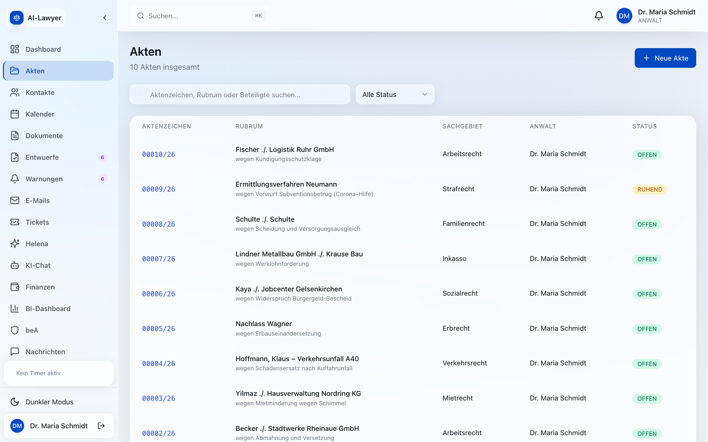
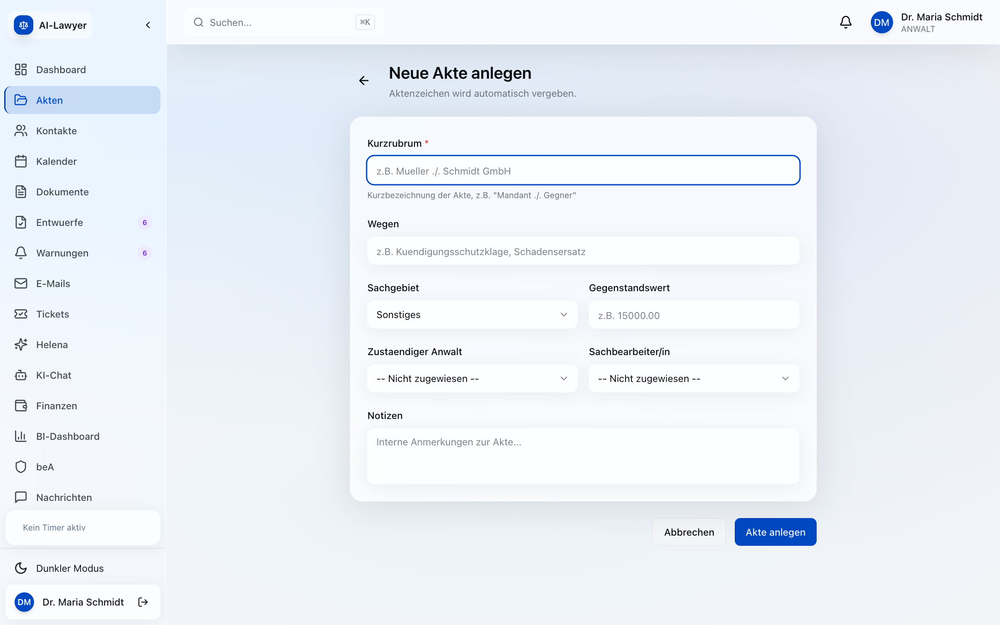
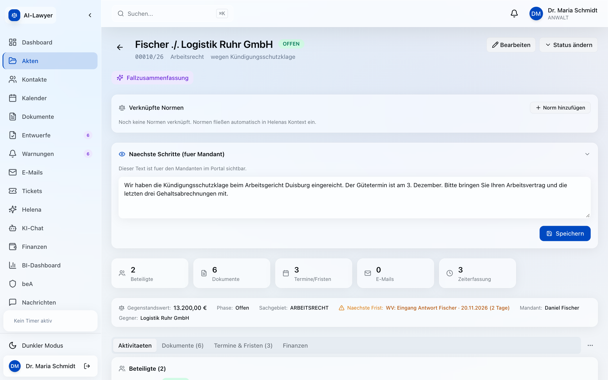

# 3 — Akten

Die Akte ist der Ort, an dem in AI-Lawyer alles zusammenläuft. Dieses Kapitel zeigt, wie Sie Akten finden und anlegen, wie die Akten-Detailseite aufgebaut ist und wie Sie Status, Beteiligte, Normen und Falldaten pflegen.

## Die Aktenliste

Klicken Sie in der Seitenleiste auf **Akten**.

Die Liste zeigt die zuletzt geänderten Akten zuerst, mit den Spalten **Aktenzeichen**, **Rubrum** (Kurzrubrum, darunter „wegen …“), **Sachgebiet**, **Anwalt** und **Status**. Ein Klick auf das Aktenzeichen öffnet die Akte. Über der Tabelle steht, wie viele Akten angezeigt werden.

### Suchen und filtern

1. Geben Sie in das Feld **Aktenzeichen, Rubrum oder Beteiligte suchen...** einen Suchbegriff ein und drücken Sie **Enter**.
2. Wählen Sie bei Bedarf im Auswahlfeld daneben einen Status: **Alle Status**, **Offen**, **Ruhend**, **Archiviert** oder **Geschlossen**. Die Liste aktualisiert sich sofort.
3. Das kleine X im Suchfeld löscht den Suchbegriff wieder.

Gut zu wissen:

- Die Suche durchsucht **Aktenzeichen, Kurzrubrum und das Feld „Wegen“**. Namen von Beteiligten findet sie entgegen dem Hinweis im Feld nicht. Um eine Akte über den Namen einer Partei zu finden, öffnen Sie den Kontakt und dort den Reiter **Akten** ([Kapitel 4](04-kontakte.md#akten-eines-kontakts)), oder Sie nutzen die Befehlspalette **⌘K** bzw. die Suche aus [Kapitel 13](13-suche-und-auswertung.md).
- Die Liste zeigt höchstens **50 Akten**. Ein Blättern gibt es nicht. Grenzen Sie bei vielen Akten mit Suchbegriff oder Status ein.
- Suchbegriff und Filter stehen in der Adresszeile (z. B. `/akten?status=OFFEN`). Sie können die Seite also als Lesezeichen speichern.

> **Hinweis:** Die Aktenliste zeigt im aktuellen Stand **alle Akten der Kanzlei**, auch solche, denen Sie nicht zugeordnet sind. Siehe [Zugriff, Dezernate und Admin-Override](#zugriff-dezernate-und-admin-override).

## Neue Akte anlegen

1. Klicken Sie in der Aktenliste auf **Neue Akte** (oder in der Befehlspalette auf **Neue Akte anlegen**).
2. Füllen Sie das Formular **Neue Akte anlegen** aus (siehe Tabelle).
3. Klicken Sie auf **Akte anlegen**.

AI-Lawyer meldet *Akte 00014/26 angelegt* und öffnet die neue Akte.

| Feld | Bedeutung |
| --- | --- |
| **Kurzrubrum** * | Pflichtfeld. Kurzbezeichnung der Akte, z. B. „Mueller ./. Schmidt GmbH“. |
| **Wegen** | Worum es geht, z. B. „Kuendigungsschutzklage, Schadensersatz“. |
| **Sachgebiet** | Auswahl aus elf Sachgebieten, Vorgabe **Sonstiges**. |
| **Gegenstandswert** | Betrag in Euro, z. B. `15000.00` (Dezimalpunkt). Wird später für Gebühren genutzt ([Kapitel 10](10-zeiterfassung-und-abrechnung.md)). |
| **Zustaendiger Anwalt** | Auswahl aus Benutzern mit Rolle Anwalt oder Admin. Lassen Sie das Feld als Anwalt leer, trägt AI-Lawyer Sie selbst ein. |
| **Sachbearbeiter/in** | Auswahl aus Benutzern mit Rolle Sachbearbeiter oder Sekretariat. |
| **Notizen** | Interne Anmerkungen zur Akte. |

### Aktenzeichen

Das Aktenzeichen wird **automatisch vergeben** („Aktenzeichen wird automatisch vergeben.“). Es folgt dem Schema `NNNNN/JJ`: fünfstellige laufende Nummer und zweistelliges Jahr, z. B. `00001/26`. Mit jedem neuen Jahr beginnt die Zählung wieder bei `00001`. Ein anderes Schema lässt sich derzeit nicht einstellen, und das Aktenzeichen kann nachträglich nicht geändert werden.

### Falldatenblatt-Vorschlag

Wählen Sie ein anderes Sachgebiet als **Sonstiges**, sucht AI-Lawyer passende Falldatenblätter und zeigt sie unter **Helena empfiehlt:**. Das Blatt mit dem Kennzeichen **STANDARD** ist vorausgewählt; andere freigegebene Blätter tragen **GENEHMIGT**. Klicken Sie auf ein anderes, um es zu wählen. Das gewählte Blatt steht in der Akte im Reiter **Falldaten** bereit ([unten](#falldaten)).

### Kollisionsprüfung

AI-Lawyer prüft auf Interessenkonflikte, wenn ein Kontakt einer Akte als **Mandant**, **Gegner** oder **Gegnervertreter** hinzugefügt wird: Ist derselbe Kontakt in einer anderen offenen oder ruhenden Akte auf der Gegenseite, erscheint der Hinweis **Interessenkonflikt erkannt** mit der betroffenen Akte, und Sie müssen ausdrücklich **Trotzdem hinzufügen** wählen.

> **Derzeit eingeschränkt:** Dieser Dialog ist im Programm vorhanden, aber in der Akte noch nicht eingebunden (siehe [Beteiligte](#beteiligte)). Beim Anlegen einer Akte selbst findet keine Kollisionsprüfung statt, weil dabei noch keine Beteiligten erfasst werden. Prüfen Sie Interessenkonflikte vor der Mandatsannahme deshalb zusätzlich selbst, etwa über den Reiter **Akten** des Kontakts.

## Die Akte im Überblick

Ein Klick auf eine Akte öffnet die Detailseite.

Von oben nach unten:

1. **Kopf:** Aktenzeichen, Kurzrubrum, Status, Sachgebiet und „wegen …“; rechts die Knöpfe **Bearbeiten** und **Status ändern**.
2. **Fallzusammenfassung** (violett): öffnet Helena mit dem Auftrag, eine Fallzusammenfassung für diese Akte zu erstellen ([Kapitel 9](09-helena.md)). Admins sehen daneben **Zugriff uebernehmen**.
3. **Verknüpfte Normen** ([unten](#verknüpfte-normen)).
4. **Naechste Schritte (fuer Mandant)**, aufklappbar ([unten](#nächste-schritte-für-den-mandanten)).
5. **Kennzahlen**, **Key-Facts** und die **Reiter**.

> **Zeiterfassung läuft mit:** Beim Öffnen einer Akte startet automatisch ein Timer für diese Akte, beim Verlassen stoppt er ([Kapitel 2](02-erste-schritte.md#timer-widget)).

### Kennzahlen

Die Kacheln zählen **Beteiligte**, **Dokumente**, **Termine/Fristen**, **E-Mails** und **Zeiterfassung**, dazu **Chat**, sobald es Team-Nachrichten zur Akte gibt. Jede Kachel ist ein Sprungziel:

| Kachel | Führt zu |
| --- | --- |
| **Beteiligte** | Reiter **Aktivitaeten** (dort steht die Beteiligtenliste) |
| **Dokumente** | Reiter **Dokumente** |
| **Termine/Fristen** | Reiter **Termine & Fristen** |
| **E-Mails** | Seite **E-Mails**, gefiltert auf diese Akte |
| **Zeiterfassung** | Reiter **Finanzen**, Abschnitt Zeiterfassung |
| **Chat** | Reiter **Chat** |

### Key-Facts

Unter den Kacheln steht eine Zeile mit den wichtigsten Eckdaten, soweit vorhanden: **Gegenstandswert**, **Phase** (Status), **Sachgebiet**, **Gericht**, **Naechste Frist**, **Mandant** und **Gegner**.

Bei **Naechste Frist** steht der nächste unerledigte Termin oder die nächste Frist ab heute; ist sie höchstens sieben Tage entfernt, wird sie farbig hervorgehoben. Gibt es nichts Anstehendes, aber etwas Unerledigtes in der Vergangenheit, erscheint stattdessen **Ueberfaellig:** mit dem Datum und „(seit … Tagen)“. So verschwindet eine verpasste Frist nicht unbemerkt.

### Reiter

| Reiter | Inhalt | Kapitel |
| --- | --- | --- |
| **Aktivitaeten** | Beteiligte und Aktivitätsverlauf (Standard) | [unten](#der-aktivitätsverlauf) |
| **Dokumente (n)** | Dokumente der Akte, Ordner, Upload, Freigabe | [5](05-dokumente.md) |
| **Termine & Fristen (n)** | Kalendereinträge der Akte | [6](06-fristen-und-kalender.md) |
| **Finanzen** | Aktenkonto, Rechnungen, Zeiterfassung | [10](10-zeiterfassung-und-abrechnung.md) |

Seltener gebrauchte Reiter liegen hinter dem Symbol mit den drei Punkten (**Weitere Tabs**):

| Reiter | Inhalt | Kapitel |
| --- | --- | --- |
| **Falldaten** | Strukturiertes Falldatenblatt | [unten](#falldaten) |
| **KI-Analyse** | Fallzusammenfassung mit Timeline und Eckdaten | [unten](#ki-analyse) |
| **Chat** | Team-Nachrichten zu dieser Akte | [11](11-team-nachrichten.md) |
| **Portal** | Nachrichten mit dem Mandanten im Portal | [12](12-mandantenportal.md) |

Ist einer dieser Reiter aktiv, ist das Drei-Punkte-Symbol hervorgehoben. Ein Reiter lässt sich auch direkt verlinken, z. B. `/akten/<id>?tab=falldaten`.

## Der Aktivitätsverlauf

Der Reiter **Aktivitaeten** zeigt oben die [Beteiligten](#beteiligte) und darunter den Verlauf: Dokumente, Fristen, E-Mails, Notizen, Telefonnotizen, Aufgaben, Statuswechsel, Hinweise und Entwürfe von Helena, neueste zuerst.

### Filtern

Die Schaltflächen über dem Verlauf filtern:

| Filter | Zeigt |
| --- | --- |
| **Alle** | Alles |
| **Fristen** | Fristen und Aufgaben |
| **Dokumente** | Dokumente |
| **Kommunikation** | E-Mails, Notizen, Telefonnotizen |
| **Zeit** | Zeiteinträge (derzeit erscheinen hier noch keine Einträge) |
| **System** | Beteiligte, Statuswechsel, Hinweise und Entwürfe von Helena |

Ältere Einträge holen Sie mit **Mehr laden** nach. Kommt während der Arbeit etwas Neues hinzu (etwa von einer Kollegin oder von Helena), erscheint oben **Neue Eintraege verfuegbar -- klicken zum Aktualisieren**.

### Notiz, Telefonnotiz, Aufgabe

Unten im Verlauf sitzt das Eingabefeld. Wählen Sie zuerst die Art:

- **Notiz:** Text in **Notiz schreiben oder @Helena erwaehnen...** eingeben, **Enter** speichert, **Umschalt+Enter** macht einen Zeilenumbruch.
- **Telefonnotiz:** **Name des Gespraechspartners** und ein Ergebnis (**Erreicht**, **Nicht erreicht**, **Rueckruf erbeten**, **Nachricht hinterlassen**, **Besetzt**) sind Pflicht; dazu optional **Stichworte zum Gespraech...** und **Naechster Schritt / Follow-up**.
- **Aufgabe:** Titel (**Aufgabe beschreiben...**) ist Pflicht, dazu optional ein Fälligkeitsdatum und **Details...**. Die Aufgabe erscheint im Verlauf. Sie ist **kein Kalendereintrag** und erinnert nicht von selbst. Für echte Fristen und Wiedervorlagen nutzen Sie den Reiter **Termine & Fristen**.

### Helena in der Notiz

Schreiben Sie in einer Notiz **@Helena** und dahinter einen Auftrag, z. B. „@Helena fasse den letzten Schriftsatz der Gegenseite zusammen“. Das Roboter-Symbol links (**@Helena erwaehnen**) fügt die Erwähnung ein. Die Notiz wird gespeichert, und Helena beginnt im Hintergrund zu arbeiten; ihr Fortschritt erscheint oben im Verlauf.

Ergebnisse von Helena erscheinen als Entwurf im Verlauf, oft mit den verwendeten Quellen (Gesetze, Urteile, Muster) zum Aufklappen. Sie entscheiden:

- **Annehmen** übernimmt den Entwurf.
- **Bearbeiten** öffnet den Text zum Ändern, **Speichern** übernimmt Ihre Fassung.
- **Ablehnen** verwirft ihn; im Feld **Feedback (optional)...** können Sie Helena sagen, was nicht passte.

> **Prüfpflicht:** Ein Helena-Entwurf ist ein Vorschlag. Prüfen Sie Inhalt, Normen und Fristen, bevor Sie ihn annehmen oder verwenden.

## Beteiligte

Die Beteiligten stehen oben im Reiter **Aktivitaeten** unter **Beteiligte (n)**, jeweils mit Name, Rolle (z. B. **Mandant**, **Gegner**), E-Mail, Telefon und Ort. Die Rollen sind in [Kapitel 1](01-was-ist-ai-lawyer.md#beteiligte-und-rollen) erklärt. Hat die Akte noch keine Beteiligten, fehlt der Abschnitt ganz.

Bei Beteiligten mit Rolle **Mandant** sehen Anwälte und Admins den Knopf für die **Portal-Einladung** ([Kapitel 12](12-mandantenportal.md)).

> **Derzeit eingeschränkt:** In der Akte gibt es im aktuellen Stand **keinen Knopf, um Beteiligte von Hand hinzuzufügen oder zu entfernen**. Der Dialog **Beteiligten hinzufügen** (mit Rollenwahl, Kontaktsuche und Kollisionsprüfung) ist im Programm vorhanden, aber noch nicht in die Akte eingebunden. Beteiligte gelangen derzeit auf zwei Wegen in eine Akte:
>
> - Helena erkennt Parteien in Dokumenten und schlägt sie vor; übernehmen Sie den Vorschlag, legt AI-Lawyer einen Kontakt an und verknüpft ihn ([Kapitel 9](09-helena.md)). Dieser Weg prüft nicht auf Interessenkonflikte.
> - Bei der Übernahme aus j-lawyer werden Beteiligte mitgenommen ([Kapitel 17](17-migration-aus-j-lawyer.md)).

## Verknüpfte Normen

Unter **Verknüpfte Normen** heften Sie Paragraphen an die Akte, die für den Fall wichtig sind. Helena bezieht sie automatisch in ihre Arbeit an dieser Akte ein.

1. Klicken Sie auf **Norm hinzufügen**.
2. Tippen Sie mindestens zwei Zeichen in **§ Nummer oder Gesetzesname (z.B. BGB 242)...** und wählen Sie einen Treffer.
3. Optional: Schreiben Sie unter **Anmerkung (optional)** auf, warum die Norm wichtig ist („Relevanz für diesen Fall...“).
4. Klicken Sie auf **Hinzufügen**.

Die Norm erscheint als Chip. Ein Klick darauf zeigt den Normtext mit dem Hinweis **Nicht amtlich — Stand:** und dem Datum der Gesetzesdatenbank. Das X am Chip (**Norm entfernen**) löst die Verknüpfung.

Gefunden werden nur Normen, die in der Gesetzesdatenbank von AI-Lawyer geladen sind ([Kapitel 9](09-helena.md)). Erscheint **Keine Normen gefunden**, ist das Gesetz dort (noch) nicht vorhanden.

## Nächste Schritte für den Mandanten

Der aufklappbare Bereich **Naechste Schritte (fuer Mandant)** enthält einen kurzen Text in verständlicher Sprache, z. B. „Wir warten auf die Antwort des Gerichts. Voraussichtlich bis Ende des Monats.“

> Dieser Text ist für den Mandanten im Portal sichtbar.

1. Klappen Sie den Bereich auf.
2. Schreiben Sie den Text.
3. Klicken Sie auf **Speichern**. AI-Lawyer meldet *Naechste Schritte gespeichert*.

Der Bereich ist nur für **Admin**, **Anwalt** und **Sachbearbeiter** sichtbar. Mandanten mit Portalzugang werden über die Änderung benachrichtigt ([Kapitel 12](12-mandantenportal.md)). Formulieren Sie deshalb so, als schrieben Sie direkt an den Mandanten.

## Falldaten

Ein **Falldatenblatt** ist ein strukturierter Erfassungsbogen je Sachgebiet, z. B. mit Eintrittsdatum, Bruttogehalt und Kündigungsdatum in einer Arbeitsrechtssache. Sie öffnen es über **Weitere Tabs → Falldaten**.

- Die Felder sind in Gruppen geordnet. Pflichtfelder sind markiert; ein Balken zeigt den Stand, z. B. „60% (3/5 Pflichtfelder)“.
- Sobald Sie etwas ändern, erscheint **Ungespeichert**. Klicken Sie auf **Speichern**. AI-Lawyer meldet *Falldaten gespeichert* und gegebenenfalls, wie viele Pflichtfelder noch fehlen.
- Wechseln Sie mit ungespeicherten Änderungen den Reiter, fragt AI-Lawyer nach (**Ungespeicherte Aenderungen**). **Abbrechen** bleibt, **Trotzdem fortfahren** verwirft die Änderungen.

**Auto-Fill:** Ein Klick auf **Auto-Fill** lässt Helena die Felder aus den (per OCR gelesenen) Dokumenten der Akte vorschlagen. Im Fenster **KI-Vorschlaege pruefen** sehen Sie jeden Vorschlag mit seiner Konfidenz. Wählen Sie die passenden aus (oder **Alle akzeptieren**) und klicken Sie auf **… Vorschlaege uebernehmen**. Danach unbedingt **Speichern**, sonst gehen die Werte verloren. Prüfen Sie jeden übernommenen Wert an der Quelle.

**Template wechseln:** Passt das Blatt nicht, wählen Sie unter **Template wechseln** ein anderes. Bereits erfasste Daten bleiben erhalten; Felder, die das neue Blatt nicht kennt, werden nur nicht mehr angezeigt.

Gibt es für das Sachgebiet kein Standardblatt, erscheint **Kein Standardtemplate verfuegbar**, gegebenenfalls mit einer Auswahl anderer Blätter. Neue Blätter legt die Administration an ([Kapitel 16](16-einstellungen-und-vorlagen.md)).

## KI-Analyse

Unter **Weitere Tabs → KI-Analyse** erstellt Helena auf Knopfdruck eine strukturierte Fallzusammenfassung:

1. Klicken Sie auf **Zusammenfassung generieren**. Während Helena arbeitet, steht dort **Helena analysiert die Akte...**.
2. Das Ergebnis heißt **Fallzusammenfassung** und enthält eine **Timeline** der Ereignisse (Dokument, Frist, Termin, Kommunikation, Entscheidung) und **Eckdaten** (Parteien, Verfahren, Finanzen, Fristen).
3. **Neu generieren** erstellt sie mit dem aktuellen Aktenstand neu.

Die Zusammenfassung ist eine Arbeitshilfe. Sie kann Lücken und Fehler enthalten und ersetzt nicht das Lesen der Akte.

## Akte bearbeiten

Ein Klick auf **Bearbeiten** im Kopf öffnet **Akte bearbeiten** mit **Kurzrubrum**, **Wegen**, **Sachgebiet**, **Gegenstandswert**, **Anwalt**, **Sachbearbeiter/in** und **Notizen**. **Speichern** übernimmt die Änderungen (*Akte gespeichert*). Jede Änderung wird im Audit-Trail festgehalten ([Kapitel 18](18-datenschutz-und-audit.md)).

## Status ändern und archivieren

1. Klicken Sie im Kopf auf **Status ändern**.
2. Wählen Sie **Offen**, **Ruhend**, **Archivieren** oder **Schließen**. Der aktuelle Status ist mit „(aktuell)“ markiert.

AI-Lawyer bestätigt z. B. *Akte archiviert*. Beim Archivieren wird zusätzlich das Archivierungsdatum gespeichert. Jeder Statuswechsel wird protokolliert.

| Status | Wirkung |
| --- | --- |
| **Offen** | Laufende Akte. Zählt auf dem Dashboard als offene Akte. |
| **Ruhend** | Vorübergehend ohne Bearbeitung. Erscheint weiter unter „Zuletzt bearbeitete Akten“. |
| **Archiviert** | Abgelegt. Erscheint nicht mehr auf dem Dashboard, bleibt aber über die Aktenliste (Filter **Archiviert**) erreichbar. |
| **Geschlossen** | Abgeschlossen. Wie Archiviert nicht mehr auf dem Dashboard. |

Für die Kollisionsprüfung zählen nur offene und ruhende Akten. Ein Statuswechsel lässt sich jederzeit über denselben Knopf zurücknehmen. Ein Löschen von Akten gibt es in der Oberfläche nicht.

## Zugriff, Dezernate und Admin-Override

**Wer darf was?** Im Grundsatz gilt: Admins dürfen alle Akten. Alle anderen dürfen eine Akte, wenn sie dort als **Anwalt** oder **Sachbearbeiter/in** eingetragen sind oder Mitglied eines **Dezernats** sind, dem die Akte zugeordnet ist. Dezernate und ihre Akten pflegt die Administration unter **Administration → Dezernate** ([Kapitel 15](15-benutzer-und-rollen.md)).

Diese Regel prüft AI-Lawyer derzeit bei den Aktionen in der Akte (Speichern, Status, Notizen, Verlauf, Normen, Zusammenfassung) und auf dem Dashboard. Ohne Berechtigung antwortet AI-Lawyer, als gäbe es die Akte nicht.

> **Derzeit eingeschränkt:** Die Aktenliste und das erste Laden der Detailseite prüfen die Zuordnung im aktuellen Stand **nicht**. Wer angemeldet ist, kann dort auch fremde Akten sehen. Verlassen Sie sich für vertrauliche Mandate bis zur Behebung nicht auf die Dezernatstrennung.

**Admin-Override:** Admins sehen in jeder Akte neben **Fallzusammenfassung** den Knopf **Zugriff uebernehmen**. Er dient dazu, einen bewussten Eingriff in eine fremde Akte (etwa bei Krankheit eines Kollegen) zu dokumentieren:

1. Klicken Sie auf **Zugriff uebernehmen**.
2. Geben Sie unter **Grund *** an, warum (Pflicht).
3. Optional: **Gueltig bis (optional)**. Ohne Angabe gilt die Überschreibung unbefristet.
4. Klicken Sie auf **Zugriff uebernehmen**.

Danach zeigt die Akte **Zugriff aktiv**; mit **Zugriff aufheben** beenden Sie ihn. Anlegen und Aufheben stehen mit Grund im Audit-Trail. Da Admins technisch ohnehin Zugriff auf alle Akten haben, ist der Override vor allem ein Protokollierungsinstrument.

## Wenn etwas nicht klappt

| Meldung | Bedeutung | Was tun? |
| --- | --- | --- |
| *Keine Akten für diese Suche gefunden.* | Kein Treffer in Aktenzeichen, Kurzrubrum oder „Wegen“. | Kürzeren Begriff oder Teil des Aktenzeichens versuchen; Statusfilter auf **Alle Status** stellen. |
| *Validierungsfehler* | Beim Anlegen oder Speichern fehlt ein Pflichtwert oder ein Wert ist ungültig. | **Kurzrubrum** ausfüllen; Gegenstandswert als Zahl mit Punkt eingeben. |
| *Keine Berechtigung* | Ihre Rolle darf die Aktion nicht ausführen. | Administration fragen ([Kapitel 15](15-benutzer-und-rollen.md)). |
| *Nicht gefunden* | Die Akte gibt es nicht, oder Sie sind ihr nicht zugeordnet. | Zuordnung (Anwalt, Sachbearbeiter, Dezernat) prüfen lassen. |
| *Fehler beim Statuswechsel* | Der Status konnte nicht gespeichert werden. | Seite neu laden und erneut versuchen. |
| *Normtext konnte nicht geladen werden* | Der Paragraph ist in der Gesetzesdatenbank nicht abrufbar. | Später erneut versuchen; IT prüft den Gesetze-Import. |
| *Keine Vorschlaege gefunden -- keine OCR-Texte verfuegbar?* | Auto-Fill fand keinen lesbaren Text in den Dokumenten. | Prüfen, ob die Dokumente per OCR erkannt sind ([Kapitel 5](05-dokumente.md)). |
| *Fehler bei der Analyse* | Die Fallzusammenfassung ist gescheitert, meist weil das KI-Modell nicht erreichbar ist. | **Erneut versuchen**; sonst IT informieren. |
| Link **Posteingang oeffnen** im leeren Filter **Kommunikation** führt ins Leere | Bekannter Fehler: Die Seite heißt **E-Mails**. | In der Seitenleiste **E-Mails** öffnen. |

---

Weiter: [4 — Kontakte](04-kontakte.md) · [Zur Übersicht](README.md)
