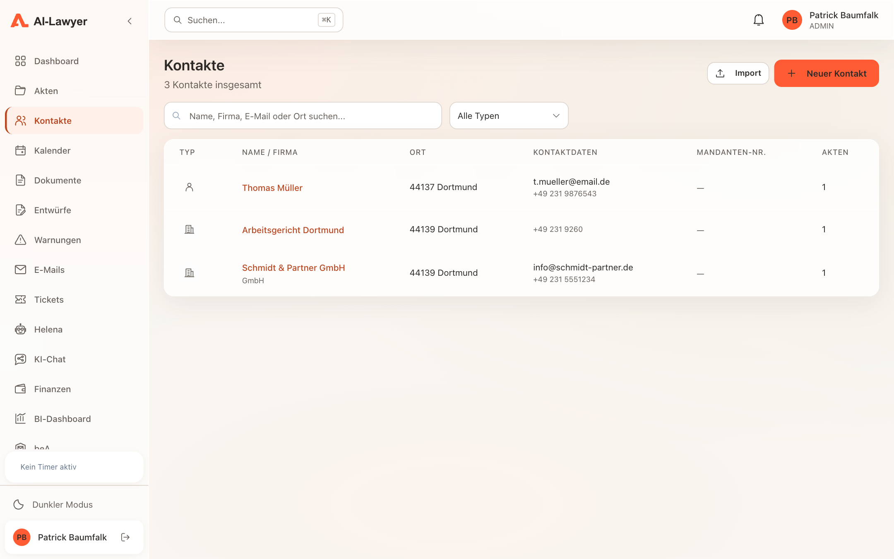
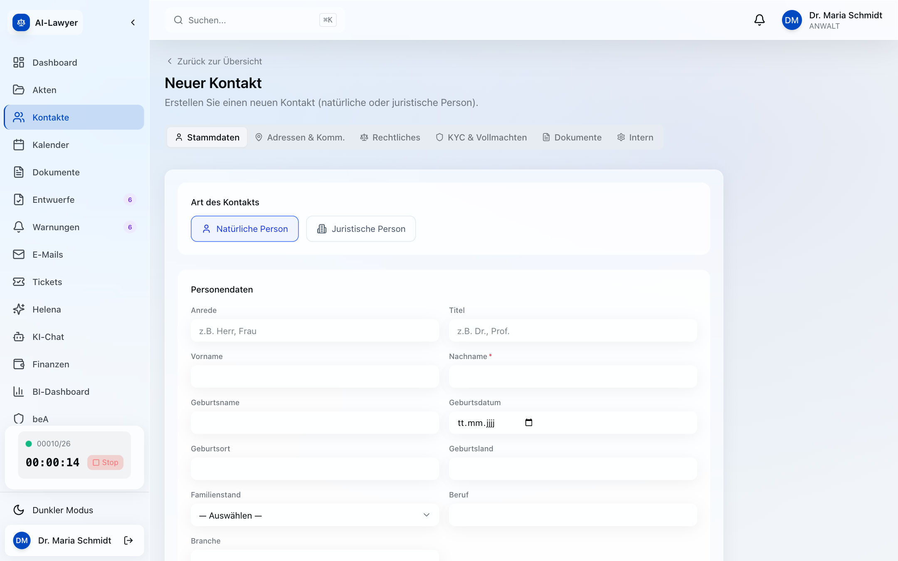

# 4 — Kontakte

Kontakte sind die Personen und Firmen, mit denen die Kanzlei zu tun hat: Mandanten, Gegner, Gerichte, Sachverständige. Dieses Kapitel zeigt, wie Sie Kontakte finden, anlegen und vollständig pflegen, einschließlich Adressen, Beziehungen, Vollmachten und Identitätsprüfung.

## Die Kontaktliste

Klicken Sie in der Seitenleiste auf **Kontakte**.

Die Tabelle zeigt **Typ** (Symbol für Person oder Firma), **Name / Firma**, **Ort**, **Kontaktdaten** (E-Mail, Telefon), **Mandanten-Nr.** und **Akten** (an wie vielen Akten der Kontakt beteiligt ist). Bei Firmen stehen unter dem Namen Rechtsform und **Ansprechpartner**. Ein Klick auf den Namen öffnet den Kontakt.

Sortiert wird nach Nachname bzw. Firma. Angezeigt werden höchstens 50 Kontakte; die Überschrift nennt die Gesamtzahl der Treffer. Grenzen Sie bei mehr Kontakten mit Suche oder Filter ein.

### Suchen und filtern

- **Suchfeld** **Name, Firma, E-Mail oder Ort suchen...**: Begriff eingeben, **Enter**. Gesucht wird in Vorname, Nachname, Firma, Kurzname, E-Mail, Telefon, Mandantennummer, USt-IdNr. sowie in Straße, PLZ und Ort der Adressen.
- **Typ**: **Alle Typen**, **Natürliche Personen** oder **Juristische Personen**.
- **Tags**: Haben Kontakte Tags, erscheinen sie als Schaltflächen unter der Suche. Ein Klick filtert auf diesen Tag, ein zweiter Klick hebt den Filter auf.

Die Befehlspalette **⌘K** findet Kontakte ebenfalls ([Kapitel 2](02-erste-schritte.md#suche-und-befehlspalette-k)).

## Neuen Kontakt anlegen

1. Klicken Sie in der Kontaktliste auf **Neuer Kontakt** (oder in der Befehlspalette auf **Neuen Kontakt anlegen**).
2. Wählen Sie unter **Art des Kontakts** **Natürliche Person** oder **Juristische Person**.
3. Füllen Sie die Pflichtfelder aus: **Nachname** bei Personen, **Firma / Name** bei juristischen Personen.
4. Ergänzen Sie weitere Angaben in den Reitern (siehe unten).
5. Klicken Sie auf **Kontakt anlegen**. AI-Lawyer meldet *Kontakt erstellt* und öffnet den Kontakt.

**Wichtig:** Adressen, Identitätsprüfungen, Vollmachten und Beziehungen lassen sich erst hinzufügen, **nachdem der Kontakt einmal gespeichert ist**. Vorher steht in diesen Bereichen z. B. „Adressen können nach dem Speichern des Kontakts hinzugefügt werden.“ Legen Sie den Kontakt also zuerst mit den Stammdaten an und öffnen Sie ihn dann mit **Bearbeiten** erneut.

Ändern: Öffnen Sie den Kontakt, klicken Sie auf **Bearbeiten**, passen Sie die Felder an und klicken Sie auf **Änderungen speichern** (*Kontakt gespeichert*).

## Die Feldgruppen

Das Formular hat sechs Reiter.

### Stammdaten

**Natürliche Person:**

| Feld | Hinweis |
| --- | --- |
| **Anrede**, **Titel** | z. B. „Frau“, „Dr.“ |
| **Vorname**, **Nachname** * | Nachname ist Pflicht. |
| **Geburtsname**, **Geburtsdatum**, **Geburtsort**, **Geburtsland** | |
| **Familienstand** | Ledig, Verheiratet, Geschieden, Verwitwet, Lebenspartnerschaft |
| **Beruf**, **Branche** | |
| **Staatsangehörigkeiten** | Mehrere möglich: eintragen (z. B. „deutsch“) und **Hinzufügen** |

**Juristische Person:**

| Feld | Hinweis |
| --- | --- |
| **Firma / Name** * | Pflicht. |
| **Kurzname** | z. B. „Müller GmbH“ |
| **Rechtsform** | z. B. GmbH, AG, e.V. |
| **Registerart** | HRB, HRA, VR, PR, GnR, Sonstige |
| **Registernummer**, **Registergericht**, **Gründungsdatum** | |
| **Vorname (Ansprechpartner)**, **Nachname (Ansprechpartner)** | Ansprechperson in der Firma |

### Adressen & Komm.

Unter **Adressen** verwalten Sie beliebig viele Anschriften:

1. Klicken Sie auf **Adresse hinzufügen**.
2. Wählen Sie den **Typ**: **Hauptanschrift**, **Zustellanschrift**, **Rechnungsanschrift** oder **Sonstige**.
3. Optional eine **Bezeichnung** (z. B. „Büro, Privatwohnung“), dann **Straße**, **Hausnummer**, **PLZ**, **Ort**, **Land** (Vorgabe Deutschland).
4. Mit **Hauptadresse** markieren Sie die wichtigste Anschrift; es gibt immer nur eine.
5. **Hinzufügen** speichert die Adresse sofort (*Adresse hinzugefügt*).

Darunter, unter **Kommunikation**: **Telefon**, **Telefon 2**, **Mobil**, **Fax**, **E-Mail**, **E-Mail 2**, **Website**, **Bevorzugte Kontaktart** (E-Mail, Telefon, Brief, Fax, beA), **Kontaktzeiten** und **Korrespondenzsprachen**. Diese Felder werden erst mit **Kontakt anlegen** bzw. **Änderungen speichern** gesichert.

> **Hinweis:** Die Spalte **Ort** in der Kontaktliste zeigt PLZ und Ort der Hauptadresse; fehlt eine als Hauptadresse markierte Anschrift, nimmt AI-Lawyer die Anschrift vom Typ **Hauptanschrift** oder die erste vorhandene. Die Suche findet Kontakte auch über Straße, PLZ und Ort ihrer Adressen. Ältere Adressen aus Import oder j-lawyer-Übernahme zeigt der Kontakt im Reiter **Adressen** mit dem Kennzeichen **Legacy**; sie werden berücksichtigt, wenn keine andere Adresse hinterlegt ist.

### Rechtliches

| Gruppe | Felder |
| --- | --- |
| **Rechtliche Kennungen** | **beA Safe-ID** (z. B. „DE.BRAK.12345678“), **Aktenzeichen (fremd)**, **Steuernummer**, **USt-IdNr.**, **Finanzamt** |
| **Bankverbindung** | **IBAN**, **BIC**, **Kontoinhaber**, **Bonitätseinschätzung**, **Zahlungsmodalitäten** |
| **Rechtlicher Status** | Schalter **Minderjährig**, **Unter Betreuung**, **Geschäftsunfähig** |

Die beA Safe-ID brauchen Sie, um den Kontakt per beA anzuschreiben ([Kapitel 8](08-bea.md)).

### KYC & Vollmachten

Hier stehen die [Identitätsprüfungen](#identitätsprüfung-kyc-und-risikostufe) und [Vollmachten](#vollmachten), siehe unten.

### Dokumente

Der Bereich **Kontakt-Dokumente** listet Unterlagen, die direkt am Kontakt hängen (Arten: Identität, Vertrag, Vollmacht, KYC, HR-Auszug, Sonstige), und erlaubt das Löschen. **Hochladen ist hier derzeit nicht möglich**; Dokumente laden Sie in der Akte hoch ([Kapitel 5](05-dokumente.md)).

Im selben Reiter stehen die [Beziehungen](#beziehungen).

### Intern

| Gruppe | Felder |
| --- | --- |
| **Kanzleiinterne Daten** | **Mandantennummer**, **Mandatskategorie** (A-Kunde, Dauerauftraggeber, Gelegenheitsmandant, Pro Bono, Sonstige), **Akquisekanal** (z. B. „Empfehlung, Website, Anwalt.de“) |
| **Einwilligungen** | **E-Mail-Kommunikation erlaubt**, **Newsletter-Versand erlaubt**, **KI-Verarbeitung erlaubt** |
| **Tags** | Freie Schlagwörter: in **Neuen Tag eingeben...** tippen, **Enter** oder **Hinzufügen** |
| **Zusatzfelder** | Kanzleieigene Felder, siehe [Eigene Felder](#eigene-felder) |
| **Notizen** | Freitext |

Die Schalter unter **Einwilligungen** dokumentieren, was der Mandant erlaubt hat. Ob andere Teile von AI-Lawyer sie bereits automatisch berücksichtigen, ist nicht für alle Funktionen gesichert. Halten Sie sich im Zweifel selbst an die erteilten Einwilligungen.

## Der Kontakt im Überblick

Die Detailseite zeigt oben den Namen, die Art (**Natürliche Person** / **Juristische Person**), Rechtsform, Mandatskategorie und Mandantennummer, rechts **Bearbeiten** und das Papierkorbsymbol zum Löschen.

Darunter die Reiter **Übersicht** (Kontaktdaten, erweiterte Personendaten, Kategorie, Tags, Einwilligungen, Notizen, Erstellt/Aktualisiert), **Adressen**, **Rechtliches**, **KYC & Vollmachten**, **Dokumente** (mit Beziehungen) und **Akten (n)**.

### Akten eines Kontakts

Der Reiter **Akten (n)** zeigt alle Akten, an denen der Kontakt beteiligt ist, mit Rolle und Aktenstatus. Ein Klick öffnet die Akte. So finden Sie auch heraus, ob ein Kontakt schon einmal auf der Gegenseite stand. Steht dort „Noch keiner Akte zugewiesen.“, ist der Kontakt nirgends beteiligt.

Wie Kontakte zu Beteiligten einer Akte werden, steht in [Kapitel 3](03-akten.md#beteiligte).

## Beziehungen

Beziehungen verbinden zwei Kontakte, z. B. eine Mutter mit ihrem Kind oder einen Geschäftsführer mit seiner GmbH.

1. Öffnen Sie den gespeicherten Kontakt mit **Bearbeiten**, Reiter **Dokumente**.
2. Klicken Sie unter **Beziehungen** auf **Beziehung hinzufügen**.
3. Wählen Sie den **Beziehungstyp**: Ehepartner, Kind, Elternteil, Gesetzlicher Vertreter, Betreuer, Arbeitgeber, Arbeitnehmer, Geschäftsführer, Gesellschafter oder Sonstige.
4. Tragen Sie unter **Ziel-Kontakt-ID** die ID des anderen Kontakts ein, optional eine **Beschreibung**.
5. Klicken Sie auf **Hinzufügen** (*Beziehung hinzugefügt*).

**Woher kommt die Kontakt-ID?** Eine Suche nach Namen gibt es in diesem Feld noch nicht. Öffnen Sie den anderen Kontakt in einem zweiten Tab: Die ID ist der letzte Teil der Adresse, z. B. `cm4x…` in `/kontakte/cm4x…`. Kopieren Sie sie von dort.

Beziehungen erscheinen bei beiden Kontakten und verlinken auf den jeweils anderen.

## Vollmachten

Unter **KYC & Vollmachten → Vollmachten** halten Sie fest, welche Vollmacht der Kontakt erteilt hat:

1. **Vollmacht hinzufügen** klicken.
2. **Typ** wählen: Einzelvollmacht, Generalvollmacht, Prozessvollmacht, Vorsorgevollmacht oder Sonstige.
3. Unter **Vollmachtnehmer-ID** die Kontakt-ID des Bevollmächtigten eintragen (wie bei den Beziehungen aus der Adresszeile kopieren).
4. Optional **Erteilungsdatum**, **Beginn**, **Ende**, **Umfang** und **Beschränkungen**.
5. **Hinzufügen** (*Vollmacht hinzugefügt*).

Die Vollmacht wird damit dokumentiert. Eine Prüfung, ob sie für eine bestimmte Handlung ausreicht, nimmt AI-Lawyer nicht vor.

## Identitätsprüfung (KYC) und Risikostufe

Für die Geldwäsche-Sorgfaltspflichten erfassen Sie unter **KYC & Vollmachten → Identitätsprüfungen (KYC)**, wie die Identität geprüft wurde:

1. **Prüfung hinzufügen** klicken.
2. Ausfüllen:

| Feld | Werte |
| --- | --- |
| **Dokumentart** | Personalausweis, Reisepass, Führerschein, Aufenthaltstitel, Sonstige |
| **Status** | Nicht geprüft, In Prüfung, Verifiziert, Abgelehnt, Abgelaufen |
| **Ausweisnummer**, **Ausstellende Behörde**, **Ausstellungsdatum**, **Gültig bis** | Angaben aus dem Ausweis |
| **Prüfmethode** | z. B. „Persönlich, Video-Ident“ |
| **Risikoeinstufung** | **Niedrig** (grün), **Mittel** (gelb), **Hoch** (rot) |
| **Notizen** | Freitext |

3. **Hinzufügen** (*KYC-Prüfung hinzugefügt*).

Die Prüfungen erscheinen als Liste mit Status und farbiger Risikostufe; bestehende lassen sich bearbeiten und löschen. Die Risikostufe legen **Sie** fest. AI-Lawyer berechnet sie nicht und erinnert auch nicht automatisch an ablaufende Ausweise.

## Eigene Felder

Braucht die Kanzlei zusätzliche Angaben (z. B. „Rechtsschutzversicherung“), kann die Administration **Zusatzfelder** definieren: Text, Zahl, Datum, Auswahl oder Ja/Nein, optional als Pflichtfeld. Sie erscheinen dann im Reiter **Intern** unter **Zusatzfelder**.

> **Derzeit eingeschränkt:** Eine Verwaltungsseite für Zusatzfelder gibt es noch nicht. Die IT legt sie über die Programmschnittstelle an (`POST /api/kontakte/felder`, nur Admin). Auf der Detailseite des Kontakts werden die Werte noch nicht angezeigt, nur im Bearbeitungsformular.

## Import

Kontakte lassen sich aus einer CSV-Datei (etwa aus Excel oder Outlook) oder aus vCard-Dateien (`.vcf`, z. B. aus dem Adressbuch des Smartphones) übernehmen.

1. Klicken Sie in der Kontaktliste auf **Import**.
2. Ziehen Sie die Datei in das Fenster **Kontakte importieren** oder klicken Sie auf **Datei hierher ziehen oder klicken**. Erlaubt sind `.csv`, `.vcf` und `.vcard`.
3. AI-Lawyer zeigt eine **Vorschau der ersten Einträge** und wie viele Zeilen erkannt wurden.
4. Nur bei CSV: **Ordnen Sie die CSV-Spalten den Kontaktfeldern zu**. Spalten, die Sie nicht brauchen, stellen Sie auf **— Überspringen —**.
5. Klicken Sie auf **… Kontakt(e) importieren**.
6. Unter **Import abgeschlossen** sehen Sie **Gesamt**, **Importiert** und **Übersprungen** sowie gegebenenfalls Fehler je Zeile.

Gut zu wissen:

- CSV-Dateien dürfen Semikolon oder Komma als Trennzeichen haben; AI-Lawyer erkennt das selbst. Speichern Sie die Datei als UTF-8, damit Umlaute stimmen.
- Jede Zeile braucht einen Nachnamen oder eine Firma, sonst wird sie mit „Pflichtfeld fehlt (Nachname oder Firma)“ übersprungen.
- **Dubletten werden nicht erkannt.** Wer dieselbe Datei zweimal importiert, hat jeden Kontakt doppelt. Prüfen Sie vorher, ob die Kontakte schon da sind.

Für die Übernahme ganzer Datenbestände aus j-lawyer gibt es einen eigenen Weg ([Kapitel 17](17-migration-aus-j-lawyer.md)).

## Export

Einen Export-Knopf gibt es in der Kontaktliste derzeit nicht. Die Funktion selbst ist vorhanden: Rufen Sie, während Sie angemeldet sind, im Browser eine dieser Adressen auf:

- als CSV-Datei: `<Ihre AI-Lawyer-Adresse>/api/kontakte/export?format=csv`
- als Excel-Datei: `<Ihre AI-Lawyer-Adresse>/api/kontakte/export?format=xlsx`

Mit `&typ=NATUERLICH` oder `&typ=JURISTISCH` und `&q=Suchbegriff` lässt sich die Auswahl eingrenzen. Die Datei enthält Name, Firma, Straße, PLZ, Ort, Telefon, E-Mail und Typ. Straße, PLZ und Ort stammen aus der Hauptadresse des Kontakts (siehe Hinweis bei [Adressen](#adressen--komm)).

## Löschen und Anonymisieren

**Löschen:** Klicken Sie auf der Detailseite auf das Papierkorbsymbol und bestätigen Sie die Rückfrage „Kontakt wirklich löschen? Dieser Vorgang kann nicht rückgängig gemacht werden.“ Ein Kontakt, der noch an einer Akte beteiligt ist, lässt sich nicht löschen.

**DSGVO-Anonymisierung:** Verlangt eine Person die Löschung ihrer Daten, während die Akten aus Aufbewahrungsgründen bleiben müssen, ersetzt die Anonymisierung die personenbezogenen Daten des Kontakts, ohne die Akten zu zerstören. Sie ist nur für Admins unter **Administration** verfügbar und in [Kapitel 18](18-datenschutz-und-audit.md) beschrieben.

**Rollenhinweis:** Kontakte löschen dürfen nur Rollen mit Löschrecht (Administrator, Anwalt/Anwältin, Sachbearbeiter/in). Das Sekretariat erhält beim Löschen die Meldung *Keine Berechtigung*. Anlegen, Bearbeiten und Importieren dürfen alle Kanzleirollen.

## Wenn etwas nicht klappt

| Meldung | Bedeutung | Was tun? |
| --- | --- | --- |
| *Bitte speichern Sie den Kontakt zuerst.* | Adresse, Prüfung, Vollmacht oder Beziehung bei einem noch nicht gespeicherten Kontakt. | **Kontakt anlegen**, dann über **Bearbeiten** ergänzen. |
| *Bitte Vollmachtnehmer-ID angeben.* / *Bitte Ziel-Kontakt-ID angeben.* | Das ID-Feld ist leer. | Kontakt-ID aus der Adresszeile des anderen Kontakts kopieren. |
| *Kontakt ist noch 2 Akte(n) zugeordnet. Bitte zuerst alle Zuordnungen entfernen.* | Der Kontakt ist Beteiligter in Akten. | Nicht löschen. Für Datenschutzanfragen die Anonymisierung nutzen ([Kapitel 18](18-datenschutz-und-audit.md)). |
| *Keine Kontakte für diese Suche gefunden.* | Kein Treffer. | Kürzeren Begriff versuchen, Typ- oder Tag-Filter aufheben. |
| *Vorschau fehlgeschlagen* / *Import fehlgeschlagen* | Die Datei konnte nicht gelesen werden. | Format prüfen (CSV mit Kopfzeile, UTF-8; gültige vCard). |
| *Keine Datei hochgeladen* | Beim Import fehlt die Datei. | Datei erneut auswählen. |
| *Feld-Zuordnung fehlt* | Beim CSV-Import wurden keine Spalten zugeordnet. | Mindestens Nachname oder Firma zuordnen. |
| *Ungueltiges Format. Erlaubt: csv, xlsx* | Beim Export ist ein falsches Format angegeben. | `format=csv` oder `format=xlsx` verwenden. |

---

Weiter: [5 — Dokumente](05-dokumente.md) · [Zur Übersicht](README.md)
