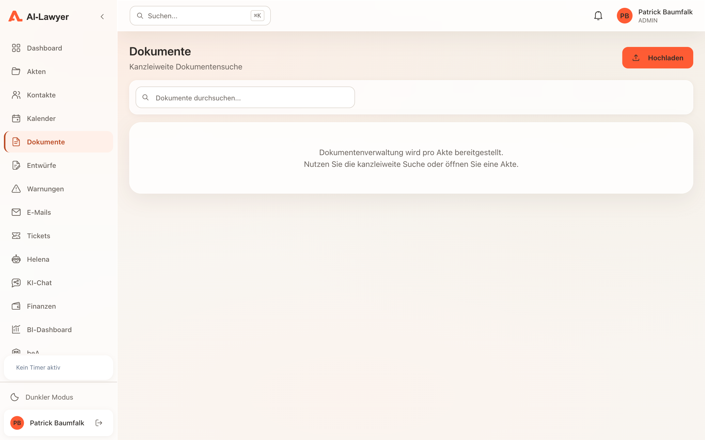
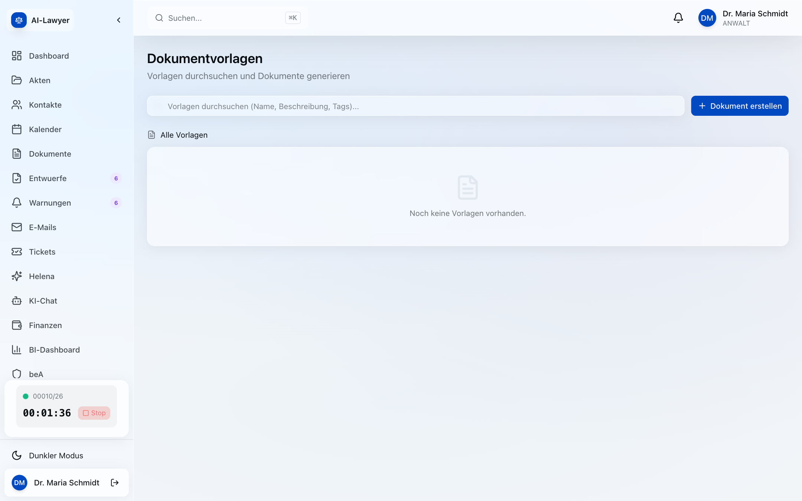

# 5 — Dokumente

Jedes Dokument in AI-Lawyer gehört zu einer Akte. Dieses Kapitel zeigt, wie Sie Dokumente hochladen, ordnen, im Browser bearbeiten, freigeben, mit PDF-Werkzeugen bearbeiten und aus Vorlagen erzeugen. Außerdem erfahren Sie, was die Texterkennung (OCR) macht und was Sie tun, wenn sie scheitert.

## Wo die Dokumente liegen

Die eigentliche Arbeit mit Dokumenten findet **in der Akte** statt: Akte öffnen, Reiter **Dokumente (…)**. Die Zahl in Klammern ist die Anzahl der Dokumente dieser Akte ([Kapitel 3](03-akten.md)).

Der Menüpunkt **Dokumente** in der Seitenleiste führt derzeit nur zu einer Platzhalterseite mit dem Hinweis *„Dokumentenverwaltung wird pro Akte bereitgestellt.“* Das Suchfeld und der Knopf **Hochladen** auf dieser Seite haben noch keine Funktion. Für die kanzleiweite Suche nutzen Sie die Suche ([Volltextsuche](#volltextsuche)).

## Die Dokumentenliste einer Akte

Links sehen Sie die Spalte **Ordner** mit **Alle Dokumente**, den vorhandenen Ordnern und gegebenenfalls **Ohne Ordner**, jeweils mit der Anzahl. Rechts steht die Liste. Über der Liste:

| Element | Wirkung |
| --- | --- |
| **Dokumente durchsuchen...** | Sucht im Dateinamen und im erkannten Text (OCR) der Dokumente dieser Akte. |
| Statusfilter | **Alle Status**, **Entwurf**, **Zur Prüfung**, **Freigegeben**, **Versendet**. |
| **Neues Dokument** | Legt ein leeres Word-Dokument („Neues Dokument.docx“) an und öffnet es sofort im Editor. |
| **Aus Vorlage** | Erzeugt ein Dokument aus einer Vorlage ([unten](#dokumente-aus-vorlagen-erstellen)). |
| **PDFs zusammenfuehren** | Erscheint nur, wenn die Akte mindestens zwei PDFs enthält ([PDF-Werkzeuge](#pdf-werkzeuge)). |
| **Hochladen** | Öffnet die Dateiauswahl. |

Aktive Filter erscheinen als kleine Schildchen unter der Leiste. Ein Klick darauf hebt den Filter auf.

Jede Zeile zeigt Name, Größe, wer das Dokument angelegt hat, Datum, OCR-Status, Ordner, bis zu zwei Schlagwörter, den Status und den Dateityp. Wenn Sie mit der Maus über eine Zeile fahren, erscheinen rechts die Knöpfe **In ONLYOFFICE bearbeiten** (nur bei Office- und Textdateien), **Vorschau**, **Herunterladen** und **Weitere Aktionen**. Ein Klick auf den Namen öffnet die [Detailseite](#die-detailseite-eines-dokuments).

## Dokumente hochladen

1. Akte öffnen, Reiter **Dokumente (…)**.
2. Auf **Hochladen** klicken und eine oder mehrere Dateien wählen. Alternativ die Dateien einfach mit der Maus auf die Liste ziehen. Es erscheint *Dateien hier ablegen – Zum Hochladen loslassen*.
3. AI-Lawyer meldet *„… Datei(en) werden hochgeladen“*. Unten rechts zeigt ein Fortschrittsfenster je Datei **Wird hochgeladen...**, **Fertig** oder **Fehler**.

Wichtig zu wissen:

- Jede Datei darf höchstens **100 MB** groß sein.
- Alle Dateitypen werden angenommen. Bearbeiten im Browser geht aber nur mit Office- und Textformaten (DOCX, DOC, ODT, RTF, TXT, HTML, XLSX, XLS, ODS, CSV, PPTX, PPT, ODP).
- Ein neues Dokument hat immer den Status **Entwurf**.
- PDFs, Bilder und Office-Dateien durchlaufen danach automatisch die Texterkennung ([OCR](#texterkennung-ocr)). Reine Textdateien werden sofort durchsuchbar.

**Wer darf hochladen?** Alle Rollen außer Mandanten, sofern sie Zugriff auf die Akte haben (zuständig als Anwalt oder Sachbearbeiter, Mitglied im Dezernat oder Admin).

## Ordner

Ordner sind einfache Beschriftungen, keine echten Verzeichnisse. Ein Dokument liegt in höchstens einem Ordner.

1. In der Zeile **Weitere Aktionen** öffnen, dann **Verschieben**.
2. Einen vorhandenen Ordner wählen oder einen der kursiv angezeigten Vorschläge (etwa **Korrespondenz**, **Schriftsätze**, **Verträge**). Der Ordner entsteht dabei automatisch.
3. **Aus Ordner entfernen** nimmt das Dokument wieder heraus.

Auf der Detailseite können Sie unter **Verschieben** auch einen beliebigen neuen Ordnernamen eintippen (**Ordnername...**).

## Weitere Aktionen

| Menüpunkt | Wirkung |
| --- | --- |
| Statuswechsel | Je nach Status, siehe [nächster Abschnitt](#status-entwurf--zur-prüfung--freigegeben--versendet). |
| **Umbenennen** | Name direkt in der Zeile ändern, mit **OK** bestätigen. |
| **Verschieben** | In einen Ordner verschieben. |
| **Als PDF exportieren** | Nur bei Office-Dateien. Erzeugt über OnlyOffice eine PDF-Kopie und legt sie in derselben Akte ab (*„PDF erstellt: …“*). |
| **Löschen** | Nach Rückfrage endgültig löschen. Nur für Admin, Anwalt und Sachbearbeiter, nicht für das Sekretariat. |

## Status: Entwurf → Zur Prüfung → Freigegeben → Versendet

Jedes Dokument durchläuft einen festen Ablauf. Er stellt sicher, dass nichts ungeprüft die Kanzlei verlässt.

| Status | Bedeutung | Nächster Schritt im Menü **Weitere Aktionen** |
| --- | --- | --- |
| **Entwurf** | In Arbeit, frei bearbeitbar. | **Zur Prüfung vorlegen** |
| **Zur Prüfung** | Wartet auf Freigabe. | **Freigeben** oder **Zurück zu Entwurf** |
| **Freigegeben** | Darf versendet werden. Schreibgeschützt. | **Freigabe widerrufen** (zurück zu *Zur Prüfung*) |
| **Versendet** | Wurde per E-Mail oder beA verschickt. Schreibgeschützt. | keine |

- **Freigeben** und **Freigabe widerrufen** dürfen Admin, Anwalt und Sachbearbeiter. Das Sekretariat kann nur zur Prüfung vorlegen. Bei freigegebenen Dokumenten zeigt das Menü *„Freigegeben von … am …“*.
- **Versendet** setzt AI-Lawyer selbst, wenn das Dokument mit einer E-Mail oder beA-Nachricht verschickt wurde. Von Hand lässt sich dieser Status in der Liste nicht setzen.
- Nur **freigegebene** Dokumente können an E-Mails und beA-Nachrichten angehängt werden. Sonst erscheint *„Nicht freigegebene Dokumente koennen nicht versendet werden“*.
- **Von Helena (KI) erstellte Dokumente** tragen zusätzlich die Schildchen **KI** und, solange sie nicht freigegeben sind, **nicht freigegeben**. Sie bleiben technisch im Entwurf, bis ein Mensch sie freigibt. Ein KI-Entwurf ist ein Vorschlag: Lesen und prüfen Sie ihn vollständig, bevor Sie ihn freigeben ([Kapitel 9](09-helena.md)).

**Abweichung im Editor:** In der Statusleiste des OnlyOffice-Editors heißen die Schritte etwas anders (**Zur Pruefung senden**, **Zurueck zum Entwurf**). Dort dürfen nur Anwalt und Admin freigeben und die Freigabe zurücknehmen, und es gibt zusätzlich **Als versendet markieren**. Verwenden Sie diesen Knopf nur, wenn das Dokument tatsächlich auf anderem Weg verschickt wurde.

## Die Detailseite eines Dokuments

Ein Klick auf den Dokumentnamen öffnet die Detailseite. Links steht die Vorschau, rechts die Seitenleiste mit:

- **Metadaten:** **Dateityp**, **Groesse**, **Hochgeladen am**, **Hochgeladen von**, Akte, **Ordner**, **OCR Status**, **AI-indexiert**, **Versionen**, gegebenenfalls **Freigegeben von**.
- **Tags:** Schlagwörter ([unten](#schlagwörter-tags)).
- **Aktionen:** Statuswechsel, **Umbenennen**, **Verschieben**, **Herunterladen**, **PDF-Tools** (nur bei PDFs), **In OnlyOffice oeffnen** (nur bei bearbeitbaren Dateien), **Erneut OCR starten** (nur nach fehlgeschlagener OCR) und **Loeschen**.
- **Versionsverlauf** und **Historie** (wer wann was am Dokument getan hat).

**Zurueck zur Akte** führt zur Dokumentenliste zurück.

### Vorschau

PDFs werden direkt angezeigt. Für Word-, Excel- und andere Office-Dateien erzeugt AI-Lawyer eine PDF-Vorschau. Solange sie entsteht, steht dort *Vorschau wird generiert...*. Klappt es nicht, erscheint *Vorschau konnte nicht generiert werden.* mit **Erneut versuchen**. Für Dateitypen ohne Vorschau (etwa ZIP) bleibt nur **Herunterladen**.

Die schnelle Vorschau aus der Liste (Augen-Symbol) zeigt Bilder und PDFs im Fenster und bietet **Bearbeiten**, **Öffnen** und **Download**.

## Bearbeiten im Browser mit OnlyOffice

Office- und Textdokumente bearbeiten Sie direkt im Browser, ohne Word zu installieren.

1. In der Liste auf das Stift-Symbol **In ONLYOFFICE bearbeiten** klicken oder auf der Detailseite **In OnlyOffice bearbeiten** wählen.
2. Der Editor öffnet sich (*Editor wird geladen...*). Schreiben Sie wie in Word.
3. Es gibt keinen Speichern-Knopf. OnlyOffice speichert laufend automatisch. Wenn alle Bearbeitenden den Editor schließen, legt AI-Lawyer eine neue Version an.

Gut zu wissen:

- **Mehrere Personen** können gleichzeitig im selben Dokument arbeiten.
- **Änderungen nachverfolgen** ist im Editor verfügbar und standardmäßig sichtbar.
- Oben rechts zeigt der Editor **Verbunden** oder **Offline**. Bei *Offline* werden Änderungen gespeichert, sobald die Verbindung wieder steht.
- **PDF** (Titel *Als PDF exportieren*) lädt den aktuellen Stand als PDF herunter.
- **Freigegebene und versendete Dokumente** öffnen sich nur zum Lesen. Der Editor zeigt dann **Schreibgeschuetzt** mit dem Grund. Wer ändern will, muss zuerst die Freigabe widerrufen.

## Versionen

Eine neue Version entsteht, wenn eine Bearbeitungssitzung in OnlyOffice endet. Im Editor öffnet **Versionen** die Liste. Dort können Sie einem Zwischenstand mit **Snapshot-Name...** einen Namen geben und als eigene Version sichern.

Auf der Detailseite zeigt **Versionsverlauf** alle Versionen, die neueste mit **Aktuell** markiert. **Wiederherstellen** holt einen älteren Stand zurück. Der bisherige Stand wird dabei vorher als eigene Version gesichert, es geht also nichts verloren.

Freigegebene oder versendete Dokumente lassen sich nicht zurücksetzen. Die Meldung lautet dann *„Dokument ist schreibgeschuetzt. Status muss zurueckgesetzt werden bevor eine Version wiederhergestellt werden kann.“*

## Texterkennung (OCR)

Damit auch eingescannte Schreiben durchsuchbar sind und Helena sie lesen kann, schickt AI-Lawyer jede hochgeladene PDF-, Bild- und Office-Datei an den Dienst **Stirling-PDF**. Er erkennt deutschen und englischen Text. Bereits durchsuchbare PDFs werden dabei nicht noch einmal erkannt. Bei PDFs wird die Originaldatei durch die durchsuchbare Fassung ersetzt.

Den Stand sehen Sie in der Liste und auf der Detailseite:

| Anzeige | Bedeutung |
| --- | --- |
| **OCR ausstehend** | Wartet in der Warteschlange. |
| **OCR laeuft...** | Wird gerade verarbeitet. Es wird immer nur ein Dokument gleichzeitig erkannt, bei vielen Uploads dauert es also. |
| **OCR abgeschlossen** | Text erkannt und durchsuchbar. |
| **OCR fehlgeschlagen** | Nach drei Versuchen gescheitert. Admins erhalten zusätzlich eine Benachrichtigung *OCR fehlgeschlagen*. |
| keine Anzeige | Texterkennung war nicht nötig (z. B. Textdatei). |

### Wenn die Texterkennung scheitert

Auf der Detailseite erscheint dann der Kasten **Texterkennung fehlgeschlagen**, meist mit dem Fehlergrund. Sie haben drei Wege, in dieser Reihenfolge:

1. **OCR erneut starten.** Hilft, wenn Stirling-PDF nur kurz nicht erreichbar war. Gleiches bewirkt das kleine Kreissymbol neben **OCR fehlgeschlagen** in der Liste oder **Erneut OCR starten** unter **Aktionen**.
2. **Vision-Analyse** (nur bei Bildern wie JPG oder PNG). Das Bild wird an das eingestellte KI-Modell geschickt, das den Text abliest. Das klappt nur mit einem Modell, das Bilder versteht. Sonst lautet die Meldung *„Das konfigurierte KI-Modell unterstuetzt keine Bilderkennung. Bitte OpenAI oder Anthropic als Provider konfigurieren.“* Bedenken Sie: Bei einem Cloud-Anbieter verlässt das Bild Ihre Kanzlei ([Kapitel 18](18-datenschutz-und-audit.md)). Für PDFs gibt es diesen Weg nicht.
3. **Text manuell eingeben.** Fügen Sie den Text in das Feld **Dokumenttext hier einfuegen...** ein und klicken Sie **Speichern**. Danach ist das Dokument wie nach einer erfolgreichen OCR durchsuchbar.

## PDF-Werkzeuge

Alle PDF-Werkzeuge arbeiten über Stirling-PDF. Ist der Dienst nicht erreichbar, schlagen sie fehl.

### PDFs zusammenführen

1. In der Dokumentenliste **PDFs zusammenfuehren** wählen.
2. Das Fenster listet alle PDFs der Akte. Nicht benötigte PDFs mit dem x entfernen, die Reihenfolge mit der Maus ändern (**Reihenfolge (per Drag & Drop aenderbar)**). Es müssen mindestens zwei übrig bleiben.
3. Unter **Dateiname** den Namen prüfen (Vorschlag: *Zusammengefuehrt_<Datum>.pdf*) und **Zusammenfuehren** klicken.

Das Ergebnis ist ein neues Dokument in derselben Akte (*„PDFs zusammengefuehrt: …“*).

### Teilen, Drehen, Komprimieren, Wasserzeichen, Schwärzen

Auf der Detailseite eines PDFs **PDF-Tools** öffnen. Das Fenster **PDF-Tools: <Name>** hat fünf Reiter:

| Reiter | Einstellungen |
| --- | --- |
| **Aufteilen** | Unter **Seitenanzahl** die Gesamtzahl der Seiten eintragen, dann Seiten anklicken (**Seiten auswaehlen (klicken)**) oder **Oder Seitenbereich eingeben**, z. B. `1-3,5,7-9`. |
| **Drehen** | **Drehwinkel** 90, 180 oder 270 Grad. |
| **Komprimieren** | **Komprimierungsstufe** von **Niedrig (1)** bis **Maximal (5)**. |
| **Wasserzeichen** | **Schnellvorlagen** ENTWURF, VERTRAULICH, KOPIE oder **Eigener Text**; dazu Schriftgröße, Drehung und Deckkraft. |
| **Schwaerzen** | **DSGVO-Muster anwenden** (IBAN, Telefonnummer, E-Mail-Adresse, Steuernummer, Sozialversicherungsnummer, Geburtsdatum) und/oder **Zusaetzliche Suchbegriffe**, durch Komma getrennt. |

Unter jedem Reiter steht **Als neue Datei speichern** (voreingestellt). Dann bleibt das Original unverändert und das Ergebnis erscheint als neues Dokument mit Zusatz im Namen, etwa `Klage_gedreht.pdf` oder `Klage_geschwaerzt.pdf`. Ohne Haken wird das Original überschrieben, ohne neue Version.

**Vorsicht beim Schwärzen.** Das Fenster warnt: *„Geschwaerzte Bereiche koennen nicht wiederhergestellt werden.“* Lassen Sie deshalb **Als neue Datei speichern** angehakt und prüfen Sie das Ergebnis Seite für Seite, bevor Sie es weitergeben. Zwei Besonderheiten:

- Die Erkennung arbeitet mit Textmustern. Was die OCR nicht als Text erkannt hat (Handschrift, Stempel, schlechte Scans), wird nicht geschwärzt.
- Ist **DSGVO-Muster anwenden** angehakt, wendet AI-Lawyer nach aktuellem Stand **alle** DSGVO-Muster an, auch wenn Sie einzelne abgewählt haben, und die zusätzlichen Suchbegriffe bleiben unberücksichtigt. Wollen Sie nur eigene Begriffe schwärzen, nehmen Sie den Haken bei **DSGVO-Muster anwenden** heraus.

Auch beim **Aufteilen** sollten Sie das Ergebnis öffnen und kontrollieren, ob es die erwarteten Seiten enthält.

## Schlagwörter (Tags)

Auf der Detailseite unter **Tags** fügen Sie mit **Tag hinzufuegen** Schlagwörter hinzu. Beim Tippen schlägt AI-Lawyer die kanzleiweit angelegten Schlagwort-Kategorien mit ihren Farben vor. Ein Klick auf das kleine x am Schlagwort entfernt es. Schlagwörter werden bei der Volltextsuche mit durchsucht und lassen sich dort als Filter nutzen.

Die Liste der Kategorien pflegen Rollen mit Zugang zu den Einstellungen (Administrator, Anwalt/Anwältin, Sachbearbeiter/in) unter `/einstellungen/dokument-tags` ([Kapitel 16](16-einstellungen-und-vorlagen.md)); Kategorien löschen dürfen nur Rollen mit Löschrecht. Dieselben Kategorien stehen auf der Seite **Suche** als Schlagwort-Filter zur Auswahl. Anhänge, die aus einer E-Mail in die Akte übernommen werden, erhalten automatisch das Schlagwort **E-Mail-Anhang**.

## Dokumente aus Vorlagen erstellen

Vorlagen sind Word-Dateien (DOCX) mit Platzhaltern in doppelten geschweiften Klammern, z. B. `{{mandant.name}}`. Beim Erstellen setzt AI-Lawyer die Daten der Akte ein. Vorlagen selbst verwaltet der Admin ([Kapitel 16](16-einstellungen-und-vorlagen.md)).

### Aus der Akte heraus

1. In der Dokumentenliste **Aus Vorlage** klicken.
2. Im Fenster **Vorlage auswählen** eine Vorlage suchen (**Vorlage suchen...**) und anklicken. Unten sehen Sie die **Platzhalter in dieser Vorlage**.
3. Im Schritt **Dokument erstellen** **Dateiname**, **Ordner** und **Tags (kommagetrennt)** festlegen.
4. **Nur erstellen** legt das Dokument ab. **Erstellen & bearbeiten** öffnet es zusätzlich gleich im Editor.

Auf diesem Weg wird automatisch der als **Standard** markierte Briefkopf eingefügt, sofern einer hinterlegt ist.

### Über die Seite Vorlagen

Die Seite **Dokumentvorlagen** (`/vorlagen`) zeigt **Favoriten**, **Zuletzt verwendet** und **Alle Vorlagen**. **Dokument erstellen** startet einen Assistenten in vier Schritten: **Vorlage**, **Akte / Mandant**, **Felder** (zusätzliche Eingabefelder der Vorlage, falls vorhanden), **Vorschau**. Im letzten Schritt wählen Sie **Dateiname**, gegebenenfalls einen **Briefkopf** (oder **Kein Briefkopf**) und ob das Dokument mit **In OnlyOffice oeffnen** gleich geöffnet werden soll.

### Verfügbare Platzhalter

| Gruppe | Beispiele |
| --- | --- |
| Akte | `{{akte.aktenzeichen}}`, `{{akte.kurzrubrum}}`, `{{akte.wegen}}`, `{{akte.sachgebiet}}`, `{{akte.gegenstandswert}}` |
| Mandant | `{{mandant.anrede}}`, `{{mandant.name}}`, `{{mandant.anschrift}}`, `{{mandant.email}}` u. a. |
| Gegner | wie Mandant, mit `gegner.` |
| Gegnervertreter | `{{gegnervertreter.name}}`, `{{gegnervertreter.firma}}`, `{{gegnervertreter.anschrift}}` |
| Gericht | `{{gericht.name}}`, `{{gericht.anschrift}}` |
| Anwalt | `{{anwalt.name}}`, `{{anwalt.email}}`, `{{anwalt.telefon}}` |
| Kanzlei | `{{kanzlei.name}}`, `{{kanzlei.anschrift}}`, `{{kanzlei.iban}}`, `{{kanzlei.ustIdNr}}` u. a. |
| Datum | `{{datum.heute}}`, `{{datum.jahr}}` |

Fehlt ein Wert in der Akte (etwa kein Gegner erfasst), bleibt die Stelle leer. Lesen Sie erzeugte Dokumente deshalb vor dem Versand gegen. Das erzeugte Dokument ist immer ein Entwurf.

## Für das Mandantenportal freigeben

Mandanten sehen im Portal nur Dokumente, die Sie ausdrücklich sichtbar geschaltet haben ([Kapitel 12](12-mandantenportal.md)).

1. In der Dokumentenliste auf das Augen-Symbol der Zeile klicken. Durchgestrichen heißt *Fuer Mandant unsichtbar*, grün heißt *Fuer Mandant sichtbar*.
2. AI-Lawyer bestätigt mit *„Dokument fuer Mandant sichtbar“* bzw. *„Dokument fuer Mandant verborgen“*.

Das Symbol sehen nur Admin, Anwalt und Sachbearbeiter. Beim Sichtbarschalten erscheint im Portal-Verlauf der Eintrag *Dokument „…“ fuer Mandant freigegeben*; das Verbergen wird dem Mandanten nicht angezeigt.

Die Portal-Sichtbarkeit ist unabhängig vom Freigabe-Status. Auch ein Entwurf wird sichtbar, wenn Sie das Auge einschalten. Prüfen Sie also vorher, was Sie teilen.

## Volltextsuche

Jedes Dokument wird mit Name, erkanntem Text, Schlagwörtern, Ordner, Aktenzeichen und Kurzrubrum in die Suchmaschine aufgenommen. So finden Sie es:

- **In der Akte:** Feld **Dokumente durchsuchen...** über der Liste.
- **Kanzleiweit:** **Strg + K** (Mac: **⌘ + K**) öffnet die Befehlspalette. Sie zeigt beim Tippen auch passende Dokumente.
- **Ausführlich:** die Seite **Suche** mit Filtern nach Akte, Dateityp, OCR-Status, Dokumentstatus, Benutzer und Schlagwort ([Kapitel 13](13-suche-und-auswertung.md)).

Sie finden nur Dokumente aus Akten, auf die Sie Zugriff haben. Ein frisch hochgeladener Scan ist erst nach abgeschlossener OCR mit seinem Inhalt auffindbar.

## Wenn etwas nicht klappt

| Meldung | Bedeutung | Was tun |
| --- | --- | --- |
| *Datei „…“ ueberschreitet das Limit von 100 MB* | Datei zu groß. | Datei verkleinern (z. B. mit **Komprimieren**) oder aufteilen. |
| *Dokumente konnten nicht geladen werden* | Verbindung oder Server gestört. | Seite neu laden; bleibt es, die IT informieren. |
| *Statusaenderung von '…' zu '…' ist nicht erlaubt.* | Schritt passt nicht zum aktuellen Status. | Ablauf einhalten, siehe [Status](#status-entwurf--zur-prüfung--freigegeben--versendet). |
| *Nur Anwalt oder Admin kann den Uebergang … durchfuehren* | Freigabe im Editor ist Anwalt und Admin vorbehalten. | Anwältin oder Anwalt freigeben lassen. |
| *Nicht freigegebene Dokumente koennen nicht versendet werden* | Anhang ist nicht freigegeben. | Dokument erst freigeben lassen. |
| **Schreibgeschuetzt** im Editor | Dokument ist freigegeben oder versendet. | Bei Bedarf **Freigabe widerrufen**, dann bearbeiten. |
| **OCR fehlgeschlagen** | Stirling-PDF konnte den Text nicht erkennen. | Wege unter [Wenn die Texterkennung scheitert](#wenn-die-texterkennung-scheitert). |
| *PDF-Operation '…' fehlgeschlagen: …* | Stirling-PDF nicht erreichbar oder Datei beschädigt. | Später erneut versuchen; IT prüft den Dienst ([Kapitel 21](21-betrieb-und-sicherung.md)). |
| *Nur PDF-Dokumente koennen bearbeitet werden* | PDF-Werkzeug auf Nicht-PDF angewendet. | Erst **Als PDF exportieren**. |
| *Vorlagen konnten nicht geladen werden* | Keine Verbindung zur Vorlagenverwaltung. | Seite neu laden; Admin fragen, ob Vorlagen angelegt sind. |

---

Weiter: [6 — Fristen und Kalender](06-fristen-und-kalender.md) · [Zur Übersicht](README.md)
