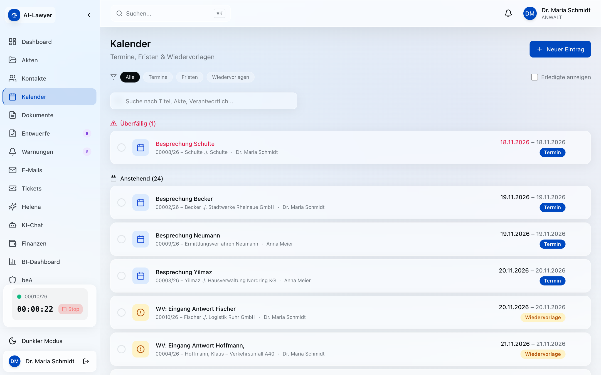

# 6 — Fristen und Kalender

Termine, Fristen und Wiedervorlagen verwalten Sie in einem gemeinsamen Kalender. Dieses Kapitel erklärt die Kalenderliste, das Anlegen von Einträgen, den Fristenrechner, Erinnerungen, Vertretung und den Abgleich mit Google- oder Apple-Kalendern. Es sagt auch deutlich, welche Fristfunktionen es in der Oberfläche noch nicht gibt.

> **Fristen immer selbst prüfen.** Der Fristenrechner ist eine Rechenhilfe, keine Fristenkontrolle im Rechtssinn. Er kennt weder Ihren konkreten Zustellungsvorgang noch richterliche Fristsetzungen, abweichende Fristbeginne oder Sonderregeln einzelner Verfahrensordnungen. Jede berechnete Frist muss eine Anwältin oder ein Anwalt anhand der Akte und des Gesetzes prüfen, bevor sie eingetragen wird. Die Verantwortung für die Fristwahrung bleibt in der Kanzlei.

## Wo Sie Termine und Fristen sehen

| Ort | Was dort steht |
| --- | --- |
| **Kalender** in der Seitenleiste | Alle Einträge, auf die Sie Zugriff haben, als Liste. |
| Akte, Reiter **Termine & Fristen (…)** | Nur die Einträge dieser Akte. |
| **Dashboard**, Kasten **Tagesuebersicht** | Überfällige und heutige Fristen, Wiedervorlagen und Termine, mit Knopf **Fristenzettel**. |
| Fristenrechner | Über **Strg + K** (Mac: **⌘ + K**), dann **Frist berechnen**, oder direkt mit **Strg + Umschalt + F** (Mac: **⌘ + Umschalt + F**). |

**Sichtbarkeit:** Sie sehen Einträge zu Akten, auf die Sie Zugriff haben, sowie alle Einträge ohne Akte. Einträge ohne Aktenbezug sind also für alle Benutzer sichtbar. Tragen Sie private Termine deshalb nicht ohne Akte ein, wenn andere sie nicht sehen sollen.

## Die Kalenderseite

Die Seite **Kalender** (*Termine, Fristen & Wiedervorlagen*) ist eine Liste, keine Monatsansicht. Sie ist in Gruppen geteilt:

- **Überfällig (…)**: offene Einträge, deren Tag vollständig vorbei ist, rot markiert (eine Frist, die heute abläuft, ist noch nicht überfällig, siehe [Fristen erledigen](#fristen-erledigen)),
- **Anstehend (…)**: offene Einträge ab heute,
- **Erledigt (…)**: nur sichtbar, wenn **Erledigte anzeigen** angehakt ist.

Oben filtern Sie nach Typ (**Alle**, **Termine**, **Fristen**, **Wiedervorlagen**) und suchen im Feld **Suche nach Titel, Akte, Verantwortlich...**. Ein Klick auf einen Eintrag öffnet ihn zum Bearbeiten. Das Drei-Punkte-Menü bietet **Bearbeiten**, **Als erledigt markieren** bzw. **Wieder öffnen** und **Löschen**.

Termine aus einem verbundenen externen Kalender erscheinen nur in der Ansicht **Alle**, gekennzeichnet als **Extern** und mit dem Namen des Kalenders statt eines Verantwortlichen. Sie sind nur lesbar: Erledigen, Bearbeiten und Löschen gibt es für sie nicht. Im Reiter der Akte, in den Typ-Filtern und unter **Erledigt** tauchen sie nicht auf.

## Eintragstypen

| Typ | Wofür | Anzeige |
| --- | --- | --- |
| **Termin** | Gerichtstermin, Besprechung. Mit **Beginn** und optional **Ende**. | blau |
| **Frist** | Ablauf einer gesetzlichen oder gerichtlichen Frist, mit **Fristablauf** und **Vorfrist**. | rot |
| **Wiedervorlage** | Wann eine Akte wieder angeschaut werden soll. | gelb |
| Fokuszeit | Entsteht nur, wenn Sie im Shop das Fokus-Siegel einlösen: ein 30-Minuten-Block ([Kapitel 14](14-gamification.md)). Lässt sich nicht von Hand anlegen und erscheint in der Liste als **Termin**. | blau |
| Externe Termine | Termine aus einem verbundenen Google- oder Apple-Kalender ([CalDAV](#abgleich-mit-google--und-apple-kalender-caldav)). | |

## Einen Eintrag anlegen

1. Auf **Neuer Eintrag** klicken (Kalenderseite oder Reiter **Termine & Fristen** der Akte).
2. Im Fenster **Neuer Kalendereintrag** die Felder ausfüllen (Tabelle unten).
3. **Erstellen** klicken. AI-Lawyer meldet *„Kalendereintrag erstellt“*.

| Feld | Hinweis |
| --- | --- |
| **Typ** | Termin, Frist oder Wiedervorlage. |
| **Titel** | Pflicht, z. B. „Berufungsbegründung“. |
| **Beschreibung** | Optional. |
| **Ganztaegig** | Ohne Uhrzeit. |
| **Beginn** / **Datum** | Pflicht. Bei Terminen heißt das Feld *Beginn*. |
| **Ende** | Nur bei Terminen. |
| **Fristablauf** | Nur bei Fristen. Der Tag, an dem die Frist endet. Erinnerungen richten sich nach diesem Datum, ersatzweise nach **Datum**. |
| **Vorfrist** | Nur bei Fristen. Ein Erinnerungstag vor dem Fristablauf. |
| **Akte (optional)** | Suche nach Aktenzeichen oder Kurzrubrum. |
| **Verantwortlich** | Pflicht. Wer die Erinnerungen bekommt. |

Weitere Merkmale, die AI-Lawyer intern kennt (Priorität, Notfrist, Bundesland, Fristart, mehrere Vorfristen, Halbfrist, Sonderfall), lassen sich in diesem Fenster **nicht** von Hand eingeben. Sie werden gesetzt, wenn Sie eine Frist aus dem Fristenrechner mit **Als Frist speichern** anlegen ([Das Ergebnis lesen](#das-ergebnis-lesen)) oder wenn Einträge aus j-lawyer übernommen werden ([Kapitel 17](17-migration-aus-j-lawyer.md)).

## Der Fristenrechner

Der Fristenrechner rechnet Fristen nach §§ 187 bis 193 BGB, berücksichtigt Wochenenden und die Feiertage des gewählten Bundeslandes und schlägt Vorfristen und eine Halbfrist vor.

1. **Strg + Umschalt + F** (Mac: **⌘ + Umschalt + F**) drücken, oder **Strg + K** (Mac: **⌘ + K**) und **Frist berechnen** wählen. Rechts öffnet sich **Fristenrechner**.
2. Unter **Berechnungsrichtung** **Vorwaerts** (*Zustellung → Fristende*) oder **Rueckwaerts** (*Fristende → Zustellung*) wählen.
3. Optional eine **Frist-Vorlage (optional)** wählen. Sie füllt Dauer und Notfrist aus.
4. **Zustellungsdatum** (bzw. **Fristende** bei rückwärts) eintragen.
5. **Fristtyp** wählen: **Ereignisfrist** oder **Beginnfrist**.
6. Die **Fristdauer** in **Monate**, **Wochen** und/oder **Tage** eintragen.
7. **Bundesland** prüfen (voreingestellt: Nordrhein-Westfalen).
8. Gegebenenfalls **Sonderfaelle** wählen.
9. **Frist berechnen** klicken.

| Feld | Bedeutung |
| --- | --- |
| **Ereignisfrist** | Der Tag des Ereignisses (z. B. Zustellung) zählt nicht mit (§ 187 Abs. 1 BGB). Der Regelfall bei Rechtsmittelfristen. |
| **Beginnfrist** | Der erste Tag zählt mit (§ 187 Abs. 2 BGB). |
| **Section 193 ZPO** | Angehakt (Standard): Fällt das Ende auf einen Samstag, Sonntag oder Feiertag, verschiebt es sich auf den nächsten Werktag. Gemeint ist § 193 BGB bzw. § 222 Abs. 2 ZPO. |
| **Notfrist** | Kennzeichnet die Frist als Notfrist. Es erscheint der Hinweis *Diese Frist ist nicht verlaengerbar.* |
| **Sonderfaelle** | **Normale Zustellung**, **Oeffentliche Zustellung (Section 188 ZPO)**: Fristbeginn einen Monat nach dem Aushang, als Datum tragen Sie den Aushangtag ein. **Auslandszustellung (EU-ZustVO)**: rechnet pauschal 14 Tage Zustellungsdauer hinzu. Dieser Wert ist eine Annahme des Programms, keine gesetzliche Regel. Prüfen Sie das tatsächliche Zustellungsdatum. |

Weicht Ihre Dauer von der gewählten Vorlage ab, warnt der Rechner: *„Die uebliche Dauer fuer … ist …. Sie haben … eingetragen.“*

### Mitgelieferte Frist-Vorlagen

| Bereich | Vorlage | Dauer |
| --- | --- | --- |
| Zivilprozess | Berufungsfrist (§ 517 ZPO, Notfrist) | 1 Monat |
| | Berufungsbegruendungsfrist (§ 520 Abs. 2 ZPO) | 2 Monate |
| | Revisionsfrist (§ 548 ZPO, Notfrist) | 1 Monat |
| | Revisionsbegruendungsfrist (§ 551 Abs. 2 ZPO) | 2 Monate |
| | Einspruchsfrist (Versaeumnisurteil) (§ 339 Abs. 1 ZPO, Notfrist) | 2 Wochen |
| | Klageerwiderungsfrist (§ 276 Abs. 1 ZPO) | 2 Wochen |
| | Klagefrist (§ 586 Abs. 1 ZPO, Notfrist) | 1 Monat |
| | Beschwerdeschrift (§ 569 Abs. 1 ZPO, Notfrist) | 2 Wochen |
| | Rechtsbeschwerdeschrift (§ 575 Abs. 1 ZPO, Notfrist) | 1 Monat |
| Verwaltungsrecht | Widerspruchsfrist (§ 70 Abs. 1 VwGO) | 1 Monat |
| | Klagefrist (Verwaltungsrecht) (§ 74 Abs. 1 VwGO) | 1 Monat |
| | Antrag auf Zulassung der Berufung (§ 124a Abs. 4 VwGO) | 1 Monat |
| Strafrecht | Berufungsfrist (Strafrecht) (§ 314 StPO) | 1 Woche |
| | Revisionsfrist (Strafrecht) (§ 341 StPO) | 1 Woche |
| Arbeitsrecht | Kuendigungsschutzklage (§ 4 KSchG) | 3 Wochen |
| Allgemein | Widerspruchsfrist (§ 355 BGB) | 2 Wochen |

Die Vorlagen sind Vorschläge. Gesetzliche Fristen können sich ändern, und im Einzelfall gelten oft andere Fristen (richterliche Fristsetzung, Verlängerung, abweichender Fristbeginn). Prüfen Sie die Vorlage jedes Mal gegen die Norm.

### Das Ergebnis lesen

Der Bereich **Ergebnis** zeigt:

- **Fristbeginn** und **Fristende**, dazu eine Ampel (grün: mehr als 7 Tage, gelb: bis 7 Tage, rot: weniger als 3 Tage).
- **Rechnerisches Ende**, falls das Fristende wegen Wochenende oder Feiertag verschoben wurde, und darunter **Verschoben wegen:** mit dem Grund (z. B. *Samstag* oder den Namen des Feiertags).
- **Vorfristen**: standardmäßig 7, 3 und 1 Kalendertag vor Fristende. Fällt eine Vorfrist auf ein Wochenende oder einen Feiertag, rückt sie auf den **vorherigen** Werktag.
- **Halbfrist**: die Mitte zwischen Beginn und Ende, nur bei Fristen über zwei Wochen, ebenfalls auf den vorherigen Werktag gezogen.
- **Sonderfall angewendet**, wenn Sie einen Sonderfall gewählt haben.
- Bei rückwärts: **Spaetester Zustellungstermin**.

**Historie** zeigt Ihre letzten zehn Berechnungen. Sie liegen nur in Ihrem Browser.

**Ergebnis als Frist eintragen:** Das Ergebnis wird nicht automatisch eingetragen. Klicken Sie auf **Als Frist speichern**. Der Fristenrechner schließt sich, und das Fenster **Neuer Kalendereintrag** öffnet sich vorbelegt: Typ **Frist**, als Titel der Name der gewählten Frist-Vorlage (sonst „Frist“), **Datum** und **Fristablauf** auf dem berechneten Fristende, in der **Beschreibung** Fristbeginn, Bundesland und gegebenenfalls Sonderfall. Im Hintergrund übernimmt AI-Lawyer außerdem Notfrist, Fristart, Bundesland, Sonderfall, alle Vorfristen und die Halbfrist. Ergänzen Sie **Akte (optional)** und **Verantwortlich**, prüfen Sie das Datum gegen das Ergebnis und klicken Sie auf **Erstellen**.

Das funktioniert nur bei einer **Vorwärts**-Berechnung. Bei **Rückwärts** passiert beim Klick nichts; legen Sie die Frist dann über **Neuer Eintrag** an.

## Erinnerungen, Vorfrist und Halbfrist

Jeden Morgen um 6:00 Uhr prüft AI-Lawyer alle offenen Fristen und verschickt Erinnerungen:

- **Vorfrist-Erinnerung** an den Verantwortlichen, z. B. *„Frist in 3 Tage: …“* mit Aktenzeichen und dem Text *Fristablauf am … (noch … Tage)*.
- **Halbfrist-Erinnerung**, wenn bei der Frist eine Halbfrist hinterlegt ist.
- **Überfällige Fristen** lösen eine Eskalation aus: *„UEBERFAELLIG: …“* an den Verantwortlichen, gegebenenfalls an den Vertreter und an alle Admins.

Erinnerungen erscheinen als Benachrichtigung in AI-Lawyer und, wenn die IT den E-Mail-Versand eingerichtet hat, zusätzlich per E-Mail ([Kapitel 20](20-konfiguration.md)). Fällt der Erinnerungstag auf ein Wochenende oder einen Feiertag, kommt die Erinnerung am Werktag davor. Erinnerungen, die wegen einer Serverpause ausgefallen sind, werden nachgeholt. Doppelte Erinnerungen am selben Tag werden unterdrückt.

## Notfrist, Priorität und Quittierung

- **Notfrist:** AI-Lawyer kann eine Frist als Notfrist führen. Notfristen lassen sich technisch nicht verlängern. Im Fenster **Neuer Kalendereintrag** gibt es dafür kein eigenes Feld; die Kennzeichnung entsteht, wenn Sie die Frist aus dem Fristenrechner mit **Als Frist speichern** anlegen.
- **Priorität:** Fünf Stufen von *sehr niedrig* bis *dringend* sind vorgesehen. Eine Eingabe in der Oberfläche fehlt noch, neue Einträge haben immer *normal*.
- **Quittierung:** Ein Feld dafür gibt es in der Datenbank. Eine Möglichkeit, eine Frist in der Oberfläche zu quittieren, gibt es nicht.

## Fristen erledigen

Für Fristen verlangt AI-Lawyer einen **Erledigungsgrund**, für überfällige Fristen zusätzlich einen **Überschreitungsgrund**. Beide werden mit Ihrem Namen und der Uhrzeit protokolliert. Sie erledigen Fristen an drei Stellen: in der **Tagesuebersicht** auf dem Dashboard (Haken-Symbol **Erledigen**), in der Kalenderliste (Kästchen links oder **Als erledigt markieren**) und im Reiter **Termine & Fristen** der Akte.

1. Bei der Frist auf **Erledigen** bzw. das Kästchen klicken. Es öffnet sich das Fenster **Erledigen: …** mit dem Fälligkeitsdatum.
2. Den **Erledigungsgrund** eintragen, z. B. „Schriftsatz per beA eingereicht“.
3. Ist die Frist bereits abgelaufen, steht dort *Fristablauf war am …*, und es erscheint zusätzlich das Feld **Diese Frist ist abgelaufen. Grund der Überschreitung**. Tragen Sie ein, warum die Frist erst jetzt abgehakt wird, z. B. „rechtzeitig erledigt, Eintrag nur verspätet abgehakt“.
4. **Erledigen** klicken. Der Knopf ist erst anklickbar, wenn alle verlangten Gründe ausgefüllt sind; ein Grund nur aus Leerzeichen zählt nicht. Meldung: *„Als erledigt markiert“*.

**Wann ist eine Frist überfällig?** Erst wenn ihr letzter Tag vollständig abgelaufen ist (§ 188 Abs. 1 BGB), gerechnet nach deutscher Zeit (Europe/Berlin). Eine Frist, die heute abläuft, erledigen Sie also noch ohne Überschreitungsgrund; ab morgen verlangt AI-Lawyer ihn.

Termine und Wiedervorlagen haken Sie ohne Rückfrage ab: in der Kalenderliste das Kästchen links oder **Als erledigt markieren**.

Die Tagesübersicht zeigt nur überfällige und heutige Einträge. Eine Frist in der Zukunft erledigen Sie über die Kalenderliste oder den Reiter der Akte.

## Verlängerung und Frist-Historie

AI-Lawyer kann eine Frist verlängern und dabei das alte Ende in einer Historie aufbewahren. Notfristen und erledigte Fristen sind ausgenommen. Diese Funktion ist bisher nur als Schnittstelle vorhanden, es gibt keinen Knopf dafür. Bis dahin: alte Frist mit Grund erledigen (z. B. „Frist verlängert bis …, Beschluss vom …“) und eine neue Frist anlegen.

## Fristenzettel

Der Fristenzettel ist ein PDF zum Ausdrucken. Sie erzeugen ihn mit **Fristenzettel** in der Tagesübersicht oder mit **Fristenzettel drucken** im Fristenrechner. Er öffnet sich in einem neuen Tab und enthält alle offenen Fristen der nächsten sieben Tage sowie alle überfälligen Fristen.

Der Fristenzettel enthält die Fristen aller Akten, auf die Sie Zugriff haben, sowie Fristen ohne Aktenbezug.

## Vertretung und Urlaub

Ist eine verantwortliche Person abwesend, leitet AI-Lawyer ihre Fristerinnerungen an den Vertreter weiter. Der Vertreter erhält sie mit dem Zusatz *„[Vertretung fuer …]“*, die abwesende Person mit *„(delegiert an Vertreter)“*.

Einrichten darf das nur der Admin unter **Einstellungen → Vertretung & Urlaub** ([Kapitel 16](16-einstellungen-und-vorlagen.md)):

- **Vertretungszuweisungen**: für jeden Benutzer einen Vertreter festlegen (**Bearbeiten**).
- **Urlaubsverwaltung**: Benutzer wählen, Zeitraum und **Vertreter** eintragen, dann **Aktivieren** oder **Nur speichern**.
- **Aktive Vertretungen** zeigt, wer gerade **Abwesend** ist. **Deaktivieren** beendet die Vertretung. Abgelaufene Vertretungen schaltet AI-Lawyer morgens selbst ab.

## Serientermine

Wiederkehrende Termine sind in der Datenbank vorbereitet, aber noch nicht umgesetzt. Legen Sie Serien vorerst als einzelne Einträge an.

## Abgleich mit Google- und Apple-Kalender (CalDAV)

Sie können Ihren persönlichen Google- oder Apple-iCloud-Kalender verbinden.

1. **Einstellungen** öffnen, Reiter **Kalender**.
2. **Kalender verbinden** klicken und **Google Calendar** oder **Apple iCloud** wählen.
3. **Name** vergeben und die Zugangsdaten eintragen: bei Apple **Apple-ID (E-Mail)** und ein **App-spezifisches Passwort** (erstellen unter appleid.apple.com > Sicherheit), bei Google **Google-Account (E-Mail)** und ein **App-Passwort**.
4. **Verbinden** klicken, dann im Schritt **Kalender auswaehlen** den gewünschten Kalender wählen.

Danach gleicht AI-Lawyer alle 15 Minuten ab, sofort mit **Jetzt synchronisieren**. Der Status zeigt **Verbunden**, **Synchronisiert...**, **Fehler** oder **Getrennt** und **Letzter Sync:**.

| Was | Richtung |
| --- | --- |
| Fristen | Nur von AI-Lawyer in den externen Kalender, dort schreibgeschützt. Änderungen im Handy-Kalender wirken nicht zurück. |
| Termine | In beide Richtungen: Anlegen, Ändern und Löschen werden abgeglichen. |
| Fremde Termine aus dem externen Kalender | Erscheinen in der Tagesübersicht unter **Externe Kalender** und in der Kalenderliste (Ansicht **Alle**) als **Extern**, jeweils nur lesbar. |

Hinweise:

- Fristen landen damit auch in Google bzw. Apple, also außerhalb der Kanzlei. Klären Sie vorher, ob das mit Ihrer Verschwiegenheitspflicht vereinbar ist ([Kapitel 18](18-datenschutz-und-audit.md)).
- Ob Google den Zugang per App-Passwort annimmt, hängt von den Google-Einstellungen Ihres Kontos ab. Klappt die Verbindung nicht, erscheint *„Verbindung fehlgeschlagen“*.
- Das Sekretariat hat in der Seitenleiste keinen Menüpunkt **Einstellungen** und damit keinen Zugang zu diesem Reiter.

## Einstellungen → Fristen (Admin)

Unter **Einstellungen → Fristen** kann der Admin Vorfristen, ein Standard-Bundesland, Eskalationszeiten und Arbeitszeiten hinterlegen. Diese Werte werden gespeichert (*„Gespeichert“*), vom Fristenrechner und den Erinnerungen derzeit aber **nicht** verwendet. Der Rechner nimmt weiterhin Nordrhein-Westfalen und die Vorfristen 7, 3 und 1 Tag.

## Wenn etwas nicht klappt

| Meldung | Bedeutung | Was tun |
| --- | --- | --- |
| *Kalendereinträge konnten nicht geladen werden* | Server nicht erreichbar. | Seite neu laden, sonst IT informieren. |
| **Erledigen** im Fenster nicht anklickbar | Erledigungsgrund oder (bei überfälligen Fristen) Überschreitungsgrund fehlt. | Beide Felder ausfüllen. |
| *Für überfällige Fristen ist ein Überschreitungsgrund erforderlich* | Die Frist ist während des Abhakens überfällig geworden (z. B. Fenster über Mitternacht offen). | Fenster schließen, erneut öffnen und den Überschreitungsgrund eintragen. |
| *Status konnte nicht geändert werden* | Server nicht erreichbar oder keine Berechtigung für die Akte. | Seite neu laden; Zuordnung zur Akte prüfen lassen. |
| Externer Termin lässt sich nicht abhaken oder bearbeiten | Termine aus Google- oder Apple-Kalender sind in AI-Lawyer nur lesbar. | Im externen Kalender ändern. |
| **Als Frist speichern** reagiert nicht | Rückwärts-Berechnung. | Frist über **Neuer Eintrag** anlegen. |
| *Bitte ein Datum eingeben* | Fristenrechner ohne Datum. | Zustellungsdatum eintragen. |
| *Bitte mindestens eine Dauer angeben (Tage, Wochen oder Monate)* | Keine Dauer. | Dauer eintragen oder Vorlage wählen. |
| *Titel ist erforderlich* / *Datum ist erforderlich* | Pflichtfeld leer. | Feld ausfüllen. |
| *Tagesuebersicht konnte nicht geladen werden* | Server nicht erreichbar. | Seite neu laden. |
| CalDAV-Status **Fehler** | Zugangsdaten falsch oder Dienst nicht erreichbar. | Verbindung **Entfernen** und neu verbinden, App-Passwort prüfen. |

---

Weiter: [7 — E-Mail und Tickets](07-email-und-tickets.md) · [Zur Übersicht](README.md)
