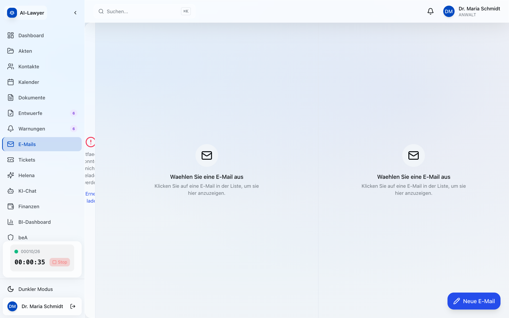
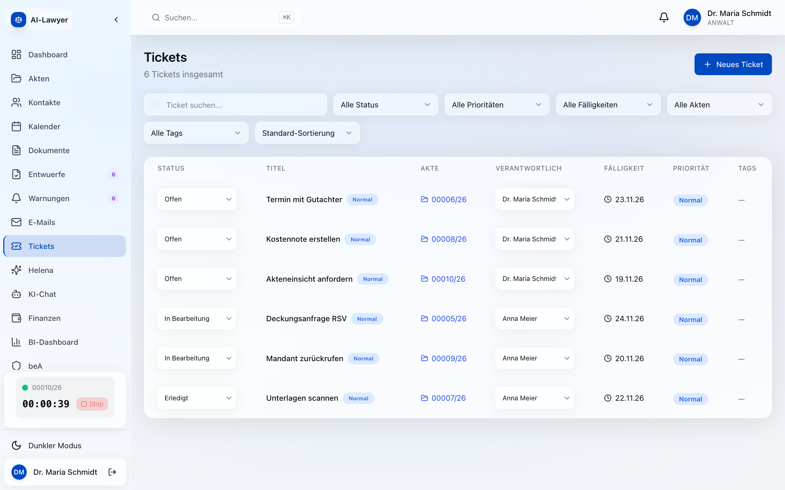

# 7 — E-Mail und Tickets

AI-Lawyer holt die E-Mails der Kanzlei aus den Postfächern, zeigt sie in einem Posteingang und ordnet sie Akten zu („Veraktung“). Aus einer E-Mail können Sie ein Ticket machen, also eine Aufgabe mit Status, Verantwortlichem und Fälligkeit. Dieses Kapitel erklärt Postfächer, Posteingang, Veraktung, das Schreiben von E-Mails und die Tickets.

## Postfächer einrichten (Admin)

Postfächer richtet nur der Admin ein. Die Seite **E-Mail-Einstellungen** erreichen Sie über die Adresse `/einstellungen/email`; einen Menüpunkt dafür gibt es derzeit nicht. Andere Rollen werden zur allgemeinen Einstellungsseite umgeleitet.

Die Seite hat vier Reiter: **Postfaecher**, **Signatur**, **Sync-Status**, **Zuweisung**.

### Ein Postfach anlegen

1. Reiter **Postfaecher**, **Neues Postfach hinzufuegen**.
2. Optional oben ein Anbieterprofil wählen (**Microsoft 365**, **Gmail**, **IONOS**, **Strato** oder **Manuell**). Es füllt Server, Ports und Verschlüsselung aus.
3. Die Felder ausfüllen (Tabelle unten).
4. **Verbindung testen** klicken. AI-Lawyer prüft Schritt für Schritt *Verbinde mit IMAP-Server...*, *Authentifiziere...*, *Postfaecher abrufen...*, *SMTP-Server pruefen...*. Am Ende steht *„Verbindung erfolgreich! IMAP und SMTP funktionieren.“*
5. Speichern. Meldung: *„Neues Postfach erstellt“*.

| Feld | Hinweis |
| --- | --- |
| **Name** | Anzeigename, z. B. „Kanzlei Hauptpostfach“. Wird auch als Absendername verwendet. |
| E-Mail-Adresse | z. B. `info@kanzlei.de`. |
| **Benutzername** | Oft identisch mit der E-Mail-Adresse. |
| **Ist Kanzlei-Postfach** | Kennzeichnet das gemeinsame Kanzleipostfach. Nur dort lassen sich einzelnen E-Mails Verantwortliche zuweisen. |
| IMAP **Host**, **Port**, **Verschluesselung** | Posteingangsserver; **SSL/TLS** oder **STARTTLS**. |
| SMTP **Host**, **Port**, **Verschluesselung** | Postausgangsserver. |
| **Passwort** | Wird verschlüsselt gespeichert. Beim Bearbeiten heißt leer lassen *unveraendert*. |
| **Initial-Sync** | **Nur neue E-Mails**, **Letzte 30 Tage** (Standard) oder **Alles synchronisieren**. |
| **Soft-Delete Aufbewahrung** | Wie lange gelöschte E-Mails aufbewahrt werden: 30, 60, 90 Tage oder **Unbegrenzt**. |

Die Anmeldung geht derzeit nur mit Benutzername und Passwort. *„OAuth2 wird in einer zukuenftigen Version unterstuetzt.“* Anbieter, die nur noch moderne Anmeldung (OAuth2) zulassen, etwa viele Microsoft-365-Konten, lassen sich deshalb unter Umständen nicht anbinden. Bei Gmail brauchen Sie in der Regel ein App-Passwort.

In der Liste zeigt jedes Postfach **Verbunden**, **Fehler** oder **Getrennt**. Über die Symbole **Bearbeiten** und **Loeschen** ändern bzw. entfernen Sie es. Hat ein Postfach noch E-Mails, die Akten zugeordnet sind, wird es nur deaktiviert (*„Postfach wurde deaktiviert (noch verknuepfte E-Mails vorhanden)“*).

### Wer sieht welches Postfach?

Im Reiter **Zuweisung** legt der Admin fest, welche Benutzer auf welches Postfach zugreifen. *„Benutzer koennen nur auf zugewiesene Postfaecher zugreifen.“* Das gilt auch für das Kanzleipostfach: Wer nicht zugewiesen ist, sieht es nicht. Der Admin sieht alle Postfächer.

### Signatur und Sync-Status

- **Signatur:** eine kanzleiweite HTML-Signatur mit den Platzhaltern `{{name}}`, `{{titel}}`, `{{mobil}}`, `{{durchwahl}}`, `{{email}}`. **Vorschau** zeigt sie mit Beispieldaten, **Signatur speichern** übernimmt sie. Beim Schreiben wird die Signatur des gewählten Postfachs automatisch eingefügt.
- **Sync-Status:** je Postfach **Letzter Sync:**, **Gespeicherte E-Mails:** und **Jetzt synchronisieren**.

Neue E-Mails kommen ohne Neuladen an: AI-Lawyer hält zu jedem aktiven Postfach eine ständige Verbindung (IMAP IDLE).

## Der Posteingang

Menüpunkt **E-Mails**. Die Seite hat drei Spalten, deren Breite Sie mit der Maus verändern können:

1. **Postfaecher**: Ihre Postfächer mit ihren Ordnern (Posteingang, Gesendet, Entwürfe, Papierkorb, Spam, Archiv und eigene Ordner).
2. Die E-Mail-Liste mit Suchfeld **Suchen...**, den Filtern **Alle**, **Veraktet**, **Unveraktet**, **Ungelesen** und der Sortierung nach **Datum**, **Absender** oder **Betreff**.
3. Die geöffnete E-Mail.

Ist Ihnen kein Postfach zugewiesen, steht dort *„Kein E-Mail-Konto eingerichtet – Ein Administrator muss ein E-Mail-Konto konfigurieren.“*

### Eine E-Mail bearbeiten

Über der geöffneten E-Mail stehen:

| Knopf | Wirkung |
| --- | --- |
| **Antworten**, **Allen antworten**, **Weiterleiten** | Öffnet das Antwortfeld direkt unter der E-Mail. |
| **Verakten** | Ordnet die E-Mail einer Akte zu ([Veraktung](#veraktung-e-mails-einer-akte-zuordnen)). |
| **Ticket** | Macht aus der E-Mail ein Ticket ([Tickets](#tickets)). |
| **Archivieren** | Verschiebt in das Archiv. |
| **Spam** | Markiert als Spam. |
| **Loeschen** | Löscht. Fünf Sekunden lang können Sie mit **Rueckgaengig** zurücknehmen. |

Ist die E-Mail noch keiner Akte zugeordnet, erinnert ein Hinweis: *„Diese E-Mail ist nicht veraktet — Jetzt verakten?“* mit **Verakten** und **Spaeter**.

Im Kanzleipostfach können Sie einer E-Mail über das Personen-Symbol neben dem Absender einen Verantwortlichen geben (*Verantwortlichen zuweisen*). Die Bestätigung lautet *„Verantwortlich: <Name>“*. Eine automatische Verteilung nach Regeln (etwa nach Absender oder Betreff) gibt es nicht.

### Tastenkürzel

| Taste | Wirkung |
| --- | --- |
| `J` / `K` | Nächste / vorherige E-Mail |
| `R` | Antworten |
| `A` | Allen antworten |
| `F` | Weiterleiten |
| `E` | Archivieren |
| `#` oder `Entf` | Löschen |
| `Esc` | Auswahl aufheben |

### Was im Posteingang noch nicht funktioniert

- **Threads:** AI-Lawyer erkennt zusammengehörige E-Mails (über die Kopfzeilen und Betreffpräfixe wie *AW:* und *WG:*) und nutzt das für Akten-Vorschläge. Eine Gesprächsansicht, die Antworten gruppiert, gibt es noch nicht.
- Die kleinen Symbole in einer Listenzeile (**Als gelesen markieren**, **Archivieren**, **Loeschen**) und die Knöpfe **Verakten**, **Gelesen**, **Loeschen**, die bei mehreren angehakten E-Mails erscheinen, haben noch keine Funktion. Bearbeiten Sie E-Mails einzeln.
- Die Taste `V` (verakten) ist noch nicht belegt.

## Veraktung: E-Mails einer Akte zuordnen

Veraktung heißt: Die E-Mail wird einer Akte zugeordnet und erscheint dort. Ausgewählte Anhänge werden als Dokumente in die Akte kopiert.

1. E-Mail öffnen und **Verakten** klicken. Rechts öffnet sich **E-Mail verakten**.
2. Unter **Vorgeschlagene Akten** stehen bis zu drei Vorschläge mit Begründung und Sicherheit:
   - **Hoch**: Eine frühere E-Mail desselben Gesprächs ist bereits dieser Akte zugeordnet.
   - **Mittel**: Absender oder Empfänger ist als Kontakt an der Akte beteiligt.
   - **Niedrig**: Das Aktenzeichen steht im Betreff.
3. Entweder einen Vorschlag mit **Verakten** übernehmen (*Mit einem Klick verakten*, dabei werden alle Anhänge in den Ordner **Korrespondenz** kopiert) oder unter **Akte suchen** eine Akte suchen (**Aktenzeichen oder Kurzrubrum...**).
4. Bei der Suche: **DMS-Ordner** wählen (Standard **Korrespondenz**), unter **Anhaenge** die zu übernehmenden Anhänge anhaken und optional eine **Notiz (optional)** schreiben.
5. **Verakten bestaetigen**. Meldung: *„E-Mail an Akte … veraktet“*.

Die E-Mail zeigt danach oben das Aktenzeichen mit *„Veraktet von … am …“*. **Aufheben** nimmt die Zuordnung zurück (*„Veraktung aufgehoben“*). Bereits kopierte Anhänge bleiben in der Akte. Eine E-Mail kann mehreren Akten zugeordnet sein.

**Automatisch** veraktet AI-Lawyer nur eine Sorte E-Mails: solche, die Sie selbst schreiben und dabei einer Akte zuordnen ([unten](#e-mails-schreiben)). Eingehende E-Mails ordnet AI-Lawyer nie selbständig zu, es macht nur Vorschläge. Die Entscheidung trifft immer ein Mensch.

Alle E-Mails einer Akte finden Sie in der Akte im Reiter **Aktivitaeten** über **Alle E-Mails anzeigen** (Seite *Akte E-Mails*).

## E-Mails schreiben

1. Im Posteingang unten rechts auf **Neue E-Mail** klicken. Es öffnet sich ein Schreibfenster, das Sie mit **Minimieren** verkleinern können, um nebenher weiterzuarbeiten. Mehrere Entwürfe gleichzeitig sind möglich.
2. **Von:** das Postfach wählen. Die Signatur wird eingefügt.
3. **An** ausfüllen. Beim Tippen schlägt AI-Lawyer Adressen aus Ihren Kontakten vor. **CC** und **BCC** blenden Sie bei Bedarf ein.
4. **Betr.:** und Text eingeben. Die Werkzeugleiste bietet Fett, Kursiv, Listen, Tabellen, Überschriften, Links, Farben und Bilder (per Bild-URL).
5. Optional **Akte:** wählen. Dann wird die E-Mail beim Senden automatisch dieser Akte zugeordnet (*Automatisch beim Senden veraktet*).
6. Optional Priorität (**Niedrig**, **Normal**, **Hoch**) setzen.
7. **Senden** klicken.

Nach dem Senden bleiben Ihnen **10 Sekunden**, in denen Sie mit **Rueckgaengig** abbrechen können (*„E-Mail wird in 10s gesendet“*). Danach ist die E-Mail unterwegs. Ohne Betreff fragt AI-Lawyer *„Ohne Betreff senden?“*.

Antworten schreiben Sie direkt unter der geöffneten E-Mail im Antwortfeld (**Ihre Antwort...**), ebenfalls mit 10 Sekunden Rücknahmezeit. **Verwerfen** löscht den Entwurf nach Rückfrage.

### Zeitversetzt senden

1. Im Schreibfenster neben **Senden** auf das Uhr-Symbol **Spaeter senden** klicken.
2. **Morgen 08:00** (genauer: nächster Werktag, 8 Uhr) oder **Naechster Montag 09:00** wählen, oder ein eigenes Datum mit Uhrzeit eintragen und **Planen** klicken.
3. AI-Lawyer bestätigt *„Geplant fuer …“*.

### Anhänge: derzeit mit Vorsicht

Über **Datei anhaengen** und **Aus Akte** (*Datei aus Akte waehlen*, erst nach Wahl einer Akte) lassen sich Anhänge auswählen. **Nach aktuellem Programmstand werden diese Anhänge aber nicht mit der E-Mail verschickt.** Prüfen Sie nach dem Versand im Ordner **Gesendet**, ob der Anhang angekommen ist, und versenden Sie wichtige Dokumente bis zur Behebung auf anderem Weg ([Kapitel 23](23-einschraenkungen-und-fragen.md)). Grundsätzlich gilt: Dokumente aus der Akte dürfen nur angehängt werden, wenn sie **freigegeben** sind ([Kapitel 5](05-dokumente.md#status-entwurf--zur-prüfung--freigegeben--versendet)).

### Die ältere Schreibseite

Unter `/email/compose` und beim Öffnen einzelner E-Mails über `/email/<id>` gibt es noch eine ältere Oberfläche (**Neue E-Mail**, **Antworten** mit Feldern **An:**, **Betr.:** und **Senden**). Sie gehört zu einem früheren E-Mail-Modul und kann nicht senden. Verwenden Sie den Posteingang unter **E-Mails**.

## Tickets

Ein Ticket ist eine Aufgabe: etwas, das jemand bis zu einem Datum erledigen soll, optional mit Bezug zu einer Akte oder E-Mail.

### Die Ticketliste

Menüpunkt **Tickets**. Die Tabelle zeigt **Status**, **Titel**, **Akte**, **Verantwortlich**, **Fälligkeit**, **Priorität** und **Tags**. Status und Verantwortlichen können Sie direkt in der Liste über die Auswahlfelder ändern.

Über der Liste filtern Sie mit **Ticket suchen...** sowie nach Status, Priorität, Fälligkeit (**Heute fällig**, **Überfällig**, **Nächste 7 Tage**), Akte und Tag. Sortieren lässt sich nach **Fälligkeit**, **Priorität** oder **Zuletzt geändert**.

Alle Benutzer sehen alle Tickets der Kanzlei, unabhängig vom Aktenzugriff.

### Ein Ticket anlegen

1. **Neues Ticket** klicken (bei leerer Liste: **Erstes Ticket anlegen**).
2. Ausfüllen:

| Feld | Hinweis |
| --- | --- |
| **Titel *** | Pflicht, *Kurze Beschreibung der Aufgabe*. |
| **Beschreibung** | Optional. |
| **Priorität** | **Niedrig**, **Normal**, **Hoch**, **Kritisch**. |
| **Fälligkeit** | Datum. |
| **Verantwortlich** | Ein Benutzer oder **– Niemand –**. |
| **Akte** | Optional. |
| **Tags** | Freie Schlagwörter. |

3. **Ticket erstellen**. Meldung: *„Ticket erstellt.“*

Schlagwörter, die mit `ai:` beginnen, sind für Helena reserviert und lassen sich nicht von Hand setzen (*„Tags mit dem Präfix 'ai:' können nicht manuell gesetzt werden.“*). Wie Helena Tickets bearbeitet, steht in [Kapitel 9](09-helena.md). Ergebnisse von Helena sind immer Entwürfe, die ein Mensch prüft.

### Ein Ticket aus einer E-Mail

1. Im Posteingang die E-Mail öffnen, **Ticket** klicken.
2. Das Fenster **Ticket aus E-Mail erstellen** übernimmt den Betreff als **Titel**. Ergänzen Sie **Beschreibung**, **Akte**, **Prioritaet**, **Faellig am** und **Verantwortlicher**.
3. **Ticket erstellen**. Die Meldung *„Ticket erstellt“* bietet **Anzeigen**.

### Ein Ticket bearbeiten

Ein Klick auf den Titel öffnet das Ticket. Titel und Beschreibung ändern Sie per Klick auf das Stift-Symbol, rechts stellen Sie **Status** (**Offen**, **In Bearbeitung**, **Erledigt**), **Priorität**, **Verantwortlich**, **Fälligkeit** und **Akte** ein. **Zeitstempel** zeigt, wann das Ticket angelegt, geändert und erledigt wurde.

**Bekannte Lücken:** Die Seite `/email/tickets` (Tickets aus E-Mails) und der Abschnitt **Verknüpfte E-Mails** im Ticket berücksichtigen nur Verknüpfungen aus dem älteren E-Mail-Modul. Tickets, die Sie im aktuellen Posteingang aus einer E-Mail erzeugen, erscheinen dort derzeit nicht. In der normalen Ticketliste sind sie vorhanden.

## Wenn etwas nicht klappt

| Meldung | Bedeutung | Was tun |
| --- | --- | --- |
| *Kein E-Mail-Konto eingerichtet* | Ihnen ist kein Postfach zugewiesen. | Admin bitten, Sie im Reiter **Zuweisung** einzutragen. |
| *Verbindungstest fehlgeschlagen. Bitte ueberpruefen Sie die Zugangsdaten und Servereinstellungen.* | Server, Port, Verschlüsselung oder Passwort falsch. | Angaben beim Anbieter prüfen; ggf. App-Passwort verwenden. |
| Postfach-Status **Fehler** | Verbindung abgerissen oder Passwort geändert. | Postfach bearbeiten, neues Passwort eintragen, **Verbindung testen**. |
| *Kein Zugriff auf dieses Postfach* | Postfach nicht zugewiesen. | Admin fragen. |
| *Bitte geben Sie mindestens einen Empfaenger an.* | Feld **An** leer. | Empfänger eintragen. |
| *Bitte waehlen Sie ein Postfach aus.* | Kein Absenderpostfach. | Bei **Von:** ein Postfach wählen. |
| *Nicht freigegebene Dokumente koennen nicht versendet werden* | Anhang aus der Akte nicht freigegeben. | Dokument freigeben lassen ([Kapitel 5](05-dokumente.md)). |
| *Konnte nicht abgebrochen werden - E-Mail wurde bereits gesendet* | Die 10 Sekunden waren vorbei. | Ggf. Korrektur nachsenden. |
| *Fehler beim Verakten* | Akte nicht gefunden oder Serverfehler. | Erneut versuchen, sonst IT informieren. |
| *Titel ist erforderlich.* | Ticket ohne Titel. | Titel eintragen. |

---

Weiter: [8 — beA](08-bea.md) · [Zur Übersicht](README.md)
