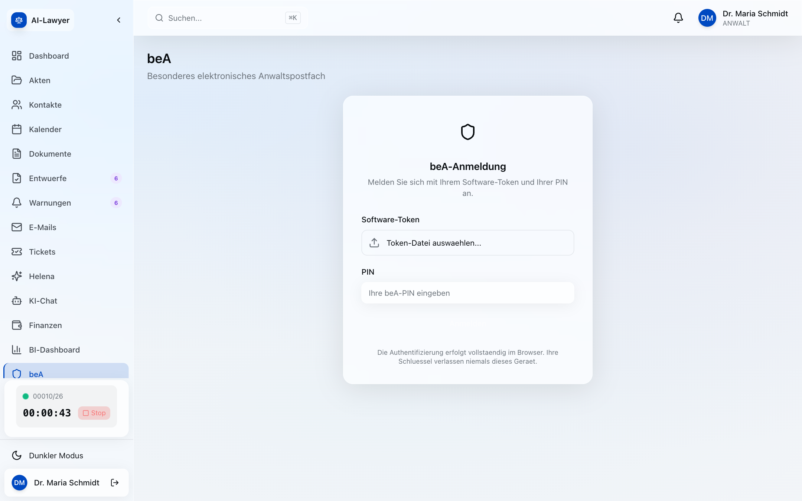

# 8 — beA

Das besondere elektronische Anwaltspostfach (beA) ist in AI-Lawyer als Bereich **beA** angelegt: Anmeldung, Posteingang und Postausgang, Zuordnung zu Akten, Versand und Empfangsbekenntnis. Dieses Kapitel beschreibt, was davon heute tatsächlich funktioniert. Die kurze Antwort: **Ohne eine eingebundene, kostenpflichtige bea.expert-Bibliothek funktioniert die Verbindung zum beA nicht.** AI-Lawyer meldet das ehrlich: Ohne Bibliothek ist keine Anmeldung möglich, und eine Nachricht oder ein Empfangsbekenntnis wird nur dann als erledigt gespeichert, wenn bea.expert den Vorgang bestätigt hat. Auch mit Bibliothek sind einige Teile noch unvollständig (etwa der Abruf von Nachrichteninhalten). Verlassen Sie sich für Fristsachen bis auf Weiteres auf Ihre bisherige beA-Software.

## Wie die Anbindung gedacht ist

AI-Lawyer spricht nicht selbst mit dem beA-Server der BRAK. Es nutzt die Programmbibliothek des Anbieters **bea.expert**, die im Browser läuft. Anmeldung, Entschlüsselung und Versand geschehen auf Ihrem Rechner; Ihr Schlüssel und Ihre PIN werden nicht an den AI-Lawyer-Server geschickt (*„Die Authentifizierung erfolgt vollstaendig im Browser. Ihre Schluessel verlassen niemals dieses Geraet.“*). Der AI-Lawyer-Server speichert nur die Nachrichten, die der Browser ihm übergibt.

## Voraussetzungen

| Voraussetzung | Stand |
| --- | --- |
| Registrierung bei bea.expert | Erforderlich, kommerziell. Die Bibliothek ist nicht Teil von AI-Lawyer. |
| Einbindung der Bibliothek | Die IT muss die bea.expert-Bibliothek in AI-Lawyer einbinden. Im ausgelieferten Code ist sie nicht eingebunden. Bis dahin endet jeder Anmeldeversuch mit *„beA-Bibliothek konnte nicht geladen werden. Bitte stellen Sie sicher, dass die bea.expert Bibliothek konfiguriert ist.“* ([Kapitel 20](20-konfiguration.md)). |
| Softwarezertifikat | Ein beA-Softwarezertifikat als Datei (`.p12` oder `.pfx`) und die zugehörige PIN. Die Anmeldung mit beA-Karte und Kartenleser ist nicht vorgesehen. |
| SAFE-IDs der Empfänger | Für den Versand. Am bequemsten im Kontakt im Feld **beA Safe-ID** hinterlegt ([Kapitel 4](04-kontakte.md)). |

## Wer darf was?

| Aktion | Rollen |
| --- | --- |
| beA-Bereich öffnen, Nachrichten lesen und Akten zuordnen | alle Kanzleirollen (Admin, Anwalt, Sachbearbeiter, Sekretariat) mit dem Recht *beA lesen* |
| Neue Nachricht schreiben (Knopf **Neue Nachricht**, Seite `/bea/compose`) | nur **Anwalt** |
| Empfangsbekenntnis bestätigen | nur **Anwalt** in der Oberfläche (die Schnittstelle erlaubt zusätzlich den Admin) |

Die beA-Liste zeigt allen Rollen mit *beA lesen* sämtliche gespeicherten beA-Nachrichten der Kanzlei, unabhängig davon, ob sie auf die zugeordnete Akte zugreifen dürfen ([Kapitel 23](23-einschraenkungen-und-fragen.md)). Wer eine Nachricht einer Akte zuordnet, braucht dagegen Zugriff auf diese Akte.

Eine Besonderheit: Beim **Synchronisieren** werden neue Nachrichten in AI-Lawyer gespeichert. Das gelingt nach aktuellem Stand nur Admins und Anwälten. Bei Sachbearbeitung und Sekretariat werden neue Nachrichten zwar abgerufen, aber nicht gespeichert, sie sehen nur bereits vorhandene.

## Anmelden

1. In der Seitenleiste **beA** öffnen. Es erscheint **beA-Anmeldung** (*Melden Sie sich mit Ihrem Software-Token und Ihrer PIN an.*).
2. Unter **Software-Token** auf **Token-Datei auswaehlen...** klicken und die `.p12`- oder `.pfx`-Datei wählen.
3. Die PIN in **Ihre beA-PIN eingeben** eintragen.
4. **Anmelden** klicken.

Nach erfolgreicher Anmeldung zeigt die Seite *„Verbunden als <SAFE-ID>“* und einen Countdown. Die Sitzung endet nach **30 Minuten ohne Aktivität** und mit **Abmelden**. Sie lebt nur in diesem Browser-Tab: Laden Sie die Seite neu oder schließen Sie den Tab, müssen Sie sich erneut anmelden.

## Posteingang und Postausgang

Nach der Anmeldung sehen Sie die Reiter **Posteingang** und **Postausgang**, ein Suchfeld und den Knopf **Synchronisieren**. Die Tabelle zeigt **Status**, **Betreff**, **Absender** bzw. **Empfaenger**, **Akte** und **Datum**.

| Status | Bedeutung |
| --- | --- |
| **Eingang** | Neu eingegangen. |
| **Gelesen** | Geöffnet. |
| **Zugeordnet** | Einer Akte zugeordnet. |
| **Gesendet** | Von hier verschickt; bea.expert hat den Versand mit einer beA-Nachrichten-ID bestätigt. |
| **Fehler** | Verarbeitung gescheitert. |

**Synchronisieren** holt die letzten 50 Nachrichten des beA-Posteingangs. Dabei werden derzeit nur **Kopfdaten** übernommen: Betreff, Absender, Empfänger, Datum und ob ein Empfangsbekenntnis angefordert ist. **Nachrichtentext, Anhänge und Prüfprotokoll werden beim Synchronisieren nicht gespeichert.** Lesen Sie den Inhalt deshalb weiterhin in Ihrer beA-Software. Ohne geladene bea.expert-Bibliothek zeigt **Synchronisieren** nur die bereits gespeicherten Nachrichten.

### Die Nachrichtenansicht

Ein Klick auf eine Nachricht zeigt **Absender**, **Empfaenger**, **Datum**, **Akte**, den **Nachrichteninhalt**, **Anhaenge (…)** (nur als Liste, ohne Download), das Prüfprotokoll und – falls ein XJustiz-Datensatz mitkam – dessen **Grunddaten**, **Beteiligte**, **Instanzen** und **Termine**. Diese Bereiche sind nur gefüllt, wenn die Daten vorliegen, was bei synchronisierten Nachrichten nach dem oben Gesagten derzeit nicht der Fall ist.

Liegt zur Nachricht eine Auswertung durch Helena vor, erscheint der Bereich **Helena-Vorschlaege**. Helena wertet nur Nachrichten mit gespeichertem Text aus ([Kapitel 9](09-helena.md)).

## Zuordnung zur Akte

### Automatisch

Wenn AI-Lawyer eine beA-Nachricht speichert, sucht es eine passende Akte, in dieser Reihenfolge:

1. **Internes Aktenzeichen** (Form `00123/26`) in Betreff oder Text. Genau ein Treffer gilt als *sicher*.
2. **SAFE-ID des Absenders** gehört zu einem Kontakt, der an einer nicht geschlossenen Akte beteiligt ist: *wahrscheinlich*.
3. **Gerichtsaktenzeichen** (z. B. `3 Ca 567/25`, `12 U 456/24`) im Text stimmt mit dem Gerichtsaktenzeichen in den Falldaten einer nicht geschlossenen Akte überein: *wahrscheinlich*.

Direkt zugeordnet wird eine Nachricht nur bei einem *sicheren* Treffer; sie erhält dann den Status **Zugeordnet**. Ein *wahrscheinlicher* Treffer (SAFE-ID, Gerichtsaktenzeichen oder mehrere passende Aktenzeichen) bleibt ein Vorschlag: Die Nachricht bleibt **Nicht zugeordnet**, bis jemand sie bestätigt ([Von Hand](#von-hand)). Prüfen Sie trotzdem auch automatisch zugeordnete Nachrichten. Eine falsch zugeordnete Nachricht kann eine Frist in der falschen Akte landen lassen.

### Von Hand

1. In der Liste bei einer nicht zugeordneten Nachricht **Zuordnen** klicken.
2. Im Fenster **Nachricht einer Akte zuordnen** entweder **Automatische Zuordnung versuchen** oder eine Akte suchen (**Aktenzeichen oder Rubrum suchen...**) und wählen.
3. Findet die automatische Zuordnung nur einen *wahrscheinlichen* Treffer, fragt AI-Lawyer nach: *„Zuordnungsvorschlag (nicht eindeutig): … Nachricht dieser Akte zuordnen?“* Erst mit **OK** wird die Nachricht der Akte zugeordnet. Gibt es gar keinen Treffer, nennt AI-Lawyer den Grund.

In der Nachrichtenansicht zeigt das Feld **Akte** bei fehlender Zuordnung **Nicht zugeordnet** mit **Zuordnen**.

### Was nicht automatisch passiert

Die Kette *Nachricht → Akte → Ticket → Bearbeiter* gibt es derzeit nur im ersten Glied. AI-Lawyer legt für eine beA-Nachricht **kein Ticket** an, weist **keinen Bearbeiter** zu, kopiert **keine Anhänge** in die Akte und trägt **keine Frist** ein. Das bleibt Handarbeit: Ticket anlegen ([Kapitel 7](07-email-und-tickets.md#tickets)), Frist berechnen und prüfen ([Kapitel 6](06-fristen-und-kalender.md)).

## Nachricht senden

Der Versand setzt eine eingebundene bea.expert-Bibliothek und eine aktive beA-Sitzung voraus. Die Sitzung, mit der Sie sich auf der beA-Seite angemeldet haben, gilt auch für **Neue beA-Nachricht** (`/bea/compose`) und die Nachrichtenansicht, solange Sie im selben Tab bleiben.

1. Auf der beA-Seite **Neue Nachricht** klicken (nur Anwälte).
2. Empfänger über **Name oder SAFE-ID eingeben...** aus den Kontakten wählen oder unter **Oder SAFE-ID direkt eingeben:** eintragen (Form `DE.BRAK....`).
3. **Betreff** und **Inhalt** ausfüllen.
4. Unter **Dokumente anhaengen** mit **Dokument hinzufuegen** Dokumente aus einer Akte wählen. *„Nur freigegebene Dokumente koennen angehaengt werden. Nicht freigegebene Dokumente koennen hier direkt freigegeben werden.“* Nicht freigegebene sind mit **Noch nicht freigegeben** markiert und haben den Knopf **Freigeben**. Geben Sie ein Dokument nur frei, wenn Sie es geprüft haben.
5. **Senden**.

So läuft der Versand ab:

- **Vor** dem Versand prüft AI-Lawyer, dass alle Anhänge freigegeben sind und Sie auf die Akte zugreifen dürfen. Sonst bricht es mit *„Versand nicht moeglich. …“* ab und nennt die betroffenen Dokumente; es wird nichts verschickt.
- Die Anhänge werden mit der Nachricht an bea.expert übergeben und versendet.
- Als **Gesendet** gespeichert wird die Nachricht nur, wenn bea.expert den Versand mit einer beA-Nachrichten-ID bestätigt. Dann erscheint *„Nachricht gesendet – Die Nachricht wurde erfolgreich versendet und gespeichert.“*, und die angehängten Dokumente erhalten den Status **Versendet**.
- Schlägt der Versand fehl oder kommt keine Nachrichten-ID zurück, zeigt AI-Lawyer die Fehlermeldung (z. B. *„beA hat den Versand nicht bestaetigt (keine Nachrichten-ID erhalten).“*) und speichert nichts.
- Ging die Nachricht hinaus, konnte AI-Lawyer sie aber nicht speichern, lautet die Meldung *„Die Nachricht wurde ueber beA versendet (Nachrichten-ID …), konnte aber nicht gespeichert werden: … Bitte manuell in der Akte vermerken.“* Vermerken Sie den Versand dann von Hand.

Prüfen Sie bei Fristsachen trotzdem die Eingangsbestätigung im beA.

## Empfangsbekenntnis (eEB)

Fordert ein Gericht ein elektronisches Empfangsbekenntnis an, zeigt die Nachrichtenansicht einen eigenen Bereich. Anwältinnen und Anwälte sehen dort **Empfangsbekenntnis bestaetigen**, alle anderen den Hinweis *„Nur Anwaelte koennen Empfangsbekenntnisse bestaetigen.“* Nach der Bestätigung steht dort *„Bestaetigt am …“*.

Als bestätigt vermerkt AI-Lawyer das eEB nur, wenn bea.expert die Abgabe bestätigt hat. Ohne Bibliothek, ohne aktive Sitzung oder bei einem Fehler erscheint die Fehlermeldung (z. B. *„eEB wurde von beA nicht bestaetigt und daher nicht gespeichert.“*), und es wird nichts gespeichert. Nachrichten ohne beA-Nachrichten-ID können kein eEB erhalten (*„Nachricht hat keine beA-Nachrichten-ID; eEB nicht moeglich.“*). Solange die Bibliothek nicht eingebunden ist, geben Sie Empfangsbekenntnisse in Ihrer bisherigen beA-Software ab. Das Datum des eEB ist für den Fristbeginn maßgeblich; tragen Sie die daraus folgenden Fristen selbst ein und lassen Sie sie prüfen ([Kapitel 6](06-fristen-und-kalender.md)).

## Was es nicht gibt

- keine Anmeldung mit beA-Karte,
- keine Verwaltung mehrerer Postfächer (Kanzlei- oder Vertretungspostfach) in der Oberfläche,
- kein Herunterladen von Anhängen,
- keine Ablage von beA-Nachrichten oder Anhängen als Dokument in der Akte,
- keine Ordner außer Posteingang und Postausgang,
- kein automatischer Abruf im Hintergrund: Nachrichten kommen nur bei angemeldeter Sitzung und **Synchronisieren** herein.

## Wenn etwas nicht klappt

| Meldung | Bedeutung | Was tun |
| --- | --- | --- |
| *beA-Bibliothek konnte nicht geladen werden …* | bea.expert-Bibliothek nicht eingebunden. | IT ansprechen ([Kapitel 20](20-konfiguration.md)). Bis dahin bisherige beA-Software nutzen. |
| *Anmeldung fehlgeschlagen. Bitte pruefen Sie Token und PIN.* | Zertifikat oder PIN falsch. | Richtige Datei wählen, PIN prüfen. |
| *Sitzung abgelaufen. Bitte erneut anmelden.* | 30 Minuten ohne Aktivität. | Neu anmelden. |
| *beA-Sitzung ist nicht aktiv. Bitte melden Sie sich zuerst an.* | Keine Sitzung in diesem Tab. | Auf der beA-Seite anmelden. |
| *Empfaenger-SAFE-ID und Betreff sind erforderlich* | Pflichtfeld leer. | Ausfüllen. |
| *Nicht freigegebene Dokumente koennen nicht versendet werden* | Anhang nicht freigegeben. | Dokument prüfen und freigeben lassen. |
| *Empfangsbekenntnis wurde bereits bestaetigt* | eEB schon vermerkt. | Nichts. |
| *Zuordnung fehlgeschlagen* | Akte nicht gefunden, kein Zugriff auf die Akte oder Serverfehler. | Erneut versuchen bzw. Aktenzugriff klären. |
| *Versand nicht moeglich. …* | Ein Anhang ist nicht freigegeben oder Sie haben keinen Zugriff auf die Akte. | Genannte Dokumente prüfen und freigeben lassen. |
| *beA hat den Versand nicht bestaetigt …* | bea.expert hat keine Nachrichten-ID geliefert. | Nachricht wurde nicht als gesendet gespeichert. Im beA prüfen, ob sie hinausging. |
| *eEB wurde von beA nicht bestaetigt und daher nicht gespeichert.* | eEB-Abgabe gescheitert. | eEB über die bisherige beA-Software abgeben. |
| Weiterleitung von `/bea/compose` zurück zur beA-Seite | Sie sind nicht in der Rolle Anwalt. | Anwältin oder Anwalt versenden lassen. |

---

Weiter: [9 — Helena](09-helena.md) · [Zur Übersicht](README.md)
