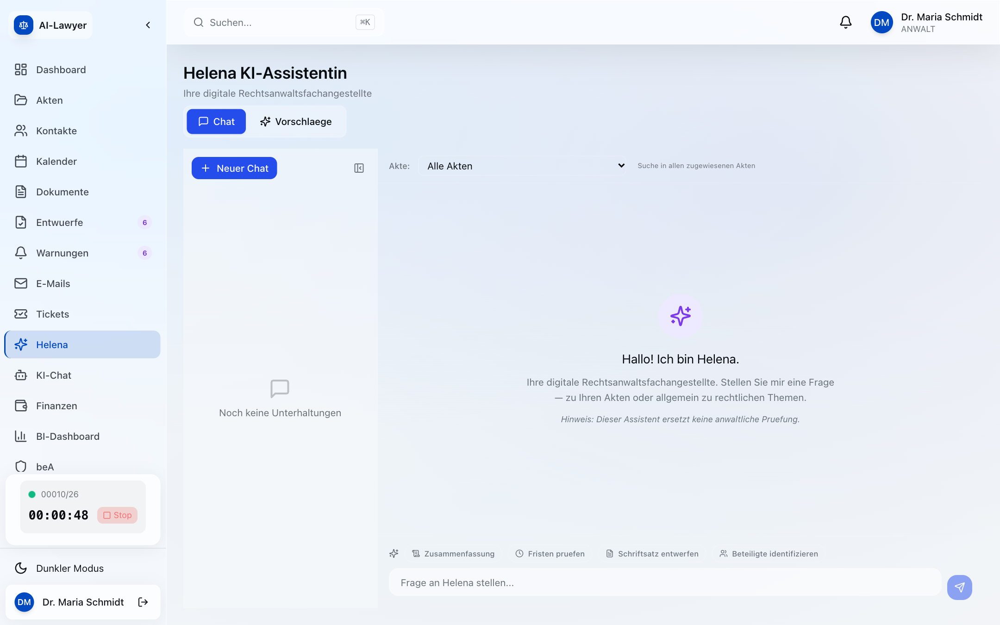
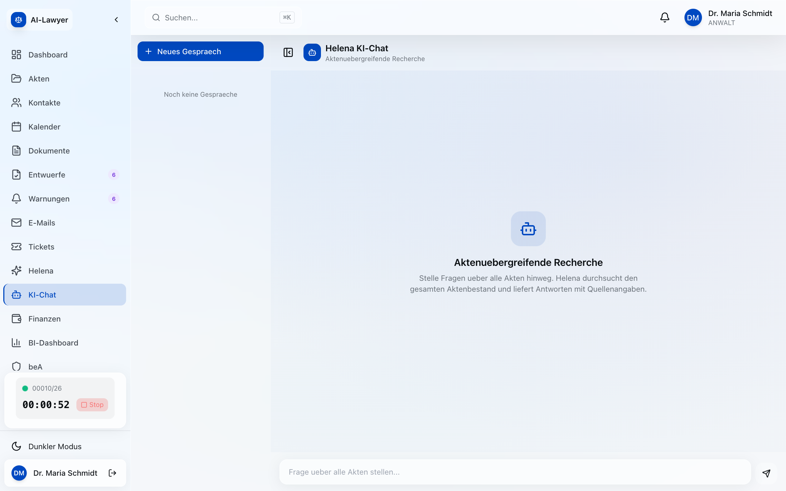
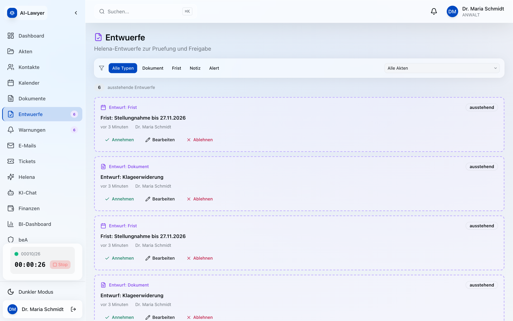
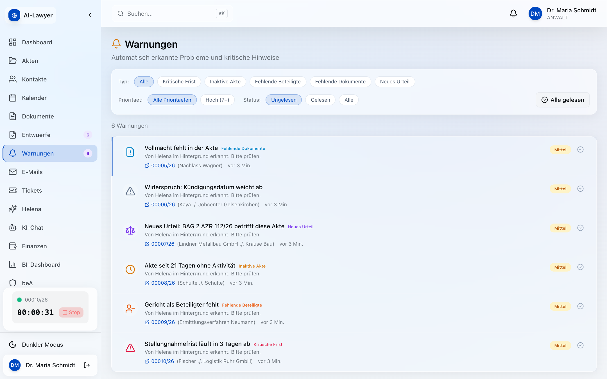

# 9 — Helena, die KI-Kollegin

Helena ist die eingebaute KI-Assistentin von AI-Lawyer. Sie beantwortet Fragen zu Ihren Akten, entwirft Schriftsätze, Fristen und Notizen, warnt vor Problemen und liefert Vorschläge aus neuen Dokumenten und E-Mails. Dieses Kapitel zeigt, wo Sie Helena finden, wie Sie mit ihr arbeiten und wo ihre Grenzen liegen.

Der Grundsatz gilt überall: **Helena schlägt vor, ein Mensch entscheidet.** Was Helena erzeugt, ist ein Entwurf. Nichts davon wird ohne Ihre Freigabe zu einem echten Dokument, einer Frist oder einer Buchung, und Helena versendet nie selbst etwas nach außen.

## Was Helena kann (Überblick)

| Funktion | Wo | Abschnitt |
| --- | --- | --- |
| Fragen zu einer Akte oder allen Akten stellen | **Helena** (`/ki-chat`), Reiter **Chat** | [Der Helena-Chat](#der-helena-chat) |
| Aktenübergreifende Recherche | **KI-Chat** (`/ki`) | [Die Seite KI-Chat](#die-seite-ki-chat) |
| Vorschläge aus neuen Dokumenten und E-Mails | **Helena**, Reiter **Vorschlaege** | [Vorschläge](#vorschläge) |
| Aufträge im Hintergrund | `@Helena` in einer Aktennotiz oder einem Akten-Kanal | [@Helena-Aufträge](#helena-aufträge) |
| Schriftsatz entwerfen mit Rückfragen | Helena-Chat mit gewählter Akte | [Die Schriftsatz-Pipeline](#die-schriftsatz-pipeline) |
| Entwürfe prüfen und freigeben | **Entwuerfe** (`/entwuerfe`) und Aktivitätsverlauf der Akte | [Entwürfe prüfen und freigeben](#entwürfe-prüfen-und-freigeben) |
| Warnungen zu Fristen, Lücken, neuen Urteilen | **Warnungen** (`/alerts`) | [Warnungen](#warnungen) |
| Fallzusammenfassung, Falldaten ausfüllen | Akte, Reiter **KI-Analyse** und **Falldaten** | [Fallzusammenfassung und Auto-Fill](#fallzusammenfassung-und-auto-fill) |

## Der Helena-Chat

Klicken Sie in der Seitenleiste auf **Helena**. Die Seite heißt **Helena KI-Assistentin** und hat oben zwei Reiter: **Chat** und **Vorschlaege**.

### Akte wählen

1. Wählen Sie oben im Feld **Akte:** die Akte, um die es geht. Die Liste zeigt Aktenzeichen und Kurzrubrum.
2. Steht dort **Alle Akten**, sucht Helena in allen Ihnen zugewiesenen Akten (Hinweis daneben: „Suche in allen zugewiesenen Akten“). Mit einer gewählten Akte heißt es „Suche in ausgewaehlter Akte“.
3. Tippen Sie Ihre Frage in das Feld **Frage an Helena stellen...** und drücken Sie **Enter** (Zeilenumbruch mit **Umschalt + Enter**) oder klicken Sie auf **Senden**.

Mit gewählter Akte kennt Helena die Stammdaten, Beteiligten, die letzten Dokumente samt erkanntem Text, Fristen, die [verknüpften Normen](03-akten.md#verknüpfte-normen) und das [Akten-Gedächtnis](#akten-gedächtnis). Bei „Alle Akten“ werden nur Akten durchsucht, in denen Sie als Anwalt oder Sachbearbeiter eingetragen sind; Akten, auf die Sie nur über ein Dezernat Zugriff haben, gehören dort nicht dazu.

Sie können Helena auch direkt aus einer Akte starten: Der Knopf **Fallzusammenfassung** im Kopf der Akte öffnet den Chat mit dieser Akte und schickt die Bitte um eine Fallzusammenfassung gleich ab.

### Schnellaktionen

Über dem Eingabefeld stehen vier Knöpfe, die eine vorformulierte Bitte senden:

| Knopf | Was Helena tut |
| --- | --- |
| **Zusammenfassung** | Fasst alle Dokumente der Akte ausführlich zusammen. |
| **Fristen pruefen** | Sucht in den Dokumenten genannte Fristen und Termine und listet sie chronologisch. Ergebnis immer selbst nachrechnen und in den Kalender übernehmen ([Kapitel 6](06-fristen-und-kalender.md)). |
| **Schriftsatz entwerfen** | Entwirft einen Schriftsatz auf Grundlage der Aktendokumente. |
| **Beteiligte identifizieren** | Listet Personen, Parteien und Institutionen aus den Dokumenten mit ihrer Rolle. |

### Antworten lesen

- **Helena denkt nach** erscheint, solange Helena arbeitet. Bei manchen Modellen lässt sich der Denkweg aufklappen.
- Unter einer Antwort stehen die **Quellen**: nummerierte Dokumente mit Aktenzeichen und Textauszug. Ein Klick öffnet das Dokument. Im Text verweist Helena mit [1], [2] usw. darauf.
- **Kopieren** legt die Antwort in die Zwischenablage.
- Der Knopf **Als Entwurf** ist sichtbar, hat aber derzeit keine Funktion. Kopieren Sie den Text stattdessen und legen Sie ihn selbst ab.
- Dateien in das Chatfenster zu ziehen funktioniert noch nicht. Es erscheint *„Dokument-Upload in den Chat wird in einer spaeteren Version unterstuetzt.“*

### Verlauf

Links stehen Ihre bisherigen Unterhaltungen, gruppiert nach Akte (ohne Akte unter **Ohne Akten-Zuordnung**). Der Titel ist der Anfang Ihrer ersten Frage.

- **Neuer Chat** beginnt eine neue Unterhaltung.
- Ein Klick auf eine Unterhaltung lädt sie wieder; die Akte wird mit ausgewählt.
- **Link kopieren** (oben rechts im Chat) kopiert einen Link auf genau diese Unterhaltung.
- **Loeschen** entfernt eine Unterhaltung nach der Rückfrage *„Unterhaltung loeschen?“*.
- **Sidebar ausblenden** und **Sidebar anzeigen** klappen die Liste ein und aus.

Unterhaltungen sind persönlich; Kolleginnen und Kollegen sehen sie nicht.

## Die Seite KI-Chat

Der Menüpunkt **KI-Chat** (`/ki`) ist eine schlankere Variante für die **Aktenuebergreifende Recherche**. Sie stellen Fragen im Feld **Frage ueber alle Akten stellen...**; Helena durchsucht dabei immer alle Ihnen zugewiesenen Akten. Eine Aktenauswahl, Schnellaktionen und Schriftsatz-Rückfragen gibt es hier nicht. Über **Neues Gespraech** beginnen Sie neu, die Liste links zeigt Ihre Gespräche.

## Vorschläge

Im Reiter **Vorschlaege** sammelt Helena Hinweise, die sie selbstständig erzeugt hat. Eine Zahl am Reiter zeigt, wie viele neu sind.

Woher Vorschläge kommen:

- **Neue Dokumente**: Nachdem ein Dokument eingelesen wurde, sucht Helena darin nach Fristen und Beteiligten.
- **Eingehende E-Mails**: Helena prüft neue E-Mails und kann einen Antwortentwurf vorschlagen.
- **Proaktive Aktenanalyse** (standardmäßig alle vier Stunden): Hinweise auf Akten ohne Aktivität seit 14 Tagen, offene Akten ohne künftige Frist und unbeantwortete E-Mails.
- **Tagesbriefing** (nur wenn eingeschaltet): eine Morgenübersicht für Anwältinnen und Anwälte.

Ob das läuft, legt die Administration unter **Proaktive Aktenanalyse** und **Tagesbriefing** fest ([Modellwahl und Einstellungen](#modellwahl-und-einstellungen)).

Filtern Sie oben nach Status (**Neu**, **Uebernommen**, **Abgelehnt**, **Alle**), Art (**Fristen**, **Beteiligte**, **Antwort-Entwuerfe**, **Hinweise**, **Briefings**) und Akte. Jede Karte bietet:

| Knopf | Wirkung |
| --- | --- |
| **Uebernehmen** | Eine erkannte Frist wird als Kalendereintrag angelegt (*„Frist wurde in den Kalender uebernommen“*), ein erkannter Beteiligter wird der Akte hinzugefügt (*„Beteiligter wurde zur Akte hinzugefuegt“*), ein Antwortentwurf wird gespeichert (*„Entwurf wurde gespeichert“*). |
| **Ablehnen** | Der Vorschlag wird als abgelehnt markiert. |
| **Bearbeiten** | Markiert den Vorschlag derzeit nur als „Bearbeitet“; einen Bearbeitungsdialog gibt es noch nicht. |
| Daumen hoch / runter | **Guter Vorschlag** / **Schlechter Vorschlag** als Rückmeldung. |

Eine übernommene Frist ist eine von Helena gelesene Frist. Sie wird mit Priorität „hoch“ für die verantwortliche Person angelegt. Hat Helena kein Datum erkannt, steht als Datum der heutige Tag. Prüfen Sie Datum und Fristart deshalb immer im Kalender, bevor Sie sich darauf verlassen.

Gespeicherte Antwortentwürfe öffnen sich unter `/ki-entwuerfe/<id>` als **KI-Entwurf** mit den Kennzeichen **KI-generiert** und **nicht freigegeben**. Dort können Sie **Als Dokument ENTWURF anlegen** oder **Als Aktennotiz speichern** wählen. Die frühere Listenseite `/ki-entwuerfe` leitet heute auf den Helena-Chat um.

## @Helena-Aufträge

Für Aufgaben, die mehrere Arbeitsschritte brauchen, geben Sie Helena einen Auftrag im Hintergrund:

1. Öffnen Sie die Akte, Reiter **Aktivitaeten**.
2. Wählen Sie unten **Notiz** und klicken Sie auf das Roboter-Symbol **@Helena erwaehnen** (oder tippen Sie `@Helena` selbst).
3. Schreiben Sie dahinter den Auftrag, z. B. `@Helena prüfe die Klageschrift auf fehlende Beweisangebote und lege eine Notiz an`.
4. Senden Sie mit **Enter**.

Die Notiz wird gespeichert, und oben im Verlauf erscheint **Helena denkt nach...** mit dem Fortschritt (**Step** x/y und dem gerade genutzten Werkzeug). Was Helena dabei anlegt (Dokument-, Fristen-, Notiz- oder Zeitentwürfe), erscheint als Entwurf im Verlauf und unter **Entwuerfe**.

Dasselbe geht in einem Akten-Kanal unter **Nachrichten** ([Kapitel 11](11-team-nachrichten.md#helena-im-kanal)). Dort schreibt Helena ihre Antwort zusätzlich als Nachricht in den Kanal zurück. In allgemeinen Kanälen ohne Aktenbezug löst `@Helena` keinen Auftrag aus.

Ehrlich gesagt: Die reine Textantwort eines Auftrags aus einer Aktennotiz wird gespeichert, aber derzeit nirgends in der Oberfläche angezeigt. Sichtbar ist nur, was Helena als Entwurf anlegt. Formulieren Sie Aufträge deshalb so, dass ein Ergebnis entsteht („lege eine Notiz an“, „entwirf …“).

## Wie der Helena-Agent arbeitet

Hintergrundaufträge erledigt ein sogenannter Agent. Er arbeitet in Runden: überlegen, ein Werkzeug benutzen (z. B. Akte lesen, Gesetz suchen), Ergebnis auswerten, nächste Runde.

| Werkzeug | Zweck |
| --- | --- |
| Akte, Aktendetails, Dokumente, Fristen, Zeiterfassung lesen | Akteninhalt kennen |
| Gesetze, Urteile, Muster durchsuchen | Rechtsgrundlagen finden |
| Kostenregeln abrufen | Gebühren-Grundlagen |
| Alle Akten durchsuchen | Aktenübergreifende Suche |
| Web-Suche | Vorhanden, aber noch nicht angeschlossen; Helena erhält eine Fehlermeldung. |
| Dokument-, Fristen-, Zeiterfassungs-Entwurf anlegen | Ergebnis als Entwurf |
| Notiz anlegen, Warnung anlegen | Hinweis in der Akte |
| Akten-Wissen aktualisieren | Akte neu für die Suche aufbereiten |

**Schrittgrenzen.** Ein kurzer Auftrag darf höchstens 5 Runden laufen, ein Hintergrundauftrag höchstens 20. Aufträge über `@Helena` laufen immer im Hintergrund. Bleibt Helena hängen (dieselbe Aktion mehrmals), versucht sie es einmal mit einem stärkeren Modell, falls eines eingerichtet ist.

**Anfragegrenze.** Pro Person sind standardmäßig 60 Agent-Aufträge je Stunde möglich. Darüber antwortet Helena: *„Du hast das Limit von 60 Helena-Anfragen pro Stunde erreicht. Bitte warte bis …“* Diese Grenze gilt für Hintergrundaufträge, nicht für den Chat.

**Rollen.** Welche Werkzeuge Helena für Sie benutzen darf, hängt von Ihrer Rolle ab:

| Rolle | Darf Helena für Sie … |
| --- | --- |
| Administrator, Anwalt | alles lesen und alle Entwürfe, Notizen und Warnungen anlegen, Akten-Wissen aktualisieren |
| Sachbearbeiter | alles lesen, alle Entwürfe, Notizen und Warnungen anlegen |
| Sekretariat | alles lesen, nur Notizen anlegen |

## Die Schriftsatz-Pipeline

Wenn Sie im Helena-Chat **mit gewählter Akte** um einen Schriftsatz bitten (z. B. „Erstelle eine Kündigungsschutzklage“, „Entwirf eine Klageerwiderung“, „Schreibe eine Abmahnung“), schaltet Helena auf einen festen Ablauf um statt frei zu formulieren:

1. **Art erkennen.** Helena ordnet die Bitte einer Vorlage zu: **Kuendigungsschutzklage**, **Lohn-/Gehaltsklage**, **Antrag auf einstweilige Verfuegung**, **Klageerwiderung**, **Berufungsschrift**, **Abmahnung** oder **Allgemeiner Schriftsatz**.
2. **Angaben sammeln.** Was in der Akte steht (Parteien, Anschriften, Gericht, Aktenzeichen), übernimmt Helena selbst. Was fehlt, erfragt sie im Chat, z. B. Datum und Zugang der Kündigung, Bruttogehalt, Betriebsratsanhörung.
3. **Entwurf zusammensetzen** aus Rubrum, Anträgen, Sachverhalt, rechtlicher Würdigung, Beweisangeboten, Anlagenverzeichnis, Kosten und Formalem, gestützt auf Gesetze, Urteile und Muster.
4. **Formal prüfen** (Pflichtangaben nach § 253 ZPO, Fristen wie die Drei-Wochen-Frist, offene Platzhalter). Die Prüfung blockiert nie, sie erzeugt nur Hinweise, die im Entwurf mitgespeichert werden.
5. **Entwurf ablegen.** Es erscheint *„Schriftsatz erstellt. Der Entwurf liegt zur Pruefung bereit.“* Der Entwurf steht unter **Entwuerfe** und im Verlauf der Akte, mit aufklappbaren **Quellen** (Normen, Urteile, Muster).

### Rückfragen

Eine Rückfrage zeigt rechts den Zähler, z. B. (2/5), und darunter aufklappbar **Bisherige Angaben**. Antworten Sie einfach in normalen Worten. Sie können auch korrigieren („Das Gehalt war 3.800 €, nicht 3.500 €“) oder abbrechen.

- Nach **5 Runden** legt Helena den Entwurf trotzdem an und markiert die fehlenden Stellen als Platzhalter: *„Ich erstelle den Entwurf mit Platzhaltern fuer: … Diese kannst du spaeter ergaenzen.“*
- Eine offene Rückfrage bleibt **7 Tage** gespeichert, je Person und Akte. Wählen Sie die Akte später wieder, erscheint oben der Hinweis **Offene Rueckfrage** mit dem Knopf **Verwerfen**.
- Bitten Sie um einen neuen Schriftsatz, während einer offen ist, fragt Helena: *„Du hast noch einen offenen Entwurf fuer einen Schriftsatz. Verwerfen und neu starten?“* Einen Knopf dafür gibt es in dieser Meldung nicht. Schreiben Sie „abbrechen“ (oder wählen Sie die Akte neu und klicken Sie im Hinweis auf **Verwerfen**) und stellen Sie die Bitte danach erneut.
- Schreiben Sie etwas, das mit der Rückfrage nichts zu tun hat, verwirft Helena den offenen Schriftsatz und antwortet normal.

Ohne gewählte Akte (bei **Alle Akten**) gibt es keine Schriftsatz-Pipeline; Helena antwortet dann frei im Chat.

## Entwürfe prüfen und freigeben

Alles, was Helena anlegt, landet als Entwurf zur Prüfung. Die Seite **Entwuerfe** in der Seitenleiste (`/entwuerfe`, Untertitel „Helena-Entwuerfe zur Pruefung und Freigabe“) zeigt alle offenen Entwürfe aus Ihren Akten; die Zahl am Menüpunkt nennt die offenen.

Filtern Sie nach Art (**Dokument**, **Frist**, **Notiz**, **Alert**) und Akte. Eine Karte zeigt Art, Titel, bei Fristen das **Fristdatum**, bei Überarbeitungen **Revision n von Original**, Zeitpunkt und Urheber. Ein Klick öffnet die Detailansicht mit dem vollen Text; mit **Vorheriger** und **Naechster** (oder den Pfeiltasten) blättern Sie.

| Knopf | Taste | Wirkung |
| --- | --- | --- |
| **Annehmen** | `A` | Der Entwurf wird übernommen (siehe unten). Fünf Sekunden lang bietet die Meldung **Rueckgaengig** an. |
| **Bearbeiten** | `B` | Öffnet die Akte. Den Text ändern Sie im Aktivitätsverlauf beim Entwurfseintrag über **Bearbeiten** und **Speichern**. Danach ist der Entwurf weiter offen und muss noch angenommen werden. |
| **Ablehnen** | `R` | Öffnet das Ablehnungsformular. |

Was beim Annehmen entsteht:

| Entwurfsart | Ergebnis |
| --- | --- |
| Dokument | Ein Dokument in der Akte mit Status **Entwurf**. Freigeben müssen Sie es danach wie jedes Dokument ([Kapitel 5](05-dokumente.md)). |
| Frist | Ein Fristeintrag im Kalender, verantwortlich ist, wer annimmt. |
| Notiz, Alert | Ein Eintrag im Aktivitätsverlauf. |

**Ablehnen mit Begründung.** Wählen Sie unter **Ablehnungsgrund** eine oder mehrere Kategorien (**Inhaltlich falsch**, **Unvollstaendig**, **Ton/Stil unpassend**, **Formatierung**) und ergänzen Sie bei Bedarf **Weitere Hinweise fuer Helena...**. Ohne Haken bei **Nicht ueberarbeiten** erstellt Helena automatisch eine überarbeitete Fassung (*„Entwurf abgelehnt, Helena ueberarbeitet.“*), höchstens dreimal je Entwurf. Ablehnungsgründe merkt sich Helena im Akten-Gedächtnis.

**Gleichzeitige Prüfung.** Öffnet jemand einen Entwurf, ist er fünf Minuten für andere gesperrt; die Karte zeigt dann *„Wird von … geprueft“*.

**Wer darf entscheiden?** Annehmen, ablehnen und bearbeiten dürfen **Administrator**, **Anwalt** und **Sachbearbeiter**. Das **Sekretariat** sieht die Entwürfe, bekommt beim Annehmen aber eine Fehlermeldung.

Der Knopf **Vergleichen** bei Revisionen ist noch ohne Funktion.

> **Ein Mensch prüft.** Ein angenommener Schriftsatz ist ein Entwurf auf Grundlage einer KI. Prüfen Sie Sachverhalt, Anträge, Fristen und jedes Zitat, bevor Sie das Dokument freigeben oder versenden.

## Warnungen

Unter **Warnungen** (`/alerts`, „Automatisch erkannte Probleme und kritische Hinweise“) stehen Hinweise, die ein nächtlicher Scanner oder Helena selbst erzeugt hat. Die Zahl am Menüpunkt nennt die ungelesenen.

| Art | Wann | Schwere |
| --- | --- | --- |
| **Kritische Frist** | Eine nicht erledigte, nicht quittierte Frist läuft in den nächsten 48 Stunden ab. Zusätzlich gibt es eine Sofort-Benachrichtigung. | Hoch |
| **Inaktive Akte** | Offene Akte ohne neue Dokumente, E-Mails oder Notizen seit 14 Tagen. | Niedrig |
| **Fehlende Beteiligte** | Kein Mandant oder kein Gegner eingetragen. | Mittel |
| **Fehlende Dokumente** | Erwartete Dokumente fehlen, z. B. Vollmacht; im Arbeitsrecht zusätzlich das Kündigungsschreiben, im Verkehrsrecht der Unfallbericht. | Niedrig |
| **Neues Urteil** | Ein neues Bundesgerichtsurteil passt inhaltlich zur Akte ([Rechtsprechungsüberwachung](#rechtsprechungsüberwachung)). | je nach Treffergüte |
| Widerspruch | Kann Helena bei einem Auftrag selbst anlegen. Kein eigener Filter, erscheint unter **Alle**. | — |

So arbeiten Sie damit:

1. Filtern Sie nach Art, nach **Hoch (7+)** und nach **Ungelesen**, **Gelesen** oder **Alle**. Voreingestellt ist **Ungelesen**.
2. Ein Klick auf das Aktenzeichen öffnet die Akte.
3. Mit dem Häkchen **Gelesen** blenden Sie eine Warnung aus, mit **Alle gelesen** alle.

Der Scanner läuft standardmäßig nachts um 1 Uhr. Er erzeugt dieselbe Warnung für dieselbe Akte höchstens einmal in 24 Stunden. Ist das Problem behoben (Frist erledigt oder quittiert, Akte wieder aktiv, Beteiligte oder Dokument ergänzt), markiert er die Warnung als **Automatisch geloest**. Bleibt eine Warnung liegen, steigt nach 3 Tagen ihre Schwere, nach 7 Tagen werden die Administratoren benachrichtigt. Ist die verantwortliche Person im Urlaub und ein Vertreter eingetragen, bekommt der Vertreter die Warnungen **Inaktive Akte**, **Fehlende Beteiligte** und **Fehlende Dokumente** zusätzlich ([Kapitel 15](15-benutzer-und-rollen.md)).

Sie sehen Warnungen aller Akten, auf die Sie Zugriff haben. Schwellenwerte, Zeitplan und erwartete Dokumente stellt die Administration ein ([Kapitel 16](16-einstellungen-und-vorlagen.md#admin-einstellungen)).

> Warnungen ersetzen keine Fristenkontrolle. Eine Frist, die nicht im Kalender steht, kann der Scanner nicht melden.

## Fallzusammenfassung und Auto-Fill

**KI-Analyse.** In der Akte öffnen Sie über das Menü mit den drei Punkten (**Weitere Tabs**) den Reiter **KI-Analyse**. Ein Klick auf **Zusammenfassung generieren** lässt Helena alle Dokumente, Fristen und Beteiligten auswerten. Das Ergebnis heißt **Fallzusammenfassung** und enthält einen Kurztext, eine **Timeline** und **Eckdaten** (Parteien, Verfahren, Finanzen, Fristen). Mit **Neu generieren** erstellen Sie sie neu. Die Zusammenfassung wird nicht gespeichert, sie ist eine Lesehilfe.

**Falldaten-Auto-Fill.** Im Reiter **Falldaten** füllt der Knopf **Auto-Fill** das Falldatenblatt aus den Dokumenten vor:

1. Klicken Sie auf **Auto-Fill**. Helena liest den erkannten Text der Dokumente.
2. Im Fenster **KI-Vorschlaege pruefen** steht je Feld der Vorschlag mit Sicherheit (**HOCH**, **MITTEL**, **NIEDRIG**) und, falls vorhanden, der **Aktuell:**-Wert durchgestrichen daneben.
3. Haken Sie an, was stimmt (oder **Alle akzeptieren**), und klicken Sie auf **… Vorschlaege uebernehmen**.
4. Die Werte stehen jetzt im Formular, sind aber noch **nicht gespeichert** (*„Vorschlaege uebernommen -- bitte speichern“*). Prüfen und speichern Sie selbst.

Ohne zugewiesenes Falldatenblatt erscheint *„Kein Falldatenblatt-Template zugewiesen“*, ohne erkannten Text *„Keine Vorschlaege gefunden -- keine OCR-Texte verfuegbar?“*.

## Akten-Gedächtnis

Helena führt zu jeder Akte ein Gedächtnis: Zusammenfassung, Risiken, nächste Schritte, offene Fragen, einschlägige Normen, erkennbare Strategie, Chronologie, Erkenntnisse zu Beteiligten, Verfahrensstand und die Gründe, aus denen Entwürfe abgelehnt wurden. Es wird automatisch neu erstellt, wenn sich die Akte geändert hat (höchstens alle fünf Minuten), und fließt in jede Chat-Antwort zu dieser Akte ein.

Das Gedächtnis selbst ist in der Oberfläche nicht einsehbar oder bearbeitbar. Wenn Helena von einer falschen Annahme ausgeht, korrigieren Sie sie im Chat oder über eine Aktennotiz.

## Rechtsprechungsüberwachung

Jede Nacht um 3 Uhr liest AI-Lawyer die neuen Entscheidungen der sieben Bundesgerichte (BGH, BAG, BVerwG, BFH, BSG, BPatG, BVerfG) aus den amtlichen Feeds von rechtsprechung-im-internet.de ein. Danach vergleicht es jede neue Entscheidung inhaltlich mit den offenen Akten des passenden Rechtsgebiets. Liegt die Ähnlichkeit über dem Schwellenwert (Standard 0,72), entsteht die Warnung **Neues Urteil** mit dem Titel „Relevantes Urteil fuer <Kurzrubrum>“ und einer kurzen Einordnung durch Helena.

Ein Treffer heißt: Das Urteil könnte relevant sein. Lesen Sie die Entscheidung selbst, bevor Sie daraus etwas für die Akte ableiten.

## Wissensquellen

Helena antwortet nicht nur aus dem Gedächtnis des Sprachmodells, sondern sucht vorher in vier Quellen:

| Quelle | Inhalt | Pflege |
| --- | --- | --- |
| Aktendokumente | Erkannter Text der Dokumente | automatisch nach dem Hochladen ([Kapitel 5](05-dokumente.md)) |
| Gesetze | Bundesgesetze, täglich um 2 Uhr aus dem Projekt bundestag/gesetze aktualisiert | automatisch |
| Urteile | Leitsätze der Bundesgerichte (siehe oben) | automatisch |
| Muster | Amtliche Formulare und kanzleieigene Schriftsatzmuster | **Administration → Muster** ([Kapitel 16](16-einstellungen-und-vorlagen.md#schriftsatzmuster-für-helena)) |

**Wie gesucht wird.** In den Aktendokumenten sucht Helena zweigleisig: nach Stichworten und nach Bedeutung. Beide Trefferlisten werden zusammengeführt und von einem Sprachmodell nach Relevanz neu sortiert; die besten zehn Passagen gehen in die Antwort. Kanzleieigene Muster werden gegenüber amtlichen leicht bevorzugt. Gesetze und Urteile werden nur einbezogen, wenn sie gut genug zur Frage passen. Fundstellen von Urteilen (Gericht, Aktenzeichen, Datum, Link) stammen aus der Datenbank, nicht aus dem Sprachmodell.

**Schutz personenbezogener Daten.** Urteile und hochgeladene Muster laufen vor der Aufnahme durch eine Namenserkennung. Findet sie Namen natürlicher Personen, wird das Urteil nicht aufgenommen, und ein Muster bekommt den Status **Abgelehnt - PII**. Nur Muster mit dem Status **Indiziert** stehen Helena zur Verfügung. Antwortet die Prüfung nicht rechtzeitig, wird nichts aufgenommen. Anonymisieren Sie eigene Muster deshalb vor dem Hochladen.

**Verknüpfte Normen.** Normen, die Sie in einer Akte unter **Verknuepfte Normen** anheften ([Kapitel 3](03-akten.md#verknüpfte-normen)), behandelt Helena für diese Akte vorrangig.

## Modellwahl und Einstellungen

Welches Sprachmodell Helena benutzt, legt die Administration auf der Seite **Helena - KI-Assistentin konfigurieren** fest (Adresse `/einstellungen/ki`; ein Menüpunkt dorthin fehlt derzeit, öffnen Sie die Adresse direkt). Speichern können nur Administratoren.

| Feld | Bedeutung |
| --- | --- |
| **KI-Provider** | **Ollama (Lokal)** auf eigener Hardware, **OpenAI** oder **Anthropic** in der Cloud. Standard ist Ollama. |
| **API-Schluessel** | Nur bei OpenAI und Anthropic. |
| **Modell** | Name des Modells, z. B. `qwen3.5:35b` (Ollama, Standard), `gpt-4o` oder `claude-sonnet-4-20250514`. |
| **Ollama-URL** | Adresse des Ollama-Servers. |
| **Verbindung testen** | Zeigt **Verbunden (… ms)** oder den Fehler. |
| **Monatliches Token-Budget** | 0 = unbegrenzt. Bei Erreichen pausieren Aktenanalyse, Dokument- und E-Mail-Prüfung und Tagesbriefing. Den Chat und `@Helena`-Aufträge hält das Budget derzeit nicht an. |
| **Proaktive Aktenanalyse** | Vorschläge aus neuen Dokumenten und E-Mails sowie die regelmäßige Aktenprüfung. |
| **Tagesbriefing** und **Briefing-Uhrzeit** | Tägliche Übersicht für Anwältinnen und Anwälte. |

Mit **Einstellungen speichern** übernehmen Sie die Werte. Ist der Provider nicht erreichbar, erscheint oben *„Helena ist gerade nicht verfuegbar“*.

Auch bei einem Cloud-Provider bleiben einige Schritte lokal und brauchen weiterhin Ollama: die Bedeutungssuche (Embeddings), das Neusortieren der Treffer und die Namenserkennung. Details zur Einrichtung stehen in [Kapitel 19](19-installation.md) und [Kapitel 20](20-konfiguration.md).

### Token-Verbrauch

Auf derselben Seite zeigt **Token-Verbrauch** für **Heute**, **Woche** oder **Monat** die **Eingabe-Tokens**, **Ausgabe-Tokens** und **Gesamt**, dazu bei gesetztem Budget den **Budget-Verbrauch** als Balken (gelb ab 80 %, rot ab 100 %). Darunter steht der Verbrauch **Nach Funktion** (Chat, Aktenanalyse, Entwurf, Briefing) und **Nach Benutzer**. Die Zahlen sind nur für Administratoren abrufbar.

### QA-Dashboard

Unter `/qa-dashboard` (nur Administratoren, kein Menüpunkt) zeigt AI-Lawyer, wie gut Helenas Schriftsatz-Recherche arbeitet: **Recall@5 Normen** (Ziel mindestens 85 %), **Halluzinationsrate** (höchstens 5 %), **Formale Vollstaendigkeit** (mindestens 90 %), **MRR** und **No-Result-Rate**. Oben steht das Gesamturteil **Release Gate: BESTANDEN**, **NICHT BESTANDEN** oder **KEINE DATEN**. Werte gibt es erst, wenn Schriftsätze erzeugt oder die Testfragen (Goldset) durchlaufen wurden. Das Dashboard ist ein Werkzeug für die Qualitätskontrolle, nicht für die tägliche Arbeit.

## Grenzen und Verantwortung

**Helena kann sich irren.** Sprachmodelle erfinden gelegentlich Fakten, Paragrafen oder Aktenzeichen, die plausibel klingen. AI-Lawyer verringert das (Quellen aus der Datenbank, Hinweis im Chat „Dieser Assistent ersetzt keine anwaltliche Pruefung.“), kann es aber nicht ausschließen. Prüfen Sie jedes Zitat an der Quelle, jede Frist im Kalender und jede Zahl am Original.

**Helena handelt nicht nach außen.** Sie versendet keine E-Mails, beA-Nachrichten oder Briefe, löscht nichts, erledigt keine Fristen und bucht keine Zeiten oder Rechnungen. Dokumente aus Helena-Entwürfen entstehen immer mit Status **Entwurf**.

**Mandatsgeheimnis bei Cloud-Modellen.** Mit **OpenAI** oder **Anthropic** als Provider gehen Ihre Fragen und die dazu gefundenen Akteninhalte (Stammdaten, Beteiligte, Dokumentauszüge, Akten-Gedächtnis) an den Anbieter. Das gilt auch für die automatischen Prüfungen neuer Dokumente und eingehender E-Mails, wenn die **Proaktive Aktenanalyse** eingeschaltet ist. Klären Sie vorher die berufsrechtliche Zulässigkeit (§ 43e BRAO, § 203 StGB) und schließen Sie die nötigen Verträge. Mit Ollama auf eigener Hardware verlassen die Daten die Kanzlei nicht. Mehr dazu in [Kapitel 18](18-datenschutz-und-audit.md).

**Einwilligung „KI-Verarbeitung erlaubt“.** Am Kontakt gibt es das Häkchen **KI-Verarbeitung erlaubt** ([Kapitel 4](04-kontakte.md)). Es wird gespeichert und angezeigt, **Helena berücksichtigt es derzeit aber nicht**: Akten eines Mandanten ohne diese Einwilligung werden genauso verarbeitet wie alle anderen. Wer die Einwilligung braucht, muss das organisatorisch sicherstellen, etwa durch die Wahl eines lokalen Modells.

**Weitere Einschränkungen**

- Der Chat speichert Unterhaltungen dauerhaft; löschen Sie, was nicht aufbewahrt werden soll.
- Die Web-Suche des Agenten ist noch nicht angeschlossen.
- Ergebnisse hängen stark vom gewählten Modell und von der Qualität der Texterkennung ab.

## Wenn etwas nicht klappt

| Meldung | Bedeutung | Was tun? |
| --- | --- | --- |
| *Helena konnte nicht antworten* – „Sitzung abgelaufen — bitte Seite neu laden.“ | Ihre Anmeldung ist abgelaufen. | Seite neu laden und anmelden. |
| *Helena konnte nicht antworten* – „Verbindung zum Server fehlgeschlagen. …“ | Netzwerk oder Server nicht erreichbar. | Verbindung prüfen, später erneut versuchen. |
| *Helena konnte nicht antworten* – „Ein Fehler ist aufgetreten. …“ | Meist ist das Modell nicht erreichbar oder überlastet. | Erneut versuchen; bleibt es, Administration informieren (**Verbindung testen**). |
| *Helena ist gerade nicht verfuegbar* | Der eingestellte Provider antwortet nicht. | Administration: Ollama-Dienst bzw. API-Schlüssel prüfen. |
| *Token-Budget aufgebraucht* | Monatsbudget erreicht, Hintergrundanalysen pausieren. | Budget erhöhen oder Monatswechsel abwarten. |
| *Du hast das Limit von 60 Helena-Anfragen pro Stunde erreicht …* | Anfragegrenze für Hintergrundaufträge. | Bis zur genannten Uhrzeit warten. |
| *„Beim Erstellen des Schriftsatzes ist ein Fehler aufgetreten. Bitte versuche es erneut.“* | Die Schriftsatz-Pipeline ist gescheitert. | Erneut versuchen, Bitte genauer formulieren. |
| *Fehler beim Annehmen* | Keine Berechtigung (Sekretariat) oder Entwurf bereits bearbeitet. | Anwalt oder Sachbearbeiter bitten. |
| *Undo fehlgeschlagen* | Die fünf Sekunden für **Rueckgaengig** sind abgelaufen. | Ergebnis von Hand entfernen (z. B. Kalendereintrag löschen). |
| Helena antwortet ohne Quellen | Zur Akte ist noch kein Text erkannt, oder die Frage passt zu keinem Dokument. | Texterkennung der Dokumente prüfen ([Kapitel 5](05-dokumente.md)). |
| Keine Vorschläge im Reiter **Vorschlaege** | **Proaktive Aktenanalyse** ist aus, oder es kamen keine neuen Dokumente/E-Mails. | Administration fragen. |

---

Weiter: [10 — Zeiterfassung und Abrechnung](10-zeiterfassung-und-abrechnung.md) · [Zur Übersicht](README.md)
