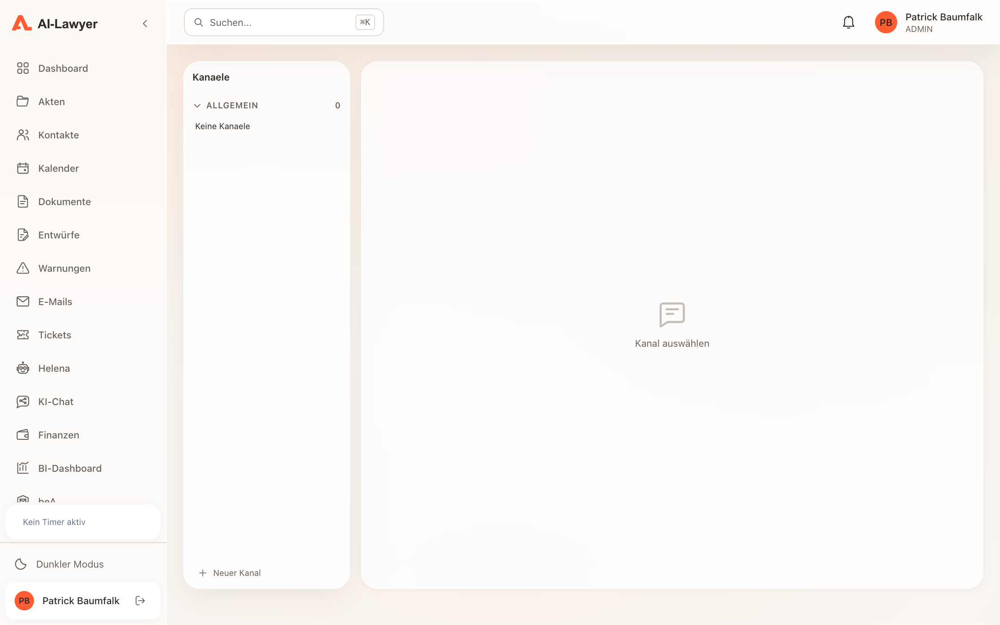

# 11 — Nachrichten im Team

AI-Lawyer hat einen eingebauten Team-Chat. Er ersetzt kurze Abstimmungen per E-Mail oder Zuruf: allgemeine Kanäle für die ganze Kanzlei, ein eigener Kanal je Akte und die Nachrichten von Mandanten aus dem Portal. Dazu kommen die Benachrichtigungen, die AI-Lawyer selbst verschickt, etwa zu Fristen oder neuen Helena-Entwürfen.

## Die Seite Nachrichten

Klicken Sie in der Seitenleiste auf **Nachrichten**. Die Zahl am Menüpunkt nennt alle ungelesenen Nachrichten aus Ihren Kanälen.

Links steht die Liste **Kanaele** in drei Gruppen, jede auf- und zuklappbar:

| Gruppe | Inhalt | Wer ist Mitglied? |
| --- | --- | --- |
| **Allgemein** | Kanzleiweite Kanäle. Ab Werk gibt es „Allgemein“ und „Organisation“. | Bei den beiden Standardkanälen alle Benutzer, die beim ersten Start schon angelegt waren; später angelegte Benutzer werden nicht automatisch Mitglied. Bei neuen Kanälen zunächst nur, wer ihn angelegt hat. |
| **Akten** | Ein Kanal je Akte, Name „Akte: <Kurzrubrum>“. Erscheint erst, wenn der Kanal einmal geöffnet wurde. | Zuständige Anwältin, Sachbearbeiter und die Mitglieder der Dezernate der Akte. |
| **Mandantenportal** | Unterhaltungen mit Mandanten aus dem Portal ([Kapitel 12](12-mandantenportal.md)). | In dieser Liste: der Mandant und die zuständige Anwältin bzw. der zuständige Anwalt. Lesen und antworten dürfen außerdem alle Mitarbeiter mit Zugriff auf die Akte, über den Reiter **Portal** der Akte. |

Die Zahl hinter einem Kanal nennt die ungelesenen Nachrichten. Beim Öffnen der Seite ist der erste Kanal ausgewählt. Sobald Sie einen Kanal öffnen, gilt er für Sie als gelesen.

## Eine Nachricht schreiben

1. Wählen Sie links den Kanal.
2. Schreiben Sie unten in das Feld **Nachricht schreiben...**.
3. **Enter** sendet, **Umschalt + Enter** macht einen Zeilenumbruch.

Während jemand schreibt, steht über dem Eingabefeld z. B. „Anna tippt...“ oder „Mehrere Personen tippen...“. Kommen neue Nachrichten herein, während Sie weiter oben lesen, erscheint der Knopf **Neue Nachrichten**; ein Klick springt nach unten. Ältere Nachrichten holen Sie mit **Aeltere laden** nach.

### Erwähnungen

Tippen Sie `@`, öffnet sich eine Auswahl:

- **alle** benachrichtigt alle Mitglieder des Kanals (außer Ihnen).
- **Helena** gibt Helena einen Auftrag (siehe unten).
- Danach folgen die Mitglieder des Kanals. Mit den Pfeiltasten wählen, mit **Enter** übernehmen, mit **Esc** schließen.

Wer erwähnt wird, bekommt eine Benachrichtigung „<Name> hat dich erwaehnt“ mit dem Anfang der Nachricht. Erwähnt werden können nur Mitglieder des Kanals; der Name muss genau so geschrieben sein, wie er in der Auswahl steht.

### Dokumente anhängen

1. Klicken Sie auf die Büroklammer **Dokument anhaengen**.
2. Suchen Sie im Feld **Dokument suchen...** und klicken Sie das Dokument an.
3. Senden Sie die Nachricht.

Die Auswahl zeigt die ersten 50 Dokumente, auf die Sie Zugriff haben; die Suche filtert nur innerhalb dieser 50. Im Kanal erscheint das Dokument als Name unter der Nachricht. Ein Klick darauf öffnet es derzeit nicht; suchen Sie es über **Dokumente** oder die Akte ([Kapitel 5](05-dokumente.md)).

## Kanäle

### Einen allgemeinen Kanal anlegen

1. Klicken Sie unten in der Kanalliste auf **Neuer Kanal**.
2. Geben Sie einen **Kanalname** ein (z. B. „Mandanten“) und bei Bedarf eine **Beschreibung (optional)**.
3. Klicken Sie auf **Erstellen**. Es erscheint *„Kanal "…" erstellt“*.

Das darf jede angemeldete Person. Sie sind danach das einzige Mitglied. Eine Möglichkeit, weitere Personen über die Oberfläche hinzuzufügen oder einem bestehenden Kanal beizutreten, gibt es derzeit nicht. Die Schnittstelle kennt zwar einen Beitritt (`POST /api/channels/<id>/members`), aber nur für die eigene Person. Nutzen Sie für kanzleiweite Themen deshalb die Standardkanäle „Allgemein“ und „Organisation“.

### Der Kanal einer Akte

In jeder Akte gibt es den Reiter **Chat** (im Menü **Weitere Tabs** mit den drei Punkten). Beim ersten Öffnen legt AI-Lawyer den Aktenkanal an. Ab dann steht er auch unter **Nachrichten** in der Gruppe **Akten**.

Wer Zugriff auf die Akte hat, darf im Aktenkanal lesen und schreiben. Neu zugewiesene Personen werden beim nächsten Öffnen automatisch Mitglied. Wer den Zugriff verliert, bleibt Mitglied in der Liste, kann den Kanal aber nicht mehr lesen.

Ist der Kanal noch leer, steht dort „Noch keine Nachrichten – Starten Sie eine Konversation zu dieser Akte.“

### Helena im Kanal

In einem **Aktenkanal** können Sie Helena mit `@Helena` und einem Auftrag ansprechen, z. B. `@Helena fasse den Schriftverkehr der letzten zwei Wochen zusammen`. Helena erledigt den Auftrag im Hintergrund und schreibt ihre Antwort als eigene Nachricht in den Kanal. Was sie dabei als Entwurf anlegt, müssen Sie wie immer prüfen ([Kapitel 9](09-helena.md#helena-aufträge)).

In allgemeinen Kanälen löst `@Helena` nichts aus, weil Helena dort keine Akte zuordnen kann.

## Was es (noch) nicht gibt

Ehrlich gesagt ist der Team-Chat bewusst einfach gehalten. Die Oberfläche bietet derzeit nicht:

| Funktion | Stand |
| --- | --- |
| Antworten auf eine bestimmte Nachricht (Threads) | Nicht in der Oberfläche. Wird eine Antwort über die Schnittstelle erzeugt, zeigt AI-Lawyer das Zitat der Ursprungsnachricht an. |
| Reaktionen (Emojis) | Vorhandene Reaktionen werden mit Anzahl angezeigt; ein Klick darauf setzt oder entfernt Ihre eigene. Eine neue Reaktion hinzufügen können Sie nicht. |
| Nachricht bearbeiten oder löschen | Nur über die Schnittstelle. Bearbeitete Nachrichten zeigen „(bearbeitet)“, gelöschte „Nachricht geloescht“. |
| Lesebestätigungen je Nachricht | Nein. AI-Lawyer merkt sich nur, bis wann Sie einen Kanal gelesen haben, und zählt daraus die ungelesenen. |
| Suche in Nachrichten | Nein, auch die globale Suche ([Kapitel 13](13-suche-und-auswertung.md)) findet keine Nachrichten. |
| Direktnachrichten an eine Person | Nein. |

## Benachrichtigungen

Oben rechts im Kopf jeder Seite sitzt die Glocke **Benachrichtigungen**. Die Zahl daran nennt die ungelesenen.

1. Klicken Sie auf die Glocke. Die Liste zeigt die letzten Benachrichtigungen.
2. Ein Klick auf einen Eintrag öffnet die zugehörige Seite, falls es eine gibt, und markiert ihn als gelesen.
3. **Alle gelesen** markiert alle, das Kreuz **Benachrichtigung verwerfen** entfernt einen Eintrag.

Neue Benachrichtigungen erscheinen zusätzlich kurz unten im Bild; mit **Anzeigen** springen Sie hin. Beim ersten Besuch fragt der Browser, ob AI-Lawyer Benachrichtigungen anzeigen darf. Wenn Sie zustimmen, erscheinen sie auch als Systemmitteilung, solange AI-Lawyer in einem Hintergrund-Tab offen ist.

Typische Benachrichtigungen:

| Titel (Beispiel) | Anlass |
| --- | --- |
| Vorfrist- und Fristerinnerungen | Eine Frist naht oder ist überschritten ([Kapitel 6](06-fristen-und-kalender.md)). |
| „<Name> hat dich erwaehnt“ | Erwähnung im Team-Chat. |
| „Neuer Helena-Entwurf: …“, „Helena-Entwurf ueberarbeitet: …“ | Helena hat einen Entwurf in Ihrer Akte angelegt oder überarbeitet ([Kapitel 9](09-helena.md)). |
| „Helena: Frist erkannt“, „Helena: Beteiligte erkannt“, „Helena: Antwort-Entwurf erstellt“, „Helena: Ihr Tagesbriefing“ | Neue Vorschläge im Helena-Reiter **Vorschlaege**. |
| „Kritische Frist: …“ | Warnung des nächtlichen Scanners. |
| „Unbehandelte Warnung: …“ | Nur Administratoren: eine Warnung liegt seit sieben Tagen. |
| „Mandant-Upload“ | Ein Mandant hat im Portal ein Dokument hochgeladen ([Kapitel 12](12-mandantenportal.md)). |
| „E-Mail-Verbindung fehlgeschlagen“, „E-Mail-Versand fehlgeschlagen“ | Problem mit einem Postfach ([Kapitel 7](07-email-und-tickets.md)). |
| „Falldaten-Template genehmigt“ / „… abgelehnt“ | Entscheidung über ein eingereichtes Falldatenblatt. |

Bei fehlgeschlagenen Hintergrundaufgaben bietet der Eintrag **Erneut versuchen** an.

Welche Fristbenachrichtigungen verschickt werden, stellt die Administration unter **Einstellungen → Benachrichtigungen** ein. Einzelne Benutzer können ihre Fristbenachrichtigungen nicht selbst abschalten ([Kapitel 16](16-einstellungen-und-vorlagen.md)).

## Urlaub und Vertretung

Urlaubszeiten und Vertretungen trägt die Administration unter **Einstellungen → Vertretung & Urlaub** ein ([Kapitel 15](15-benutzer-und-rollen.md)). Für Sie im Alltag sichtbar wird das an drei Stellen:

- **Fristerinnerungen**: Ist die verantwortliche Person im Urlaub und ein Vertreter eingetragen, bekommt der Vertreter die Erinnerung mit dem Zusatz „[Vertretung fuer <Name>]“.
- **Warnungen**: Die Scanner-Warnungen **Inaktive Akte**, **Fehlende Beteiligte** und **Fehlende Dokumente** bekommt in dieser Zeit zusätzlich der Vertreter ([Kapitel 9](09-helena.md#warnungen)).
- **Gamification**: Urlaubstage unterbrechen Ihre Serie nicht ([Kapitel 14](14-gamification.md#streaks)).

Nachrichten im Team-Chat und Erwähnungen werden nicht an Vertreter weitergeleitet.

## Wenn etwas nicht klappt

| Meldung | Bedeutung | Was tun? |
| --- | --- | --- |
| *Fehler beim Senden* | Die Nachricht wurde nicht gespeichert. | Text ist noch im Feld; erneut senden. |
| *Du bist kein Mitglied dieses Kanals* | Sie sind nicht Mitglied eines allgemeinen Kanals. | Ein Mitglied oder die Administration fragen. |
| *Kein Zugriff auf diese Akte* (Akten- oder Portal-Kanal) | Sie haben keinen Zugriff auf die Akte des Kanals. | Zugriff auf die Akte prüfen lassen ([Kapitel 15](15-benutzer-und-rollen.md)). |
| *Ein Kanal mit diesem Namen existiert bereits* | Kanalname ist schon vergeben. | Anderen Namen wählen. |
| *Kanal konnte nicht geladen werden* (Reiter **Chat** der Akte) | Kein Zugriff auf die Akte oder Serverfehler. | **Erneut versuchen**; sonst Zugriff auf die Akte prüfen lassen. |
| Ein Aktenkanal fehlt unter **Nachrichten** | Der Kanal wurde noch nie geöffnet. | Einmal den Reiter **Chat** der Akte öffnen. |
| Eine Erwähnung kommt nicht an | Die Person ist nicht Mitglied des Kanals oder der Name ist anders geschrieben. | Namen aus der `@`-Auswahl übernehmen. |
| Keine Systemmitteilungen des Browsers | Der Browser hat die Erlaubnis nicht erhalten. | In den Website-Einstellungen des Browsers Benachrichtigungen für AI-Lawyer erlauben. |

---

Weiter: [12 — Mandantenportal](12-mandantenportal.md) · [Zur Übersicht](README.md)
