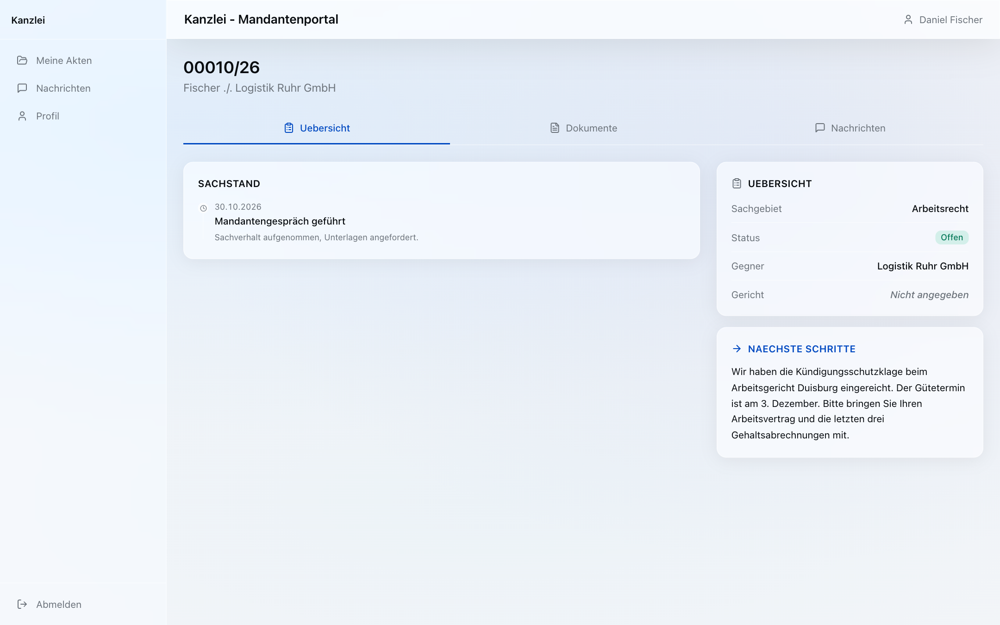

# 12 — Mandantenportal

Über das Mandantenportal sehen Ihre Mandantinnen und Mandanten den Stand ihres Verfahrens, laden freigegebene Dokumente herunter, schicken eigene Unterlagen und schreiben der Kanzlei. Dieses Kapitel hat zwei Teile: Teil A beschreibt, was die Kanzlei tut, Teil B, was Mandanten im Portal sehen. Teil B können Sie Mandanten auch als Anleitung weitergeben.

Das Prinzip: Im Portal erscheint nur, was die Kanzlei ausdrücklich freigibt. Interne Notizen, Entwürfe, Fristen, Rechnungen und alle anderen Akteninhalte bleiben unsichtbar.

## Teil A — Für die Kanzlei

### Einen Mandanten einladen

Voraussetzungen: Der Mandant ist in der Akte als Beteiligter mit der Rolle **Mandant** eingetragen, und am Kontakt ist eine E-Mail-Adresse hinterlegt ([Kapitel 4](04-kontakte.md)). Einladen dürfen nur **Anwalt** und **Administrator**.

1. Öffnen Sie die Akte, Reiter **Aktivitaeten**. Oben stehen die Beteiligten.
2. Klicken Sie beim Mandanten auf **Portal-Einladung**.
3. Das Fenster **Portal-Einladung senden** zeigt Namen und E-Mail-Adresse. Prüfen Sie die Adresse.
4. Klicken Sie auf **Einladung senden**. Es erscheint *„Einladung an … gesendet“*.

Der Mandant bekommt eine E-Mail „Einladung zum Mandantenportal — <Kanzleiname>“ mit einem Aktivierungslink. Der Link ist **7 Tage** gültig. Schicken Sie eine neue Einladung, wird die alte ungültig.

Gut zu wissen:

- Ein Mandant hat **ein** Portalkonto. Er sieht darin **alle Akten**, in denen sein Kontakt als Mandant eingetragen ist, auch spätere und auch abgeschlossene. Eine zweite Einladung für eine weitere Akte ist weder nötig noch möglich (*„Mandant hat bereits einen Portal-Account“*).
- Die Einladungs-E-Mail wird unabhängig vom Häkchen für die E-Mail-Einwilligung am Kontakt verschickt.
- Einen Knopf zum erneuten Senden, eine Übersicht offener Einladungen oder eine Möglichkeit, ein Portalkonto zu sperren, gibt es in der Oberfläche derzeit nicht. Abgelaufen? Einfach erneut **Portal-Einladung** klicken, solange das Konto noch nicht aktiviert ist.

### Dokumente freigeben

Dokumente sind für Mandanten zunächst unsichtbar. So geben Sie eines frei:

1. Öffnen Sie in der Akte den Reiter **Dokumente**.
2. Klicken Sie in der Zeile des Dokuments auf das Augen-Symbol. Der Hinweis wechselt von **Fuer Mandant unsichtbar** zu **Fuer Mandant sichtbar**, das Symbol wird grün.
3. Es erscheint *„Dokument fuer Mandant sichtbar“*.

Das Augen-Symbol sehen **Administrator**, **Anwalt** und **Sachbearbeiter**. Beim Freigeben passiert dreierlei: Im Sachstand des Mandanten erscheint der Eintrag „Dokument "…" fuer Mandant freigegeben“, der Mandant bekommt eine E-Mail (siehe unten), und die Änderung wird im Audit-Trail protokolliert. Ein erneuter Klick nimmt die Freigabe zurück (*„Dokument fuer Mandant verborgen“*); der Eintrag im Sachstand bleibt aber stehen.

> Prüfen Sie vor der Freigabe, welche Fassung Sie freigeben. Die Freigabe für den Mandanten ist unabhängig vom Dokumentstatus: Auch ein Dokument mit Status **Entwurf** wird sichtbar, wenn Sie das Auge anklicken.

### Nächste Schritte für den Mandanten

Oberhalb der Reiter jeder Akte steht das Feld **Naechste Schritte (fuer Mandant)** mit dem Hinweis „Dieser Text ist fuer den Mandanten im Portal sichtbar.“ Sichtbar ist es für **Administrator**, **Anwalt** und **Sachbearbeiter**.

1. Schreiben Sie in verständlicher Sprache, was als Nächstes passiert, z. B. „Wir warten auf die Antwort des Gerichts. Voraussichtlich bis Ende des Monats.“
2. Klicken Sie auf **Speichern** (*„Naechste Schritte gespeichert“*).

Der Text steht im Portal auf der Aktenübersicht. Jedes Speichern erzeugt im Sachstand den Eintrag „Naechste Schritte aktualisiert“ mit dem neuen Text und löst eine E-Mail an den Mandanten aus.

### Was der Mandant im Sachstand sieht

Der Sachstand im Portal zeigt nur Einträge des Aktivitätsverlaufs, die ausdrücklich für den Mandanten bestimmt sind. Das sind derzeit genau drei Arten:

- freigegebene Dokumente,
- Aktualisierungen der nächsten Schritte,
- Dokumente, die der Mandant selbst hochgeladen hat.

Notizen, Telefonnotizen, Aufgaben, E-Mails, Fristen und Helena-Einträge erscheinen nie. Einen Schalter, um einzelne andere Verlaufseinträge freizugeben, gibt es nicht. Namen von Kanzleimitarbeitenden werden im Sachstand nicht angezeigt.

### Portal-Nachrichten beantworten

Nachrichten des Mandanten sehen Sie an zwei Stellen:

- In der Akte im Reiter **Portal** (Menü **Weitere Tabs** mit den drei Punkten). Ein Klick auf die Unterhaltung öffnet sie; **Zurueck zur Uebersicht** führt zur Liste.
- Unter **Nachrichten** in der Gruppe **Mandantenportal** ([Kapitel 11](11-team-nachrichten.md)).

Die Unterhaltung entsteht erst, wenn der Mandant im Portal **Nachrichten** öffnet. Vorher steht im Reiter **Portal** „Noch keine Portal-Nachrichten – Mandanten koennen ueber das Portal Nachrichten senden.“ Sie können also nicht von sich aus die erste Portal-Nachricht schreiben; nutzen Sie dafür E-Mail oder Telefon.

Mitglieder der Unterhaltung sind der Mandant und die zuständige Anwältin bzw. der zuständige Anwalt der Akte (dazu Administratoren). Andere Kolleginnen und Kollegen sehen die Unterhaltung im Reiter **Portal**, können aber nicht schreiben (*„Du bist kein Mitglied dieses Kanals“*). Hat die Akte keinen zuständigen Anwalt, kann der Mandant keine Nachrichten schreiben.

Anhänge des Mandanten landen als Dokumente in der Akte im Ordner **Mandant**. Die zuständige Anwältin bzw. der zuständige Anwalt bekommt dazu die Benachrichtigung „Mandant-Upload“.

### E-Mails an den Mandanten

AI-Lawyer schickt Mandanten bei drei Ereignissen eine kurze E-Mail mit Link ins Portal:

| Anlass | Betreff |
| --- | --- |
| Die Kanzlei schreibt eine Portal-Nachricht. | [<Kanzleiname>] Neue Nachricht zu Ihrem Verfahren |
| Ein Dokument wird freigegeben. | [<Kanzleiname>] Neues Dokument in Ihrem Portal verfuegbar |
| Die nächsten Schritte werden gespeichert. | [<Kanzleiname>] Aktualisierung zu Ihrem Verfahren |

Die E-Mails enthalten bewusst keine Inhalte aus der Akte, nur den Hinweis und den Link. Sie gehen nur an Kontakte, bei denen die **E-Mail-Einwilligung** gesetzt ist ([Kapitel 4](04-kontakte.md)). Pro Anlass, Mandant und Akte geht höchstens eine E-Mail am Tag hinaus; wer am selben Tag drei Dokumente freigibt, löst eine E-Mail aus.

Beachten Sie: Die E-Mails gehen an **alle** Beteiligten mit Rolle Mandant in der Akte, die eine E-Mail-Einwilligung haben, auch an solche ohne Portalkonto. Geben Sie deshalb nichts frei, bevor der Mandant eingeladen ist, oder rechnen Sie mit Rückfragen.

## Teil B — Für Mandanten

### Zugang aktivieren

1. Öffnen Sie den Link aus der E-Mail „Einladung zum Mandantenportal“. Es erscheint **Willkommen im Mandantenportal**.
2. Wählen Sie ein **Passwort** und wiederholen Sie es unter **Passwort bestaetigen**. Es braucht mindestens 8 Zeichen, einen Großbuchstaben und eine Zahl.
3. Klicken Sie auf **Account aktivieren**. Nach *„Account aktiviert!“* führt **Zur Anmeldung** zum Login.

Der Link ist 7 Tage gültig. Ist er abgelaufen, bitten Sie Ihre Kanzlei um eine neue Einladung.

### Anmelden

1. Rufen Sie die Anmeldeseite des Portals auf (Adresse der Kanzlei mit `/portal/login`). Sie heißt **Mandantenportal – Sicherer Zugang zu Ihren Akten**.
2. Geben Sie Ihre **E-Mail-Adresse** und Ihr **Passwort** ein und klicken Sie auf **Anmelden**.

Nach 30 Minuten ohne Aktivität meldet das Portal Sie ab. Fünf Minuten vorher erscheint **Sitzung laeuft ab**; mit **Weiter** bleiben Sie angemeldet. Abmelden können Sie jederzeit links mit **Abmelden**.

### Passwort vergessen

1. Klicken Sie auf der Anmeldeseite auf **Passwort vergessen?**.
2. Geben Sie Ihre E-Mail-Adresse ein und klicken Sie auf **Zuruecksetzen**.
3. Sie erhalten eine E-Mail „Passwort zuruecksetzen — <Kanzleiname> Mandantenportal“. Der Link darin ist **eine Stunde** gültig.
4. Wählen Sie unter **Neues Passwort setzen** das neue Passwort und bestätigen Sie mit **Neues Passwort setzen**.

Aus Sicherheitsgründen meldet das Portal immer „Falls ein Account mit dieser E-Mail existiert, erhalten Sie in Kuerze eine E-Mail …“, auch wenn die Adresse unbekannt ist.

### Meine Akten

Links finden Sie **Meine Akten**, **Nachrichten** und **Profil**.

Haben Sie nur eine Akte bei der Kanzlei, öffnet das Portal sie direkt. Bei mehreren zeigt **Meine Vorgaenge** eine Karte je Akte mit Aktenzeichen, Kurzbezeichnung, Rechtsgebiet, Status und dem Anfang der nächsten Schritte.

### Eine Akte ansehen

Eine Akte hat drei Reiter: **Uebersicht**, **Dokumente** und **Nachrichten**. Mit **Zurueck zur Uebersicht** kommen Sie zu Ihren Akten.

Die **Uebersicht** zeigt:

- **Sachstand**: was zuletzt passiert ist, neueste Einträge oben; ältere mit **Mehr laden**.
- **Uebersicht**: Rechtsgebiet, Status, Gegner und Gericht.
- **Naechste Schritte**: was Ihre Kanzlei als Nächstes plant. Steht dort „Ihr Anwalt hat noch keine naechsten Schritte hinterlegt.“, ist noch nichts eingetragen.

### Dokumente

Im Reiter **Dokumente** stehen alle Dokumente, die Ihre Kanzlei für Sie freigegeben hat, nach Ordnern gruppiert. Ein Klick auf das Download-Symbol lädt das Dokument herunter.

Eigene Unterlagen schicken Sie so:

1. Ziehen Sie die Datei in das Feld **Datei hierher ziehen oder klicken** oder klicken Sie darauf und wählen Sie die Datei.
2. Nach *„Dokument hochgeladen“* steht die Datei im Ordner **Mandant** mit dem Hinweis **Von mir hochgeladen**.

Eine Datei darf höchstens 50 MB groß sein. Ihre Anwältin bzw. Ihr Anwalt wird über den Upload benachrichtigt.

### Nachrichten

Im Reiter **Nachrichten** (oder links unter **Nachrichten**) schreiben Sie Ihrer Kanzlei: **Nachrichten an Ihre Kanzlei**.

1. Schreiben Sie in das Feld **Nachricht schreiben...**.
2. Mit der Büroklammer **Datei anhaengen** fügen Sie bis zu 5 Dateien mit je höchstens 25 MB hinzu.
3. **Enter** sendet, **Umschalt + Enter** macht einen Zeilenumbruch.

Neue Antworten der Kanzlei erscheinen ohne Neuladen; das Portal fragt alle 10 Sekunden nach. Haben Sie mehrere Akten, öffnet der Menüpunkt **Nachrichten** links die Nachrichten Ihrer ersten Akte; für eine andere Akte wählen Sie diese unter **Meine Akten** und dort den Reiter **Nachrichten**.

### Profil

Unter **Profil** (**Mein Profil**) sehen Sie **Ihre Kontaktdaten**: Name, E-Mail, Telefon, Mobil und Adresse. Ändern können Sie sie nicht selbst: „Kontaktdaten werden von Ihrer Kanzlei verwaltet. Bei Aenderungen wenden Sie sich bitte an Ihren Anwalt.“

Ihr Passwort ändern Sie unter **Passwort aendern**: **Aktuelles Passwort**, **Neues Passwort**, **Neues Passwort bestaetigen**, dann **Passwort aendern**.

## Datentrennung

Die Trennung zwischen Mandanten geschieht auf dem Server, nicht nur in der Anzeige. Bei jedem Abruf prüft AI-Lawyer die Kette Portalkonto → Kontakt → Beteiligter mit Rolle Mandant → Akte. Nur wenn diese Kette besteht, liefert der Server Akte, Sachstand, Dokumente oder Nachrichten aus. Fragt ein Mandant eine fremde Akte ab, antwortet der Server so, als gäbe es sie nicht. Dokumente werden nur ausgeliefert, wenn sie freigegeben sind; der Download-Link gilt eine Stunde.

Wird der Mandant aus der Akte als Beteiligter entfernt oder seine Rolle geändert, verschwindet die Akte sofort aus seinem Portal.

## Wenn etwas nicht klappt

| Meldung | Bedeutung | Was tun? |
| --- | --- | --- |
| *Keine E-Mail-Adresse hinterlegt. Bitte zuerst eine E-Mail beim Kontakt erfassen.* | Am Kontakt fehlt die E-Mail. | E-Mail im Kontakt eintragen, dann einladen. |
| *Mandant hat bereits einen Portal-Account* | Der Kontakt hat schon ein Portalkonto. | Nichts tun: Die Akte erscheint dort automatisch. |
| *Keine Berechtigung. Nur Anwaelte und Admins koennen Einladungen versenden.* | Ihre Rolle darf nicht einladen. | Anwältin oder Administration bitten. |
| Knopf **Portal-Einladung** fehlt | Beteiligter hat nicht die Rolle Mandant, oder Ihre Rolle darf nicht einladen. | Rolle des Beteiligten prüfen ([Kapitel 3](03-akten.md#beteiligte)). |
| *Einladung ungueltig oder abgelaufen* | Link älter als 7 Tage oder durch neue Einladung ersetzt. | Kanzlei um neue Einladung bitten. |
| *Passwort muss mindestens 8 Zeichen, 1 Grossbuchstabe und 1 Zahl enthalten.* | Passwort zu schwach. | Längeres Passwort mit Großbuchstabe und Zahl wählen. |
| *Passwoerter stimmen nicht ueberein.* | Wiederholung weicht ab. | Beide Felder neu ausfüllen. |
| *Ungueltige Anmeldedaten. Bitte versuchen Sie es erneut.* | E-Mail oder Passwort falsch, oder Konto noch nicht aktiviert. | **Passwort vergessen?** nutzen. |
| *Link ungueltig oder abgelaufen* (Passwort zurücksetzen) | Link älter als eine Stunde. | Erneut **Passwort vergessen?** anfordern. |
| *Maximale Dateigroesse: 50 MB* | Datei zu groß. | Datei verkleinern oder aufteilen. |
| *Akte hat keinen zustaendigen Anwalt* | Mandant kann keine Nachrichten schreiben. | In der Akte einen Anwalt eintragen. |
| *Sie haben derzeit keine aktiven Vorgaenge.* | Kein Kontakt mit Rolle Mandant verknüpft. | Beteiligte der Akte prüfen. |
| Mandant bekommt keine Hinweis-E-Mails | E-Mail-Einwilligung am Kontakt fehlt, oder es ging heute schon eine E-Mail zu diesem Anlass hinaus. | Einwilligung prüfen; Versand der Kanzlei-E-Mails prüfen lassen ([Kapitel 7](07-email-und-tickets.md)). |

---

Weiter: [13 — Suche und Auswertung](13-suche-und-auswertung.md) · [Zur Übersicht](README.md)
