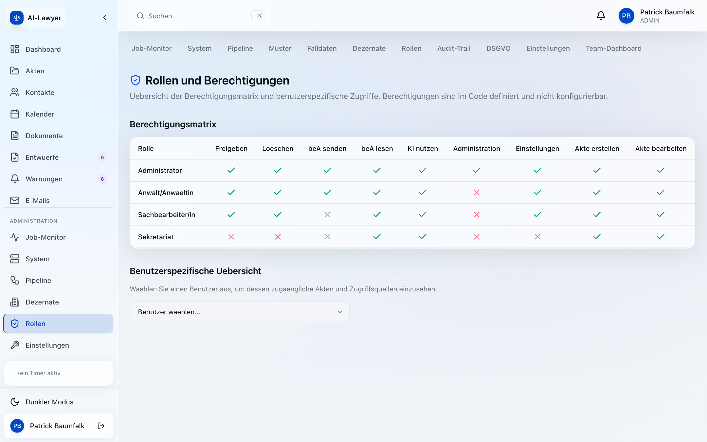

# 15 — Benutzer und Rollen

Dieses Kapitel erklärt, wer in AI-Lawyer was darf: die fünf Rollen und ihre Rechte, wie ein Benutzer Zugriff auf eine Akte bekommt (direkt, über ein Dezernat oder als Admin), die Pflicht zur Zwei-Faktor-Anmeldung, Urlaub und Vertretung sowie das Team-Dashboard. Alle Seiten in diesem Kapitel sind nur für die Rolle **Administrator** sichtbar.



## Wo die Verwaltung liegt

Der Admin-Bereich steht in der Seitenleiste unter der Überschrift **Administration**. Dort finden Sie **Dezernate** und **Rollen**. Weitere Seiten (**Audit-Trail**, **DSGVO**, **Team-Dashboard**) erreichen Sie über die Reiterleiste, die oben auf jeder Admin-Seite steht.

Wer nicht Administrator ist und eine Admin-Adresse aufruft, landet ohne Meldung wieder auf dem Dashboard.

## Benutzer anlegen, deaktivieren, Passwort zurücksetzen

Ehrlich vorweg: **Eine Benutzerverwaltung für Kanzleimitarbeitende gibt es in der Oberfläche derzeit nicht.** Es gibt keinen Knopf zum Anlegen, Einladen, Deaktivieren oder zum Zurücksetzen eines Passworts. Die Seite **Rollen** zeigt Benutzer nur an.

Was es gibt:

| Vorgang | Stand im Code | Wie es heute geht |
| --- | --- | --- |
| Mitarbeitende anlegen | Kein Dialog, keine Schnittstelle | Nur über die Datenbank. Die Beispieldaten (`npm run db:seed`) legen drei Testkonten an (Administrator, Anwältin, Sachbearbeiterin) mit dem Passwort `password123`. Diese Passwörter vor dem Echtbetrieb ändern. |
| Mandanten-Zugang | Einladung aus der Akte | Über das Mandantenportal, siehe [Kapitel 12](12-mandantenportal.md). Nur so entstehen Konten mit der Rolle Mandant. |
| Benutzer deaktivieren | Feld `aktiv` im Benutzerdatensatz | Nur über die Datenbank. Ein deaktiviertes Konto kann sich nicht mehr anmelden; der Versuch wird im Audit-Trail als *Fehlgeschlagener Login-Versuch* mit Grund „Konto deaktiviert“ vermerkt. |
| Passwort vergessen (Mitarbeitende) | Keine Funktion | Die IT setzt in der Datenbank einen neuen bcrypt-Hash im Feld `passwordHash` (Tabelle `users`). |
| Passwort vergessen (Mandant) | Vorhanden | Im Portal über **Passwort vergessen**, siehe [Kapitel 12](12-mandantenportal.md). |

Für Arbeiten direkt in der Datenbank bringt AI-Lawyer `npm run db:studio` (Prisma Studio) mit. Das ist Sache der IT ([Kapitel 20](20-konfiguration.md)).

## Die fünf Rollen

| Rolle (Anzeige) | Gedacht für |
| --- | --- |
| **Administrator** | Kanzleiinhaber, IT. Sieht alle Akten und den Admin-Bereich. |
| **Anwalt/Anwaeltin** | Berufsträger. Darf freigeben, beA senden, eEB abgeben. |
| **Sachbearbeiter/in** | Fachangestellte. Darf freigeben und löschen, aber kein beA senden. |
| **Sekretariat** | Empfang, Schreibdienst. Darf Akten anlegen und bearbeiten, aber nicht freigeben oder löschen. |
| **Mandant** | Mandantinnen und Mandanten. Nur Mandantenportal ([Kapitel 12](12-mandantenportal.md)). |

Die Rechte sind **im Code festgelegt und nicht einstellbar**. Das steht auch auf der Seite **Rollen** („Berechtigungen sind im Code definiert und nicht konfigurierbar.“).

## Die Rechte-Matrix

So steht es in der Matrix (Spaltenbeschriftungen wie auf der Seite **Rollen**). Die Seite selbst zeigt nur die vier Kanzleirollen; die Spalte Mandant ist hier ergänzt.

| Berechtigung | Administrator | Anwalt/Anwaeltin | Sachbearbeiter/in | Sekretariat | Mandant |
| --- | --- | --- | --- | --- | --- |
| **Freigeben** | ja | ja | ja | – | – |
| **Loeschen** | ja | ja | ja | – | – |
| **beA senden** | ja | ja | – | – | – |
| **beA lesen** | ja | ja | ja | ja | – |
| **KI nutzen** | ja | ja | ja | ja | – |
| **Administration** | ja | – | – | – | – |
| **Einstellungen** | ja | ja | ja | – | – |
| **Akte erstellen** | ja | ja | ja | ja | – |
| **Akte bearbeiten** | ja | ja | ja | ja | – |

Wo das im Programm tatsächlich geprüft wird:

| Berechtigung | Wirkt auf |
| --- | --- |
| **Freigeben** | Dokument freigeben und Freigabe zurücknehmen. Ausnahme: Vorlagen freigeben dürfen nur Administrator und Anwalt/Anwältin. |
| **Loeschen** | Dokumente löschen. |
| **beA senden** | beA-Nachrichten senden und ändern. Das elektronische Empfangsbekenntnis (eEB) dürfen nur Anwalt/Anwältin und Administrator abgeben ([Kapitel 8](08-bea.md)). |
| **beA lesen** | beA-Posteingang, Nachrichten öffnen, automatische Zuordnung. |
| **KI nutzen** | KI-Entwürfe. Welche Werkzeuge Helena verwenden darf, hängt zusätzlich von der Rolle ab: Sekretariat darf nur lesen und Notizen anlegen ([Kapitel 9](09-helena.md)). |
| **Administration** | Der gesamte Admin-Bereich. |
| **Einstellungen** | Für das Sekretariat blendet die Seitenleiste **Einstellungen** aus. Die Seite selbst sperrt der Code nicht. Die meisten Reiter dort sieht ohnehin nur der Administrator. |
| **Akte erstellen** | Neue Akte anlegen. |
| **Akte bearbeiten** | Steht in der Matrix, wird im Code derzeit nicht gesondert geprüft. Maßgeblich ist der Aktenzugriff (nächster Abschnitt). |

Daneben gibt es Funktionen, die fest dem Administrator vorbehalten sind, etwa Buchungsperioden und Kostenstellen ([Kapitel 10](10-zeiterfassung-und-abrechnung.md)), Sonder-Quests ([Kapitel 14](14-gamification.md)) und das Neuindizieren von Dokumenten.

Verweigert das Programm eine Aktion, erscheint *Keine Berechtigung*, und im Audit-Trail entsteht der Eintrag *Zugriff verweigert* ([Kapitel 18](18-datenschutz-und-audit.md)).

## Wie Aktenzugriff entsteht

Wer welche Akten sieht, regelt nicht die Rolle allein, sondern die Zuordnung. Es gibt drei Wege:

1. **Direkte Zuweisung.** In der Akte stehen die Felder **Zustaendiger Anwalt** (beim Anlegen) bzw. **Anwalt** (beim Bearbeiten) und **Sachbearbeiter/in**. Wer dort eingetragen ist, hat Zugriff ([Kapitel 3](03-akten.md)).
2. **Dezernat.** Wer Mitglied eines Dezernats ist, sieht alle Akten, die diesem Dezernat zugewiesen sind (siehe unten).
3. **Administrator.** Sieht immer alle Akten.

Alle anderen bekommen eine Akte, auf die sie keinen Zugriff haben, gar nicht erst angezeigt. Ruft jemand sie über die Schnittstelle auf, lautet die Antwort *Nicht gefunden*, nicht *Keine Berechtigung*, damit nicht einmal die Existenz der Akte verraten wird.

**Wichtig:** Eine Akte ohne eingetragenen Anwalt, ohne Sachbearbeiter/in und ohne Dezernat sieht nur der Administrator. Das betrifft insbesondere alle Akten aus der j-lawyer-Übernahme ([Kapitel 17](17-migration-aus-j-lawyer.md)).

**Bekannte Lücke:** Die Aktenliste, die Suche und die Schnittstellen filtern nach diesen Regeln. Die Detailseite einer Akte (`/akten/<ID>`) prüft den Zugriff derzeit nicht selbst. Wer die genaue Adresse einer fremden Akte kennt, kann sie öffnen.

### Zugriff prüfen

Unter **Rollen**, Abschnitt **Benutzerspezifische Uebersicht**:

1. Im Feld **Benutzer waehlen...** eine Person auswählen.
2. Die Tabelle zeigt **Aktenzeichen**, **Kurzrubrum** und **Zugriffsquelle**, z. B. „direkt (Anwalt)“, „direkt (Sachbearbeiter)“, „Dezernat: Familienrecht-Team“ oder „Admin-Override: <Grund>“.

Bei Administratoren steht dort „Administratoren haben Zugriff auf alle Akten.“ Je Quelle werden höchstens 100 Akten aufgeführt.

## Dezernate

Ein Dezernat ist eine Gruppe von Benutzern mit gemeinsamem Aktenzugriff, etwa ein Team je Rechtsgebiet.


### Dezernat anlegen

1. **Administration → Dezernate** öffnen.
2. **Neues Dezernat** klicken.
3. **Name \*** eintragen (Beispiel im Feld: „z.B. Familienrecht-Team“), optional **Beschreibung**.
4. Unter **Mitglieder** die Benutzer anhaken.
5. Unter **Zugewiesene Akten** die Akten anhaken. Das Feld **Aktenzeichen oder Kurzrubrum filtern...** grenzt die Liste ein.
6. **Erstellen** klicken.

Jede Karte zeigt danach Name, Beschreibung, Anzahl **Mitglieder** und **Akten** und bis zu fünf Namen. Mit dem Stift-Symbol (**Bearbeiten**) ändern Sie Mitglieder und Akten, mit dem Papierkorb (**Loeschen**) löschen Sie das Dezernat nach der Rückfrage „Dezernat wirklich loeschen?“.

Grenzen:

- Die Aktenauswahl im Dialog zeigt nur die ersten 100 Akten. Bei größeren Beständen hilft der Filter nur innerhalb dieser 100.
- Ein Dezernat, dem noch Akten zugewiesen sind, lässt sich nicht löschen. Erst alle Akten abwählen, speichern, dann löschen.
- Die Mitgliederliste im Dialog zeigt alle aktiven Benutzer mit E-Mail und technischem Rollennamen. Ein Benutzer kann in mehreren Dezernaten sein.

## Admin-Zugriff auf eine Akte (Override)

Administratoren sehen technisch ohnehin jede Akte. Der Override dient der **Dokumentation**: Wer als Admin in einer fremden Akte arbeitet, hält das mit Grund fest.

1. Die Akte öffnen. Oben erscheint für Administratoren der Knopf **Zugriff uebernehmen**.
2. Im Dialog den Grund eintragen (Feld „Grund fuer die Zugriffsueberschreibung...“). Ohne Grund erscheint *Grund ist erforderlich*.
3. Optional **Gueltig bis (optional)** setzen. „Ohne Angabe gilt die Ueberschreibung unbefristet.“
4. **Zugriff uebernehmen** klicken. Es erscheint „Zugriffsueberschreibung erfolgreich erstellt“, in der Akte dann **Zugriff aktiv**.
5. Zum Beenden **Zugriff aufheben** klicken.

Beide Schritte stehen im Audit-Trail (*hat Admin-Zugriff uebernommen*, rot markiert als sicherheitsrelevant, und *hat Admin-Zugriff zurueckgegeben*). Eine Übersicht steht unter **Dezernate** im Abschnitt **Aktive Admin-Zugriffsueberschreibungen** mit **Akte**, **Grund**, **Erstellt am**, **Gueltig bis** und **Aufheben**.

Zu wissen: Diese Übersicht zeigt nur die eigenen Overrides des angemeldeten Admins. Das Datum **Gueltig bis** wird angezeigt, aber nicht automatisch durchgesetzt. Den Override heben Sie selbst auf.

## Kanzleiweite Finanzen je Anwalt

Standardmäßig sieht ein Anwalt in Rechnungen, Aktenkonto und Zeiterfassung nur die Akten, auf die er Zugriff hat. Administratoren sehen alles.

So geben Sie einzelnen Anwälten den Blick auf alle Finanzen:

1. **Administration → Rollen**, Abschnitt **Benutzerspezifische Uebersicht**.
2. Den Anwalt auswählen.
3. Rechts auf der Karte den Haken **Kanzleiweite Finanzen** setzen. Die Änderung gilt sofort.

Den Haken gibt es nur bei der Rolle Anwalt/Anwältin. Für andere Rollen lehnt das Programm ab: *Kanzleiweite Finanzen ist nur fuer Anwaelte verfuegbar*.

## Zwei-Faktor-Pflicht je Rolle

Jeder Kanzleibenutzer kann die Zwei-Faktor-Anmeldung (Einmalcode aus einer Authenticator-App) für sich einschalten: **Einstellungen → Sicherheit → 2FA aktivieren** ([Kapitel 2](02-erste-schritte.md)). Mandanten können das nicht.

Ob 2FA für bestimmte Rollen **Pflicht** ist, legt die IT über die Umgebungsvariable `TOTP_REQUIRED_ROLES` fest, z. B.:

```
TOTP_REQUIRED_ROLES=ADMIN,ANWALT
```

Die Rollennamen sind die technischen: `ADMIN`, `ANWALT`, `SACHBEARBEITER`, `SEKRETARIAT`. Ist die Variable leer oder fehlt sie, gibt es keine Pflicht. Die Variable steht nicht in `.env.example` und muss von Hand ergänzt werden ([Kapitel 20](20-konfiguration.md)).

So wirkt die Pflicht: Wer zu einer genannten Rolle gehört und 2FA noch nicht eingerichtet hat, wird bei jedem Seitenaufruf auf die Seite **Zwei-Faktor-Authentifizierung erforderlich** umgeleitet („Ihre Rolle erfordert eine aktive Zwei-Faktor-Authentifizierung.“). Nur die Einstellungen bleiben erreichbar.

1. **Zu den Sicherheitseinstellungen** klicken.
2. Die Einstellungen öffnen sich auf dem Reiter **Allgemein**. Auf den Reiter **Sicherheit** wechseln (der direkte Sprung dorthin funktioniert derzeit nicht).
3. **2FA aktivieren**, QR-Code scannen, Code eingeben, **Bestätigen**, Backup-Codes sichern, **Fertig**.

Danach gilt die Pflicht sofort als erfüllt, ohne neue Anmeldung.

Hinweise:

- `MANDANT` **nicht** in die Liste aufnehmen. Mandanten können 2FA nicht einrichten und wären dann aus dem Portal ausgesperrt.
- Unter **Administration → Einstellungen** gibt es das Feld **2FA-Pflicht: Rollen (ENV: TOTP_REQUIRED_ROLES, z.B. ADMIN,ANWALT)**. Es hat derzeit keine Wirkung. Maßgeblich ist allein die Umgebungsvariable.
- Ein Benutzer mit Pflicht kann 2FA in seinen Einstellungen selbst abschalten. Danach wird er sofort wieder auf die Pflichtseite geleitet.

### Backup-Codes und verlorenes Handy

Beim Einrichten erzeugt AI-Lawyer zehn Backup-Codes aus je acht Zeichen (Großbuchstaben und Ziffern). Jeder Code gilt einmal. Bei der Anmeldung führt **Backup-Code verwenden** zur Eingabe. Den Code ohne Bindestrich und in Großbuchstaben eingeben, auch wenn das Feld „xxxx-xxxx“ als Muster zeigt.

Neue Codes erzeugt jeder Benutzer selbst unter **Einstellungen → Sicherheit → Backup-Codes neu generieren** (mit aktuellem App-Code).

**Eine Admin-Funktion zum Zurücksetzen der 2FA eines anderen Benutzers gibt es nicht.** Hat jemand Handy und Backup-Codes verloren, muss die IT in der Datenbank (Tabelle `users`) `totpEnabled` auf `false` sowie `totpSecret` und `backupCodes` zurücksetzen. Der Benutzer richtet 2FA danach neu ein.

## Urlaub und Vertretung

Unter **Einstellungen → Vertretung & Urlaub** (nur für Administratoren sichtbar) pflegen Sie Abwesenheiten.

### Vertreter festlegen

1. In der Liste **Vertretungszuweisungen** beim Benutzer **Bearbeiten** klicken.
2. **Vertreter** wählen, **Von** und **Bis** setzen.
3. **Aktivieren** (Vertretung gilt ab sofort im Zeitraum) oder **Nur speichern** (Vertreter hinterlegt, noch nicht aktiv).

Aktive Vertretungen stehen oben unter **Aktive Vertretungen** mit dem Hinweis **Abwesend**; dort beenden Sie sie mit **Deaktivieren**. **Auf Standard zuruecksetzen** löscht alle Vertretungszuweisungen nach Rückfrage.

Was die Vertretung bewirkt:

- **Fristerinnerungen** gehen im Zeitraum zusätzlich an den Vertreter, mit dem Titelzusatz „[Vertretung fuer <Name>]“, als Mitteilung im Programm und per E-Mail ([Kapitel 6](06-fristen-und-kalender.md)).
- **Warnungen** des Akten-Scanners gehen ebenfalls an den Vertreter.
- Abgelaufene Vertretungen schaltet der Fristen-Worker automatisch ab.

Was sie **nicht** bewirkt: Der Vertreter bekommt keinen Zugriff auf die Akten der abwesenden Person. Soll er darin arbeiten, braucht er eine direkte Zuweisung oder ein gemeinsames Dezernat.

Neben dem Administrator dürfen über die Schnittstelle auch Anwälte und der betroffene Benutzer selbst eine Vertretung setzen; eine eigene Oberfläche dafür haben sie aber nicht.

### Urlaub eintragen

1. Unter **Urlaubsverwaltung** im Feld **Benutzer auswaehlen...** die Person wählen.
2. **Urlaub hinzufuegen**, **Von**, **Bis** und optional **Notiz (optional)** eintragen, **Speichern**.

Urlaubszeiträume dürfen sich nicht überschneiden. Sie wirken derzeit nur auf die Gamification: An Urlaubstagen reißt die Serie (Streak) nicht ab ([Kapitel 14](14-gamification.md)). Auf Fristerinnerungen wirkt nur die Vertretung, nicht der Urlaubseintrag.

## Team-Dashboard

**Administration → Team-Dashboard** zeigt drei Kennzahlen für die ganze Kanzlei, ohne Werte einzelner Personen:

| Kachel | Bedeutung |
| --- | --- |
| **Quest-Erfuellungsquote** | Wie viele der heutigen Tages-Quests die Teilnehmenden im Schnitt erledigt haben, in Prozent. Nur Benutzer mit eingeschalteter Gamification zählen. |
| **Offene Wiedervorlagen** | Aktueller Bestand, Farbe nach Trend (**Steigend**, **Fallend**, **Stabil**). |
| **Bossfight-Teamschaden** | Summe aller Bossfight-Schäden. |

Darunter stehen der Verlauf **Offene Wiedervorlagen der letzten 8 Wochen** und die **Bossfight-Historie**.

Mit **Export <Monat>** laden Sie einen Monatsbericht für den letzten abgeschlossenen Kalendermonat herunter (**PDF herunterladen** oder **CSV herunterladen**). Er enthält Wiedervorlagen je Woche, Anzahl und Nettosumme der Rechnungen im Vergleich zum Vormonat sowie die Quest-Quote.

Ist dem Admin-Konto keine Kanzlei zugeordnet, erscheint nur „Keine Kanzlei zugeordnet.“

## Wenn etwas nicht klappt

| Meldung | Bedeutung | Was tun |
| --- | --- | --- |
| Admin-Seite springt zurück zum Dashboard | Sie sind nicht als Administrator angemeldet. | Mit einem Admin-Konto anmelden. |
| *Fehler beim Laden der Rollen-Daten* | Die Seite **Rollen** konnte ihre Daten nicht laden. | Neu laden; bleibt es, die IT informieren. |
| *Dezernat kann nicht geloescht werden, solange Akten zugewiesen sind* | Dem Dezernat hängen noch Akten an. | Akten abwählen, speichern, dann löschen. |
| *Zugriffsueberschreibung existiert bereits* | Für diese Akte haben Sie schon einen Override. | Den bestehenden nutzen oder erst aufheben. |
| *Ein Benutzer kann nicht sein eigener Vertreter sein* | Vertreter und vertretene Person sind gleich. | Andere Person wählen. |
| *Vertreter nicht gefunden oder inaktiv* | Der gewählte Vertreter ist deaktiviert. | Aktiven Benutzer wählen. |
| *Vertretungszeitraum liegt in der Vergangenheit* | **Bis** liegt vor heute. | Datum korrigieren. |
| *Kein Vertreter zugewiesen* | **Aktivieren** ohne Vertreter. | Erst einen Vertreter wählen. |
| *Ueberschneidung mit bestehendem Urlaubszeitraum* | Der neue Urlaub überlappt einen vorhandenen. | Zeitraum anpassen oder den alten löschen. |
| *Startdatum muss vor dem Enddatum liegen* | **Von** liegt nach **Bis**. | Daten tauschen. |
| Kollege sieht eine Akte nicht | Keine Zuweisung und kein Dezernat. | Unter **Rollen** prüfen, dann zuweisen. |
| Ständige Umleitung auf **Zwei-Faktor-Authentifizierung erforderlich** | Rolle steht in `TOTP_REQUIRED_ROLES`, 2FA fehlt. | 2FA unter **Einstellungen → Sicherheit** einrichten. |

---

Weiter: [16 — Einstellungen und Vorlagen](16-einstellungen-und-vorlagen.md) · [Zur Übersicht](README.md)
