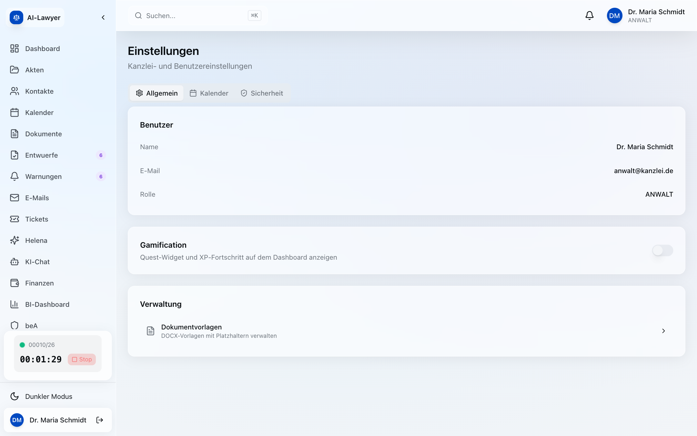
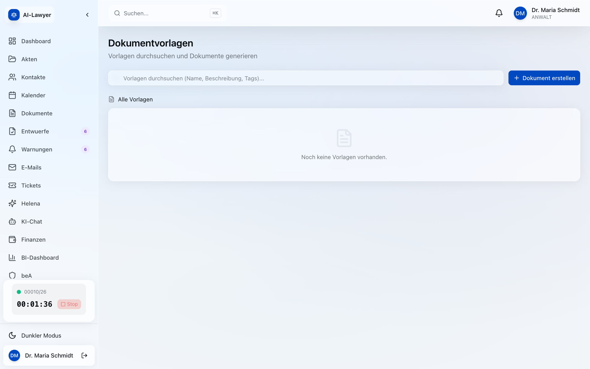
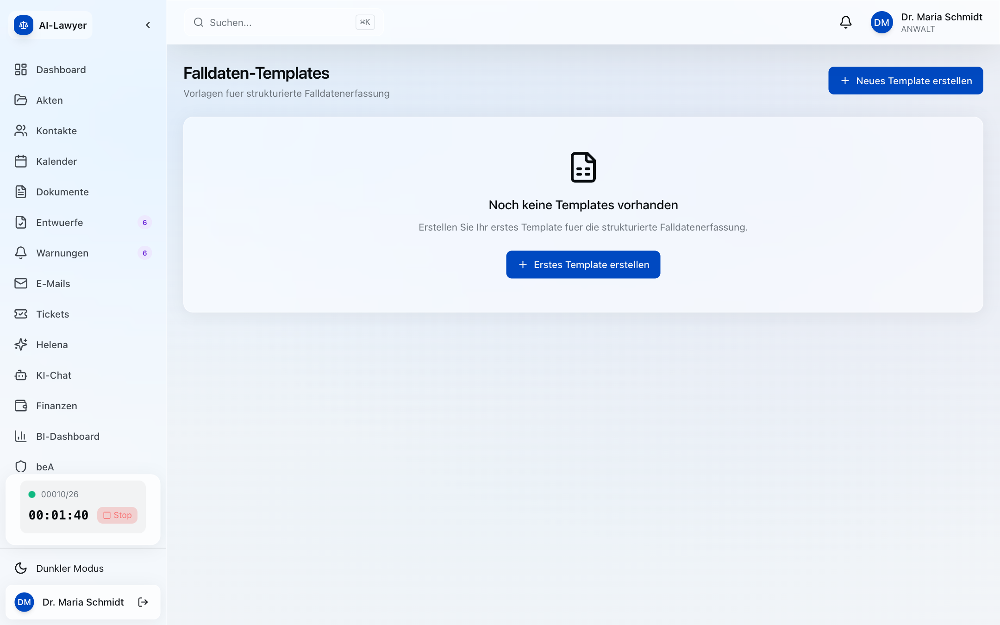

# 16 — Einstellungen und Vorlagen

Dieses Kapitel beschreibt, wo Sie AI-Lawyer an Ihre Kanzlei anpassen: persönliche Einstellungen wie die Zwei-Faktor-Anmeldung, kanzleiweite Einstellungen für Admins, Briefköpfe, Dokumentvorlagen mit Platzhaltern, Falldaten-Templates und die Schriftsatzmuster für Helena. Am Ende steht, was davon derzeit nur gespeichert, aber noch nicht ausgewertet wird.

## Wo liegt was?

| Seite | Inhalt | Erreichbar über | Wer |
| --- | --- | --- | --- |
| `/einstellungen` | Reiter für Benutzer- und Kanzleieinstellungen | Seitenleiste **Einstellungen** | alle außer Sekretariat (siehe unten) |
| `/einstellungen/vorlagen` | Dokumentvorlagen hochladen und verwalten | **Einstellungen → Allgemein → Dokumentvorlagen** | alle angemeldeten Benutzer |
| `/vorlagen` | Vorlagen durchsuchen, Dokument erzeugen | nur über die Adresse | alle angemeldeten Benutzer |
| `/einstellungen/ki` | KI-Provider, Token-Budget, Automatisierung | nur über die Adresse | Admin |
| `/einstellungen/email` | Postfächer, Kanzlei-Signatur, Sync-Status, Zuweisung | nur über die Adresse | Admin |
| `/einstellungen/dokument-tags` | Tag-Kategorien für Dokumente | nur über die Adresse | Anlegen/Löschen nur Admin |
| `/falldaten-templates` | eigene Falldaten-Templates anlegen und einreichen | nur über die Adresse | alle angemeldeten Benutzer |
| `/admin/falldaten-templates` | eingereichte Templates prüfen | Admin-Leiste **Falldaten** | Admin |
| `/admin/muster` | Schriftsatzmuster für Helena | Admin-Leiste **Muster** | Admin |
| `/admin/settings` | Laufzeit-Einstellungen (Worker, Scanner, KI …) | Seitenleiste **Administration → Einstellungen** | Admin |

Mehrere Seiten haben derzeit keinen Menüeintrag. Tippen Sie die Adresse dann direkt hinter die Adresse Ihrer AI-Lawyer-Installation, z. B. `https://ai-lawyer.kanzlei.local/einstellungen/ki`.

**Rollen:** Für die Rolle Sekretariat blendet die Seitenleiste den Punkt **Einstellungen** aus. Die Seite selbst prüft die Rolle nicht; über die Adresse `/einstellungen` erreicht auch das Sekretariat die Reiter **Allgemein**, **Kalender** und **Sicherheit**. Alle `/admin/…`-Seiten leiten Nicht-Admins auf das Dashboard um. Mehr zu Rollen in [Kapitel 15](15-benutzer-und-rollen.md).

## Die Seite „Einstellungen“

Die Seite trägt die Überschrift **Einstellungen** und den Untertitel *Kanzlei- und Benutzereinstellungen*. Welche Reiter Sie sehen, hängt von Ihrer Rolle ab:

| Reiter | Wer sieht ihn | Inhalt |
| --- | --- | --- |
| **Allgemein** | alle | Name, E-Mail und Rolle (nur Anzeige), Schalter **Gamification**, Link **Dokumentvorlagen** |
| **Vertretung & Urlaub** | Admin | Vertreter je Benutzer, Urlaubszeiträume |
| **Fristen** | Admin | Vorfristen, Bundesland, Fristen-Presets, Eskalation, Arbeitszeiten |
| **Vorlagen** | Admin | Freigabestatus der Dokumentvorlagen |
| **Briefkoepfe** | Admin | Briefköpfe anlegen und bearbeiten |
| **Ordner-Schemata** | Admin | Ordnerstrukturen für Akten |
| **Benachrichtigungen** | Admin | Frist-Benachrichtigungen ein/aus |
| **Kalender** | alle | Google- oder Apple-Kalender per CalDAV verbinden |
| **Gamification** | Admin | Bossfight und Special Quests ([Kapitel 14](14-gamification.md)) |
| **Import/Export** | Admin | Einstellungen als JSON sichern oder einspielen |
| **Sicherheit** | alle | Zwei-Faktor-Authentifizierung |

**Ein Profil im engeren Sinn gibt es nicht.** Im Reiter **Allgemein** sehen Sie Name, E-Mail und Rolle, können sie aber nicht ändern. Auch eine Funktion zum Ändern des eigenen Passworts fehlt für Kanzleibenutzer derzeit in der Oberfläche; wenden Sie sich an Ihre Administration ([Kapitel 15](15-benutzer-und-rollen.md)).

Der Schalter **Gamification** (*Quest-Widget und XP-Fortschritt auf dem Dashboard anzeigen*) gilt nur für Sie selbst und speichert sofort (*Gamification aktiviert* bzw. *Gamification deaktiviert*).

### Zwei-Faktor-Authentifizierung (Reiter „Sicherheit“)

Mit 2FA verlangt AI-Lawyer bei der Anmeldung zusätzlich einen sechsstelligen Code aus einer Authenticator-App (etwa Google Authenticator, Microsoft Authenticator oder 1Password).

1. **Einstellungen → Sicherheit** öffnen und auf **2FA aktivieren** klicken.
2. Unter **Authenticator-App einrichten** den QR-Code mit der App scannen. Geht das nicht, den Schlüssel unter **Oder manuell eingeben:** abtippen.
3. Bei **Code aus Authenticator-App eingeben** den aktuellen Code eintragen und **Bestätigen** klicken.
4. Es erscheinen zehn **Backup-Codes**. *Diese Codes werden nur einmal angezeigt.* Mit **Alle kopieren** übernehmen, sicher ablegen (z. B. im Passwortmanager), dann **Fertig**.

Danach zeigt der Reiter **2FA aktiv** und wie viele Backup-Codes noch übrig sind. Jeder Backup-Code ersetzt einmal den App-Code, etwa wenn das Telefon fehlt.

- **Backup-Codes neu generieren**: aktuellen Code aus der App eingeben, **Bestätigen**. Die alten Codes werden dabei ungültig, die neuen erscheinen einmalig.
- **2FA deaktivieren**: aktuellen Code eingeben, **Deaktivieren bestätigen**.

Ist für Ihre Rolle 2FA vorgeschrieben (Umgebungsvariable `TOTP_REQUIRED_ROLES`, [Kapitel 20](20-konfiguration.md)), leitet AI-Lawyer Sie nach der Anmeldung so lange auf einen Hinweis um, bis 2FA eingerichtet ist. Die Einstellungen bleiben dabei erreichbar. Der Reiter öffnet sich allerdings immer auf **Allgemein**; klicken Sie selbst auf **Sicherheit**.

### Kalender verbinden (Reiter „Kalender“)

Hier verbindet jede Person ihren eigenen Google- oder iCloud-Kalender. Fristen werden als schreibgeschützte Termine in den externen Kalender übertragen, Termine in beide Richtungen abgeglichen. Der Abgleich läuft automatisch alle 15 Minuten. Einzelheiten in [Kapitel 6](06-fristen-und-kalender.md).

1. **Kalender verbinden** klicken und **Google Calendar** oder **Apple iCloud** wählen.
2. **Name**, **Google-Account (E-Mail)** bzw. **Apple-ID (E-Mail)** und das **App-Passwort** bzw. **App-spezifisches Passwort** eintragen. Ein Apple-Passwort erzeugen Sie unter *appleid.apple.com > Sicherheit*. Ihr normales Kontopasswort funktioniert nicht.
3. **Verbinden** klicken, dann unter **Kalender auswaehlen** den gewünschten Kalender wählen.

In der Liste zeigt jede Verbindung ihren Status (**Verbunden**, **Fehler**, **Getrennt**, **Synchronisiert...**). **Jetzt synchronisieren** stößt den Abgleich sofort an, **Entfernen** trennt die Verbindung.

### Reiter für Admins

**Vertretung & Urlaub.** Unter **Vertretungszuweisungen** wählen Sie je Benutzer über **Bearbeiten** einen **Vertreter** und optional einen Zeitraum (**Von**, **Bis**). **Aktivieren** schaltet die Vertretung sofort ein, **Nur speichern** hinterlegt nur den Vertreter. Aktive Vertretungen stehen oben unter **Aktive Vertretungen** mit dem Hinweis **Abwesend**. Läuft der Zeitraum ab, schaltet der nächtliche Fristen-Lauf die Vertretung selbst ab. Unter **Urlaubsverwaltung** tragen Sie Urlaubszeiträume ein (**Urlaub hinzufuegen**).

**Fristen.** Vorfristen (drei Werte in Tagen), **Standard-Bundesland**, **Fristen-Presets**, **Eskalation** (Vertreter und Admin nach x Stunden) und **Kanzlei-Arbeitszeiten**. Jede Änderung speichert sofort (*Gespeichert*).

> **Achtung:** Nach aktuellem Stand liest die Fristenberechnung und die Erinnerungsfunktion diese Werte nicht aus. Vorfristen kommen aus den eingebauten Fristarten, das Bundesland wählen Sie in jeder Frist selbst ([Kapitel 6](06-fristen-und-kalender.md)). Verlassen Sie sich nicht darauf, dass eine Änderung in diesem Reiter wirkt. Fristen prüft immer ein Mensch.

**Vorlagen.** Liste aller Dokumentvorlagen mit Status **Freigegeben** oder **Entwurf** und Knopf **Freigeben**. Siehe [Freigabe](#freigabe).

**Briefkoepfe.** Siehe [Briefkopf-Editor](#briefkopf-editor).

**Ordner-Schemata.** Mit **Neues Schema** legen Sie eine Liste von Ordnern an (**Name**, **Sachgebiet (optional)**, **Ordner**), mit **Standard** markieren Sie eines als Standard. Derzeit legt AI-Lawyer beim Anlegen einer Akte diese Ordner noch nicht automatisch an; die Schemata werden gespeichert und exportiert, aber nicht angewendet.

**Benachrichtigungen.** Ein Schalter **Frist-Vorfristen Benachrichtigungen**. Der Hinweis auf der Seite erklärt, dass Benutzer diese Einstellung nicht selbst ändern können. Auch dieser Wert wird derzeit von der Erinnerungsfunktion nicht ausgewertet; maßgeblich ist **E-Mail-Erinnerungen aktiviert** unter `/admin/settings` (siehe [unten](#admin-einstellungen)). **E-Mail-Benachrichtigungen** ist ausgegraut.

**Import/Export.** **Einstellungen exportieren** lädt eine JSON-Datei mit allen Systemeinstellungen, Fristen-Presets, Briefkopf-Angaben und Ordner-Schemata. Logos, Briefkopf-DOCX und Vorlagendateien sind nicht enthalten. Beim Import wählen Sie die Datei, prüfen die **Vorschau** und bestätigen mit **Jetzt importieren**; *Bestehende Einstellungen werden ueberschrieben.*

> **Vorsicht mit der Exportdatei:** Sie enthält alle Systemeinstellungen im Klartext, also auch einen dort hinterlegten KI-API-Schlüssel. Behandeln Sie die Datei wie ein Passwort.

**„Auf Standard zuruecksetzen“** gibt es in mehreren Reitern. Die Wirkung ist je Reiter verschieden: Unter **Briefkoepfe** werden alle Briefköpfe außer dem ersten in der Liste gelöscht, unter **Vertretung & Urlaub** alle Vertretungen entfernt, unter **Fristen** und **Benachrichtigungen** die Werte auf die Vorgaben gesetzt. Die Aktion lässt sich nicht rückgängig machen.

## Der Einrichtungsassistent

Öffnet ein Admin die Einstellungen zum ersten Mal, erscheint der Assistent **Kanzlei einrichten** mit sechs Schritten: **Kanzleidaten**, **Briefkopf**, **Bundesland**, **Vorfristen**, **Ordner-Schema**, **Benutzer**. Mit **Weiter**, **Zurueck** und **Ueberspringen** bewegen Sie sich, **Einrichtung abschliessen** speichert. **Spaeter einrichten** schließt ihn; er kommt dann nicht wieder.

Was der Assistent tatsächlich speichert, ist weniger, als die Schritte nahelegen:

| Schritt | Wird gespeichert? |
| --- | --- |
| **Kanzleidaten** (Name, Adresse, Telefon, E-Mail) | Ja, als Systemeinstellung. Kanzleiname und E-Mail nutzt AI-Lawyer z. B. beim E-Mail-Schreiben und für Portal-Benachrichtigungen. |
| **Briefkopf** (nur ein Name) | Nein. Briefköpfe legen Sie im Reiter **Briefkoepfe** an. |
| **Bundesland**, **Vorfristen** | Ja, werden aber derzeit nicht ausgewertet (siehe oben). |
| **Ordner-Schema** | Nein. |
| **Benutzer** | Nur Anzeige der vorhandenen Benutzer. |

### Kanzlei-Stammdaten

Die Kanzleidaten, die in Vorlagen (`{{kanzlei.…}}`), Rechnungen und Exporten erscheinen, stammen aus einem eigenen Kanzlei-Datensatz. Für diesen gibt es derzeit **keine Bearbeitungsmaske**. Er wird bei der Installation aus den Startdaten angelegt (`prisma/seed.ts`) und muss bis auf Weiteres von der IT direkt in der Datenbank angepasst werden. Prüfen Sie nach der Installation unbedingt, ob dort Ihre Kanzlei steht. Für Briefe ist der [Briefkopf](#briefkopf-editor) die praktikable Stelle für Kanzleiangaben.

## KI, E-Mail und Dokument-Tags

**KI-Einstellungen** (`/einstellungen/ki`, nur Admin; andere werden auf `/einstellungen` zurückgeleitet). Unter **Provider-Konfiguration** wählen Sie den **KI-Provider** (**Ollama (Lokal)**, **OpenAI**, **Anthropic**), das **Modell**, bei Ollama die **Ollama-URL**, sonst den **API-Schluessel**. **Verbindung testen** meldet *Verbunden (… ms)* oder den Fehler. Unter **Automatisierung** stehen **Monatliches Token-Budget** (0 = unbegrenzt; bei Erreichen pausiert Helena), **Proaktive Aktenanalyse**, **Tagesbriefing** und **Briefing-Uhrzeit**. **Token-Verbrauch** zeigt den Verbrauch für **Heute**, **Woche** oder **Monat**, aufgeteilt nach Funktion und Benutzer. Am Ende **Einstellungen speichern**; Erfolg zeigt **Gespeichert**, ein Fehler wird nicht gemeldet. Was Helena mit diesen Einstellungen macht, steht in [Kapitel 9](09-helena.md).

**E-Mail-Einstellungen** (`/einstellungen/email`, nur Admin) mit den Reitern **Postfaecher**, **Signatur** (kanzleiweite HTML-Signatur mit Platzhaltern), **Sync-Status** und **Zuweisung**. Die Bedienung beschreibt [Kapitel 7](07-email-und-tickets.md).

**Dokument-Tags** (`/einstellungen/dokument-tags`). Sind noch keine Tags vorhanden, legt die Seite beim ersten Aufruf acht System-Tags an (Schriftsatz, Vertrag, Rechnung, Gutachten, Korrespondenz, Vollmacht, Bescheid, Sonstiges). Mit **Neuer Tag** legen Sie weitere an (Name und Farbe, **Erstellen**). System-Tags tragen das Kennzeichen **System** und lassen sich umbenennen, aber nicht löschen. Anlegen und Löschen dürfen nur Admins.

## Briefkopf-Editor

Briefköpfe verwalten Admins unter **Einstellungen → Briefkoepfe**. **Neuer Briefkopf** (bzw. **Ersten Briefkopf erstellen**) öffnet den Editor, das Stift-Symbol bearbeitet einen vorhandenen.

1. **Name** vergeben (z. B. *Standard-Briefkopf*) und eine **Design-Vorlage** wählen: **Klassisch** (zentriert, blauer Kanzleiname), **Modern** (zweispaltig, Kontakt rechts) oder **Elegant** (Serifenschrift, Linien).
2. Optional ein **Logo** hochladen (Bilddatei, Klick oder Ziehen).
3. **Kanzleiname** und unter **Anwaelte (BRAO-Pflichtangabe)** alle zugelassenen Anwältinnen und Anwälte eintragen, je Eintrag **Enter**. Der Hinweis auf der Seite erinnert: *Gem. BRAO/BORA muessen alle zugelassenen Anwaelte auf dem Briefkopf aufgefuehrt werden.*
4. **Adresse**, **Telefon**, **Fax**, **E-Mail**, **Website**, **Steuernummer**, **USt-IdNr.**, **IBAN**, **BIC**, **Bank** und **BRAO-Info** ergänzen. Rechts sehen Sie eine Vorschau.
5. Für einen neuen Briefkopf, der Standard werden soll: **Als Standard-Briefkopf setzen** ankreuzen. Dann **Speichern**.

AI-Lawyer erzeugt daraus eine DOCX-Datei mit Kopf- und Fußzeile, die beim Erzeugen von Dokumenten aus Vorlagen eingesetzt wird.

Bekannte Einschränkungen:

- Der Modus **DOCX in OnlyOffice** ist nur ein Hinweistext; das Öffnen in OnlyOffice ist dort nicht eingebaut.
- Einen **bestehenden** Briefkopf zum Standard zu machen, funktioniert derzeit nicht: Der Knopf **Standard** in der Liste endet mit *Fehler beim Setzen als Standard*, und das Häkchen im Editor wird beim Speichern eines vorhandenen Briefkopfs ignoriert. Umweg: einen neuen Briefkopf mit Häkchen anlegen.
- Den Standard-Briefkopf und den letzten verbleibenden Briefkopf kann man nicht löschen.

## Dokumentvorlagen

Vorlagen sind Word-Dateien (DOCX) mit Platzhaltern in doppelten geschweiften Klammern. Beim Erzeugen eines Dokuments setzt AI-Lawyer die Daten der gewählten Akte ein.

### Vorlage anlegen

Unter `/einstellungen/vorlagen` (Überschrift **Dokumentvorlagen**):

1. **Vorlage hochladen** klicken.
2. Die DOCX-Datei in das Feld ziehen oder **durchsuchen**. *Nur .docx-Dateien mit {{platzhalter}} werden unterstützt.*
3. **Name \***, **Kategorie** (Schriftsatz, Klage, Mandatsvollmacht, Mahnung, Vertrag, Brief, Bescheid, Sonstiges) und optional **Beschreibung** angeben, **Hochladen**.

AI-Lawyer liest die Platzhalter beim Hochladen aus; die Liste zeigt danach z. B. **12 Platzhalter**. Ein Klick darauf zeigt sie einzeln.

Ohne eigene Word-Datei: **Neue Vorlage** legt eine leere DOCX-Datei an. Laden Sie sie über das Symbol **Herunterladen**, fügen Sie in Word oder LibreOffice Text und Platzhalter ein und laden Sie sie mit **Vorlage hochladen** als neue Vorlage hoch.

**Platzhalter** blendet die Liste aller verfügbaren Platzhalter ein.

### Platzhalter

Schreibweise: `{{gruppe.feld}}`, z. B. `{{mandant.name}}`. Tippen Sie einen Platzhalter am Stück und ohne Formatwechsel in der Mitte.

| Gruppe | Platzhalter |
| --- | --- |
| Akte | `akte.aktenzeichen`, `akte.kurzrubrum`, `akte.wegen`, `akte.sachgebiet`, `akte.gegenstandswert` |
| Mandant | `mandant.anrede`, `mandant.titel`, `mandant.vorname`, `mandant.nachname`, `mandant.name`, `mandant.firma`, `mandant.strasse`, `mandant.plz`, `mandant.ort`, `mandant.anschrift`, `mandant.email`, `mandant.telefon` |
| Gegner | dieselben Felder wie Mandant mit `gegner.` |
| Gegnervertreter | `gegnervertreter.name`, `gegnervertreter.firma`, `gegnervertreter.anschrift` |
| Gericht | `gericht.name`, `gericht.anschrift` |
| Anwalt | `anwalt.name`, `anwalt.email`, `anwalt.telefon` (die für die Akte zuständige Person) |
| Kanzlei | `kanzlei.name`, `kanzlei.strasse`, `kanzlei.plz`, `kanzlei.ort`, `kanzlei.anschrift`, `kanzlei.telefon`, `kanzlei.fax`, `kanzlei.email`, `kanzlei.website`, `kanzlei.steuernr`, `kanzlei.ustIdNr`, `kanzlei.iban`, `kanzlei.bic`, `kanzlei.bankName` |
| Datum | `datum.heute` (z. B. 23.02.2026), `datum.jahr` |

Mandant, Gegner, Gegnervertreter und Gericht kommen aus den Beteiligten der Akte mit der jeweiligen Rolle; gibt es mehrere, nimmt AI-Lawyer den ersten. Fehlt ein Beteiligter, bleibt der Platzhalter leer. `akte.gegenstandswert` erscheint als Betrag in Euro.

Bedingte Abschnitte sind möglich: `{{#gegner.firma}}…{{/gegner.firma}}` erscheint nur, wenn das Feld gefüllt ist, `{{^gegner.firma}}…{{/gegner.firma}}` nur, wenn es leer ist.

> **Tippfehler fallen auf:** Ein Platzhalter, den es nicht gibt (z. B. `{{mandant.nam}}`), bleibt nicht leer, sondern erscheint im fertigen Dokument als Wort „undefined“. Prüfen Sie jedes erzeugte Dokument.

### Dokument aus Vorlage erzeugen

Unter `/vorlagen` sehen Sie **Favoriten** (Stern auf der Karte), **Zuletzt verwendet** und **Alle Vorlagen**, filterbar nach Kategorie. Noch nicht freigegebene Vorlagen tragen das Kennzeichen **Entwurf**, lassen sich aber trotzdem verwenden.

1. **Dokument erstellen** klicken (oder eine Vorlage anklicken).
2. **Vorlage** wählen, **Weiter**.
3. **Akte / Mandant**: Akte suchen und wählen, **Weiter**.
4. **Felder**: zusätzliche Felder der Vorlage ausfüllen, falls vorhanden, **Weiter**.
5. **Vorschau**: optional **Dateiname** und **Briefkopf** wählen, dann **Dokument erstellen**.

Das neue Dokument liegt mit Status Entwurf in der Akte, im Ordner passend zur Kategorie (z. B. Schriftsaetze, Vollmachten, Korrespondenz). Ohne eigenen Dateinamen heißt es `Aktenzeichen_Kategorie_Mandant_Datum.docx`. Wie Sie es weiter bearbeiten, steht in [Kapitel 5](05-dokumente.md).

Derzeit gilt:

- Die Auswahl **Kein Briefkopf** verhindert den Briefkopf nicht; AI-Lawyer setzt dann den Standard-Briefkopf ein, sofern einer besteht.
- **In OnlyOffice oeffnen** hat keine Wirkung; öffnen Sie das Dokument aus der Akte.
- Werte im Schritt **Felder** werden nicht in das Dokument übernommen. Zusatzfelder lassen sich in der Oberfläche ohnehin nicht anlegen.

### Freigabe

Im Reiter **Einstellungen → Vorlagen** gibt ein Admin eine Vorlage mit **Freigeben** frei (*Vorlage freigegeben*). Laut Schnittstelle dürfen das Admins und Anwälte; den Reiter sieht aber nur die Admin-Rolle. Die Freigabe ist derzeit nur eine Kennzeichnung. Das Zurückziehen über **Zurueckziehen** schlägt fehl (*Vorlage ist bereits freigegeben*); ebenso hebt **Auf Standard zuruecksetzen** dort keine Freigaben auf.

Hochladen, Ändern und Löschen von Vorlagen ist für alle angemeldeten Benutzer möglich. Löschen entfernt auch alle früheren Versionen der Datei.

## Falldaten-Templates

Falldaten-Templates legen fest, welche strukturierten Angaben zu einer Akte erfasst werden, etwa Unfallort und Schadenshöhe bei Verkehrsunfällen. Jede Person kann eigene Templates entwerfen; für alle sichtbar werden sie erst nach Prüfung durch einen Admin.

### Template entwerfen und einreichen

Die Seite `/falldaten-templates` zeigt Ihre eigenen Templates in jedem Status und die genehmigten Templates der anderen.

> **Bekannter Fehler:** Die Knöpfe **Neues Template erstellen**, **Erstes Template erstellen** und **Bearbeiten** sowie die Rücksprünge nach dem Speichern führen auf `/dashboard/falldaten-templates/…`, eine Adresse, die es nicht gibt. Rufen Sie stattdessen direkt `/falldaten-templates/neu` bzw. `/falldaten-templates/<ID>/bearbeiten` auf und kehren Sie über `/falldaten-templates` zur Liste zurück.

1. Unter **Template-Informationen** **Name** (z. B. *Verkehrsunfall Personenschaden*), **Beschreibung** und **Sachgebiet** eintragen.
2. Unter **Gruppen & Felder** mit **Gruppe hinzufuegen** eine Gruppe anlegen (z. B. *Unfallhergang*).
3. In der Gruppe mit **Feld** ein Feld anlegen: **Label**, **Key (intern)** (wird vorgeschlagen), **Typ**, **Pflichtfeld**, **Placeholder**. Typen: Text, Textbereich, Zahl, Waehrung, Datum, Dropdown, Checkbox, Mehrfachauswahl. Bei Dropdown und Mehrfachauswahl mit **Option hinzufuegen** mindestens eine Option (**Wert**, **Anzeigename**) anlegen. **Feld speichern**.
4. **Als Entwurf speichern** oder gleich **Speichern und einreichen**.

Status und Aktionen in der Liste:

| Status | Bedeutung | Aktionen für die Erstellerin |
| --- | --- | --- |
| **Entwurf** | nur für Sie sichtbar | **Bearbeiten**, **Einreichen**, Löschen |
| **Eingereicht** | liegt bei der Prüfung | keine (*Wartet auf Pruefung*) |
| **Genehmigt** | für alle verfügbar | keine; nicht mehr änderbar |
| **Abgelehnt** | mit **Ablehnungsgrund** | **Bearbeiten**, **Erneut einreichen** |
| **System-Standard** | mitgeliefert | unveränderlich |

### Prüfung durch Admins

Unter **Admin → Falldaten** (Überschrift **Falldaten-Templates -- Pruefung**) stehen unter **Zur Pruefung** alle eingereichten Templates, darunter **Letzte Entscheidungen**.

1. Bei einem Template **Pruefen** klicken. Die **Template-Vorschau** zeigt alle Gruppen und Felder.
2. **Genehmigen**, oder **Ablehnen**, einen **Ablehnungsgrund** eintragen und erneut **Ablehnen**.

Die Erstellerin erhält eine Benachrichtigung mit dem Ergebnis. Es gilt das Vier-Augen-Prinzip: Gibt es mehr als einen aktiven Admin, kann niemand sein eigenes Template genehmigen.

## Schriftsatzmuster für Helena

Unter **Admin → Muster** (Überschrift **Schriftsatzmuster**, *Kanzlei-eigene Muster fur Helenas Schriftsatz-RAG*) laden Admins eigene Musterschriftsätze hoch. Helena nutzt sie als Vorbild beim Entwerfen von Schriftsätzen ([Kapitel 9](09-helena.md)).

1. Unter **Neues Muster hochladen** die **Datei (PDF oder DOCX)** wählen.
2. **Name** (z. B. *Kundigungsschutzklage Standard*), **Kategorie** (z. B. *Klage*) und optional **Beschreibung** eintragen.
3. **Muster hochladen** klicken.

Danach prüft AI-Lawyer im Hintergrund, ob das Muster personenbezogene Daten enthält, vor allem Namen natürlicher Personen. Geprüft werden Anfang und Ende des Textes, wo Rubrum und Unterschriften stehen; Behörden und Gerichte sind ausgenommen. Erst ein unbedenkliches Muster wird für Helena aufbereitet.

| NER-Status | Bedeutung | Was tun? |
| --- | --- | --- |
| **Ausstehend** | Prüfung wartet oder ist fehlgeschlagen | Seite neu laden; bleibt es so, **Erneut prufen** |
| **PII-Prufung lauft...** | Prüfung läuft | Seite später neu laden (keine automatische Aktualisierung) |
| **Indiziert** | keine Personendaten gefunden, Muster ist für Helena verfügbar | nichts |
| **Abgelehnt - PII** | Namen oder andere Personendaten gefunden | Muster anonymisieren, löschen (**Loschen**), neu hochladen |

Die Spalte **Herkunft** unterscheidet **Kanzlei-eigen** und **Amtlich** (mitgelieferte Muster). Die Prüfung läuft immer über den lokalen Ollama-Dienst, auch wenn Helena sonst einen anderen KI-Provider nutzt. Ist Ollama nicht erreichbar, bleibt das Muster **Ausstehend**. Anonymisieren Sie Muster trotzdem selbst, bevor Sie sie hochladen; die automatische Erkennung ist eine zusätzliche Sicherung, keine Garantie.

## Admin-Einstellungen

Unter **Administration → Einstellungen** (`/admin/settings`, Untertitel *Laufzeit-Konfiguration ohne Neustart aendern*) stehen die Laufzeit-Einstellungen nach Gruppen: Worker, Logging, Benachrichtigungen, Fristen, Sicherheit, System, KI / Helena, Scanner, beA, Gamification. Schalter speichern sofort, andere Felder mit dem Disketten-Knopf daneben (*Einstellung gespeichert*).

Die wichtigsten Einträge, deren Wirkung im Code belegt ist:

| Einstellung | Wirkung |
| --- | --- |
| **Fristen-Scan Uhrzeit (HH:MM)** | Uhrzeit des täglichen Fristen-Erinnerungslaufs |
| **E-Mail-Erinnerungen aktiviert** | Frist-Erinnerungen auch per E-Mail |
| **Max. E-Mail-Nachversand (Tage)** | wie lange verpasste Erinnerungen nachgesendet werden |
| **KI-Provider**, **KI-Modell**, **Ollama-URL**, **API-Schluessel** | wie unter `/einstellungen/ki` |
| **Monatliches Token-Budget (0 = unbegrenzt)** | Helena pausiert bei Erreichen |
| **Proaktive Aktenanalyse**, **Scan-Intervall (Cron)** | regelmäßige Aktenanalyse durch Helena |
| **Tagesbriefing aktiviert**, **Briefing-Uhrzeit (HH:MM)** | tägliches Briefing |
| **Naechtlicher Akten-Scanner aktiviert**, **Scanner Cron-Zeitplan** und die übrigen Scanner-Werte | Warnungen zu Fristen, inaktiven Akten, fehlenden Dokumenten, neuen Urteilen ([Kapitel 9](09-helena.md)) |
| **Boss-Schwellenwert**, **Boss-Abklingzeit**, **Taegliches Runen-Limit** | Gamification ([Kapitel 14](14-gamification.md)) |

Ohne nachweisbare Wirkung sind derzeit: **Worker-Parallelitaet**, **Maximale Wiederholungen**, **Log-Level**, **Standard-Benachrichtigungston**, **Aufbewahrung Benachrichtigungen (Tage)**, **Wartungsmodus**, **beA-API-URL**, **beA-Integration aktiviert** und **2FA-Pflicht: Rollen**. Die 2FA-Pflicht steuert allein die Umgebungsvariable `TOTP_REQUIRED_ROLES` ([Kapitel 20](20-konfiguration.md)).

Die Seite zeigt außerdem Einträge, die andere Reiter angelegt haben (z. B. Kanzleidaten aus dem Assistenten oder Werte aus dem Reiter **Fristen**). Diese lassen sich hier nicht speichern (*Unbekannte Einstellung: …*). Ein hinterlegter API-Schlüssel steht hier im Klartext im Eingabefeld.

## Wenn etwas nicht klappt

| Meldung | Bedeutung | Was tun? |
| --- | --- | --- |
| *Bitte geben Sie einen 6-stelligen Code ein* | Der 2FA-Code ist unvollständig. | Sechs Ziffern aus der App eingeben. |
| *Ungültiger Code* | Code falsch oder abgelaufen. | Neuen Code abwarten; Uhrzeit von Telefon und Server prüfen. |
| *Verbindung fehlgeschlagen* (Kalender) | Zugangsdaten falsch oder Kontopasswort statt App-Passwort. | App-Passwort neu erzeugen und eintragen. |
| *Fehler beim Setzen als Standard* | Bekannter Fehler beim Briefkopf. | Neuen Briefkopf mit **Als Standard-Briefkopf setzen** anlegen. |
| *Name ist erforderlich* | Briefkopf oder Vorlage ohne Namen. | Namen eintragen. |
| *Nur DOCX-Dateien werden unterstützt* | Falsches Dateiformat beim Vorlagen-Upload. | Datei als .docx speichern. |
| *Vorlage ist bereits freigegeben* | Bekannter Fehler beim **Zurueckziehen**. | Freigabe bleibt bestehen; die IT kann sie zurücknehmen. |
| *Nur ADMIN oder ANWALT duerfen Vorlagen freigeben* | Ihre Rolle darf nicht freigeben. | Admin oder Anwalt bitten. |
| Im Dokument steht „undefined“ | Platzhalter falsch geschrieben. | Schreibweise mit der [Platzhalterliste](#platzhalter) vergleichen, Vorlage neu hochladen. |
| *Feld-Key existiert bereits in einem anderen Feld* | Zwei Felder im Template haben denselben Key. | Key ändern. |
| *Mindestens ein Feld ist erforderlich* | Template ohne Felder. | Mindestens ein Feld anlegen. |
| *4-Augen-Prinzip: Eigene Templates koennen nicht selbst genehmigt werden* | Sie haben das Template selbst erstellt. | Ein anderer Admin genehmigt. |
| Seite nicht gefunden nach Klick auf **Neues Template erstellen** | Bekannter Fehler (falsche Adresse). | `/falldaten-templates/neu` direkt aufrufen. |
| *Ungültiger Dateityp: … Erlaubt: PDF und DOCX* | Muster in anderem Format. | Als PDF oder DOCX hochladen. |
| *Unbekannte Einstellung: …* | Eintrag unter `/admin/settings`, der dort nicht vorgesehen ist. | Im zuständigen Reiter unter **Einstellungen** ändern. |
| *Ungueltige Import-Datei: Fehlende Version* | Die Datei stammt nicht aus **Einstellungen exportieren**. | Eine exportierte Datei verwenden. |

---

Weiter: [17 — Migration aus j-lawyer](17-migration-aus-j-lawyer.md) · [Zur Übersicht](README.md)
