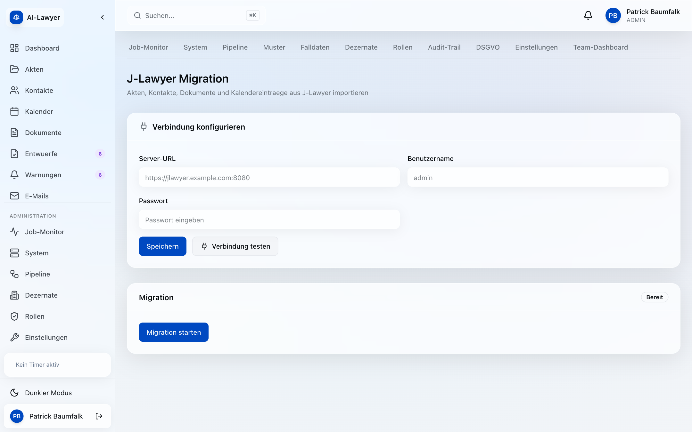

# 17 — Migration aus j-lawyer

Wer bisher mit j-lawyer.org gearbeitet hat, kann Akten, Kontakte, Beteiligte, Dokumente und Kalendereinträge über die j-lawyer-Schnittstelle nach AI-Lawyer übernehmen. Dieses Kapitel beschreibt Voraussetzungen, Ablauf, was übernommen wird und was nicht, und worauf Sie nach der Übernahme achten müssen. Die Seite ist nur für Administratoren zugänglich.

## Vorab: Wie AI-Lawyer j-lawyer anspricht

AI-Lawyer liest alle Daten über die REST-Schnittstelle von j-lawyer, und zwar über die Endpunkte, die j-lawyer in seinem Endpunktkatalog anbietet: `/v1/cases/list` und `/v2/cases/<id>` (Akten), `/v1/cases/<id>/parties` (Beteiligte), `/v4/cases/<id>/duedates` (Fristen, Wiedervorlagen, Termine), `/v1/cases/<id>/documents` und `/v1/cases/document/<id>/content` (Dokumente), `/v3/cases/<id>/folders` (Ordner), `/v1/contacts/list` und `/v2/contacts/<id>` (Kontakte) sowie `/v6/security/users/list` (Benutzer).

Diese Pfade hängt AI-Lawyer an den REST-Stamm `/j-lawyer-io/rest` an. Tragen Sie als **Server-URL** nur Protokoll, Rechner und Port ein (z. B. `https://jlawyer.kanzlei.de:8080`); daraus wird `https://jlawyer.kanzlei.de:8080/j-lawyer-io/rest/v1/cases/list`. Liegt j-lawyer hinter einem Reverse-Proxy unter einem anderen Pfad, tragen Sie den vollständigen REST-Stamm als URL ein (z. B. `https://proxy.kanzlei.de/jlawyer/j-lawyer-io/rest`); ein Pfad in der URL wird unverändert verwendet.

## Voraussetzungen

| Was | Warum |
| --- | --- |
| j-lawyer-Server mit eingeschalteter REST-Schnittstelle | AI-Lawyer liest alles über die Schnittstelle, nicht aus der Datenbank. |
| j-lawyer-Benutzer und Passwort | Anmeldung per HTTP-Basic. Der Benutzer muss alle Akten, Kontakte, Dokumente und die Benutzerliste lesen dürfen. |
| Server-URL | Mit `https://`, siehe oben. Beispiel im Feld: `https://jlawyer.example.com:8080`. |
| `JLAWYER_ALLOW_PRIVATE_URLS=true` | Nur wenn j-lawyer im eigenen Netz läuft (z. B. `192.168.…`, `10.…`, `localhost`) oder nur per `http://` erreichbar ist. Ohne diese Variable lehnt AI-Lawyer solche Adressen ab. Die IT setzt sie in der `.env` ([Kapitel 20](20-konfiguration.md)). |
| `EMAIL_ENCRYPTION_KEY` (mindestens 32 Zeichen) | Das j-lawyer-Passwort wird verschlüsselt gespeichert (AES-256-GCM). Ohne gültigen Schlüssel lässt es sich nicht speichern. |
| Benutzerkonten in AI-Lawyer | Damit Akten und Fristen den richtigen Personen zugeordnet werden, sollten die Anwältinnen, Anwälte und Mitarbeitenden aus j-lawyer vor der Migration in AI-Lawyer angelegt sein, möglichst mit derselben E-Mail-Adresse wie in j-lawyer (siehe [Benutzerabgleich](#benutzerabgleich)). |
| Administrator mit Kanzlei | Die neuen Akten werden der Kanzlei des Administrators zugeordnet, der die Migration startet. |

Adressen mit Benutzername und Passwort darin (`https://name:pw@…`) werden abgelehnt. Zugangsdaten gehören in die eigenen Felder.

## Ablauf

Die Seite heißt **J-Lawyer Migration** und liegt unter `/admin/jlawyer`. Einen Menüeintrag gibt es nicht; geben Sie die Adresse im Browser ein.

### 1. Verbindung einrichten

1. Im Abschnitt **Verbindung konfigurieren** **Server-URL**, **Benutzername** und **Passwort** eintragen.
2. Unter **Standard-Verantwortlicher** wählen, wer Akten und Fristen erhält, deren j-lawyer-Benutzer keinem Benutzer in AI-Lawyer zugeordnet werden kann. Voreinstellung ist **Startender Administrator**.
3. **Verbindung testen** klicken. AI-Lawyer ruft testweise die Liste der Beteiligtenarten ab. Erfolg zeigt **Verbunden**, ein Fehler **Fehler: …** mit dem Grund.
4. **Speichern** klicken. Es erscheint *Verbindungsdaten gespeichert*.

Das Passwortfeld ist danach leer und zeigt Punkte. Das Passwort ist gespeichert, wird aber nie wieder angezeigt. Lassen Sie das Feld beim nächsten Speichern leer, bleibt das alte Passwort erhalten. Auch **Verbindung testen** verwendet bei leerem Feld das gespeicherte Passwort.

### 2. Migration starten

1. Im Abschnitt **Migration** auf **Migration starten** klicken.
2. Der Status wechselt auf **Laueft...** mit dem Hinweis „Dies kann mehrere Minuten dauern. Der Status wird automatisch aktualisiert.“
3. Die Seite fragt den Stand alle paar Sekunden ab. Am Ende steht **Abgeschlossen** oder **Fehler**, darunter **Gestartet** und **Beendet**.

Die Übernahme läuft in einem Zug und in dieser Reihenfolge: Benutzerabgleich, Akten, Kontakte, Beteiligte, Dokumente, Kalender. Nach jedem Schritt wird der Zwischenstand gespeichert. Eine Fortschrittsanzeige je Schritt gibt es nicht. Lassen Sie die Seite offen, bis **Abgeschlossen** erscheint.

Es kann immer nur ein Lauf gleichzeitig aktiv sein. Ein laufender Lauf meldet sich alle 20 Sekunden als lebendig. Bricht er ab, ohne fertig zu werden (etwa durch einen Neustart des Servers), gilt er nach zwei Minuten ohne Lebenszeichen als verwaist und blockiert keinen neuen Lauf mehr. Die Seite zeigt dann den Hinweis „Der letzte Lauf wurde unterbrochen (z. B. Server-Neustart) und nicht abgeschlossen. Ein neuer Lauf übernimmt nur noch fehlende Datensätze.“ Starten Sie die Migration in diesem Fall einfach erneut.

### 3. Abschlussbericht lesen

Der **Abschlussbericht** zeigt je eine Kachel für **Akten**, **Kontakte**, **Beteiligte**, **Dokumente** und **Kalender** mit der Zahl der in diesem Lauf neu angelegten Datensätze (z. B. „12 Akten neu“), daneben **Keine Fehler** oder **<Anzahl> Fehler**.

- **<Anzahl> Fehler anzeigen** klappt die Fehlerliste auf. Jeder Eintrag nennt Art (z. B. `Akte`, `Kontakt`, `Beteiligter`, `Dokument`, `Kalender`), die j-lawyer-ID bzw. das Aktenzeichen und die Meldung. Angezeigt werden die ersten 20; darunter steht „Und … weitere Fehler...“. Ein Fehler bei einem einzelnen Datensatz bricht die Migration nicht ab; der Datensatz fehlt dann in AI-Lawyer.
- **<Anzahl> Hinweise (Ersatzzuordnungen) anzeigen** klappt die Hinweise auf. Dort steht jede Ersatzzuordnung (z. B. „Anwalt "mueller" aus j-lawyer keinem Benutzer zuordenbar; Standard-Verantwortlicher … eingesetzt.“), jede Verknüpfung mit einem vorhandenen Kontakt, mögliche Dubletten, unlesbare Geburtsdaten, unbekannte Kalendertypen und Dokumente, deren Texterkennung nicht eingereiht werden konnte. Angezeigt werden die ersten 200.

Lesen Sie die Hinweise vollständig. Sie sind die Arbeitsliste für die Nacharbeit.

## Benutzerabgleich

Zu Beginn liest AI-Lawyer die Benutzerliste aus j-lawyer und ordnet die j-lawyer-Benutzer (Anwalt und Sachbearbeitung einer Akte, verantwortliche Person einer Frist) den Benutzern in AI-Lawyer zu. In Frage kommen nur aktive Kanzleibenutzer, keine Mandantenkonten und keine Systembenutzer. Die erste eindeutige Übereinstimmung gilt:

1. die E-Mail-Adresse des j-lawyer-Benutzers ist die E-Mail-Adresse in AI-Lawyer,
2. der j-lawyer-Anmeldename ist die E-Mail-Adresse in AI-Lawyer oder deren Teil vor dem @,
3. der Anzeigename bzw. „Vorname Nachname“ aus j-lawyer ist der Name in AI-Lawyer.

Passen mehrere Benutzer, gilt das als keine Übereinstimmung; AI-Lawyer ordnet dann nichts auf Verdacht zu. Ist die Benutzerliste in j-lawyer nicht lesbar, wird nur über Anmeldename = E-Mail bzw. E-Mail-Präfix abgeglichen; der Bericht weist darauf hin.

Wer nicht zugeordnet werden kann, wird ersetzt:

| Feld | Ersatz |
| --- | --- |
| **Anwalt** der Akte | **Standard-Verantwortlicher** |
| **Sachbearbeiter/in** der Akte | bleibt leer |
| Verantwortliche Person einer Frist, Wiedervorlage oder eines Termins | der Anwalt der Akte, sonst der **Standard-Verantwortlicher** |

Jede Ersatzzuordnung steht in den Hinweisen des Berichts. Ist der gespeicherte Standard-Verantwortliche nicht mehr aktiv, nimmt AI-Lawyer den startenden Administrator und vermerkt das ebenfalls.

## Was übernommen wird

### Akten

| j-lawyer | AI-Lawyer |
| --- | --- |
| Aktenzeichen | **Aktenzeichen**. Fehlt es, entsteht `JL-<j-lawyer-ID>`. |
| Name | **Kurzrubrum** |
| Wegen | **Wegen** |
| Sachgebiet (Text) | Sachgebiet nach Stichwort: enthält der Text „arbeit“ → Arbeitsrecht, „famili“ → Familienrecht, „verkehr“, „miet“, „straf“, „erb“, „sozial“, „inkasso“, „handel“, „verwaltung“ entsprechend, sonst **Sonstiges**. |
| Archiviert | Archivierte Akten werden **Archiviert**, alle anderen **Offen**. |
| Gegenstandswert | **Gegenstandswert** (nur wenn größer als 0) |
| Notiz | Notizen der Akte |
| Anwalt, Sachbearbeitung | **Anwalt** und **Sachbearbeiter/in** über den [Benutzerabgleich](#benutzerabgleich) |
| Anlagedatum | Angelegt am |

### Kontakte

Alle Kontakte aus j-lawyer, nicht nur die mit Akten. Übernommen werden Anrede, Titel, Vorname, Nachname, Firma, Rechtsform, Straße mit Hausnummer, PLZ, Ort, Land (ohne Angabe „Deutschland“), Telefon, Mobil, Fax, E-Mail, Website, Geburtsdatum, Geburtsname, Geburtsort, Beruf, beA-SAFE-ID, USt-IdNr. und Notiz. Ein Kontakt mit Firma, aber ohne Vor- und Nachnamen wird juristische Person, alle anderen natürliche Person. Ein unlesbares Geburtsdatum wird weggelassen und im Bericht genannt.

**Abgleich mit vorhandenen Kontakten:** Gibt es in AI-Lawyer schon einen Kontakt mit derselben E-Mail-Adresse **und** demselben Nachnamen bzw. derselben Firma, wird er nur mit dem j-lawyer-Kontakt verknüpft. Seine Daten bleiben unverändert, nichts wird überschrieben. Stimmt nur die E-Mail-Adresse überein, legt AI-Lawyer einen neuen Kontakt an und meldet im Bericht eine mögliche Dublette.

### Beteiligte

Die Beteiligten jeder Akte werden mit ihrer Rolle verknüpft. Die Rolle ergibt sich aus der Bezeichnung der Beteiligtenart in j-lawyer:

| Beteiligtenart in j-lawyer enthält | Rolle in AI-Lawyer |
| --- | --- |
| „Gegner“ und „Anwalt“ oder „Vertret“ (z. B. „Rechtsanwalt Gegner“) | Gegnervertreter |
| „Mandant“ | Mandant |
| „Gegner“ | Gegner |
| „Gericht“ | Gericht |
| „Zeug“ | Zeuge |
| „Sachverst“ oder „Gutacht“ | Sachverständiger |
| alles andere | Sonstiger |

Eigene Beteiligtenarten aus j-lawyer (etwa Versicherung, Behörde) landen also als **Sonstiger**. Die ursprüngliche Bezeichnung und das Zeichen des Beteiligten stehen in der Notiz zur Beteiligung (z. B. „j-lawyer: Versicherung · Zeichen: …“).

### Dokumente

Jedes Dokument einer Akte wird heruntergeladen und im Dokumentenspeicher (MinIO) unter `akten/<Akte>/jlawyer/…` abgelegt. Übernommen werden Dateiname, Größe, Versionsnummer und der Ordner aus j-lawyer als Pfad (z. B. „Schriftverkehr/Gericht“). Den Dateityp leitet AI-Lawyer aus der Dateiendung ab.

- Alle übernommenen Dokumente haben den Status **Entwurf**, wie bei einem normalen Upload, auch wenn sie in j-lawyer längst versendet waren.
- Als Ersteller steht der Administrator, der die Migration gestartet hat.
- Die Dokumente durchlaufen denselben Weg wie ein normaler Upload: Sie kommen in den Suchindex, und alle Dateien außer reinen Textdateien werden zur Texterkennung (OCR) eingereiht. Nach der OCR sind sie im Volltext durchsuchbar und Helena kennt ihren Inhalt ([Kapitel 5](05-dokumente.md)). Bei vielen Dokumenten kann die Texterkennung Stunden dauern.
- Nur die aktuelle Fassung, keine Versionsgeschichte.

### Kalender

| j-lawyer | AI-Lawyer |
| --- | --- |
| Wiedervorlage | **Wiedervorlage** |
| Frist | **Frist** |
| Termin | **Termin** |
| unbekannter Typ | **Wiedervorlage**, mit Hinweis im Bericht |

Übernommen werden Bezeichnung, Beschreibung, Ort (in der Beschreibung), Beginn, Ende und erledigt. Fristen und Wiedervorlagen werden ganztägig angelegt. Eine in j-lawyer erledigte Frist erhält den Erledigungsgrund „In j-lawyer erledigt (Migration)“. Die verantwortliche Person kommt aus j-lawyer über den [Benutzerabgleich](#benutzerabgleich). Vorfristen werden nicht übernommen.

## Erneut einlesen

Die Migration lässt sich wiederholen, ohne dass Dubletten entstehen. AI-Lawyer merkt sich zu jedem Datensatz die j-lawyer-ID. Ein weiterer Lauf **legt nur an, was noch fehlt, und ändert nichts, was schon übernommen wurde**:

| Bereich | Beim zweiten Lauf |
| --- | --- |
| Akten | Bereits übernommene bleiben unverändert; neue kommen hinzu. |
| Kontakte | Bereits übernommene bleiben unverändert; neue kommen hinzu. |
| Beteiligte | Vorhandene Beteiligungen bleiben unverändert. Hat sich die Rolle in j-lawyer geändert, kommt eine weitere Beteiligung mit der neuen Rolle hinzu; die alte bleibt. |
| Dokumente | Bereits übernommene werden übersprungen, neue kommen hinzu. |
| Kalender | Bereits übernommene Einträge bleiben unverändert (auch **erledigt**); neue kommen hinzu. |

Änderungen, die Sie in AI-Lawyer an übernommenen Daten gemacht haben, bleiben also erhalten. Umgekehrt kommen Änderungen, die nach der ersten Übernahme in j-lawyer an schon übernommenen Datensätzen gemacht wurden, nicht mehr herüber. Gelöschtes in j-lawyer wird in AI-Lawyer nicht gelöscht.

## Was nicht übernommen wird

- Benutzer, Rollen und Gruppen (nur die Zuordnung über den Benutzerabgleich)
- Rechnungen, Zahlungen, Aktenkonto, Zeiterfassung
- E-Mails, beA-Nachrichten, Aktenhistorie
- Etiketten, Falldatenblätter, eigene Felder
- Dokumentversionen (nur die aktuelle Fassung), Dokument-Etiketten
- Vorfristen

## Nach der Migration

Gehen Sie diese Liste vollständig durch, bevor Sie mit den übernommenen Akten arbeiten.

1. **Hinweise abarbeiten.** Öffnen Sie im Abschlussbericht **Hinweise (Ersatzzuordnungen) anzeigen** und prüfen Sie jede Ersatzzuordnung. Wo der Standard-Verantwortliche eingesetzt wurde, tragen Sie in der Akte den richtigen **Anwalt** und ggf. **Sachbearbeiter/in** ein oder ordnen Sie die Akte einem Dezernat zu ([Kapitel 15](15-benutzer-und-rollen.md#dezernate)).
2. **Fristen prüfen.** Prüfen Sie bei jeder offenen Frist Datum, Fristablauf und verantwortliche Person und legen Sie Vorfristen neu an ([Kapitel 6](06-fristen-und-kalender.md)). Ein Mensch muss jede übernommene Frist gegen die Akte prüfen.
3. **Wiedervorlagen und Termine** ebenso prüfen, besonders Einträge, die wegen eines unbekannten Typs als Wiedervorlage übernommen wurden.
4. **Texterkennung abwarten.** Im Dokument steht der OCR-Stand. Bei Dokumenten mit **OCR fehlgeschlagen** stoßen Sie die Erkennung in der Dokumentansicht mit **OCR erneut starten** neu an ([Kapitel 5](05-dokumente.md)).
5. **Dokumentstatus** bei Bedarf anpassen, etwa versendete Schreiben nicht als Entwurf stehen lassen.
6. **Beteiligte mit Rolle „Sonstiger“** durchsehen und korrigieren.
7. **Kontakte** auf gemeldete mögliche Dubletten prüfen.

### Empfehlung: Probelauf

Machen Sie die erste Übernahme in einer Testinstallation von AI-Lawyer, nicht in der Produktivumgebung. Vergleichen Sie Stichproben (Aktenzahl, einige Akten mit Beteiligten, Dokumenten und Fristen) mit j-lawyer. Erst wenn das passt, migrieren Sie produktiv, und zwar möglichst kurz vor dem Umstieg, damit nicht doppelt gepflegt wird. Sichern Sie vorher die Datenbank ([Kapitel 21](21-betrieb-und-sicherung.md)).

## Wenn etwas nicht klappt

| Meldung | Bedeutung | Was tun |
| --- | --- | --- |
| *Private/lokale Hosts sind nicht erlaubt. Fuer On-Premises-Installationen JLAWYER_ALLOW_PRIVATE_URLS=true setzen.* | j-lawyer läuft im internen Netz. | IT setzt `JLAWYER_ALLOW_PRIVATE_URLS=true` und startet AI-Lawyer neu. |
| *Unverschluesseltes http ist nicht erlaubt. …* | Adresse beginnt mit `http://`. | `https://` verwenden oder (intern) die Variable oben setzen. |
| *Ungueltige j-lawyer URL* | Die Adresse ist keine gültige URL. | Vollständig mit `https://` eingeben. |
| *Nur http(s)-URLs sind erlaubt* | Anderes Protokoll. | `https://…` verwenden. |
| *Zugangsdaten gehoeren nicht in die URL* | Name/Passwort stehen in der Adresse. | Aus der URL entfernen, in die Felder eintragen. |
| *Verbindungsdaten fehlen* | URL, Benutzer oder Passwort fehlt. | Alle drei Felder füllen. |
| *J-Lawyer API error 401 …* | Anmeldung abgelehnt. | Benutzer und Passwort prüfen. Bleibt es nach dem Speichern, ist evtl. `EMAIL_ENCRYPTION_KEY` geändert worden: Passwort neu eingeben und speichern. |
| *J-Lawyer API error 404 …* | Der aufgerufene Pfad existiert auf dem Server nicht, meist weil der REST-Stamm nicht unter `/j-lawyer-io/rest` liegt. | URL prüfen; hinter einem Reverse-Proxy den vollständigen REST-Stamm eintragen, siehe [Vorab](#vorab-wie-ai-lawyer-j-lawyer-anspricht). |
| *Fehler beim Speichern der Verbindungsdaten* | Meist fehlt `EMAIL_ENCRYPTION_KEY` oder ist kürzer als 32 Zeichen. | IT prüft die Variable ([Kapitel 20](20-konfiguration.md)). |
| *J-Lawyer Verbindungsdaten nicht konfiguriert* | Migration ohne gespeicherte Zugangsdaten gestartet. | Erst **Speichern**, dann starten. |
| *Migration läuft bereits* | Ein Lauf ist noch aktiv. | Warten. Ein durch Neustart abgebrochener Lauf gibt die Sperre nach spätestens zwei Minuten frei; danach erneut starten. |
| *Standard-Verantwortlicher muss ein aktiver Kanzlei-Benutzer sein* | Der gewählte Benutzer ist deaktiviert oder kein Kanzleibenutzer. | Anderen Benutzer wählen. |
| Fehlerliste: *Unique constraint failed …* bei `Akte` | Das Aktenzeichen gibt es in AI-Lawyer schon. | Vorhandene Akte umbenennen oder in j-lawyer das Aktenzeichen prüfen, dann erneut migrieren. |
| Fehlerliste: *Kontakt … nicht übernommen (Akte …)* | Ein Beteiligter verweist auf einen Kontakt, der nicht übernommen wurde. | Kontakt in der Fehlerliste suchen, Ursache beheben, erneut migrieren. |
| Hinweis: *Übernommen, OCR-Auftrag konnte nicht eingereiht werden …* | Das Dokument ist gespeichert, aber die Warteschlange (Redis) war nicht erreichbar. Es steht auf **OCR fehlgeschlagen**. | Texterkennung im Dokument erneut anstoßen; bei vielen Fällen die IT informieren. |

---

Weiter: [18 — Datenschutz und Audit](18-datenschutz-und-audit.md) · [Zur Übersicht](README.md)
