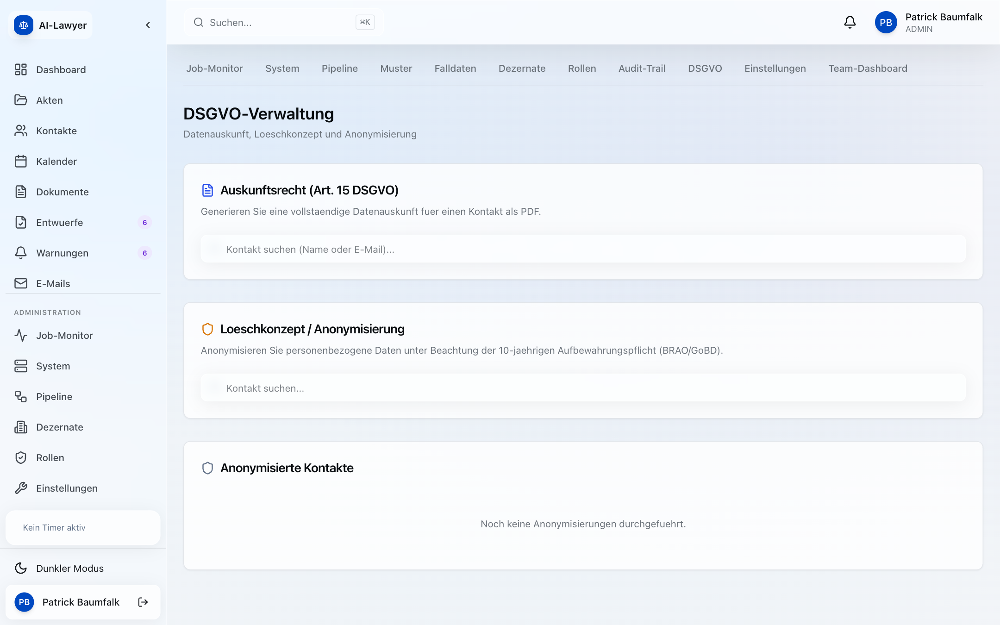

# 18 — Datenschutz und Audit

Dieses Kapitel beschreibt nüchtern, welche Daten AI-Lawyer wo speichert, was verschlüsselt ist, was das Audit-Protokoll festhält, welche DSGVO-Werkzeuge es gibt und welche Daten bei der KI-Nutzung das Haus verlassen können. Es ist keine Rechtsberatung. Für den datenschutzkonformen Betrieb und die Wahrung des Mandatsgeheimnisses (§ 43a Abs. 2 BRAO, § 203 StGB) ist die Kanzlei als Betreiberin verantwortlich. AI-Lawyer liefert dafür Werkzeuge, ersetzt aber weder Verzeichnis der Verarbeitungstätigkeiten noch Auftragsverarbeitungsverträge noch die eigene Prüfung.

Die Seiten **Audit-Trail** und **DSGVO** sind nur für Administratoren zugänglich.

## Was AI-Lawyer speichert

AI-Lawyer läuft auf Ihren eigenen Servern. Ohne Cloud-KI verlassen Akteninhalte das Haus nur dort, wo Sie es selbst auslösen (E-Mail, beA, Portal).

| Ort | Inhalt |
| --- | --- |
| PostgreSQL-Datenbank | Benutzer, Kontakte, Akten, Beteiligte, Kalender und Fristen, E-Mails, Rechnungen, Zeiterfassung, Nachrichten, Audit-Protokoll, Einstellungen, KI-Gespräche, Helenas Aktengedächtnis, KI-Verbrauch je Benutzer |
| Dokumentenspeicher (MinIO) | Alle Dateien: hochgeladene Dokumente, Entwürfe, E-Mail-Anhänge, Mandanten-Uploads |
| Suchindex (Meilisearch) | Volltext der Dokumente (aus der Texterkennung) für die Suche |
| Vektorindex (pgvector in PostgreSQL) | Textabschnitte und Zahlenvektoren der Dokumente für Helenas Suche |
| Redis | Warteschlangen der Hintergrundaufgaben, kurzlebig |
| Protokolldateien | Technische Logs (siehe [Logs](#logs)) |

Wer als Kanzleimitarbeiter angemeldet ist, sieht alle Kontakte. Akten sieht man nur mit Zugriff ([Kapitel 15](15-benutzer-und-rollen.md#wie-aktenzugriff-entsteht)).

## Verschlüsselung

**Zugangsdaten** zu fremden Systemen speichert AI-Lawyer verschlüsselt, mit AES-256-GCM. Der Schlüssel wird aus der Umgebungsvariablen `EMAIL_ENCRYPTION_KEY` abgeleitet (mindestens 32 Zeichen).

| Feld | Verschlüsselt |
| --- | --- |
| Passwörter der E-Mail-Postfächer (IMAP/SMTP) | ja, AES-256-GCM |
| Passwörter der CalDAV-Konten | ja, AES-256-GCM (eigene Ableitung aus demselben Schlüssel) |
| j-lawyer-Passwort | ja, AES-256-GCM |
| Anmeldepasswörter der Benutzer | nicht umkehrbar gespeichert (bcrypt-Hash) |
| 2FA-Backup-Codes | bcrypt-Hash |
| 2FA-Geheimnis (TOTP) | **nein**, im Klartext in der Datenbank |
| API-Schlüssel des KI-Anbieters | **nein**, im Klartext in den Systemeinstellungen |

Wichtig für die IT:

- Geht `EMAIL_ENCRYPTION_KEY` verloren oder wird er geändert, lassen sich die gespeicherten Passwörter nicht mehr entschlüsseln. Postfächer, CalDAV-Konten und j-lawyer-Zugang müssen dann neu eingegeben werden. Den Schlüssel deshalb mit der Sicherung aufbewahren, aber getrennt von ihr ([Kapitel 21](21-betrieb-und-sicherung.md)).
- **Akteninhalte, Dokumente und Kontaktdaten sind nicht feldweise verschlüsselt.** Die Datenbank und der Dokumentenspeicher liegen im Klartext auf den Datenträgern. Schutz bieten hier nur Festplattenverschlüsselung, Zugriffsschutz des Servers und verschlüsselte Sicherungen. Das ist Aufgabe des Betriebs.

## Audit-Trail

Das Audit-Protokoll hält fest, wer wann was getan hat. Einträge entstehen automatisch, Benutzer können sie nicht ändern oder löschen. Eine automatische Löschung nach Frist gibt es nicht; das Protokoll wächst unbegrenzt.

### Was protokolliert wird

| Bereich | Beispiele (Anzeige im Protokoll) |
| --- | --- |
| Akten | *hat Akte erstellt*, *hat Akte aktualisiert* (mit alten und neuen Werten), *hat Status geaendert*, *hat Beteiligten hinzugefuegt / entfernt* |
| Dokumente | *hat Dokument hochgeladen*, *hat Dokument geloescht*, *hat Dokument-Status geaendert* |
| Kalender | *hat Frist erstellt*, *hat Frist erledigt*, *hat Termin erstellt*, *hat Wiedervorlage erstellt*, *hat Kalender-Eintrag bearbeitet / geloescht* |
| KI | *hat KI-Entwurf erstellt*, *hat KI-Notiz erstellt*, *hat KI-Aufgabe aktualisiert* |
| E-Mail und beA | *hat E-Mail veraktet*, *beA Nachricht gesendet*, *eEB bestaetigt*, *beA Anhang heruntergeladen* |
| Finanzen | Rechnungen, RVG-Berechnungen, Aktenkonto-Buchungen und Stornos, Buchungsperioden, Kostenstellen |
| Portal | Einladungen, Aktivierung, Passwort-Reset, Mandanten-Uploads, Portal-E-Mails |
| Sicherheit | *Fehlgeschlagener Login-Versuch*, *Zugriff verweigert*, *hat Admin-Zugriff uebernommen / zurueckgegeben*, 2FA ein/aus, Anmeldung mit 2FA, neue Backup-Codes |
| Verwaltung | Vertretung und Urlaub, Einstellungen geändert, importiert, exportiert |
| DSGVO | *hat personenbezogene Daten anonymisiert*, *hat Datenauskunft exportiert* |

Fehlgeschlagene Anmeldungen, verweigerte Zugriffe und übernommene Admin-Zugriffe sind rot markiert.

Nicht protokolliert wird das bloße **Öffnen** von Akten und das **Ansehen** von Dokumenten. Die Aktionen dafür sind im Code vorgesehen, werden aber derzeit nirgends ausgelöst. Auch erfolgreiche Anmeldungen ohne 2FA stehen nicht im Protokoll. Das Feld für die IP-Adresse wird derzeit nicht befüllt.

### Filtern

**Administration → Audit-Trail** zeigt alle Einträge, neueste zuerst. In der Leiste **Filter**:

| Feld | Wirkung |
| --- | --- |
| **Benutzer** | Nur Einträge dieser Person; **Alle** hebt den Filter auf. |
| **Akte (ID)** | Die interne Akten-ID, nicht das Aktenzeichen. Sie steht in der Adresszeile der Akte (`/akten/<ID>`). |
| **Aktion** | Eine bestimmte Aktion, z. B. *Fehlgeschlagener Login-Versuch*. |
| **Von** / **Bis** | Zeitraum, jeweils einschließlich des ganzen Tages. |
| **Suche** | Freitext in den Details und im Benutzernamen. |

Die Filter stehen auch in der Adresszeile; eine gefilterte Ansicht lässt sich als Lesezeichen speichern. Weitere Einträge lädt die Seite beim Weiterblättern nach.

Einen kurzen Ausschnitt mit Link zum vollständigen Protokoll zeigt **Administration → System**.

### Exportieren

1. Filter setzen.
2. **Exportieren** klicken. Der Dialog **Audit-Trail exportieren** öffnet sich.
3. **CSV** oder **PDF** wählen, bei Bedarf **Von** und **Bis** anpassen.
4. **Exportieren** klicken. Die Datei `audit-trail-export.csv` bzw. `.pdf` wird heruntergeladen.

Die CSV-Datei hat die Spalten Zeitpunkt, Benutzer, Rolle, Aktion, Akte und Details, getrennt durch Semikolon. Exportiert werden höchstens 10.000 Einträge. Der Freitext aus **Suche** wird beim Export nicht berücksichtigt. Schlägt der Export fehl, schließt sich der Dialog nicht, eine Meldung erscheint aber nicht.

Die exportierte Datei enthält personenbezogene Daten. Bewahren Sie sie entsprechend auf.

## DSGVO-Verwaltung

**Administration → DSGVO** bündelt Datenauskunft und Anonymisierung.

### Auskunft (Art. 15 DSGVO)

1. Im Bereich **Auskunftsrecht (Art. 15 DSGVO)** in **Kontakt suchen (Name oder E-Mail)...** mindestens zwei Zeichen eingeben.
2. Beim richtigen Kontakt **PDF generieren** klicken. Es erscheint *Datenauskunft PDF heruntergeladen*.

Das PDF „Datenauskunft gemaess Art. 15 DSGVO“ enthält:

1. Kontaktdaten mit Adressen, Bank- und Steuerdaten, beA-SAFE-ID, Tags
2. Akten, in denen der Kontakt beteiligt ist, mit Rolle
3. Dokumente in diesen Akten (Name und Datum, höchstens 200)
4. Kalendereinträge dieser Akten (höchstens 100)
5. Buchungen im Aktenkonto

Nicht enthalten sind E-Mails, Nachrichten, Dokumentinhalte und Protokolleinträge. Prüfen Sie vor dem Versand, ob das PDF Daten Dritter enthält (etwa Dokumenttitel mit Namen anderer Beteiligter), und ergänzen Sie fehlende Angaben. Jede Auskunft wird im Audit-Trail vermerkt.

### Anonymisierung (Löschkonzept)

AI-Lawyer löscht Kontakte nicht, sondern **anonymisiert** sie: Die Datensätze bleiben, damit Akten und Buchungen vollständig bleiben, aber die personenbezogenen Angaben werden ersetzt.

1. Im Bereich **Loeschkonzept / Anonymisierung** den Kontakt suchen.
2. **Vorschau** klicken. AI-Lawyer zeigt die **Aufbewahrungsfrist bis …** und wie viele **Felder**, **Adressen** und **Audit-Logs** betroffen sind.
3. **Grund der Anonymisierung \*** eintragen (Beispiel im Feld: „z.B. Betroffenenanfrage gemaess Art. 17 DSGVO...“).
4. **Anonymisieren (unwiderruflich)** klicken. Es erscheint *Kontakt erfolgreich anonymisiert*.

Was dabei passiert:

- Name wird zu „Geloeschter Mandant“, bei Organisationen zu „Anonymisierte Organisation“.
- Geleert werden unter anderem E-Mail, Telefonnummern, Geburtsdaten, Anschrift, Beruf, Steuer- und Registerdaten, Bankverbindung, beA-SAFE-ID, Mandantennummer, Notizen, Tags und eigene Felder. Weitere Adressen werden geleert und „Anonymisiert“ genannt.
- In Protokolleinträgen der zugehörigen Akten wird der Name durch „Anonymisiert“ ersetzt.

**Aufbewahrungsfrist.** AI-Lawyer rechnet zehn Jahre ab dem **Anlagedatum des Kontakts**, nicht ab Mandatsende. Vor Ablauf ist der Knopf gesperrt („Aufbewahrungsfrist laeuft noch - Admin-Override erforderlich“). Sie können ihn mit dem Haken **Aufbewahrungsfrist ueberschreiben** („Ich bestaetige, dass eine vorzeitige Anonymisierung rechtlich zulaessig ist.“) freigeben. Ob die Frist im Einzelfall länger oder kürzer ist (§ 50 BRAO, steuerliche Fristen), entscheidet die Kanzlei, nicht das Programm.

**Was nicht anonymisiert wird:** Dokumente und ihr Inhalt, E-Mails, Kurzrubrum und Notizen der Akten, Nachrichten, KI-Gespräche und Helenas Aktengedächtnis, Suchindex und Vektorindex, ein Portalzugang des Kontakts. Diese Stellen müssen Sie bei einem Löschbegehren gesondert prüfen.

Die Liste **Anonymisierte Kontakte** zeigt die letzten 50 Vorgänge mit Grund und, falls die Frist überschrieben wurde, dem Hinweis **Override**.

**Bekannter Fehler:** Die Kontaktsuche auf dieser Seite filtert derzeit nicht nach dem eingegebenen Begriff, sondern zeigt die ersten zehn Kontakte in alphabetischer Reihenfolge. Prüfen Sie vor **PDF generieren** und **Vorschau** genau, ob Sie den richtigen Kontakt erwischt haben. Steht er nicht in der Liste, ist er auf dieser Seite derzeit nicht erreichbar.

### Einwilligungen am Kontakt

Im Kontakt gibt es die Haken **E-Mail-Kommunikation erlaubt**, **Newsletter-Versand erlaubt** und **KI-Verarbeitung erlaubt** ([Kapitel 4](04-kontakte.md)).

- **E-Mail-Kommunikation erlaubt** wirkt: Benachrichtigungen aus dem Mandantenportal gehen nur an Kontakte mit diesem Haken.
- **KI-Verarbeitung erlaubt** wird gespeichert und angezeigt, **hat aber derzeit keine Wirkung**. Helena verarbeitet Akten auch dann, wenn der Haken fehlt.

## Datenflüsse der KI

Wohin Daten bei der KI-Nutzung gehen, hängt allein von der Einstellung **KI-Provider** unter **Einstellungen → KI** ab (nur Administrator, [Kapitel 16](16-einstellungen-und-vorlagen.md)).

| Einstellung | Was das Haus verlässt |
| --- | --- |
| **Ollama (Lokal)** (Voreinstellung) | Nichts. Das Sprachmodell läuft auf Ihrem eigenen Server. |
| **OpenAI** oder **Anthropic** | Alles, was Helena für eine Antwort braucht: Ihre Frage, der bisherige Gesprächsverlauf, Aktendaten (Aktenzeichen, Kurzrubrum, Beteiligte, Fristen, Zeiten) und Dokumenttexte aus der Texterkennung (gekürzt), die Helena nachschlägt. Ebenso Schriftsatz-Entwürfe, Zusammenfassungen und, wenn eingeschaltet, automatische Akten-Scans und das Tagesbriefing. |

Immer lokal, auch bei Cloud-Anbieter: die Zahlenvektoren für Helenas Dokumentsuche und der Personennamen-Filter. Beides läuft über den Ollama-Server (`OLLAMA_URL`).

Der **Personennamen-Filter (PII-Filter)** prüft mit dem lokalen Modell, ob ein Text Namen natürlicher Personen enthält. Er wird **nur** für hochgeladene Muster-Schriftsätze und für Gerichtsentscheidungen in Helenas Wissensbasis eingesetzt: Muster mit erkannten Namen werden abgelehnt. Akteninhalte, die an einen Cloud-Anbieter gehen, filtert er **nicht**.

Für einen Cloud-Anbieter brauchen Sie daher mindestens einen Auftragsverarbeitungsvertrag und eine eigene Prüfung, ob die Übermittlung mit dem Mandatsgeheimnis vereinbar ist (§ 43e BRAO, § 203 Abs. 3 und 4 StGB). Im Zweifel bleiben Sie bei **Ollama (Lokal)**.

Gespeichert werden in AI-Lawyer: Gespräche mit Helena, Helenas Gedächtnis je Akte und ein Verbrauchsprotokoll (Benutzer, Akte, Anbieter, Modell, Tokenzahl). Alle KI-Ergebnisse sind Entwürfe, die ein Mensch prüft und freigibt ([Kapitel 9](09-helena.md)).

## Datentrennung im Mandantenportal

Mandanten sehen im Portal nur, was für sie bestimmt ist ([Kapitel 12](12-mandantenportal.md)):

- Nur Akten, in denen ihr Kontakt als **Mandant** beteiligt ist. Die Prüfung läuft auf dem Server, bei jeder Abfrage.
- Nur Dokumente und Aktivitäten, die in der Kanzlei ausdrücklich als für den Mandanten sichtbar markiert wurden. Voreinstellung ist „nicht sichtbar“.
- Fremde Akten liefern *Nicht gefunden*, nicht *Keine Berechtigung*.
- Benachrichtigungs-E-Mails enthalten keine Aktendetails, Dokumentnamen oder Nachrichteninhalte.

**Bekannte Lücke:** Ein Mandantenkonto ist technisch ein normales Benutzerkonto. Der Kanzleibereich (`/dashboard` usw.) und einige Schnittstellen, die nur die Anmeldung prüfen, sind für angemeldete Mandanten derzeit nicht gesperrt. Akten bleiben durch den Aktenfilter geschützt, die Kontaktliste der Kanzlei aber nicht. Bis das behoben ist, sollten Sie das Portal nur mit dieser Einschränkung im Blick einsetzen ([Kapitel 23](23-einschraenkungen-und-fragen.md)).

## Gamification

Die Gamification ([Kapitel 14](14-gamification.md)) verarbeitet Leistungsdaten von Beschäftigten. Deshalb:

- **Freiwillig.** Sie ist für jeden Benutzer ausgeschaltet, bis er sie selbst unter **Einstellungen → Allgemein → Gamification** einschaltet. Nur wer eingeschaltet hat, sammelt Punkte und zählt in Auswertungen.
- **Eigene Daten nur für sich.** Die Heldenkarte zeigt jedem nur sein eigenes Profil.
- **Team-Dashboard nur zusammengefasst.** Administratoren sehen Quoten und Summen für das ganze Team, keine Werte einzelner Personen ([Kapitel 15](15-benutzer-und-rollen.md#team-dashboard)).
- **Ausnahme Bossfight:** Bei einem laufenden Bossfight sehen alle Angemeldeten eine Bestenliste der drei stärksten Teilnehmer und die letzten Treffer, jeweils **mit Namen**.
- **Abschalten löscht nicht.** Wer die Gamification ausschaltet, sammelt nichts mehr und wird nicht mehr angezeigt. Bereits gesammelte Punkte, erledigte Quests und Bossfight-Treffer bleiben gespeichert. Eine Löschfunktion gibt es nicht; eine Löschung muss die IT in der Datenbank vornehmen.

Ob die Gamification einer Mitbestimmung durch den Betriebsrat oder einer Vereinbarung mit den Beschäftigten bedarf, klärt die Kanzlei vor der Einführung.

## Logs

Das Programm schreibt technische Protokolle (Fehler, Hintergrundaufgaben, Warnungen):

- Im Betrieb auf die Standardausgabe und in Dateien unter `LOG_FILE_PATH` (Voreinstellung `/var/log/ai-lawyer/app`). Die Dateien werden täglich oder ab 10 MB gewechselt. Alte Dateien werden **nicht** automatisch gelöscht.
- Den Umfang steuert `LOG_LEVEL` (Voreinstellung `info`).
- Administratoren sehen die letzten Einträge unter **Administration → System** im Abschnitt **Systemprotokoll**.

Logs können Aktenzeichen, Dateinamen und Fehlermeldungen mit Inhalten enthalten. Legen Sie eine Löschfrist fest und setzen Sie sie mit den Mitteln des Servers um (z. B. logrotate), siehe [Kapitel 21](21-betrieb-und-sicherung.md). Das Feld **Aufbewahrung Benachrichtigungen (Tage)** in den Systemeinstellungen hat derzeit keine Wirkung.

## Wenn etwas nicht klappt

| Meldung | Bedeutung | Was tun |
| --- | --- | --- |
| *Aufbewahrungspflicht: Anonymisierung erst ab … moeglich* | Die Zehn-Jahres-Frist ab Anlage des Kontakts läuft noch. | Abwarten oder, wenn rechtlich zulässig, **Aufbewahrungsfrist ueberschreiben** setzen. |
| *Grund ist erforderlich* | Feld **Grund der Anonymisierung** leer. | Grund eintragen. |
| *Kontakt nicht gefunden* | Der Kontakt wurde inzwischen gelöscht oder die Auswahl ist veraltet. | Seite neu laden, erneut suchen. |
| *Vorschau fehlgeschlagen* / *Anonymisierung fehlgeschlagen* | Server- oder Netzwerkfehler. | Erneut versuchen; bleibt es, Systemprotokoll prüfen. |
| Gesuchter Kontakt erscheint nicht | Bekannter Fehler der Suche auf der DSGVO-Seite. | Siehe [Anonymisierung](#anonymisierung-löschkonzept). |
| Export des Audit-Trails passiert nicht | Der Export ist fehlgeschlagen, ohne Meldung. | Zeitraum verkleinern, erneut versuchen. |
| *EMAIL_ENCRYPTION_KEY muss mindestens 32 Zeichen lang sein. Bitte in .env setzen.* | Schlüssel fehlt oder ist zu kurz. | IT setzt den Schlüssel ([Kapitel 20](20-konfiguration.md)). |

---

Weiter: [19 — Installation](19-installation.md) · [Zur Übersicht](README.md)
