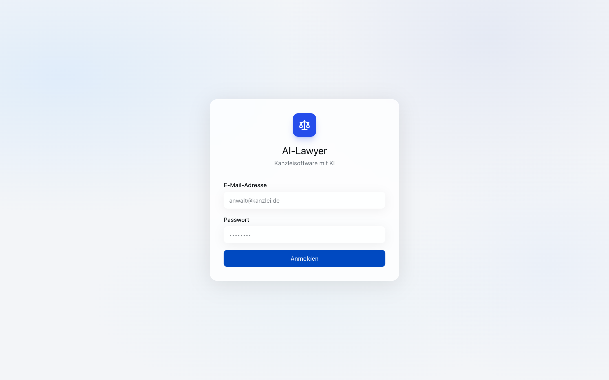

# 19 — Installation

Dieses Kapitel führt vom leeren Linux-Server bis zur ersten Anmeldung. Es richtet sich an die IT. Rechnen Sie für die erste Installation mit einem halben Tag, vor allem wegen der großen Docker-Images und des KI-Modells.

> **Stand der Software.** AI-Lawyer ist laut README noch nicht für den Produktivbetrieb freigegeben. Testen Sie Installation, Sicherung und Wiederherstellung ([Kapitel 21](21-betrieb-und-sicherung.md)) mit Testdaten, bevor echte Mandantendaten hineinkommen. Die bekannten Stolpersteine stehen unten im Abschnitt [Bekannte Stolpersteine](#bekannte-stolpersteine) und in [Kapitel 23](23-einschraenkungen-und-fragen.md).

## Was installiert wird

AI-Lawyer besteht aus neun Docker-Diensten, dazu einem einmaligen Hilfsdienst und einem optionalen Dienst:

| Dienst | Image | Aufgabe |
| --- | --- | --- |
| `app` | eigener Build (`Dockerfile`) | Oberfläche, API und Socket.IO, Port 3000 |
| `worker` | derselbe Build, Befehl `node dist-worker/index.js` | Hintergrund-Jobs (OCR, E-Mail, Fristen, KI) |
| `db` | `pgvector/pgvector:pg16` | PostgreSQL 16 mit pgvector |
| `redis` | `redis:7-alpine` | Warteschlangen (BullMQ), mit Passwort |
| `minio-init` | wie `minio` | läuft einmal vor MinIO und passt die Besitzrechte im Volume an, dann endet er |
| `minio` | `cgr.dev/chainguard/minio:latest` (änderbar über `MINIO_IMAGE`) | Dateispeicher (S3-kompatibel) |
| `meilisearch` | `getmeili/meilisearch:v1.11` | Volltextsuche |
| `onlyoffice` | `onlyoffice/documentserver:latest` | Bearbeiten von Dokumenten im Browser |
| `stirling-pdf` | `stirlingtools/stirling-pdf:latest-fat` | OCR und PDF-Werkzeuge |
| `ollama` | `ollama/ollama:latest` | lokale KI-Modelle; GPU nur mit `docker-compose.gpu.yml` |
| `languagetool` | `erikvl87/languagetool:latest` | nur mit `--profile full`, im Code derzeit nicht angebunden |

Den Aufbau im Einzelnen erklärt [Kapitel 22](22-architektur-und-entwicklung.md).

## Voraussetzungen

**Software:** ein aktuelles 64-Bit-Linux (z. B. Debian 12 oder Ubuntu 24.04), Docker Engine mit dem Plugin Docker Compose V2 (`docker compose`, nicht `docker-compose`), `git` und `openssl`. `setup.sh` bricht ab, wenn Docker, Compose V2, der Docker-Dienst oder `openssl` fehlen.

**Speicherplatz:** `setup.sh` warnt unter 15 GB freiem Platz („Docker images + Ollama model require ~15-20 GB“). Das ist knapp bemessen: Die Images von OnlyOffice und Stirling-PDF (Variante `latest-fat`) sind groß, das Standardmodell kommt dazu, und Dokumente wachsen mit. Planen Sie mindestens 100 GB auf SSD ein.

**Arbeitsspeicher und Prozessor:** Die Compose-Datei begrenzt OnlyOffice auf 4 GB (2 GB reserviert) und Stirling-PDF auf 4 GB. Dazu kommen PostgreSQL, Meilisearch, Redis, App und Worker. Die folgenden Werte sind Richtwerte, keine gemessenen Mindestwerte:

| Einsatz | CPU | RAM | GPU |
| --- | --- | --- | --- |
| Ausprobieren ohne lokales Sprachmodell (KI über OpenAI/Anthropic, Ollama nur für Einbettungen) | 4 Kerne | 16 GB | keine |
| Kanzleibetrieb mit lokalem Standardmodell `qwen3.5:35b` | 8 Kerne | 64 GB | NVIDIA mit 24 GB VRAM oder mehr |
| Lokales Modell ohne GPU | 16 Kerne | 64 GB | keine (Antworten dauern dann sehr lange) |

**Warum Ollama auch bei Cloud-KI nötig ist:** Unabhängig vom gewählten KI-Anbieter laufen drei Funktionen immer über Ollama (`OLLAMA_URL`): die Einbettungen für die Wissenssuche (`src/lib/embedding/embedder.ts`, Modell `blaifa/multilingual-e5-large-instruct`), das Reranking der Suchtreffer (`src/lib/ai/reranker.ts`, fest `qwen3.5:35b`) und die Erkennung personenbezogener Daten in Schriftsatzmustern (`src/lib/pii/ner-filter.ts`). Der Worker startet erst, wenn der Ollama-Container gesund ist.

**GPU:** `docker-compose.yml` selbst reserviert keine GPU; Ollama läuft damit auf der CPU. Für eine NVIDIA-GPU nehmen Sie `docker-compose.gpu.yml` dazu. Dafür müssen auf dem Server der NVIDIA-Treiber und das NVIDIA Container Toolkit installiert sein. `setup.sh` erkennt das selbst: Findet es `nvidia-smi` und meldet `docker info` die NVIDIA-Laufzeit, nimmt es die GPU-Datei automatisch dazu („NVIDIA-GPU erkannt – Ollama nutzt die GPU“), sonst warnt es „Keine NVIDIA-GPU – Ollama läuft auf der CPU (langsam für große Modelle)“.

**Netz:** Eine eigene Domain mit drei Hostnamen ist für den Betrieb mit HTTPS am einfachsten, etwa `ailawyer.kanzlei.example` (Anwendung), `office.kanzlei.example` (OnlyOffice) und `dateien.kanzlei.example` (MinIO für Downloads). Warum drei, erklärt der Abschnitt [Reverse Proxy mit HTTPS](#reverse-proxy-mit-https).

**Ausgehende Verbindungen:** Der Worker lädt nachts Gesetze von GitHub (`bundestag/gesetze`) und Urteile aus den RSS-Feeds von `rechtsprechung-im-internet.de`. Beim ersten Start zieht er außerdem die Ollama-Modelle.

## Zwei Compose-Dateien

Im Repository liegen zwei Compose-Dateien und eine Ergänzung für die GPU:

| Punkt | `docker-compose.yml` (+ `docker-compose.gpu.yml`) | `docker-compose.portainer.yml` |
| --- | --- | --- |
| Liest die `.env`? | ja, alle Werte | ja bzw. die Stack-Variablen in Portainer |
| Pflichtwerte (`:?` – sonst bricht Compose mit Meldung ab) | `NEXTAUTH_URL`, `NEXTAUTH_SECRET`, `EMAIL_ENCRYPTION_KEY`, `ONLYOFFICE_SECRET`, `POSTGRES_PASSWORD`, `REDIS_PASSWORD`, `MINIO_SECRET_KEY`, `MEILISEARCH_API_KEY` | `NEXTAUTH_URL`, `NEXTAUTH_SECRET`, `EMAIL_ENCRYPTION_KEY`, `ONLYOFFICE_SECRET` |
| `POSTGRES_PASSWORD`, `MINIO_SECRET_KEY`, `MEILISEARCH_API_KEY` ohne Angabe | Abbruch | Standardwerte `ailawyer` / `ailawyer123` / `ailawyer-meili-key` |
| Redis | mit Passwort (`REDIS_PASSWORD`) | ohne Passwort |
| Ports für den Browser | 3000 (App), 8080 (OnlyOffice), 9000 (MinIO) auf `PUBLIC_BIND` (Standard `0.0.0.0`) | 3000 und 8080 auf allen Schnittstellen; MinIO 9000 nicht veröffentlicht |
| Interne Ports | nur `127.0.0.1`: 5432, 6379, 7700, 8081, 9001, 11434 (LanguageTool 8010) | nur `127.0.0.1`: 5432, 9001 |
| `MINIO_PUBLIC_URL` | `.env`, Standard `http://localhost:9000` | Variable, Standard `NEXTAUTH_URL` |
| `ONLYOFFICE_URL` | `.env`, Standard `http://localhost:8080` | Variable, Standard `${NEXTAUTH_URL}:8080` |
| Ollama | ohne GPU; mit `docker-compose.gpu.yml` alle NVIDIA-GPUs | ohne GPU, Speichergrenze `OLLAMA_MEMORY_LIMIT` (Standard 8 GB) |
| Stirling-PDF | `latest-fat` | `latest` |
| Worker | Healthcheck, wartet auch auf Stirling-PDF; erhält KI-Startwerte und SMTP | ohne Healthcheck; ohne SMTP- und KI-Startwerte |
| Kanzleiname (`KANZLEI_NAME`) | Build-Argument | nicht vorgesehen |
| LanguageTool | als Profil `full` | fehlt |

**Empfehlung:** Für einen Server mit echten Daten nehmen Sie `docker-compose.yml` mit einer `.env` (bei NVIDIA-GPU zusätzlich `docker-compose.gpu.yml`). Die Portainer-Datei ist für den Weg über die Portainer-Oberfläche gedacht und hat die oben genannten Lücken.

## Schnellstart mit setup.sh

So läuft das Skript ab:

1. Repository holen und Skript starten:
   ```bash
   git clone https://github.com/PBaumfalk/AI-Lawyer.git
   cd AI-Lawyer
   ./setup.sh
   ```
2. Das Skript prüft Docker, Docker Compose V2, ob der Docker-Dienst läuft, und den freien Platz.
3. Gibt es schon eine `.env`, fragt es „Overwrite and reconfigure? [y/N]“. Mit **Enter** bleibt die alte Datei.
4. Es fragt nach der **App URL** (Standard `http://localhost:3000`) und dem KI-Anbieter: **1** Ollama (`qwen3.5:35b`), **2** OpenAI (`gpt-4o`, mit API-Schlüssel), **3** Anthropic (`claude-sonnet-4-6`, mit API-Schlüssel).
5. Es kopiert `.env.example` nach `.env` und erzeugt mit `openssl` alle Geheimnisse: `NEXTAUTH_SECRET`, `EMAIL_ENCRYPTION_KEY`, `ONLYOFFICE_SECRET`, `POSTGRES_PASSWORD`, `REDIS_PASSWORD`, `MINIO_SECRET_KEY` und `MEILISEARCH_API_KEY`. Dazu trägt es `MINIO_PUBLIC_URL` (App-Adresse mit Port 9000), `ONLYOFFICE_URL` (Port 8080), die KI-Wahl sowie passende `DATABASE_URL` und `REDIS_URL` für die lokale Entwicklung ein. Die Datei erhält die Rechte `600`. Bleibt ein Platzhalter „ÄNDERN“ stehen, bricht das Skript ab.
6. Es prüft auf eine NVIDIA-GPU (siehe [Voraussetzungen](#voraussetzungen)).
7. Nach „Jetzt bauen und starten? [Y/n]“ baut es die Images (erster Build 5–10 Minuten) und startet alle Dienste mit `docker-compose.yml`, bei GPU zusätzlich mit `docker-compose.gpu.yml`.
8. Es wartet bis zu fünf Minuten, bis der Container `ailawyer-app` als *healthy* gilt, und zeigt dann die Adressen und die Beispielkonten.

Die KI-Wahl aus Schritt 4 übernimmt der Worker beim allerersten Start in **Einstellungen → KI**. Danach gilt nur noch die Oberfläche (siehe [KI einrichten](#ki-einrichten-und-modelle-laden)).

Für einen Server hinter einem Reverse Proxy passen Sie anschließend in der `.env` die Adressen an (`NEXTAUTH_URL`, `MINIO_PUBLIC_URL`, `ONLYOFFICE_URL`, `PUBLIC_BIND=127.0.0.1`) und erzeugen die Container mit `docker compose up -d` neu (Schritt 2 und 4 im nächsten Abschnitt).

## Installation Schritt für Schritt

1. **Repository holen**
   ```bash
   git clone https://github.com/PBaumfalk/AI-Lawyer.git /opt/ai-lawyer
   cd /opt/ai-lawyer
   ```
2. **`.env` anlegen**, am einfachsten mit `./setup.sh` (Start am Ende mit **n** ablehnen) oder von Hand mit `cp .env.example .env` und dem Ersetzen aller Werte „ÄNDERN“ (z. B. `openssl rand -hex 32`). Für den Betrieb hinter HTTPS zusätzlich:
   ```bash
   NEXTAUTH_URL="https://ailawyer.kanzlei.example"
   MINIO_PUBLIC_URL="https://dateien.kanzlei.example"
   ONLYOFFICE_URL="https://office.kanzlei.example"
   PUBLIC_BIND="127.0.0.1"
   KANZLEI_NAME="Kanzlei Mustermann"
   TOTP_REQUIRED_ROLES="ADMIN,ANWALT"
   SMTP_HOST="smtp.kanzlei.example"
   SMTP_USER="ailawyer@kanzlei.example"
   SMTP_PASS="…"
   SMTP_FROM="ailawyer@kanzlei.example"
   ```
   `PUBLIC_BIND=127.0.0.1` bindet App, OnlyOffice und MinIO nur an die lokale Schnittstelle, sodass sie ausschließlich über den Reverse Proxy erreichbar sind; alle anderen Dienste hören ohnehin nur auf `127.0.0.1`. Bei NVIDIA-GPU ergänzen Sie `COMPOSE_FILE=docker-compose.yml:docker-compose.gpu.yml`; dann braucht kein Befehl mehr `-f`. Alle Variablen erklärt [Kapitel 20](20-konfiguration.md). Die Datei muss die Rechte `600` haben (`chmod 600 .env`; `setup.sh` setzt sie selbst).
3. **Prüfen**, ob Compose alle Pflichtwerte findet:
   ```bash
   docker compose config --quiet && echo OK
   ```
   Fehlt ein Pflichtwert, meldet Compose z. B. „POSTGRES_PASSWORD fehlt in .env“.
4. **Bauen und starten:**
   ```bash
   docker compose up -d --build
   docker compose logs -f app
   ```
   `KANZLEI_NAME` wird als Build-Argument in das Image eingebaut. Ändern Sie den Namen später, bauen Sie mit `--build` neu.
5. **Reverse Proxy einrichten** (Abschnitt [Reverse Proxy mit HTTPS](#reverse-proxy-mit-https)).

## Mit Portainer

1. Portainer → **Stacks** → **Add stack** → **Repository**.
2. Repository-URL `https://github.com/PBaumfalk/AI-Lawyer`, Compose-Pfad `docker-compose.portainer.yml`.
3. Unter **Environment variables** die Pflichtwerte `NEXTAUTH_URL`, `NEXTAUTH_SECRET`, `EMAIL_ENCRYPTION_KEY` und `ONLYOFFICE_SECRET` setzen, unbedingt auch `POSTGRES_PASSWORD`, `MINIO_SECRET_KEY` und `MEILISEARCH_API_KEY` (sonst gelten die öffentlich bekannten Standardwerte). Die Browser-Adressen `MINIO_PUBLIC_URL` und `ONLYOFFICE_URL` lassen sich ebenfalls als Variablen setzen.
4. **Deploy the stack**. Das Image wird auf dem Server gebaut, der erste Lauf dauert entsprechend.

Grenzen dieses Wegs: Redis läuft ohne Passwort, der MinIO-Port 9000 wird nicht veröffentlicht (Downloads brauchen dann einen Reverse Proxy im selben Docker-Netz), der Worker erhält keine SMTP-Werte (keine Fristerinnerungen per Mail) und keine KI-Startwerte. Wer das braucht, nimmt den Weg über die Kommandozeile oben.

## Reverse Proxy mit HTTPS

Der Browser spricht mit drei Diensten direkt. Das ergibt sich aus dem Code:

| Ziel | Intern | Warum der Browser hin muss |
| --- | --- | --- |
| Anwendung | `app:3000` | Oberfläche, API, Socket.IO unter `/socket.io/` |
| OnlyOffice | `onlyoffice:80` (Host-Port 8080) | Der Browser lädt `…/web-apps/apps/api/documents/api.js` direkt von `ONLYOFFICE_URL`; der Editor hält WebSocket-Verbindungen. |
| MinIO | `minio:9000` | Downloads laufen über vorsignierte S3-Links auf `MINIO_PUBLIC_URL` (`src/lib/storage.ts`, `getDownloadUrl`), Pfad `/dokumente/akten/…` bzw. `/dokumente/vorlagen/…`. |

Zwei Hinweise zur Wahl der Adressen:

- **OnlyOffice:** Steht `ONLYOFFICE_URL` auf `localhost`, leitet die App die Adresse aus der Anfrage ab (Hostname aus `X-Forwarded-Host`, Protokoll aus `X-Forwarded-Proto`) und hängt den Port 8080 an. Hinter einem HTTPS-Proxy wird daraus `https://ailawyer…:8080`, was ohne TLS auf Port 8080 nicht funktioniert. Setzen Sie `ONLYOFFICE_URL` daher fest auf einen eigenen Hostnamen. Gleiches gilt für den Portainer-Standard `${NEXTAUTH_URL}:8080`.
- **MinIO:** Ein eigener Hostname ist nötig, weil der Bucket `dokumente` heißt und sich der Pfad `/dokumente/…` mit der Seite `/dokumente/[id]` der Anwendung überschneiden würde. Der Proxy muss den `Host`-Header unverändert weitergeben, sonst passt die Signatur der Links nicht.

Die Anwendung erlaubt Uploads bis 100 MB je Datei (`src/app/api/akten/[id]/dokumente/route.ts`), setzen Sie das Limit am Proxy etwas höher.

### Beispiel Caddy

Caddy holt die Zertifikate selbst und leitet WebSockets ohne Zusatz weiter.

```caddy
ailawyer.kanzlei.example {
    request_body {
        max_size 110MB
    }
    reverse_proxy 127.0.0.1:3000
}

office.kanzlei.example {
    reverse_proxy 127.0.0.1:8080 {
        header_up X-Forwarded-Proto https
    }
}

dateien.kanzlei.example {
    request_body {
        max_size 110MB
    }
    reverse_proxy 127.0.0.1:9000
}
```

### Beispiel nginx

```nginx
map $http_upgrade $connection_upgrade {
    default upgrade;
    ''      close;
}

server {
    listen 443 ssl http2;
    server_name ailawyer.kanzlei.example;
    ssl_certificate     /etc/letsencrypt/live/ailawyer.kanzlei.example/fullchain.pem;
    ssl_certificate_key /etc/letsencrypt/live/ailawyer.kanzlei.example/privkey.pem;
    client_max_body_size 110m;

    location /socket.io/ {
        proxy_pass http://127.0.0.1:3000;
        proxy_http_version 1.1;
        proxy_set_header Upgrade $http_upgrade;
        proxy_set_header Connection $connection_upgrade;
        proxy_set_header Host $host;
        proxy_read_timeout 3600s;
    }

    location / {
        proxy_pass http://127.0.0.1:3000;
        proxy_http_version 1.1;
        proxy_set_header Host $host;
        proxy_set_header X-Forwarded-Host $host;
        proxy_set_header X-Forwarded-Proto $scheme;
        proxy_set_header X-Forwarded-For $proxy_add_x_forwarded_for;
        proxy_read_timeout 300s;
    }
}

server {
    listen 443 ssl http2;
    server_name office.kanzlei.example;
    # ssl_certificate … wie oben
    client_max_body_size 110m;

    location / {
        proxy_pass http://127.0.0.1:8080;
        proxy_http_version 1.1;
        proxy_set_header Upgrade $http_upgrade;
        proxy_set_header Connection $connection_upgrade;
        proxy_set_header Host $host;
        proxy_set_header X-Forwarded-Host $host;
        proxy_set_header X-Forwarded-Proto $scheme;
    }
}

server {
    listen 443 ssl http2;
    server_name dateien.kanzlei.example;
    # ssl_certificate … wie oben
    client_max_body_size 110m;

    location / {
        proxy_pass http://127.0.0.1:9000;
        proxy_set_header Host $http_host;
        proxy_buffering off;
    }
}
```

Dazu jeweils ein `server`-Block auf Port 80, der auf HTTPS umleitet. Die Antwortzeit von 300 Sekunden für die Anwendung ist großzügig gewählt, weil Helena-Anfragen mit lokalem Modell lange dauern können.

**Interne Wege bleiben im Docker-Netz:** OnlyOffice holt Dokumente und schickt Speicherstände über `APP_INTERNAL_URL` (`http://app:3000`, Pfad `/api/onlyoffice/…`), die App spricht OnlyOffice über `ONLYOFFICE_INTERNAL_URL` (`http://onlyoffice:80`) an. Diese Wege laufen nicht über den Proxy.

**Socket.IO:** Der Block `/socket.io/` ist für die Echtzeit-Aktualisierungen nötig (Team-Nachrichten, Benachrichtigungen, neue E-Mails). Das Docker-Image startet den eigenen Server `dist-server/index.js`, der Socket.IO am selben Port 3000 bereitstellt. Ohne WebSocket-Weiterleitung am Proxy kommen diese Ereignisse nicht an.

**Firewall:** Docker schreibt eigene iptables-Regeln und umgeht dabei `ufw`. Ein Port, den Compose auf `0.0.0.0` veröffentlicht, ist auch dann von außen erreichbar, wenn `ufw` ihn sperrt. `docker-compose.yml` bindet deshalb Datenbank, Redis, Meilisearch, Stirling-PDF, Ollama und die MinIO-Konsole fest an `127.0.0.1`; App, OnlyOffice und MinIO folgen `PUBLIC_BIND`. Setzen Sie hinter einem Reverse Proxy `PUBLIC_BIND=127.0.0.1` (Schritt 2). Redis, Meilisearch und MinIO sind zusätzlich mit den in der `.env` erzeugten Geheimnissen geschützt. Prüfen Sie von einem anderen Rechner aus (z. B. mit `nmap`), welche Ports tatsächlich offen sind.

## Erster Start: was docker-entrypoint.sh tut

Beide Container `app` und `worker` starten über `docker-entrypoint.sh`. Das Skript:

1. wartet bis zu 30 × 2 Sekunden auf PostgreSQL (`db:5432`),
2. führt `prisma migrate deploy` aus. Die Migrationen bilden das Schema vollständig ab; die Migration `20261118120000_schema_sync` holt alles nach, was frühere Installationen nur per `db push` erhalten hatten, und ist so geschrieben, dass sie auch auf solchen Datenbanken durchläuft. Ein `db push` ist nicht mehr nötig,
3. spielt mit `prisma/apply-manual-migrations.js` die Dateien `prisma/migrations/manual_*.sql` ein (pgvector-Erweiterung und HNSW-Indizes für die Vektorsuche). Alle Anweisungen sind idempotent. Scheitert eine, bricht das Skript mit „Manual migration failed: …“ ab, und der Container startet neu,
4. prüft, ob es Benutzer gibt. Wenn nicht, läuft **nur im App-Container** `prisma/seed.ts`. Ein Fehler im Seed ist fatal: Der Container startet nicht, denn ohne Seed gäbe es kein Konto zum Anmelden,
5. **nur im Worker:** prüft, ob Ollama die Modelle `qwen3.5:35b` und `blaifa/multilingual-e5-large-instruct` hat, und lädt fehlende herunter,
6. startet den eigentlichen Prozess: in `app` den eigenen Server mit Socket.IO (`node dist-server/index.js`), im Worker `node dist-worker/index.js`.

Bei jedem Start (`set -e`) gilt: Schlägt Schritt 2 oder 3 fehl, startet der Container nicht und Docker versucht es erneut. Die Ursache steht in `docker compose logs app`.

Beim ersten Worker-Start legt der Worker außerdem Standardeinstellungen an (dabei die KI-Startwerte aus `AI_PROVIDER`, `AI_MODEL` und dem passenden API-Schlüssel), dazu amtliche Formulare, Falldaten-Vorlagen, die Kanäle für Team-Nachrichten, Quests und Shop-Artikel, und er registriert die zeitgesteuerten Jobs ([Kapitel 21](21-betrieb-und-sicherung.md#hintergrund-jobs)).

## Erste Anmeldung und Beispielkonten

Öffnen Sie `NEXTAUTH_URL` im Browser.



Der Seed hat angelegt:

| E-Mail | Rolle | Passwort |
| --- | --- | --- |
| `admin@kanzlei.de` | ADMIN | `password123` |
| `anwalt@kanzlei.de` | ANWALT | `password123` |
| `sachbearbeiter@kanzlei.de` | SACHBEARBEITER | `password123` |

Dazu die Kanzlei „Kanzlei Baumfalk“, einige Beispielkontakte und eine Beispielakte sowie den Systembenutzer `helena@system.local` (nicht anmeldbar).

> **Passwörter sofort ändern.** Das Passwort `password123` steht öffentlich im Repository. Die Oberfläche bietet für Kanzleikonten derzeit **keine** Funktion, ein Passwort zu ändern oder ein neues Konto anzulegen (nur Mandanten im Portal können ihr Passwort ändern). Bis das nachgerüstet ist, geht beides nur über die Datenbank.

Passwort ändern:

```bash
HASH=$(docker compose exec -T app node -e \
  "console.log(require('bcryptjs').hashSync(process.argv[1], 12))" 'NeuesLangesPasswort')
docker compose exec -T db psql -U ailawyer -d ailawyer -c \
  "UPDATE users SET \"passwordHash\"='$HASH' WHERE email='admin@kanzlei.de';"
```

Eigenes Konto anlegen (Rolle `ADMIN`, `ANWALT`, `SACHBEARBEITER` oder `SEKRETARIAT`):

```bash
docker compose exec -T db psql -U ailawyer -d ailawyer -c \
  "INSERT INTO users (id, email, name, \"passwordHash\", role, aktiv, \"kanzleiId\", \"createdAt\", \"updatedAt\")
   SELECT 'u' || md5(random()::text), 'ra.mustermann@kanzlei.example', 'Max Mustermann', '$HASH', 'ANWALT', true, \"kanzleiId\", now(), now()
   FROM users WHERE email='admin@kanzlei.de';"
```

Beispielkonten abschalten: `UPDATE users SET aktiv=false WHERE email IN ('anwalt@kanzlei.de','sachbearbeiter@kanzlei.de');`. Ein deaktiviertes Konto kann sich nicht mehr anmelden (`src/lib/auth.ts`). Die Beispielakte und -kontakte löschen Sie in der Oberfläche. Rollen und Rechte erklärt [Kapitel 15](15-benutzer-und-rollen.md).

Richten Sie für die Admin-Konten die Zwei-Faktor-Anmeldung ein und erzwingen Sie sie über `TOTP_REQUIRED_ROLES` ([Kapitel 20](20-konfiguration.md#adresse-und-anmeldung)).

## KI einrichten und Modelle laden

Welchen KI-Anbieter Helena nutzt, steht in der Datenbank. Beim allerersten Start übernimmt der Worker die Werte `AI_PROVIDER`, `AI_MODEL` und `OPENAI_API_KEY` bzw. `ANTHROPIC_API_KEY` aus der `.env` als Startwerte (so wirkt die Wahl in `setup.sh`). Danach haben diese Variablen keine Wirkung mehr; ein Admin ändert die Einstellung unter **Einstellungen → KI** (`/einstellungen/ki`):

1. **KI-Provider** wählen: **Ollama (Lokal)**, **OpenAI** oder **Anthropic**.
2. Bei OpenAI oder Anthropic den **API-Schluessel** eintragen. Er wird verschlüsselt gespeichert und nie an den Browser zurückgegeben; ein leeres Feld behält den gespeicherten Schlüssel („Gespeichert. Leer lassen, um den Schlüssel zu behalten.“).
3. **Modell** eintragen. Standard ist `qwen3.5:35b` für Ollama, `gpt-4o` für OpenAI, `claude-sonnet-4-20250514` für Anthropic (`src/lib/ai/provider.ts`).
4. Bei Ollama die **Ollama-URL** prüfen (in Docker `http://ollama:11434`).
5. **Verbindung testen**, dann **Einstellungen speichern**.

Der Worker zieht die beiden Standardmodelle beim Start selbst. Bei großen Modellen bricht dieser Abruf oft vorzeitig ab („Ollama pull failed … (non-fatal)“). Laden Sie die Modelle deshalb von Hand und beobachten Sie den Fortschritt:

```bash
docker compose exec ollama ollama pull qwen3.5:35b
docker compose exec ollama ollama pull blaifa/multilingual-e5-large-instruct
docker compose exec ollama ollama list
```

Das Einbettungsmodell ist fest mit 1024 Dimensionen in der Datenbank verankert (`vector(1024)`). Ändern Sie `EMBEDDING_MODEL` nicht auf ein Modell mit anderer Dimension ([Kapitel 20](20-konfiguration.md#ki)).

Ein kleineres Chat-Modell (z. B. für einen Server ohne GPU) können Sie mit `ollama pull` laden und unter **Modell** eintragen. Das Reranking verlangt aber weiter `qwen3.5:35b`; fehlt es, scheitert dieser Schritt der Wissenssuche.

Was Helena kann und welche Grenzen gelten, steht in [Kapitel 9](09-helena.md). KI-Entwürfe prüft immer ein Mensch, bevor sie die Kanzlei verlassen.

## Bekannte Stolpersteine

| Problem | Ursache | Workaround |
| --- | --- | --- |
| `docker compose up` bricht mit „… fehlt in .env“ ab | Ein Pflichtwert fehlt in der `.env`. | Wert eintragen oder `./setup.sh` erneut laufen lassen. |
| `could not select device driver "nvidia"` beim Start | `docker-compose.gpu.yml` ist eingebunden, der Server hat aber keine NVIDIA-GPU oder kein NVIDIA Container Toolkit. | Toolkit installieren oder die GPU-Datei weglassen (auch in `COMPOSE_FILE`). |
| Uploads scheitern nach einem Update mit „Insufficient permissions“ / 403 | Alte MinIO-Daten gehören noch dem Benutzer des früheren Images; das Chainguard-Image läuft als UID 65532. | `minio-init` passt die Rechte beim Start an. Prüfen Sie mit `docker compose logs minio-init`, ob er gelaufen ist, und starten Sie mit `docker compose up -d`. |
| Eigenes MinIO-Image gewünscht (Spiegel, feste Version) | – | `MINIO_IMAGE` in der `.env` setzen. Das Image muss `mc` enthalten (Healthcheck `mc ready local`) und als UID 65532 laufen oder die Rechte selbst passend haben. |
| `app` startet in einer Schleife neu, Log „Manual migration failed“ oder Fehler bei `migrate deploy` | Eine Migration oder manuelle SQL-Datei scheitert. | Meldung im Log lesen, Ursache beheben; nicht mit `db push` überdecken. |
| `app` startet nicht, Log endet im Seed | Seed beim ersten Start fehlgeschlagen (fatal). | Meldung im Log prüfen, Ursache beheben, Container neu starten. |
| Worker startet nicht, `docker compose ps` zeigt `ollama` als *unhealthy* | Der Worker wartet auf einen gesunden Ollama-Container. | `docker compose logs ollama` prüfen. |
| Editor bleibt leer oder meldet einen Token-Fehler | `ONLYOFFICE_URL` vom Browser nicht erreichbar oder Geheimnis nach dem Start geändert, ohne beide Container neu zu erzeugen | `ONLYOFFICE_URL` auf einen Hostnamen mit HTTPS setzen; `docker compose up -d` erzeugt `app` und `onlyoffice` mit demselben `ONLYOFFICE_SECRET` neu. |
| Downloads führen auf `localhost:9000` oder liefern `SignatureDoesNotMatch` | `MINIO_PUBLIC_URL` zeigt nicht auf eine vom Browser erreichbare Adresse, oder der Proxy ändert den `Host`-Header. | `MINIO_PUBLIC_URL` auf `https://dateien…` setzen, `Host` unverändert weiterreichen. |
| Healthcheck-Timeout bei `setup.sh` | Erster Start mit Migrationen und Modell-Downloads dauert länger als fünf Minuten. | `docker compose logs -f app` beobachten, abwarten. |

---

Weiter: [20 — Konfiguration](20-konfiguration.md) · [Zur Übersicht](README.md)
