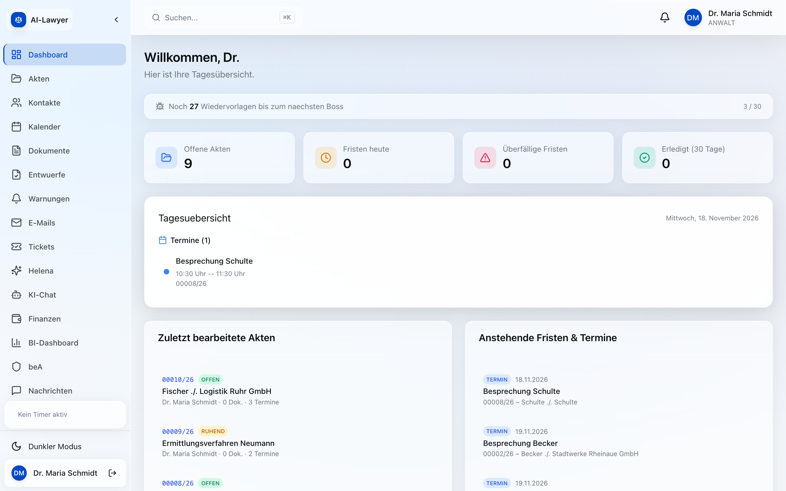

# AI-Lawyer — Handbuch

Willkommen im Handbuch von **AI-Lawyer**, der selbst gehosteten Kanzleisoftware mit
der KI-Kollegin Helena. Teil A ist für alle, die in der Kanzlei mit AI-Lawyer
arbeiten. Technische Vorkenntnisse sind dafür nicht nötig. Teil B richtet sich an
die Kanzlei-Admins, Teil C an die IT, die AI-Lawyer installiert und betreibt.

> AI-Lawyer ist noch in Entwicklung (Version 0.9) und **noch nicht für den
> Produktivbetrieb freigegeben**. Die früher hier genannte Lücke bei den
> Zugriffsrechten ist geschlossen: Aktenliste, Aktenansicht, Suche, Helena und
> die übrigen Schnittstellen prüfen die Aktenrechte, Mandantenkonten kommen nur
> ins Portal. Offen sind unter anderem beA (die Bibliothek von bea.expert fehlt)
> und eine Maske zum Anlegen von Rechnungen. Was bekannt nicht oder nur
> teilweise funktioniert, steht in [Kapitel 23](23-einschraenkungen-und-fragen.md).
> Die Kapitel beschreiben jeweils offen, wo eine Funktion noch fehlt.

## Inhalt

**Teil A — Arbeiten mit AI-Lawyer**

| Kapitel | Inhalt |
| --- | --- |
| [1 — Was ist AI-Lawyer?](01-was-ist-ai-lawyer.md) | Wofür, Grundbegriffe, Rollen, das Prinzip „KI schlägt vor, Mensch entscheidet“ |
| [2 — Erste Schritte](02-erste-schritte.md) | Anmelden, Zwei-Faktor, die Oberfläche, Suche, Dashboard |
| [3 — Akten](03-akten.md) | Anlegen, Kollisionsprüfung, Akte im Detail, Beteiligte, Verlauf, Status |
| [4 — Kontakte](04-kontakte.md) | Personen und Unternehmen, Beziehungen, Vollmachten, KYC, Import |
| [5 — Dokumente](05-dokumente.md) | Hochladen, Versionen, Freigabe, Bearbeiten im Browser, OCR, PDF-Werkzeuge, Vorlagen |
| [6 — Fristen und Kalender](06-fristen-und-kalender.md) | Termine, Fristen, Wiedervorlagen, Fristenrechner, Vorfristen, Quittierung, CalDAV |
| [7 — E-Mail und Tickets](07-email-und-tickets.md) | Postfächer, Veraktung, Versand, Aufgaben im Team |
| [8 — beA](08-bea.md) | Anmeldung, Posteingang, Zuordnung, Versand, eEB |
| [9 — Helena, die KI-Kollegin](09-helena.md) | Chat, Entwürfe und Freigabe, Warnungen, Schriftsätze, Wissensquellen, Grenzen |
| [10 — Zeiterfassung und Abrechnung](10-zeiterfassung-und-abrechnung.md) | Stoppuhr, RVG-Rechner, Rechnungen, E-Rechnung, Mahnwesen, Aktenkonto |
| [11 — Nachrichten im Team](11-team-nachrichten.md) | Kanäle, Akten-Threads, Erwähnungen, Benachrichtigungen |
| [12 — Mandantenportal](12-mandantenportal.md) | Einladen, freigeben, was Mandanten sehen |
| [13 — Suche und Auswertung](13-suche-und-auswertung.md) | Globale Suche, BI-Dashboard, Exporte |
| [14 — Gamification](14-gamification.md) | Quests, Level, Bossfight, Shop, Datenschutz |

**Teil B — Administration**

| Kapitel | Inhalt |
| --- | --- |
| [15 — Benutzer und Rollen](15-benutzer-und-rollen.md) | Konten, Rechte, Dezernate, Zwei-Faktor-Pflicht, Vertretung |
| [16 — Einstellungen und Vorlagen](16-einstellungen-und-vorlagen.md) | Kanzleidaten, E-Mail, KI, Vorlagen, Briefkopf, Falldatenblätter, Muster |
| [17 — Migration aus j-lawyer.org](17-migration-aus-j-lawyer.md) | Verbindung, was übernommen wird, wiederholtes Einlesen |
| [18 — Datenschutz und Audit](18-datenschutz-und-audit.md) | Verschlüsselung, Audit-Trail, DSGVO, Datenflüsse der KI |

**Teil C — Installation und Betrieb (IT)**

| Kapitel | Inhalt |
| --- | --- |
| [19 — Installation](19-installation.md) | Vom leeren Server bis zum ersten Login, Reverse Proxy, KI-Modelle |
| [20 — Konfiguration](20-konfiguration.md) | Alle Umgebungsvariablen |
| [21 — Betrieb und Sicherung](21-betrieb-und-sicherung.md) | Sicherung (S3, SFTP, rest-server), Wiederherstellung, Updates, Hintergrund-Jobs, Logs |
| [22 — Architektur und Entwicklung](22-architektur-und-entwicklung.md) | Aufbau, Datenmodell, Entwicklungsumgebung, Tests |
| [23 — Einschränkungen und häufige Fragen](23-einschraenkungen-und-fragen.md) | Was (noch) nicht geht, Antworten auf häufige Fragen |

## Schnelleinstieg in 5 Minuten

1. AI-Lawyer im Browser öffnen und anmelden ([Kapitel 2](02-erste-schritte.md)).
2. Links auf **Akten** und dann **Neue Akte** klicken. Kurzrubrum und Sachgebiet
   eintragen, **Akte anlegen** ([Kapitel 3](03-akten.md)).
3. Unter **Kontakte** den Mandanten anlegen ([Kapitel 4](04-kontakte.md)) und ihn
   in der Akte unter **Beteiligte** mit **Hinzufügen** als Mandanten eintragen.
   Dabei läuft die Kollisionsprüfung ([Kapitel 3](03-akten.md)).
4. Im **Kalender** eine Frist zur Akte anlegen und das Datum prüfen ([Kapitel 6](06-fristen-und-kalender.md)).
5. Links **Helena** öffnen, die Akte auswählen und um eine Zusammenfassung bitten
   ([Kapitel 9](09-helena.md)).

## Für die IT in einem Satz

`git clone`, `./setup.sh` ausführen (fragt Adresse und KI-Anbieter ab, erzeugt
alle Geheimnisse in `.env`, erkennt eine NVIDIA-GPU und startet den Stack), dann
die Passwörter der Beispielkonten ändern. Einzelheiten in
[Kapitel 19](19-installation.md).
